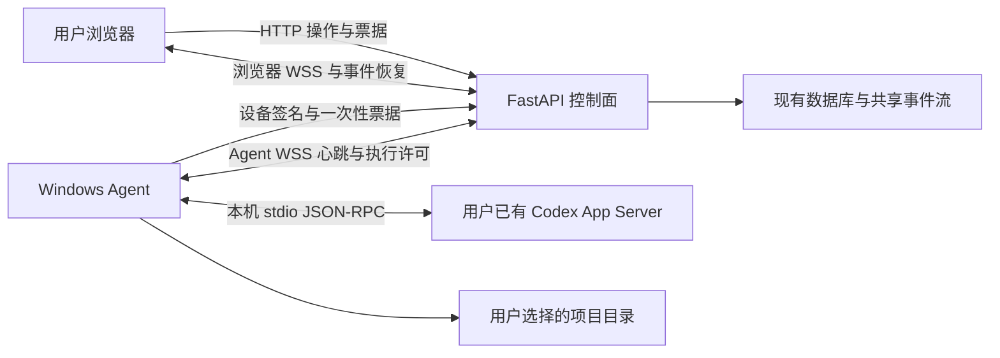

# Codex 安装、连接体验与 CLI 版本兼容改进方案

日期：2026-10-20  
性质：基于当前源码的设计审计与后续实施方案；本轮不修改应用代码、配置、测试、发布包和运行环境。  
适用项目：`E:/python_web_fastapi/work`、`E:/python_web_fastapi/typescript-web-nuxt`。  
审阅基线：后端 HEAD `591467f93c7590be9065ae711bf22d4923a0a073`；前端 HEAD `666519b204c3c0c2720f3639e7fd646c89f482df`。以审阅时磁盘源码为准，已有文档整理产生的删除/移动不属于本方案修改。  
位置说明：按用户要求进入 `work/docs/archive/2026/2026_10/` 现有日期分类；本文件是本次方案、实施任务和验收要求的唯一正文。

## 1. 目标、边界与结论

用户目标有两项：第一，普通用户从安装、连接到实际使用，步骤尽可能少、含义清楚、不编辑配置文件，且能够稳定工作；第二，主机 Codex CLI 从 0.145.0 升级后，尽可能不让用户额外操作，避免整个产品因为版本号变化失效。

当前实现已有较好的基础：按用户安装的 MSI、预置服务地址、自定义 URI、设备绑定、原生目录选择、自动写配置、计划任务、退避重连、命令日志、事件重放、执行租约、签名更新和回滚。问题不是缺少一套全新的架构，而是几个关键闭环尚未贯通，且兼容性判断分散、事实来源不一致。

推荐实施方向：

1. 复用现有安装器和 Agent，把安装、唤起、绑定、项目选择、就绪收敛成一个可恢复的引导流程。
2. 修复浏览器 ready/重放、握手超时、presence 错误分类等确定缺口；验证并启用已有的短断线执行连续性。
3. 将版本兼容收敛成现有 manifest/catalog/adapter 体系中的统一兼容档案，支持多个经过验证的 CLI 版本和按功能降级；自动更新 Agent 及兼容资料，不接管主机 Codex。
4. 当前禁用自动更新的内部安装包，必须明确提供一次覆盖安装的过渡路线；过渡后正常受支持升级才可承诺用户零操作。
5. 以真实安装、首次任务、故障恢复和跨版本执行作为验收，不能用 WebSocket open、单次 initialize、mock 测试或 schema 摘要相等代替。

**明确不做**：主机 Codex 登录管理、认证合规检查、凭据读取/复制/迁移、自动登录/登出、修改主机 Codex 配置、自动升级或降级主机 CLI。主机可用就使用；实际调用返回认证、额度、服务或策略错误时，直接显示准确错误。网站自身登录和“允许网站连接这台电脑”的设备授权仍属于产品必要流程，不能与主机 Codex 登录混为一谈。

本文件提出的是后续实施设计，不表示相关改动已完成、性能已达标或现场故障已复现。未运行安装器、真实设备授权、模型任务、故障注入、共享服务操作或 CLI 升级；没有检查用户主机认证状态。

## 2. 审计方法与证据等级

沿“浏览器入口 → 安装发布 → URI/绑定 → Agent 进程 → 设备票据/WSS → 控制面 → App Server → 命令/事件 → 页面恢复”的直接调用链检查源码、消费者、配置和测试，并交叉复核关键分支。审计不是按目录名称推断职责，也没有把缓存副本当当前实现。

- **已证实**：可以从当前源码控制流直接证明的行为或缺口。
- **条件风险**：代码分支明确，但是否命中取决于实际配置、拓扑、网络或故障时序。
- **待测**：现场故障占比、耗时、频率、平台表现及优化收益，需要下一轮真实验证。

用户观察到的“正在连接”和中断可能由多种路径共同造成。目前不能把其中某一项宣称为现场唯一根因。

以下源码引用使用 `B/...` 和 `F/...`：B 为后端根 `E:/python_web_fastapi/work`，F 为前端根 `E:/python_web_fastapi/typescript-web-nuxt`。行号是本次审阅定位，实施时需重新确认。

## 3. 当前真实用户路线与调用链

### 3.1 当前路线

1. 用户进入 Codex 任务页，在设置页点击“连接我的电脑”。前端创建 enrollment intent，打开自定义 URI，等待约 1.2 秒后跳转验证页。
2. 未安装 Agent 时，需要在验证页下载 MSI。当前内部发布路线还有风险确认勾选、人工 SHA-256 核对提示。
3. 运行 MSI：当前用户目录安装、注册 URI 和计划任务。首次没有 `agent.toml` 时任务禁用；安装完成没有自动启动绑定/续接动作。
4. 用户返回验证页，点击“已安装，继续连接”，重新创建 intent、再次唤起 Agent。
5. Agent 首先检查 CLI 版本是否严格等于包内版本，然后选择项目目录，生成设备密钥、消费 intent、等待网页批准。
6. 用户在网页确认设备。Agent 收到批准后自动写配置并启动任务；网页激活目标主机，轮询上线和工作区，进入任务页。
7. 浏览器另外申请实时票据、建立 WSS、处理 ready 和快照。随后才能可靠地提交任务、接收输出和处理审批。

这里已不要求正常用户手改 TOML；“完全没有配置文件”和“用户不用配置文件”是不同要求，本方案保留程序自动生成的内部配置。当前提示“已批准，等待本机选择目录”与源码中先选目录、再请求批准的顺序不一致，应纠正。

### 3.2 必须区分的连接事实



“可以使用”应是多个事实的合取：目标设备绑定有效、当前主机具备执行资格、Agent 在线且快照新鲜、本机 App Server 初始化和所需能力可用、项目有效、浏览器已恢复所需权威状态。计划任务 Running、设备批准、TCP/WSS open、收到 heartbeat，都不能单独等价为可以使用。

## 4. 源码审计发现

### 4.1 安装、绑定与自动更新

| 编号 | 等级 | 源码证据 | 问题与影响 |
|---|---|---|---|
| I1 | 已证实 | `B/packaging/windows/wix/Product.wxs:34,61`；`B/packaging/windows/scripts/register_task_scheduler.ps1:45,88` | per-user 安装和自动配置基础存在，但首装任务禁用且没有安装完成续接，用户必须回网页再次唤起。 |
| I2 | 已证实 | `B/src/cli/run_codex_host_agent.py:434`；`F/app/pages/codex/verify-device.vue:467` | 有效旧绑定只启动任务、弹提示后返回，没有完成新 intent；网页仍按新 intent 等待。重复连接不能自动收敛到原主机。 |
| I3 | 已证实 | `B/src/infrastructure/codex_agent/agent_setup.py:234,331` | 轮询网络异常/5xx 直接失败；429 只继续循环，没有本地到期截止和 Retry-After；任何异常都删除本次私钥，批准响应丢失或本地写入失败不能安全续接。 |
| I4 | 已证实 | `B/src/application/codex/manage_enrollment_intent_usecase.py:115,219`；`B/src/infrastructure/codex_agent/agent_setup.py:170,209` | 同一 consumed intent 重试返回原授权，但未核对本次 key 与原 key；重新 setup 又生成新 key，最后 key 不匹配。仅加网络重试不够。 |
| I5 | 条件风险 | `B/src/cli/run_codex_host_agent.py:234,362,781`；`B/src/infrastructure/codex_agent/agent_network_policy.py:14` | setup、旧绑定检查、运行阶段分别构造网络客户端，代理/CA来源不完全一致，可能出现“绑定可用、正式连接不可用”。 |
| I6 | 已证实 | `B/src/infrastructure/codex_agent/codex_agent_update_coordinator.py:51` → `agent_startup_updater.py:168` → `B/src/cli/run_codex_host_agent.py:901` | 灰度未命中抛 PermissionError，被上层当最低安全版本封锁；启用更新后可能阻止本来安全的用户连接。 |
| I7 | 已证实 | `B/src/cli/run_codex_host_agent.py:224,847`；`B/scripts/codex/build_internal_production_agent_installer.ps1:95,149` | 更新在启动连接前串行执行；内部包明确禁用 release/TUF 和自动更新。已有更新框架不等于当前安装用户能够自动获得新代码。 |
| I8 | 已证实 | `F/app/pages/codex/verify-device.vue:27,127,497` | 内部包风险确认/人工摘要提示增加负担；release 请求失败被展示成没有可下载版本，混淆网络故障与未发布。正式发布应由机器验证完整性。 |
| I9 | 已证实 | `B/src/infrastructure/codex/codex_device_authorization_store.py:42,112`；`B/src/application/codex/manage_device_authorization_usecase.py:232,424,720` | 临时授权记录按批准窗口 TTL 删除；poll 先检查到期；APPROVED 投影先于数据库 key 激活。清理还会过期 pending/从未连过的 active key。仅保留本地 key 不能解决跨 TTL 或激活失败后的恢复。 |

### 4.2 长期“正在连接”、中断与恢复

| 编号 | 等级 | 源码证据 | 问题与影响 |
|---|---|---|---|
| C1 | 已证实 | `F/app/composables/useCodexRealtime.client.ts:424,459` | 创建 socket 后没有独立握手 deadline；只有 open 后启动 90 秒 idle timer。一直 CONNECTING 且无 open/close 时可无限等待。open 后持续收到普通事件但无 ready，也无独立 ready 截止。 |
| C2 | 已证实 | `B/src/api/endpoint_codex_control/route_codex_realtime.py:360,383,424`；`F/app/stores/codex-realtime.ts:115` | 带有效 cursor 重放返回 True，跳过含 connection.ready 的初始化分支，空重放也一样。前端只在 ready 标 Connected，heartbeat 不修复该状态；这是可直接解释重连后长期 connecting 的确定路径。 |
| C3 | 已证实 | `B/src/api/endpoint_codex_control/route_codex_realtime.py:434`；`B/src/infrastructure/streaming/redis_stream_state_store.py:342,376` | 重放只读取一页，默认 500 条，不使用 next_cursor 追赶。连接前积压超过一页的后续事件不在新订阅队列中，存在静默遗漏。 |
| C4 | 条件风险 | `B/config/runtime/codex_control_runtime/codex_control_runtime_base.toml:4`；`B/src/infrastructure/codex_agent/agent_control_channel.py:634,652` | 默认关闭执行连续性；未协商 continuity 时传输断线会停止 App Server。已有保留进程方案，但测试启用与默认发布配置不一致。 |
| C5 | 条件风险 | `B/src/infrastructure/codex/codex_agent_gateway.py:561` → `codex_connection_session.py:133` → `B/src/infrastructure/codex_agent/agent_connection_policy.py:57` → `agent_control_channel.py:389` | presence 续租失败变成 PermissionError/1008，再归为永久授权拒绝，Agent blocked 等待重启。自然过期和真正设备撤销没有正确区分。 |
| C6 | 条件风险 | `B/src/infrastructure/codex/codex_browser_event_hub.py:176,217,276`；`B/src/api/endpoint_codex_control/route_codex_realtime.py:434` | 持久化事件写共享流，但 live fan-out 只有进程内订阅；源码没有持续跨实例读取者。Browser 在 A、Agent 在 B 时可能只有心跳没有业务输出。未核验现场是否多实例。 |
| C7 | 已证实 | `F/app/pages/codex/verify-device.vue:283,467,496` | mount 清 verification，已有主机匹配又依赖 verification.hostId；恢复 consumed/approved 后只赋值不自动继续。刷新和重复进入容易要求多点一次。不能用“任意在线主机”冒充本次目标。 |
| C8 | 已证实 | 同文件 `:389,399,467`；`F/app/types/codex-enrollment.ts:18` | 未按 expires_at 截止；一次轮询失败退回手工码；首次 activate 暂时失败直接结束；等待工作区时每轮重复 selectHost/activate。轮询还需统一取消和 generation。 |
| C9 | 已证实/待测 | `F/app/composables/useCodexRealtime.client.ts:210,588` | 权威刷新失败只 markError，无独立恢复重试；Network Information 任意 change 都主动断线。前者是恢复缺口，后者实际抖动频率需设备测量。 |
| C10 | 条件风险 | `B/src/api/endpoint_codex_control/route_codex_realtime.py:137,154,233` | 持锁 send_text 无明确超时，关闭也等待相同锁；极慢/挂起发送可能拖住清理。 |
| C11 | 已证实 | `F/app/utils/codex-realtime-write-guard.ts:29`；`F/app/pages/codex/tasks/[threadId].vue:268` | 前端统一 guard 只处理 Offline/AuthBlocked/Resyncing，其余状态默认通过；发送对 compatibility/具体能力消费不完整。后端仍有拒绝，不能据此称安全绕过，但用户会看到误导按钮与后续失败。 |
| C12 | 已证实 | `B/src/infrastructure/codex/codex_agent_gateway.py:342,391,470`；`B/src/infrastructure/codex_agent/agent_control_channel.py:346` | 不兼容时在 hello/compatibility observer 前抛错，未形成网页可见的完整兼容投影；本机 App Server 首次启动又在控制连接前，启动失败同样不能靠现有管理通道自然上报。 |

已存在的正确机制必须保留：generation 隔离旧回调、退避和 jitter、票据过期换票、事件 epoch/ACK、SQLite command journal、现有 command outbox、执行许可与 Windows Job、未知执行结果不盲重放。不能因为上表缺口就重写所有连接模块。

### 4.3 CLI 版本限制的准确现状

不是所有入口都使用同一种“只允许 0.145.0”规则：

| 入口 | 当前真实行为 | 定位 |
|---|---|---|
| 首次 setup | `--version` 与包内 expected version 精确相等，否则直接失败 | `B/src/cli/run_codex_host_agent.py:357,707,725` |
| 已绑定 Agent 启动 App Server | allowed_versions 仅保存；读取实际版本但没有比较白名单 | `B/src/infrastructure/codex_agent/app_server_process_supervisor.py:132,303` |
| doctor | 不等于旧 expected version 记 WARN，最终可能返回 USER_ACTION_REQUIRED | `B/src/infrastructure/codex_agent/agent_doctor.py:250,369` |
| hello 兼容判定 | 未知版本 READ_ONLY；低于最低版本/明确封禁则拒绝 | `B/src/domain/codex/codex_compatibility_policy.py:169,178,220` |
| 实际写命令 | 要求 host 整体 COMPATIBLE；只读 actor 仅允许 thread.list/read | `B/src/application/codex/execute_thread_command_usecase.py:961`；`B/src/infrastructure/codex/codex_host_actor.py:75` |
| 方法级策略 | evaluate(method) 存在，但生产 src 未发现调用方，不能当已生效门禁 | `B/src/domain/codex/codex_compatibility_policy.py:96`；`B/src/application/ports/codex_app_server_compatibility_port.py:13` |
| Agent 更新 | 只覆盖 agent_version，旧 expected CLI version/digest 留在本地配置；doctor 非零又可使更新回滚 | `B/src/cli/run_codex_host_agent.py:197`；`B/src/infrastructure/codex_agent/agent_startup_updater.py:90` |

更关键的事实：`agent_control_channel.py:1050` 构造 hello 时，CLI version 来自真实进程，schema digest 却直接来自安装配置，capabilities 来自 `AppServerDefaultCatalog` 全集。这不是当前 CLI 的实测能力声明。`AppServerApprovalProtocolProbe` 只在生成脚本、Phase0/测试使用，正常连接没有执行。

目前只有 `B/protocol/codex_app_server/0.145.0/` 一个版本快照；`AppServerManifestRegistry` 已支持多目录加载，原始字节 digest 可以证明快照完整性，不能证明另一版本行为相容。

还必须处理以下兼容消费者：

- `agent_configuration.py:212` 的 Agent `allow_experimental_api` 默认 True，而控制面配置默认 false；它们不是天然一致的能力事实。历史读取在 `agent_command_executor.py:267` 依赖实验性 `thread/turns/list` 路径，不能一刀切关闭实验 API。
- `app_server_protocol_adapter.py:102,496,528,667` 对 thread/turn/item 结构和状态枚举有实际要求；未知通知可 warning，但缺失关键终态不应被当成功。
- `agent_control_channel.py:1397` 只处理三类审批请求。冻结 schema 已含 `item/tool/requestUserInput`、`mcpServer/elicitation/request`，Agent 尚不支持；固定同版本也不代表所有上游功能完整可用。至少必须明确失败，不能无期限等待。
- `.github/workflows/codex-agent-publish.yml:15,129`、两个 installer 构建脚本、bootstrap builder、doctor、发布健康检查和旧配置都消费版本信息，不能只改一处白名单。
- `agent_doctor.py:118` 目前主动调用 account/read 并检查 requiresOpenaiAuth。按本轮用户约束，后续应从安装准入和自动更新健康门中移除这类账号管理前置；实际操作的认证错误照常报告。

## 5. 设计原则与方案取舍

| 方向 | 结论 | 原因 |
|---|---|---|
| 只扩大超时、提高重试次数 | 不采用为主方案 | 无法修复 ready 缺失、分页遗漏、错误分类和版本事实失真；会把失败变成更长等待。 |
| 清空配置、反复配对、要求降级 CLI | 不作为正常恢复方式 | 增加用户工作，可能破坏绑定和在途结果；没有处理根因。 |
| 删除全部版本检查，所有新版直接放行 | 不采用 | initialize 成功不证明写入、审批、历史、幂等语义兼容。 |
| 重建桌面客户端/连接框架 | 不采用 | MSI、launcher、计划任务、设置窗口、现有通道已能承载需求；重写增加迁移面。 |
| 多版本已验证档案 + 窄适配器 + 可信自动更新 | 推荐 | 复用当前 registry/catalog/adapter/发布链；解决单值锁定和消费者分裂，可验证、可回滚。 |
| 运行时通用 schema 推理并自动授权未知版本写入 | 本期不采用 | 结构相同不证明行为相同，通用判定复杂且审批/副作用风险高；不为未知未来承诺全兼容。 |
| 默默下载一份独立旧 Codex，绕过用户主机版本 | 不采用为默认 | 改变“使用已有主机 Codex”的事实源，可能引入共享历史格式、配置、认证和双进程问题。现有 update_codex 方法不等于获得了接管主机的授权。 |

涉及公共契约和跨模块边界的调整必须作为完整闭包落地：契约、用例/端口、适配器、装配、前端消费者、测试与迁移一起修改。局部修复能解决的事项不扩大成架构升级。

## 6. 安装与首次使用：最少步骤方案

### 6.1 一页引导、一个本机助手

保留当前 Web 页面和原生设置/目录选择能力。前端新增或抽取一个仅负责 enrollment 生命周期的 composable/controller，页面负责展示；不创建通用工作流引擎。

页面只显示当前动作和一个主要按钮：安装连接助手 → 打开助手 → 选择项目 → 确认这台电脑 → 自动进入任务。服务地址、文件路径规则、密钥生成、配置落盘、计划任务启用、主机激活和工作区选择由程序完成。

首次连接只能保留两个产品必要选择：**选择允许访问的项目目录**、**确认把这台电脑连接给当前网站账号**。安装启动、浏览器协议确认及系统签名提示按操作系统要求计数，不虚报为“零点击”。不要求手填服务 URL、token、host ID、schema digest、CLI 版本、配置文件、常规终端命令或 SHA-256。

### 6.2 安装到绑定的衔接

推荐正常首装路径：用户在连接页下载并运行正式签名安装包；安装完成默认打开现有 Agent 的首次设置入口。该入口读取包内可信服务地址、选择目录、发起现有设备授权并打开 `verification_uri`（服务端生成的 user_code URL），不再要求用户回网页第二次创建 intent。原页面可说明“请在自动打开的页面确认”；不能保证跨浏览器标签自动聚焦，因此必须支持直接完成新打开的授权页。

已安装路径继续使用现有 enrollment intent + 自定义 URI，沿用原浏览器会话。不要为了统一外观，给通用 MSI 注入一次性 token 或把 token 放入长期安装属性、日志、下载文件名。若安装 UI 无法可靠实现完成后启动，只保留一个“打开连接助手”按钮作为可解释降级；不得采用浏览器轮询本机端口、关闭浏览器保护或未声明的服务作为捷径。

浏览器不能可靠证明协议处理器已安装，当前 1.2 秒延时只能用于界面提示，不能判安装成功/失败。连接页根据服务端 intent/授权事实推进；用户取消协议唤起时给同一个重试按钮。

正式签名发布的校验由下载/更新链和操作系统完成。内部未签名分发仍如实标注限制，不能只删除警告就包装成优质正式安装。代码签名也不保证所有系统完全没有信誉提示，需在真实干净 Windows 验证。

### 6.3 已绑定主机的无重复连接

扩展现有 intent 用例和状态结果，使“用已有设备身份恢复这台电脑”能够完成当前 intent 并返回明确 host_id。请求必须证明持有既有设备密钥，服务端核对 intent 网站主体与设备 owner 一致；不能凭浏览器传来的 host_id 复用，也不能把别人的有效绑定自动转给当前账号。

同账号有效绑定：启动/恢复原 Agent → 完成 intent → 页面自动等待该 host 的就绪；不选第二次目录、不批准第二次、不创建第二台主机。账号不同：明确显示需在原账号解除或切换账号，不擅自迁移。已撤销：保留安装与项目选择，重新完成设备授权；不把临时不可达当作撤销。

### 6.4 可恢复 enrollment，限定在已有绑定 owner 内

I3/I4 证明了响应丢失和本地写失败风险，不能只加无限重试。对现有 setup/intent 做以下收敛：

1. 在网络提交前，原子保存当前绑定尝试所需的最小记录：同一 key_id、enrollment/intent 定位、已选目录、截止时间；device_code 等敏感内容用现有 DPAPI/ACL 保护，不写日志。没有新增全局任务队列或第二身份系统。
2. 同一尝试重启沿用同一设备 key 和请求身份。consume 的幂等重取必须核对 key 指纹及有效请求身份；相同请求返回同一结果，不同 key 明确冲突。
3. create/consume/approve 的响应丢失先查询/恢复原结果；不得生成新 key 后盲重试副作用。补齐 consuming 阶段中断后的可恢复语义，并验证服务端已创建授权但 intent 更新失败的分支。
4. 轮询遵守服务端 interval、expires_at 和 Retry-After；可取消，临时网络/5xx 退避；网站会话失效、设备拒绝、明确过期分别显示原因。
5. 批准后本地写失败保留恢复所需身份，修复后原子写配置；到期不能直接删除已批准身份的唯一私钥，应先确认结果。只有明确拒绝/取消或确认未建立有效绑定后才清理。
6. 成功后清除临时记录；无重复主机、无丢失私钥的孤儿批准。跨用户隔离和最长保留期纳入测试。

**批准截止与结果恢复必须分开处理。** 当前授权索引在 Redis 按原 expires_at 清除，poll 即使读到记录也先按时间判过期；审批流程先在 PostgreSQL 保存 host/key 与批准审计，再投影 Redis APPROVED，最后激活 key。批准窗口结束不能抹掉已成立批准的结果，更不能让 Agent 看到 APPROVED 就假设 key 已可连接。

在现有设备授权用例内增加“恢复已批准结果/完成身份激活”的窄入口：以同一 key 对服务端短时、一次性挑战签名，挑战绑定恢复用途、enrollment_id/key_id，校验指纹和 owner；从既有 PostgreSQL key/enrollment 关联与批准审计核对结果，幂等完成 finalization，返回原 host/key 和明确 activation 状态。不得只凭已过期 device_code、user_code 或客户端声称的 APPROVED 激活；没有持久化批准证据的请求仍需重新授权。复用现有 UnitOfWork、repository、审计和挑战基础，不新增业务 Outbox 或后台补偿系统。

同时调整 `CleanupExpiredDeviceAuthorizationsUsecase` 的准入：未批准尝试按授权截止清理；已批准未激活/未首次连接记录按单独、有限的结果恢复保留期处理，不能继续复用 device_authorization_ttl_seconds 立即撤销。恢复与清理需要事务/CAS保护；明确撤销、已过结果恢复保留期、密钥丢失时不能复活身份，应给重新连接入口。恢复入口只处理本次新绑定结果，不能顺带放宽密钥轮换的原子性。接口、持久化所需最小字段/查询和清理配置作为同一任务闭包设计；保留期需要依据故障恢复测试确定并记录。

Web 的 intent 轮询、批准后就绪等待统一 cancellation/generation。页面刷新恢复已批准结果后自动继续；只激活一次目标主机，后续观察，不每秒重复 activate/selectHost。

### 6.5 网络配置与非正常环境

让现有 `AgentNetworkPolicy` 成为 setup、binding check、ticket、WSS、doctor、update 的共同代理/TLS来源；必要时将其构造输入拆成不依赖已完成绑定的窄网络设置对象，避免首次 setup 必须先有 host_id 的循环依赖。

默认使用已支持的系统网络设置；普通用户零输入。企业代理/自定义 CA、CLI 安装不在当前用户 PATH 等例外，通过现有设置 UI 的“选择程序/连接设置”完成，不让用户编辑文件。不静默忽略 TLS 校验，不在直连/代理之间盲目轮换。系统 PAC、带认证代理等是否被依赖库真正支持，需要实测后明确支持范围，不能由“system”命名推断。

## 7. 稳定连接与执行恢复

### 7.1 每次连接都要有明确完成信号

修复 C2 时避免直接把 socket open 当 ready。建议分两步兼容落地：

1. 先保证现有协议每次连接（无 cursor、空重放、有重放）都发送一次 connection.ready，恢复既有前端对“通道已建立”的语义；消除重放分支绕过 ready。
2. 将“通道建立”和“权威状态恢复完成”在现有 store 中分别持有。ready 不自动解除尚未完成的 resync；只有初始快照或有界回放闭合后才允许依赖这些状态的操作。若需要增加恢复完成事件/字段，作为显式契约修订同时更新后端 schema、验证器、前端和旧客户端兼容测试。

控制事件不要推进业务持久化 cursor，不能用本地 heartbeat 序号覆盖业务重放位置。保留事件和 cursor 去重、旧 generation 隔离及 UI 投影成功后提交 checkpoint 的已有逻辑。

### 7.2 分页重放与实时接续

复用 `CodexRealtimeStreamAdapter` 和通用 cursor stream，不另建第二份事件账本。

- 订阅/建立流读取时取得可核对的恢复上界，使用 next_cursor 分页追赶，不能只读一页。
- 当前通用 `CursorStreamWindow` 没有恢复上界字段；若采用固定 high-water 方案，应在通用流适配边界增加最小 tail-position/有界读取能力，不能在业务路由解码 Redis ID 或直接依赖 Redis 客户端。
- 恢复期间持续到来的事件与历史重放按同一 cursor 顺序接续、去重。达到预算上限或流被 trim/TTL 清除时显式 gap，走现有权威快照流程，不“成功返回”并跳过积压。
- 快照恢复必须覆盖 host、workspace、受影响 thread 和待处理 approval/operation；有版本/游标边界地应用快照和缓存事件，防止旧快照覆盖刚完成任务。无法覆盖的历史以现有 thread read/history 路径补齐。
- 大量持续流量不能无限占住恢复阶段；有时间/数量预算，超限显示“正在同步结果”并走明示恢复路径。

### 7.3 暂时连接失效与授权拒绝分开

对 gateway/session/policy 统一有类型的失败原因：网络/上游暂时不可达、票据到期、当前 session/presence 自然过期、被新 owner 接管、真正设备撤销、协议不兼容、配置/TLS错误。

自然到期：关闭旧连接和准入 → 新挑战/新票据 → 新连接代次与 presence → 恢复；身份仍保留。被新 owner 接管：旧实例停止准入，不抢占循环；等待明确恢复/激活逻辑。设备撤销和真实授权拒绝保持终态。不能把所有 1008 改成无限重试；新增 reason/close 映射必须兼容旧 Agent，避免旧客户端把新临时原因当永久 blocked。

临时 408/429/5xx、连接超时继续复用现有 capped backoff、jitter 和 Retry-After；单一网络循环拥有重试，HTTP库、业务用例、WebSocket外层不能各自无限叠加。

### 7.4 使用现有执行连续性，而非把断线等同杀任务

当前已实现“协商 continuity + 有效执行许可 + 确认传输故障”才保留 App Server 的边界。补齐默认配置下的验收后启用，不另起执行服务：

- 浏览器断开不停止主机正在运行的 turn；浏览器恢复读取原结果。
- Agent WSS 短断且执行许可仍有效：保留原 App Server 实例、turn、journal 和事件缓冲；断开期间不接收新远程副作用命令。
- 执行许可到期、设备撤销、主机切换或授权明确失效：按现有边界停止执行，不能用无限租约换“稳定”。
- 恢复后复用原 operation_id/command_id 查证结果；不因为没收到 ACK 自动创建第二个 turn。不确定结果明确显示“正在确认执行结果”，必要时由用户决定是否新建尝试。
- App Server 自身退出与网络掉线分别处理；旧审批 RPC id 不跨进程复用。恢复历史不等价于恢复同一个在途模型执行，长分区/进程死亡必须诚实显示中断或未知状态。

### 7.5 截止、存活与恢复预算

为 ticket 获取、socket handshake、hello、App Server initialize、application ready、快照恢复、发送和关闭分别设置有界预算，并由一次连接尝试的总预算约束。初次 App Server start 位于网络重试外，必须给本机错误和有界进程恢复，不能用“连接网络中”掩盖。

前端握手定时器在创建 socket 时启动；open 后转换为 ready 截止；任何阶段退出都取消旧计时器/请求，旧结果不得复活旧连接。网络 online、页面回到前台先检查连接新鲜度；Network Information 的带宽/延迟变化不能无条件杀掉健康 socket。

heartbeat_interval 要与浏览器存活判定、Agent heartbeat、presence TTL、执行许可和代理空闲超时形成明确约束，而不是彼此独立硬编码。浏览器原生 API 不提供 Ping/Pong，复用应用 heartbeat；不为同一目标堆叠多个互相矛盾的探活机制。

本轮不调参数。后续需要调整时使用第 10 节 autotuner；本节不把任何候选超时值称为最优值。

### 7.6 多实例实时同步与发送背压

若正式部署允许多 worker/实例，C6 是发布阻断项：沿现有共享 owner 事件流补齐持续 tail/广播读取，生命周期挂在现有 runtime 装配中；有订阅的实例各自收到对应 owner 的事件。不能使用会把事件在实例之间分摊的单一竞争 consumer group 冒充广播，也不能只靠 sticky session。

优先让同一共享流同时承担重放和 live 真源，避免本地发布、远程发布形成双重排序体系。实例级读取者在无订阅时释放；设置读取批量、阻塞/轮询预算、断点和背压上限。复用通用 streaming 端口，不把业务可靠性逻辑塞进路由。

若首发明确只支持单实例，需在部署文档/启动检查中限制并验证，不能宣称多实例可用；该限制不替代未来启用多实例前的实现门禁。当前现场拓扑未核验，不能把跨实例问题直接当当前故障事实。

浏览器 send 和 close 有界，慢消费者使用已有 gap/snapshot 路径，不能无限占内存；挂起发送取消后确保 session lease、订阅和后台任务被释放。

### 7.7 UI可操作性与错误表达

提供一处纯业务投影，按目标 host、工作区、兼容能力、执行许可、实时恢复事实推导“可发送/可审批/可中断/可读历史”；页面、快捷键、store 和后端命令准入同步消费各自权威结果，前端不再自建版本白名单。

发送、审批和中断不能一律用“socket 非 Connected 就全部禁用”代替业务判断。例如浏览器事件流恢复中，若后端可核对活跃 turn 并安全接受 interrupt，应保留有依据的中断入口；审批则必须绑定当前 request/进程代次，旧审批不得提交。

用户主提示只显示阶段、原因和动作：正在启动本机助手、正在连接服务、正在同步结果、网络暂时中断且正在恢复、主机已暂停、当前版本部分功能不可用。错误码、epoch、close code、摘要等收进可复制诊断详情。正常使用中不要求用户理解协议术语。

## 8. CLI 升级兼容方案

### 8.1 单一兼容档案，多版本和多消费者

扩展现有 `AppServerSchemaManifest`/registry 与窄 adapter，不新建平行兼容服务。将已验证的 CLI 版本集合、Agent 协议代次、适配器修订、实际方法/事件/审批契约、历史读取策略和实验特性选择组织成一份可审核档案。

三个版本维度必须分开：Agent 发布版本、Agent↔控制面协议版本、主机 CLI/App Server 版本。升级其中一个不代表另两个自动兼容。

职责划分：

| 最近 owner | 改造职责 |
|---|---|
| `core/codex_contract` 的 manifest/hello/host 契约 | 兼容档案与能力结果的强类型定义；版本化新增字段，区分观测值与已验证值。 |
| `domain/codex/codex_compatibility_policy.py` | 唯一兼容判断：整体连接管理资格、每项操作许可、拒绝原因；不执行 IO。 |
| Agent process supervisor + registry | 解析真实可执行入口/版本，选择受信档案；限定到当前进程代次，不由用户配置伪造 digest。 |
| JSON-RPC catalog/protocol adapter/command executor | 按所选档案发参数、解析响应和事件、保留审批语义及幂等分类。 |
| gateway、application 用例、host actor | 在实际调用链接入一致决策，不能让 method policy 继续只存在于定义/单测。 |
| doctor/update health check | 使用同一兼容结果，取消旧 expected_version 的独立否决和主机账号状态前置。 |
| Web API DTO/服务层/共享可操作性投影 | 展示实际可用功能与原因，避免 Incompatible/ReadOnly 全部显示“离线”。 |

### 8.2 真实观测和受信证据

正常启动先解析现有 Codex 入口并读取版本。能力来自“受信兼容档案可实现的功能 ∩ 实际运行验证可用的功能 ∩ 服务端允许的功能”，不从 `AppServerDefaultCatalog` 全集直接声明。

已审核版本通过本地随包档案选择 adapter；完整 schema 原始摘要只表示发布快照完整性。若 hello 要声明“本机已验证 schema”，必须真正对所选二进制生成 schema 并核对；否则字段应明确为 profile/参考快照标识，不得继续伪装成实测摘要。推荐在 CLI 可执行身份/版本改变时做一次受限 schema 验证，使用相同解析入口；缓存按可执行身份、版本、档案修订失效，禁止只按旧 TOML 值缓存。生成失败作为明确能力检查问题，不写入主机 Codex 配置，也不读取认证文件。

Windows npm shim、包装脚本、同版本替换二进制均要纳入身份解析测试。不能只 hash 一个未变化的 shim 就断言底层 runtime 未变。校验和启动必须使用同一已解析入口；升级并发改变入口时安全重试，不把旧 profile 绑定给新进程。

本机 schema 验证仍不是未知版本的行为认证。未知版本先刷新可信 Agent/档案；没有匹配时只保留管理通道、诊断及**明确已验证可读取的数据**。本地已保存历史可以继续显示，不能宣称未知上游必然支持完整只读 API。

为使上段真正可落地，必须解除“只有 App Server 已启动才允许设备连上控制面”的启动耦合：

- 设备身份验证、控制通道和必要诊断不依赖模型运行成功；本机进程监督器持有 App Server 生命周期，通道只读取其有类型的可用性结果，不创建第二个 Agent 服务。
- 当前 hello 的 `app_server_instance_id` 已允许空，但 `codex_version`/digest 必填，heartbeat 又要求真实实例 UUID；因此不能仅调换函数顺序。需要为本机未就绪的 hello/heartbeat 定义明确契约分支，复用已有 runtime_status 诊断，不填假的版本、摘要或实例 ID。就绪后按显式能力更新/重新握手进入可执行状态。
- gateway 在设备身份可信后保存结构化兼容/运行错误；App Server 不兼容只关闭相应执行能力，不能再次在 observer 前抛掉唯一用户可见原因。设备身份不可信、Agent 通道协议无法解析仍应拒绝连接。
- 账号执行许可与本机能力是不同条件。管理连接在线、主机被激活或拥有账号租约，都不能绕过本机未就绪/不兼容门禁；命令 admission 必须同时核对这些条件。不能把所有本机未就绪都映射为 inactive_host。
- 这是 Agent 协议与启动闭包的变更，必须先部署支持新契约的服务端，再发布 Agent；旧协议保持保守行为和清楚错误。新增“CLI不存在/启动失败/未知版本仍能展示原因、恢复后自动就绪”的端到端用例。

### 8.3 核心闭包和可选能力

核心“正常使用”最少需要：initialize/initialized、模型与项目有效配置解析、thread start/resume/read、turn start/interrupt、关键增量/完成事件、产品所需审批往返，以及操作结果不确定时的查询/恢复。当前真实调用还涉及 configRequirements、参数安全检查等，必须沿调用链纳入，不能仅列方法名就算覆盖。

可选能力按产品实际支持拆分：历史分页策略、压缩、重命名/归档等管理操作。缺少可选能力只禁相应按钮并说明原因；审批或核心写入语义变化则禁止受影响执行。基本历史访问本身是核心需求，只有其“分页实现方式”可选择适配策略；不能把无法读取完整必要历史包装成完整兼容。

`allow_experimental_api` 由所选档案按实际依赖决定，不能仅为稳定性全部关闭，也不能为某个实验功能开启后宣称其余所有实验功能可用。历史读取选择经过验证的 `thread/read` 或分页策略；保持当前容量限制，超大历史不能改成无界载入。

未知普通可选字段/通知允许有界忽略和诊断；缺关键字段、错误类型、未知关键终态、未知审批请求明确报错并限制相关功能。继续保留原请求 ID、线程/turn/item 绑定和进程代次检查，不能将未知审批自动批准。

### 8.4 主机升级时的行为

1. 主机仍运行旧 App Server 时，不仅因为磁盘 CLI 已升级就杀掉正在运行的 turn。当前进程继续绑定其实际版本和 profile；新 profile 在下次受控进程创建时选择。
2. 进入空闲安全切换点时解析新入口，校验匹配档案并初始化新进程；刷新 host 能力，不需要重新绑定或重新选目录。
3. 新版本在已验证矩阵内：自动使用匹配档案，用户无操作。
4. 缺少本地匹配但已有可信 Agent 更新：后台下载、验证，空闲切换并健康检查；等待期间显示具体原因，不不断重建网络连接。
5. 未知新版本或真实破坏性变更：明确显示“电脑已连接，当前 Codex 版本尚未适配/某功能不可用”，保留可用历史与诊断。适配发布后自动恢复；不能承诺尚未发布的所有未来版本零等待可用，也不要求用户编辑文件或默认降级。
6. 实际 CLI 调用返回认证错误：显示“本机 Codex 返回认证错误”及安全的原始原因；不调用登录接口，不写凭据，不把账号检查纳入自动升级健康门。

用户尚未给出准备升级到的具体版本，因此本文件不虚构目标版本或宣称已兼容。实施开始时确定真实升级目标，必须把它加入真实矩阵并验证；这是工程验收输入，不是让最终用户配置版本号。

### 8.5 可信自动更新与旧包迁移

复用现有 artifact release orchestrator、TUF、签名校验、灰度、激活记录、health check、回滚和稳定 launcher。

- 修复灰度未命中的错误语义，使用明确结果（未命中/已最新/已更新/已回滚/确实安全阻断），不要用 PermissionError 混同所有情况。
- 普通检查/下载移出首次 ready 的串行关键路径，并支持长时间运行 Agent 的周期检查；只在空闲且无在途任务/审批时切换。安全最低版本不满足另行明确提示，不能假装普通网络故障。
- 更新服务不可达、普通更新失败、灰度外用户继续运行当前安全版本。签名失败拒绝候选，不激活、不要求用户绕过校验。
- 新 Agent、兼容档案及其本地配置迁移作为同一激活/回滚闭包；避免只更新 exe 而继续以旧 expected_version/digest 判健康。设备身份、项目白名单与协议兼容资料分开演进。
- health check 检查候选可启动、协议/配置可解析、核心能力与新旧状态格式可读；不发真实用户任务、不做登录检查、不因 WARN 文案一律回滚。详细错误与退出分类共同决定结果。
- 更新回滚只回滚本产品的 Agent/档案；绝不自动回滚主机 CLI。旧 Agent 不能支持当前 CLI 时，回滚后只能诚实降级并报错，不能承诺恢复全部功能。
- 当前 internal 包没有自动更新链。发布一个可信过渡安装包，用户覆盖安装一次，保留绑定和项目；安装成功后才有可靠的后续自动更新入口。不能仅修改服务器 manifest 就声称旧包会自动执行新逻辑。

### 8.6 兼容发布流水线

建立发布者承担的跨版本验证：获取精确官方 artifact → 校验来源/摘要 → 生成该版本 schema → 对比实际消费闭包 → 选择/实现窄 adapter → 执行真实 stdio、审批、历史和任务矩阵 → 审核 manifest → 发布服务端支持 → 发布 Agent/兼容档案 → 灰度 → 观测 → 扩大。

保留不可变版本快照，禁止把新 schema 覆盖进 0.145.0 目录或改写旧 digest 来“通过”检查。复用 `scripts/codex/generate_app_server_schema` 与现有 drift/adapter 测试；按稳定版候选验证，预发布版本单独标明，不用 `>=0.145.0` 或 `latest` 当兼容证据。

服务端应先接受新协议的兼容字段和旧 Agent；再发新 Agent；最后启用新能力。收紧最低版本/删除旧字段必须有已部署覆盖和回滚依据。生产配置、构建脚本、bootstrap、doctor、快照目录和前端 DTO 一起验收。

## 9. 实施任务与交付顺序

所有条目都是后续待实施；本轮没有将代码任务标为完成。任务按用户可观察闭包组织，既避免一项改动跨多个无人负责的位置，也不人为拆成逐文件任务。

| 顺序/优先级 | 实施闭包 | 主要 owner 与直接消费者 | 关闭条件 |
|---|---|---|---|
| 1 / P0 | 建立当前失败用例与有效部署事实 | 现有 connection/compatibility 测试、发布配置、只读诊断 | 复现 C1/C2/C3；确认有效 continuity 配置、实例数和真实升级目标；日志不含秘密。 |
| 2 / P0 | 浏览器建链与恢复闭环 | realtime route/session/stream adapter；Nuxt realtime composable/store/validator/write guard | 每次 ready、有握手/恢复截止；0/500/501/多页重放与并发 live 无遗漏；恢复失败自动重试且写操作按能力控制。 |
| 3 / P0 | Agent 临时故障与执行连续性 | gateway/session/presence/connection policy/control channel/runtime config | 自然过期可恢复，真正撤销终止；默认发布配置短断保进程、长断按许可停止，原操作不重复。 |
| 4 / P0 | 版本兼容事实与调用准入收敛 | manifest contract、registry、domain policy、supervisor、catalog、executor、gateway、actor、doctor、DTO | 首装/已绑定/doctor/更新使用同一决策；真实能力声明；0.145.0 与目标升级版本完整执行通过。 |
| 5 / P1 | 单页绑定与本机恢复 | setup、intent/授权用例与契约、key/audit repository、清理用例、config/DPAPI、verify-device controller、hosts/session | 响应丢失、激活失败、跨原授权 TTL/Redis丢失后在恢复保留期内恢复同一 key/host；撤销不复活；已有绑定完成 intent；刷新自动继续。 |
| 6 / P1 | 正式安装与零文件配置 | WiX、launcher、bootstrap、计划任务、原生 UI、发布下载页 | 干净普通用户首装自动进入设置/批准；无手工摘要/URL/TOML；覆盖安装保留绑定；暂停语义正确。 |
| 7 / P1 | 网络与错误呈现统一 | AgentNetworkPolicy、所有 HTTP/WSS 构造点、Web API 错误归一化、banner/settings | 直连/支持的系统代理/CA 矩阵一致；每项错误有明确动作，版本不符不显示离线；主机认证只报错。 |
| 8 / P1 | 可信更新与兼容资料迁移 | release coordinator/startup updater/health check/activation、发布 workflow | 灰度外不阻断；普通更新不挡 ready；空闲切换；迁移与回滚闭合；旧内部包一次覆盖安装路线验证。 |
| 9 / 条件 P0 | 多实例 live 广播与背压 | browser hub、stream port/adapter、runtime 生命周期、部署消费者 | 若部署多实例，Browser A/Agent B 实时事件、恢复、滚动发布通过；否则明确单实例边界。 |
| 10 / 发布前 | 真实用户路线与稳定性晋升 | 现有 Windows acceptance + 真浏览器 E2E + 定向 autotuner | 第 10 节门禁全部满足；失败路线和版本矩阵报告归档，不能以 mock 替代。 |

建议第 2、3 项先消除主要连接缺口；第 4 项尽早完成目标版本适配，避免把升级阻断拖到 UI 优化之后。第 5～8 项最终作为“低操作成本交付”整体验收，不能只发布新页面就宣称首装体验完成。

## 10. 验收目标、实验与晋升

### 10.1 可量化目标

以下是拟定验收目标，不是已测结果或最终调优参数。测量环境必须记录网络 RTT/丢包、机器配置、浏览器、代理和 CLI/Agent/服务端版本。

| 目标 | 验收定义 |
|---|---|
| 零文件配置 | 正常支持环境从首装到首次任务，手工编辑文件、输入技术配置、执行诊断命令次数均为 0。 |
| 最少选择 | 首次仅选择项目和确认设备两个产品决策；下载/安装启动/系统协议提示另计原始点击数；正常路线无重复唤起和重复授权。 |
| 再次使用 | 已绑定且在线：打开任务页即可用；Agent 未运行但允许启动：一次“连接/恢复”后自动就绪，无重新配对。 |
| 阶段可解释 | 任一 connecting/starting/syncing 均有截止或持续进展及明确重试状态，不允许无期限 spinner。候选目标：30 秒内结束一次不可达连接尝试并显示原因。 |
| 就绪耗时 | 已安装、绑定有效、无升级下载、测试网络正常时，从连接动作/批准完成到任务界面可操作 p95 ≤ 10 秒；模型首 token 耗时单独测量。 |
| 自动恢复 | 故障解除后 p95 ≤ 15 秒、p99 ≤ 30 秒恢复通道和必要状态；依赖仍故障时不算恢复计时起点，但必须显示原因。 |
| 执行正确性 | 故障注入中原 operation/command 不产生重复副作用；短断在有效许可内保持同一实例；终态/审批/历史最终与权威结果一致。 |
| 可用性 | 排除明确主机休眠/用户暂停/依赖不可用等已定义窗口，试点测量可操作时间占比，目标 ≥ 99.9%；同时报告未排除的总体验中断，不能靠扩大排除项美化。 |
| 升级零操作 | 已进入自动更新链且 CLI 目标在支持矩阵内，主机升级前后无重装、重配、重授权；身份和项目不变。未知未来版本不冒充通过。 |
| 主机认证边界 | 不以 account/read/登录检测决定安装或更新健康；故障用例只确认错误呈现，不登录、不修改/复制凭据。 |

### 10.2 必跑矩阵

| 类别 | 用例 | 必须观察的结果 |
|---|---|---|
| 首装 | 干净 Windows 普通用户，真实 MSI、真实浏览器、真实服务 | 安装→目录→设备批准→首次 turn→输出/必要审批全链完成，无手工配置。 |
| 安装分支 | 已安装未绑定、已绑定、重复唤起、浏览器禁止 URI、取消目录、下载失败 | 同一目标可继续；取消有明确出口；不创建重复主机。 |
| 授权分支 | 拒绝、到期、页面刷新/关闭重开、批准后响应丢失 | 正确终态/自动续接；不过度重授权。 |
| 一致性 | consume/create 响应丢失、consuming 中断、批准后配置写失败、setup 进程退出 | 同一 key/host 可恢复；不同 key 重试明确拒绝；无丢失私钥的已批准孤儿。 |
| 批准结果恢复 | APPROVED 后 key 激活失败、响应丢失后跨原授权 TTL、Redis记录丢失、恢复与清理竞争 | 在独立恢复保留期内凭同一 key 的用途绑定挑战恢复原 host/key；无批准审计不激活，已撤销/超恢复期限不复活。 |
| 身份隔离 | 不同网站账号、撤销后重连、已绑定主机切换 | 不跨账号复用、不自动夺取新 owner、不复活撤销身份。 |
| Web 建链 | ticket 挂起、socket 永久 CONNECTING、open 无 ready、ready 无业务恢复、半开连接 | 各阶段有界，旧 generation 不回写，错误与自动重试准确。 |
| 重放 | 积压 0/1/499/500/501/多页，重放时持续写，cursor trim/TTL/epoch 变化 | 每次有 ready；没有切换缝隙；超预算显式 gap；最终投影一致。 |
| 连续性 | 浏览器掉线、Agent 短断、网络切换、网关 1012、许可到期长断 | 浏览器掉线不杀 turn；有效许可内保进程；长断明确停止/未知，不重复执行。 |
| presence | 自然到期、Redis 重启/键丢失、续租延迟、新 owner 接管、设备撤销 | 临时到期新票据恢复；真正授权终态不重试；不发生双主机争抢。 |
| 压力 | 慢 RPC、慢浏览器、发送永久阻塞、队列溢出 | 心跳/执行许可不被业务阻塞；有界关闭；gap后可恢复，内存不持续增长。 |
| 多实例 | Browser A/Agent B、实例重启、滚动发布、同账号多个标签 | 实时广播可达、无跨用户事件、顺序/去重成立。仅单实例发布可明确延期此项并禁止扩容。 |
| 网络环境 | 直连、支持的系统代理、明确代理、企业 CA、DNS/TLS/429/5xx | 各阶段同策略；Retry-After 生效；证书错误不通过关闭校验解决。 |
| 系统生命周期 | 登录启动、注销、睡眠/唤醒、电池供电、手动暂停/恢复 | 交互用户任务不承诺注销仍运行；恢复无需重新绑定；暂停不被定时触发器擅自撤销。 |
| CLI矩阵 | 0.145.0、明确目标升级版本、至少一个实际可获得的相邻受支持版本 | 完整核心闭包而非只 initialize；首次安装和已绑定升级两条路线都通过。 |
| 协议差异 | 新可选字段/通知、缺可选方法、缺关键字段、未知核心终态、未知审批 | 可选降级不切连接；核心风险明确阻断，不自动批准、不默默显示成功。 |
| CLI运行升级 | turn 进行中替换主机 CLI、空闲后重建、同版本入口替换 | 旧进程不被无端终止，新进程重新选 profile，缓存不错误复用。 |
| 更新 | 未命中灰度、源不可达、签名失败、普通健康失败、安全最低版本失败 | 仅真实安全底线阻断；其他情况保留安全当前版本；记录准确原因。 |
| 迁移 | 旧内部 MSI 覆盖安装、旧 expected/digest 配置、候选激活和回滚 | 身份/项目保留，兼容资料和程序一致，doctor 不因旧单值或主机账号检查误回滚。 |
| 可理解性 | 小屏、放大字体、中文错误、键盘操作 | 主要按钮可达，引导不被 overflow 裁剪；无需理解 close code/schema/epoch。 |

### 10.3 复用现有测试并明确缺口

已有 `B/scripts/codex/acceptance/windows_connection.py` 是重要的真实运行测试：慢 RPC、journal 不重执行、短断保 PID、长断停止、continuity 回滚均有覆盖。它在第 472 行显式启用 continuity，不能证明默认配置已启用；第 513 行附近通过 helper/直接设备密钥与 settings 准备环境，不能证明真实 MSI 首装交互通过。

前端 `F/tests/e2e/codex-connection.spec.ts` 的 HTTP/WebSocket 使用 mock，有助于 UI/状态回归，不能证明真实网络稳定。后端现有 schema drift 测试以 0.145.0 为基线，不能证明新版兼容。

静态审阅还发现两处测试预期与当前实现可能不一致：`B/test/unit_test/test_app_server_process_supervisor_unit.py:116` 仍期望版本白名单异常；`F/tests/nuxt/codex-pages.spec.ts:345` 仍期望任意在线主机触发验证页成功。下一轮先运行并核定正确契约，再同步修复；本轮未运行，不宣称已得到失败测试结果。

实施时先跑最窄有效测试，再按实际改动执行项目正式质量入口。后端完整门为 `uv run nox -s static offline regression`；前端以当时 package.json/Playwright 定义为准。真实故障验收必须在隔离环境进行，不能为验证本方案破坏用户正在使用的主机任务。

### 10.4 autotuner 与证据晋升

确定性缺陷先修复，不能把修复 ready 缺失或错误类型问题当调参实验。若随后调整 heartbeat、presence、握手/恢复预算、退避、队列/批量等参数，必须在当前模块的 autotuner 目录实现可复跑工具；不要手动试几个数再宣称最优。

- Agent 参数工具归 `B/src/infrastructure/codex_agent/autotuner/`；Web恢复参数如需独立调优，归前端 Codex 实时模块对应的 `autotuner/`。这些为后续拟建路径，本轮不创建代码。
- 输入：受控网络模型、随机种子、版本组合、配置候选、负载和故障脚本；输出：每轮配置、连接/恢复分位数、误断率、重复副作用、丢失终态、CPU/内存、请求量、结论。
- 先小规模筛选，再用不同种子、延迟/丢包/代理/休眠条件复验。训练式优化的类比在这里是“避免只针对一种网络环境调优”，不引入无关模型训练。
- 报告最优与失败配置对比、失败机制、是否值得继续；后续调参引用这些元数据。若所有参数都不能修复确定性逻辑缺陷，回到代码 owner，不继续扩大搜索。
- 只晋升同时满足正确性、用户动作数、稳定性和资源预算的配置；不能用更长等待换低断线数字，也不能为了更快恢复造成重复执行或撤销失效。
- 稳定性验收建议包含正常网络长时间运行及多轮故障恢复；24 小时 soak 可作为初始发布门之一，但它不能单独证明长期 99.9%。试点继续测量真实可操作时间和故障分布。

## 11. 完整用户操作路线

### 11.1 正常首装：主机已有可用 Codex

1. 打开网站的“连接这台电脑”，点击下载并运行正式连接助手安装器。
2. 安装完成自动打开助手，选择要使用的项目文件夹。所有地址、设备信息和内部配置自动生成。
3. 助手打开网站确认页；用户确认“连接这台电脑”。浏览器/系统要求的必要授权提示正常确认。
4. 页面自动显示启动、同步进展，随后进入该项目任务页。用户输入任务并开始使用。

首次任务可能按既有项目执行策略请求命令/文件审批，这是用户任务本身的操作，不是安装配置。不能为了减少步骤自动批准未知副作用。

### 11.2 已安装未绑定

“连接这台电脑” → 浏览器允许打开助手（若要求） → 选择项目 → 网站确认 → 自动进入任务。无需再下载，不填写用户码。

### 11.3 已绑定与日常使用

主机已经在线：打开任务页直接使用。主机助手未运行：点击一次“连接/恢复”，助手启动，网页精确恢复原 host/workspace。主机仍在执行：页面恢复原任务输出，不重复提交。用户主动暂停：显示“已暂停”，点击一次恢复；不擅自后台恢复。

### 11.4 各类例外处理

| 情况 | 系统自动处理 | 用户看到/需要做什么 |
|---|---|---|
| 浏览器阻止 URI 或取消打开 | 保留当前连接页和有效 intent | 一个“打开连接助手”按钮；仍不可用则打开已安装助手，由它打开授权页。 |
| 从另一台设备发起 | 使用既有设备码授权路线；不试图让手机选择电脑目录 | 在目标电脑运行助手并选目录，在登录网站的设备输入/打开授权码确认；不编辑文件。 |
| 安装下载网络失败 | 保留引导状态，区分网络错误和无发布版本 | 点击重试下载；无需从头填信息。 |
| 未找到 CLI/入口无权限 | 准确报告本机执行入口问题 | 已安装时通过“选择 Codex 程序”修正；确未安装时按官方安装指引处理。助手不管理其登录。 |
| 本机 Codex 返回认证/额度错误 | 原操作失败分类，保留设备绑定 | 显示真实错误；用户自行在主机处理后重试原明确失败操作。无自动登录、凭据修复或合规流程。 |
| 项目目录取消/不存在/无权限 | 不产生不可恢复批准；保留其他有效信息 | 重新选择目录；不要求重装。 |
| 设备批准中短断网 | 保留同一 key、enrollment 和目录，按期限退避恢复 | 显示“网络暂时中断，正在继续连接”；无需重授权。 |
| 授权拒绝/明确过期 | 终止本次等待，安全清理未成立尝试 | 明确“已拒绝/已过期”，一个重新连接按钮。 |
| 刷新页面/关闭后重开 | 通过当前会话可访问的 intent/授权恢复目标；已批准自动推进 | 无重复确认；网站会话过期时按网站既有登录处理，不涉及 CLI 账号。 |
| 普通网络掉线/网关重启 | 自动新票据重连、补事件/快照；有效执行许可内保持主机任务 | 显示恢复进展；不重装、不解绑、不重复发送任务。 |
| 长分区/执行许可到期 | 按既有边界停止，恢复后核对原操作结果 | 明确中断/结果未知，提供查看结果；只有确认需要后由用户新建重试。 |
| 主机睡眠/关机/注销 | 显示不可达，恢复运行条件后自动连接 | 唤醒/开机/登录即可；不承诺关机期间执行。 |
| 设备被撤销/另一个主机已接管 | 阻止旧身份或旧执行资格继续运行 | 明确要求重新连接或切换主机，不能用网络重试偷偷恢复。 |
| 企业代理/证书异常 | 统一网络策略给出具体诊断，保留绑定 | 打开连接设置选择受支持选项，或由管理员修复网络；不手改 TOML、不关闭校验。 |
| 受支持 CLI 升级 | 自动选择档案/更新 Agent，空闲切换 | 正常无需操作。正在执行的任务不因磁盘版本变化被强杀。 |
| 未知/破坏性 CLI 升级 | 保留管理连接和已验证可用能力，获取可信适配更新 | 明确显示尚未适配的版本/功能；发布适配后自动恢复，不无期限“正在连接”。 |
| 旧内部包无自动更新 | 网站识别旧能力并提供过渡包 | 一次覆盖安装，保留绑定、项目；此后进入自动更新路线。 |
| 更新下载失败/灰度未命中 | 当前安全版本继续使用，稍后重试 | 通常无需操作；只有真实安全底线不满足才明确阻断。 |

跨设备操作不能凭空绕过“必须在目标电脑安装并授权项目目录”的现实约束。以上正常路线的最少步骤以同机、已有可用 CLI、受支持平台与网络为前提，例外也不要求用户编辑配置文件。

## 12. 外部资料与适用边界

本轮尝试访问 OpenAI 官方开发者文档 `https://developers.openai.com/codex/app-server` 及相关入口，返回 HTTP 403，因此没有把无法获取的页面内容当证据，也不推断官方对任意未来版本的兼容保证。以下是实际获取的上游源仓库文件或第三方原始技术资料，读取日期均为 2026-10-20：

1. [OpenAI Codex 0.145.0 源仓库 App Server README](https://raw.githubusercontent.com/openai/codex/rust-v0.145.0/codex-rs/app-server/README.md)：说明 stdio JSONL、initialize/initialized 生命周期、生成 schema 与执行生成命令的具体版本对应；该版本的直接 WebSocket transport 标为 experimental/unsupported。用于支持继续保留 Agent WSS + 本机 stdio，不建议把本机 App Server 直接暴露公网。
2. [OpenAI Codex 当前协议实现 common.rs](https://raw.githubusercontent.com/openai/codex/main/codex-rs/app-server-protocol/src/protocol/common.rs)：可见方法/字段级 experimental gating。main 会变化，只作设计参考，不能替代目标发行版验收，也不构成 semver 或向后兼容保证。
3. [websockets Keepalive and latency](https://websockets.readthedocs.io/en/stable/topics/keepalive.html)：区分 keepalive、heartbeat 与 latency，说明代理空闲关闭和浏览器原生 API 无 Ping/Pong 能力。用于探活与超时设计，不直接照抄其默认数值。
4. [AWS Timeouts, retries, and backoff with jitter](https://aws.amazon.com/builders-library/timeouts-retries-and-backoff-with-jitter/)：超时、有限退避、jitter、重试放大与副作用幂等。支持复用现有重试/journal，并禁止盲重试 turn/start。
5. [RFC 8628](https://www.rfc-editor.org/rfc/rfc8628.txt)：设备授权轮询 interval、到期、slow_down、连接超时退避。当前产品为自定义设备绑定协议，只借鉴轮询原则，不宣称已实现标准 OAuth Device Grant，也不扩展成主机 Codex 登录管理。
6. [MDN NetworkInformation change](https://developer.mozilla.org/en-US/docs/Web/API/NetworkInformation/change_event)：change 是连接信息变化事件，且平台支持有限；不能把它作为必备能力或每次都强制重连的唯一依据。

不引入新的第三方连接/授权框架：现有 httpx、websockets、原生 WebSocket、DPAPI、WiX、TUF/签名发布与通用流存储足以承载本方案。需要补的是所有权、调用闭环、异常语义和真实验收。

## 13. 最终交付判定

本方案代码落地完成的判定，不是“支持更多版本号”或“页面看起来连接了”，而是：普通用户无需编辑任何文件即可完成真实首次任务；短暂故障自动恢复且不重复执行、不静默漏终态；已支持的主机 CLI 升级无需重新安装/绑定/配置；未知破坏性变化给出准确、有限、可理解的处理路径。

最初交付为审计与实施方案；2026-10-20 的代码实施与实际验收结果记录于下节。源码推断、历史测试和配置开关存在均不代替端到端证据。


## 14. 2026-10-20 实施记录与交付边界

### 14.1 已落地的执行链

| 范围 | 唯一执行链与结果 |
|---|---|
| 浏览器连接 | realtime ticket → 带总截止的 WebSocket 尝试 → 固定上界分页 replay / 明确 gap → 每次 ready → 权威快照恢复 → 共享写入门禁。网络 change 不再销毁健康连接，断线期间新写入关闭，有依据的 interrupt 保留。 |
| 多实例事件 | 产品事件 → 通用 cursor stream → 每实例每个有订阅 owner 的唯一 reader → 有界队列 → WebSocket 单 writer。Redis 边界与页面读取在事务内完成；最后一个订阅离开后回收 reader。修复直接 WSS 的 Origin scheme 规范化。发送与入队使用 `asyncio.timeout`，避免 Python 3.11 `wait_for` 在完成/取消竞态中吞掉取消、导致旧 writer 阻止重新握手。 |
| 执行连续性 | 默认开启既有 lease continuity；presence 过期返回可恢复关闭，确认身份接管仍终止。实际传输中断保留在途结果、journal 和受许可保护的进程；许可过期或撤销停止整个 Remote 进程树。 |
| CLI 兼容 | 真实入口/版本 → registry 精确已审核档案 → 受限真实 schema 生成/语义核对 → 同入口 initialize → hello → 唯一 compatibility policy → host actor 方法准入。原始快照 digest 继续保护包完整性；不修改 0.145.0 快照，不用旧 TOML digest 伪装观测。 |
| 管理与执行解耦 | v2 hello 明确 ready/unavailable、可空真实版本/digest/实例，heartbeat 可无实例。CLI 缺失/启动失败保留已认证管理通道及 doctor 原因；恢复后重新握手。未知版本不执行未经验证的上游历史/模型调用，不宣称全部只读能力。 |
| 主机 CLI 升级 | npm 全局与本地 .bin 入口统一解析，记录 JS/Node/native 文件身份；校验与初始化之间再次核对身份。正在执行的 turn、审批、命令阻止切换，空闲时创建新进程代次并重新选择档案。 |
| enrollment | 原子 DPAPI 本地尝试 → 同 key/签名请求幂等 consume → 持久批准与激活 → APPROVED 投影 → 配置原子落盘。恢复只允许审计已批准的原 owner/key/host；用途绑定 challenge、独立有界恢复期、行锁与撤销核对，不复活撤销身份，不混入轮换流程。 |
| 已绑定连接 | 原设备 challenge proof → 同账号 intent resume → 明确 host_id → 浏览器选中原主机、同步原项目。无重复主机或第二次选目录。 |
| 网络与安装 | HTTP、WSS、TUF 和下载复用 AgentNetworkPolicy；系统/direct/explicit 及附加 CA，首装网络失败与已有设置共用表单。附加 CA 保留系统根证书，HTTPS 代理与目标服务的 TLS 分别接入同一信任链；明文 HTTP 代理不传 TLS 参数。安装完成后交互首装打开助手；升级/卸载/静默安装不弹出。保留已有暂停语义和 singleton 锁。 |
| 更新与发布 | 普通检查/下载从首次连接路径移入周期任务，空闲切换；灰度未命中单独返回 not_eligible；本地候选 doctor 不使用登录/控制面网络作健康门。签名构建接入逐版本真实证据校验，发布 bootstrap digest 从选中档案派生，取消手工第二份摘要。 |

兼容档案内集中保存 adapter revision、历史策略与 experimental 选择。Agent 发布版本、Agent 通道版本和 CLI 版本仍是三个独立维度。旧 bootstrap 的 expected_version/digest 字段保留为旧包解析迁移资料，不能作为运行时执行准入依据。

### 14.2 本轮实测证据

证据目录：`work/artifacts/codex-connection/`。协议与网络验收使用隔离状态、项目和端口；本机安装验收按用户授权卸载旧 Agent 后安装新版并恢复原绑定。没有升级主机 CLI、改写主机 Codex 配置或操作其登录凭据。没有执行单元测试。

- `cli-0.145.0.json`、`cli-0.162.0.json`、`cli-0.163.0.json`：真实官方 CLI initialize、实测 schema、model/list、有效 config/configRequirements、thread start/name/read/resume、真实任务增量/终态、历史分页、steer、interrupt 和验收专用线程删除通过。命令审批实际触发时保留其方法记录；不把未触发审批计为覆盖。
- `approvals-0.145.0.json`、`approvals-0.162.0.json`、`approvals-0.163.0.json`：产品 actor 创建并绑定隔离线程，真实 CLI 发起审批，经 Agent/WSS、控制面持久化、HTTP 决定返回原 RPC；文件修改接受/拒绝/取消及 permissions 拒绝均通过。核对真实文件、终态、pending 清理和同幂等键重复决定返回同一 operation。验收不伪造审批通知；临时开启 permissions 工具不改主机配置。
- `approvals-extra-0.145.0.json`、`approvals-extra-0.162.0.json`、`approvals-extra-0.163.0.json`：permissions 接受（真实 step-up、仅隔离目录权限）及 command 接受/拒绝/取消全部通过。两组共 24 个版本/审批组合通过，发布检查同时核对核心 CLI 与两组审批证据的版本、schema 和实现指纹，最终校验通过。
- `connection.json`：真实 TLS/HTTP/WSS 下 520/522、票据过期、慢 RPC 不阻塞 lease、同 command_id 仅调用上游一次、在途结果跨短断保留、长断停止进程树、无协商保守重建、撤销停止确认通过。使用产品默认连续性配置，ticket_reuse=0。
- `enrollment-realtime.json`：consume 响应丢失幂等、不同 key 拒绝、批准即能连、同设备 resume、临时记录丢失恢复、原尝试无 create 响应仍以相同 key/host 落盘、撤销不复活、1501 条与空 replay 的 ready、真实 Redis 跨实例 live、owner 隔离、1/499/500/501 分页和丢流 gap 通过。
- `browser.json`、`browser-enrollment.png`：真实生产构建浏览器登录、引导页、WebSocket ready、离线与在线恢复通过，无 HTTP/WebSocket mock。开发服务器热更新可能主动刷新页面，因此最终验收采用生产构建。
- `runtime-recovery.json`：CLI 缺失保留管理连接、原设备自动恢复、空闲入口变更重新选档案、未知版本管理连接稳定、恢复已知版本自动就绪。
- `proxy-http.json`、`proxy-https.json`、`proxy-system.json`：真实 CONNECT 代理转发产品 HTTP/WSS，服务端连接来源核对、附加 CA、主动中断隧道后新票据恢复和实例连续性通过；system 用当前验收进程的系统环境代理，不修改用户注册表或全局设置。这不替代真实企业 PAC/认证代理环境。
- `binary.json`：最终打包 EXE 的真实连接、doctor、singleton 与崩溃进程树回收结果；哈希绑定具体二进制。
- `local-installation.json` 及同目录 `local-*` 明细：本机 0.1.38 卸载成功，旧程序和任务移除后安装 0.1.42 成功；真实交互首装显示 CLI 选择窗口。为保留原设备，停止首装助手，恢复原配置、DPAPI 密钥、项目目录和数据库，逐文件哈希一致；唯一 Limited 后台任务已运行，URI 与快捷方式指向新包，安装后 local-only doctor 通过。安装 EXE 与 `binary.json` 的 SHA256 相同。原绑定远端 hello 仍出现 transport_unavailable/TimeoutError，未计为远端连接验收通过，未更改绑定地址。备份保留在 `C:/Users/ThinkPad/AppData/Local/CodexRemoteAgent-ReinstallBackup-20261020`，无任务或入口指向备份；临时 UI 检查任务已删除。
- Python 编译、Nuxt typecheck 与生产构建通过。`python -m scripts.codex.verify_compatibility_release` 校验三个已批准档案的完整性、实现指纹及对应真实 CLI 证据；不以版本号范围代替验收。

0.162.0、0.163.0 来源为 npm 官方精确版本包，安装在任务隔离目录；0.145.0 为原主机入口。本轮未安装或升级用户的全局 CLI。

审批验收的两个重要边界：先通过产品命令建立线程及执行根绑定，不能用裸 `thread/start` 代替完整产品身份；以真实 `turn/completed` 再读取历史，不能把执行期间的持久快照当终态。0.145.0 继承本机 `gpt-6-astra` 时曾未提供 `apply_patch`，改用其真实 `model/list` 默认 `gpt-5.6-sol` 后完成审批验收；仅调整隔离验收线程，不修改主机模型偏好，也不宣称 CLI 版本审核能保证任意模型提供所有工具。

### 14.3 安装产物与部署顺序

最终本地验证包为 `work/dist/internal-releases/0.1.42/CodexRemoteAgent.msi`，同包 EXE 位于 `work/dist/installer-payload-internal-0.1.42/codex-remote-agent.exe`。已按用户授权在本机卸载 0.1.38 后安装 0.1.42 并恢复原绑定；未上传或替换远端发布清单。MSI SHA256 为 `1a899d7f8dc801fb41bf57df56224aeba779ac61897150f5d6c2830a4eae3b3d`，EXE SHA256 为 `6b05e06ba3f53d8d21ea4b8307689ad4fd190caece15b87ec0df1ba5598ae24f`。

该包仍明确属于 **unsigned internal**。不删除内部包风险提示，不伪装为正式过渡包。正式发布沿现有 `codex-agent-release.yml` 与 `codex-agent-publish.yml`：先部署支持可空运行态的服务端，再签名和发布 Agent/档案/TUF，随后执行覆盖迁移及灰度。新 Agent 的管理态字段要求新版服务端先行；旧 Agent 的正常协议和默认保守降级路线继续支持。

### 14.4 未完成/未晋升的事项（不能据此宣称第 13 节完全闭环）

1. **用户选择自行手动发布当前内部包，不要求本轮配置 Azure/TUF**：本轮不再等待签名环境或发布凭据，不代替用户执行部署/公开发布。手动发布 0.1.42 后通过现有 metadata sync 入口更新下载配置，仍为 internal，自动更新关闭；正式可信更新机制保留，未来启用该通道时才需要签名/TUF 与一次可信过渡安装。完整仓库更新、服务器部署及手动发布命令托管在 `docs/project_manual/04_infrastructure/codex_connection_release_commands.md`。
2. **用户明确允许本机卸载后重装代替独立干净机，本轮该路径已完成**。这不等同于真实旧 MSI 原位覆盖迁移或正式签名更新的激活/回滚，这两项与企业代理/PAC 环境仍未实测。显式 HTTP/HTTPS 代理及 CA 已接入并通过本地真实代理验收；PAC 自动执行未实现，采用明确代理地址处理例外。原绑定远端最终在 hello 阶段返回 WebSocket 1002，运行态收束为 blocked/protocol_invalid，并停止网络重试；这与部署兼容性不匹配相符，但未取得服务端日志，不能断言具体失败字段。先部署新版服务端，再通过现有助手设置的“重启”恢复连接；不以本地 doctor 通过替代上线验收。
3. **24 小时本地 soak 已启动，尚未通过；企业网络/重启睡眠矩阵与生产 99.9% / p95 / p99 指标仍未验证**。隔离运行从 2026-10-20 13:30（Asia/Shanghai）开始，证据为 `soak-24h.json`；真实只读命令每分钟一次，计划每十分钟注入一次 1012 重连，分别记录人工故障和其他中断、观察空档及进程树内存。当前运行的采样可用率不包含只读命令等待区间，命令失败另行计数；后续入口已补齐区间统计。该证据只证明本地链路，不能作为生产 SLO 或干净机验收结果。本轮未进行盲目参数优化，没有宣称达到量化稳定性指标，也没有为固定有界策略另外制造 autotuner。
4. 未对任意未来 CLI 版本承诺自动兼容；未知版本管理连接可用但执行关闭，待真实档案验证发布。通用任意包装脚本背后的所有外部依赖无法静态穷尽；已覆盖产品实际使用的 npm shim/Node/native 路径及脚本自身变更。

服务器部署和手动内部包发布由用户接管，其余未实测项保持明确边界，不伪装为已通过。当前代码、已列出的本地端到端链路及用户授权的本机卸装恢复已落地；上线连接/首次任务需要新版控制面，24 小时 soak 尚在运行，完整验收尚不能宣告闭环。

### 14.5 可重复执行入口

后端工作目录中运行：

```powershell
.venv/Scripts/python.exe scripts/codex/acceptance/enrollment_realtime.py --redis
.venv/Scripts/python.exe scripts/codex/acceptance/windows_connection.py
.venv/Scripts/python.exe scripts/codex/acceptance/windows_connection.py --runtime-recovery
.venv/Scripts/python.exe scripts/codex/acceptance/windows_connection.py --binary --executable=E:/python_web_fastapi/work/dist/codex-remote-agent.exe
.venv/Scripts/python.exe scripts/codex/acceptance/cli_compatibility.py --codex-bin <精确CLI入口> --output artifacts/codex-connection/cli-<版本>.json
.venv/Scripts/python.exe scripts/codex/acceptance/windows_connection.py --approval-matrix --codex-bin=<精确CLI入口> --acceptance-report=artifacts/codex-connection/approvals-<版本>.json
.venv/Scripts/python.exe scripts/codex/acceptance/windows_connection.py --approval-matrix --approval-extra --codex-bin=<精确CLI入口> --acceptance-report=artifacts/codex-connection/approvals-extra-<版本>.json
.venv/Scripts/python.exe scripts/codex/acceptance/windows_connection.py --proxy=https --acceptance-report=artifacts/codex-connection/proxy-https.json
.venv/Scripts/python.exe scripts/codex/acceptance/windows_connection.py --soak-seconds=86400 --codex-bin=<精确CLI入口> --acceptance-report=artifacts/codex-connection/soak-24h.json
.venv/Scripts/python.exe -m scripts.codex.verify_compatibility_release
```

Redis 验收要求隔离 Redis 监听 `127.0.0.1:16379`；脚本使用随机 key 前缀并清理自己的键，不执行 FLUSH。浏览器验收后端入口为 `scripts/codex/acceptance/browser_backend.py`（隔离测试管理员、3339），前端按本节生产构建使用本地 API/WSS 后在 3329 启动，再运行 `typescript-web-nuxt/scripts/acceptance/codex-connection.cjs`。该浏览器脚本拒绝非本机目标。

审批验收可加 `--approval-resume`，仅复用同 CLI、schema、实现指纹及模型下明确通过的组合，记录证据时间，继续未通过组合；默认完整执行。隔离测试服务的短期访问令牌到期后重新登录，不将登录过期当作审批协议失败。已结束验收的线程及进程正常清理，24 小时 soak 保持运行；代理验收发现并修复 HTTPS 代理自身的 CA 信任缺失后，已重建 0.1.42，并重新完成三个 CLI 版本的核心/审批验收、最终冻结 EXE 验收及本机卸装恢复。
