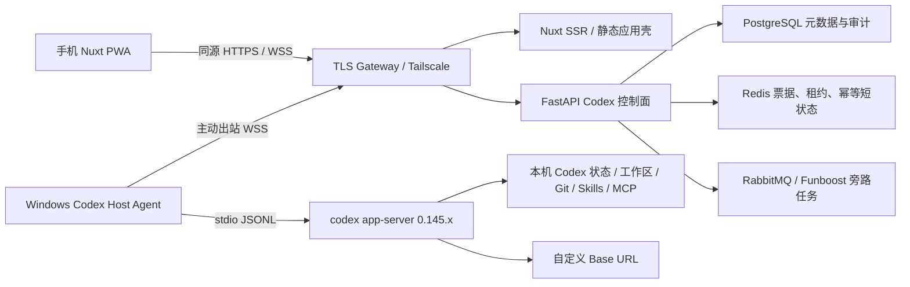
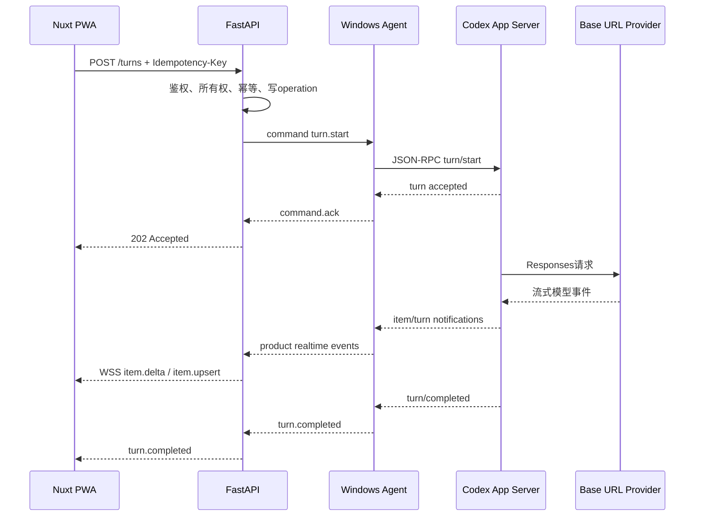
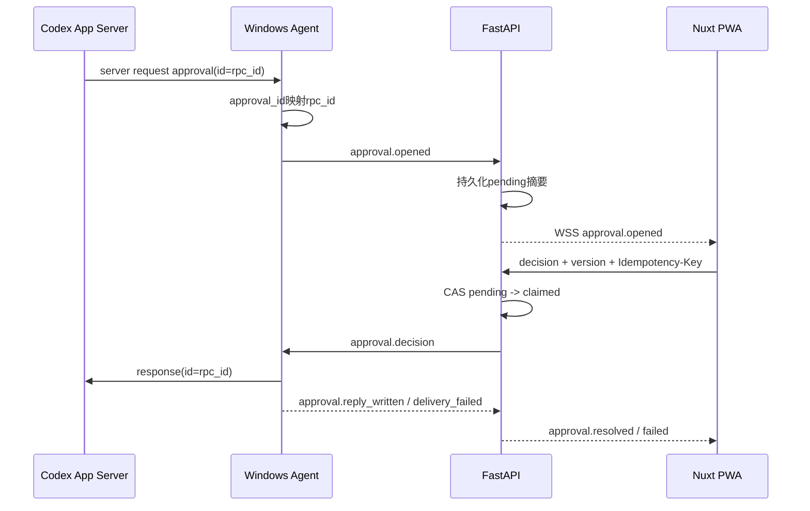

# 手机远程控制本机 Codex：架构与直接开发实施文档

> 文档状态：历史 Phase 0 基线，已由 `docs/design_docs/codex_remote_codex_first_execution_plan.md` 取代  
> 基线日期：2026-07-31  
> 后端仓库：`E:\python_web_fastapi\work\`  
> 前端仓库：`E:\python_web_fastapi\typescript-web-nuxt\`  
> 当前 Codex CLI：`codex-cli 0.145.0`  
> 当前认证方式：自定义 `base_url + API key`，`auth_mode=apikey`  
> 当前模型提供商：`code4ai`，Responses 协议

> 2026-08-08 回归说明：本文保留最初调研、个人 MVP 取舍和 Phase 0 历史证据，不再描述当前实现状态，也不作为任务清单。当前冻结契约、阶段勾选、测试证据和残余外部验收以 [Codex-first 执行方案](design_docs/codex_remote_codex_first_execution_plan.md)、[Phase 0 最终决策](design_docs/codex_remote_phase0_baseline_and_decisions.md) 和 [Windows Agent 手册](project_manual/04_infrastructure/codex_host_agent.md) 为准。

---

## 1. 文档目的

本文件是“通过手机控制本机 Codex”的最初调研与 Phase 0 历史基线；当前实施、迁移、部署与验收入口已经迁移到上述执行方案和项目手册。

本方案不是单纯做一个手机聊天页面，而是构建一个安全的远程控制链路，使手机能够：

- 查看本机 Codex 的主机、工作区和线程。
- 创建或继续 Codex 线程。
- 发送普通消息和运行中的 steer 消息。
- 实时查看文本、计划、工具调用、命令输出、Diff 和最终结果。
- 中断正在执行的 turn。
- 在手机上处理 Codex 的命令、文件、网络等审批。
- 手机断网或页面关闭后重新连接并恢复权威状态。
- 保持本机工作区、Git、Skills、MCP、Codex 配置和 API Key 都留在电脑上。
- 首先服务于单人使用，并在不推倒重写的前提下扩展为用户之间完全隔离的多租户系统。

本文明确区分三个阶段：

1. **个人核心 MVP**：完成真正可用的手机远程控制闭环。
2. **个人生产加固**：完成安全、断线恢复、审计、PWA 和可观测性。
3. **多租户扩展**：由管理员创建用户和分配角色；每个用户拥有独立主机、工作区、线程、凭据和额度，用户之间不共享工作区。

除非某项被标为 MVP 必需，否则不应为了“架构完整”阻塞个人版本上线。

---

## 2. 最终结论

### 2.1 是否需要自建

OpenAI 当前已经提供官方 [Remote connections](https://learn.chatgpt.com/docs/remote-connections)，可通过 ChatGPT 手机端连接 Windows 或 macOS 主机，继续线程、审批命令、查看 Diff 和终端输出。

官方 Remote 要求：

- 手机端和桌面端登录同一个 ChatGPT 账号与工作区。
- 桌面端保持在线、唤醒并启用 Remote。
- 通过官方账号、工作区和设备配对完成授权。

本机当前实际配置为：

- `auth_mode=apikey`。
- 自定义模型提供商 `code4ai`。
- 自定义 `base_url=https://code4ai.top/v1`。

因此，**只要必须继续使用当前 Base URL 和 API Key，就不能把官方 Remote 作为本项目的可靠实现基础，自建控制层仍然有必要。**

如果未来改为官方 ChatGPT 账号和工作区认证，应先重新评估官方 Remote；届时继续自建的理由只能是自定义 UI、自定义提供商、私有部署、多租户或额外业务能力。

### 2.2 是否需要实现原方案全部内容

不需要一次性实现。

原方案的大部分设计是正确的，但它把个人需求直接扩展成了公网、多用户、多主机、完整审计的生产平台。对于个人 MVP：

- PostgreSQL可以复用，但只保存控制面元数据。
- Redis只在一次性 WebSocket 票据、分布式租约或多实例时成为必需。
- RabbitMQ/Funboost不是实时主链路依赖。
- 现有统一流式响应基建可复用其票据、Origin校验、会话配额、背压、Redis有界重放、指标和停机排空能力，但不能直接充当长期多路复用的Agent/浏览器控制通道。
- 完整 RBAC 不必阻塞首版，但必须保留所有权字段和服务器端授权检查。
- 文件管理、完整终端、Skills/MCP 管理、Web Push可以后置。
- 前端不是从零开始，现有 Nuxt 工程已经具备成熟骨架。

### 2.3 推荐实施周期

| 范围 | 时间估算 | 结果 |
| --- | ---: | --- |
| 协议探针与最小技术验证 | 2–4 天 | 手机页面能触发本机 Codex 并收到流式事件 |
| 个人核心 MVP | 2–3 周 | 线程、发送、流式输出、中断、审批、重连可用 |
| 个人生产加固 | 再增加 2–3 周 | 安全登录、PWA、审计、异常恢复、容量保护完整 |
| 多租户和高级能力 | 再增加 4–8 周 | 用户创建、角色分配、租户隔离、独立Agent、终端、推送、多实例等 |

---

## 3. 已确认的现有工程事实

### 3.1 FastAPI 后端

后端已经具备：

- 端口与适配器分层。
- 组合根 `FastApiAppAssembler`。
- `ApplicationContainer` 与 `DependencyContextAccessor`。
- 配置驱动的 Web 模块清单。
- `SharedResourceMount` 和统一 `RuntimeBundle`。
- PostgreSQL、Redis、RabbitMQ/Funboost。
- 数据库 Outbox 与 at-least-once 后台任务语义。
- JWT access/refresh token、刷新轮换和重放防御。
- user-role-scope RBAC。
- 统一响应 envelope、异常、安全事件、日志、Prometheus 和 OTel。
- 统一HTTP/SSE/WebSocket流式响应基建，包括一次性票据、Origin准入、会话配额、慢消费者保护、Redis有界重放和异步停机排空。
- 静态、离线、回归等 Nox 门禁。

相关入口：

- [架构总览](/E:/python_web_fastapi/work/docs/project_manual/01_architecture/architecture_overview.md)
- [认证与授权](/E:/python_web_fastapi/work/docs/project_manual/04_infrastructure/authentication_and_authorization.md)
- [任务运行时](/E:/python_web_fastapi/work/docs/project_manual/04_infrastructure/task_runtime.md)
- [FastAPI 组合根](/E:/python_web_fastapi/work/src/api/fastapi_app_assembler.py)
- [Web 模块清单](/E:/python_web_fastapi/work/src/api/web_module_manifest.py)
- [共享资源入口](/E:/python_web_fastapi/work/src/infrastructure/shared_resource_mount.py)

当前后端工作树存在大量尚未提交的可观测性、日志、指标、资源生命周期和测试改动。Codex 功能会修改相同文件，开工前必须先建立明确基线，避免同时修改：

- `FastApiAppAssembler`
- `SharedResourceMount`
- `RuntimeResourceBootstrapper`
- lifespan
- 日志契约
- Prometheus registry
- 配置模型与加载器

2026-07-31定向复核中，当前统一流式基建的36项unit/interface/network integration测试通过。该结果证明现有短生命周期流操作骨架可复用，不证明Codex长期控制通道已经实现；这些文件仍处于未提交工作树中，必须先收口为可追溯基线。

### 3.2 Nuxt 前端

前端仓库已经具备：

- Nuxt 4，使用 `app/` 目录。
- Vue 3 Composition API。
- TypeScript 5.9。
- Pinia 3。
- Tailwind CSS v4。
- SSR + Nitro `node-server`。
- 统一 API client 和响应 envelope 解析。
- access/refresh token 登录、刷新锁和权限状态。
- RBAC route meta 与全局路由守卫。
- Base/Admin/Layout/Feedback 等组件。
- Vitest、Nuxt runtime tests、Coverage、Playwright。
- `pnpm release:check` 完整门禁。

相关入口：

- [前端 README](/E:/python_web_fastapi/typescript-web-nuxt/README.md)
- [Nuxt 配置](/E:/python_web_fastapi/typescript-web-nuxt/nuxt.config.ts)
- [统一 API client](/E:/python_web_fastapi/typescript-web-nuxt/app/composables/useApi.ts)
- [认证 store](/E:/python_web_fastapi/typescript-web-nuxt/app/stores/auth.ts)
- [全局路由守卫](/E:/python_web_fastapi/typescript-web-nuxt/app/middleware/framework.global.ts)
- [现有测试目录](/E:/python_web_fastapi/typescript-web-nuxt/tests)

### 前端实时事件版本排障

后端浏览器实时事件当前固定使用 `schema_version=2.0`。本地前端必须在
`E:\python_web_fastapi\typescript-web-nuxt` 目录执行 `docker compose up -d`；
Compose 的 `pull_policy: build` 会在启动前按当前源码重建前端镜像，防止旧镜像
继续携带 `schema_version=1.0` 的校验器。重建后若浏览器仍显示“Codex实时事件
schema_version不兼容”，关闭旧标签页并强制刷新，再检查 `http://127.0.0.1:3000`
对应容器为 healthy。

当前缺少：

- WebSocket 客户端和连接状态机。
- Codex 领域类型、API service、realtime reducer 和页面。
- PWA manifest、Service Worker 和安装能力。
- 长线程虚拟列表。
- Markdown 安全渲染。
- 移动端 unified diff 展示。
- Codex 审批 UI。
- 图片附件和文件预览。
- Codex 专用 E2E 测试。
- 前端仓库自身的 Git 元数据和 CI workflow。

### 3.3 当前前端认证需要修正

当前 `auth.ts` 把 access token 和 refresh token 都放在可由 JavaScript 读取的 Nuxt cookie 中。即使配置了 `SameSite=Strict` 和生产 `Secure`，它仍不是 HttpOnly。

远程 Codex 能执行命令和修改代码，生产上线前必须迁移为：

- access token只存在页面内存。
- refresh token由 FastAPI 设置为 `HttpOnly + Secure + SameSite=Strict` Cookie。
- 前端 JavaScript不得读取 refresh token。
- refresh/revoke 通过浏览器专用接口和 Cookie完成。
- 登录、刷新、退出验证 `Origin`。
- 生产环境尽量使用同源网关，避免跨站 Cookie和复杂 CORS。

原有非浏览器 Bearer 接口可继续保留，不能直接破坏现有管理后台调用方。

---

## 4. Codex 当前事实和限制

### 4.1 App Server 是正确接入面

官方 [Codex App Server](https://learn.chatgpt.com/docs/app-server) 是 Codex 富客户端使用的接口，提供：

- authentication/account。
- thread start/list/read/resume/fork/archive。
- turn start/steer/interrupt。
- 流式 item、plan、diff、command 和 turn 事件。
- 命令、文件、网络等审批请求。
- model、skills、MCP 等能力查询。
- JSON Schema 和 TypeScript 类型生成。

本项目必须以 App Server 为事实源，不能通过读取 `.codex` JSONL 文件模拟运行时协议。

当前使用API-key-only认证时，账户类能力必须按探针结果降级。尤其 `account/usage/read` 需要Codex服务支持的认证，API-key-only和Bedrock认证不可用；产品 `/account`、`/usage` 接口只能在Agent上报对应capability时开放，不能作为MVP硬依赖。

### 4.2 传输选择

App Server 支持默认 `stdio://`、实验 WebSocket 和 Unix socket。稳定方案为：

```text
Codex Host Agent ──stdin/stdout JSONL── codex app-server
```

不应把 App Server 原始 WebSocket直接暴露给公网，也不应让 Nuxt 前端直接依赖原始 JSON-RPC。

### 4.3 Windows daemon 限制

`codex app-server daemon` 命令在 CLI 帮助中存在，但本机实际执行返回：

```text
Error: codex app-server daemon lifecycle is only supported on Unix platforms
```

因此当前 Windows 0.145.0 环境：

- 不能把 daemon lifecycle 当成可靠恢复基础。
- Agent退出、Windows重启或用户退出登录时，活动 turn不保证继续。
- 可以恢复已经持久化的 thread。
- 活动 turn在Agent/App Server丢失后必须标记为 `interrupted` 或 `unknown`。
- 手机断网或 FastAPI短暂重启不应终止仍存活的本地 App Server。

### 4.4 本地持久化现状

当前 `C:\Users\ThinkPad\.codex` 已确认包含：

- `sessions/**/*.jsonl`：实际 thread rollout 历史。
- `state_5.sqlite`：线程索引、标题、cwd、模型、状态、rollout 路径等。
- `session_index.jsonl`：会话索引。
- `logs_2.sqlite`：本地运行日志。
- `memories_1.sqlite`：记忆任务和输出。
- `goals_1.sqlite`：目标状态。

session JSONL 中可包含用户消息、Codex回复、工具调用和输出、命令结果、turn context、world state、reasoning摘要、加密reasoning内容、token和状态事件。

这不等于“完整保存模型所有原始思维链”。远程产品只展示 App Server正式提供的 reasoning摘要、计划、事件和结果，不能依赖隐藏原始推理。

### 4.5 自定义 Base URL 的数据边界

Codex会把 prompt、上下文和必要工具结果发送到当前 `code4ai.top` 提供商。该服务是否记录、保留或再次处理数据，取决于提供商自身策略。

因此：

- 控制面数据库不保存对话，只减少本系统的副本。
- 它不能阻止自定义 Base URL 服务端看到模型请求。
- 如果未来错误地让多个租户共用同一个 API Key，所有人会共同消耗该凭据的配额，因此强隔离方案应使用每用户独立凭据或可按用户归因的上游凭据profile。
- API Key只存在Windows安全边界、Codex凭据存储或受控环境变量。
- API Key不得发送到手机、`runtimeConfig.public`、FastAPI响应、日志或数据库明文。

---

## 5. 目标架构

### 5.1 推荐生产拓扑



### 5.2 为什么保留 Windows Agent

现有 FastAPI生产容器不能直接替代 Agent，因为：

- 容器无法自然继承Windows当前用户的Codex登录态。
- 容器无法安全访问任意本地仓库和用户级配置。
- App Server和文件操作必须使用当前Windows用户权限。
- 容器与宿主机路径、junction、符号链接和Git环境不同。
- Agent需要在控制面断线时继续维护本地App Server。

“Agent”表示宿主机代理，不是Node.js Agent。推荐用Python实现，与后端Pydantic契约、日志和测试体系复用。

### 5.3 个人最简部署

- 手机和电脑加入同一Tailscale tailnet。
- Nuxt、FastAPI仍按现有部署方式运行。
- Windows Agent主动连接FastAPI WSS。
- 网关统一提供同源 `https://codex.example/`、`/api/` 和 `/ws/`。
- 不将App Server端口暴露到LAN或公网。

---

## 6. 组件职责

| 组件 | 负责 | 不负责 |
| --- | --- | --- |
| Nuxt PWA | 页面、认证状态、REST、WS消费、reducer、审批、移动展示 | 不保存API Key，不直接访问本地路径，不解释原始JSON-RPC |
| FastAPI控制面 | 用户鉴权、所有权、产品API、Agent连接、事件路由、幂等、审计 | 不执行本地命令，不保存绝对路径，不成为thread正文事实源 |
| Windows Agent | App Server监督、RPC关联、工作区白名单、断线缓冲、设备鉴权 | 不承载用户RBAC，不提供公网匿名端口 |
| Codex App Server | thread/turn/item、工具、审批、模型、Skills、MCP、账户 | 不直接暴露给手机和公网 |
| PostgreSQL | 主机、工作区索引、thread映射、操作、审批、审计元数据 | 默认不保存prompt、代码、Diff、终端正文 |
| Redis | 一次性WS票据、host租约、短期幂等、分布式路由状态 | 不保存对话正文和代码 |
| Funboost/RabbitMQ | 推送、清理、索引刷新、日报 | 不传turn、审批回复和实时delta |

---

## 7. 三条认证链必须分开

### 7.1 模型提供商认证

主体是本机Codex到自定义Base URL；凭据是现有API Key，仅存于Windows安全边界。该凭据不能用于证明手机用户是谁。

### 7.2 手机用户认证

复用现有用户、角色、scope和refresh轮换体系，新增：

```text
POST /auth/browser/token
POST /auth/browser/refresh
POST /auth/browser/revoke
POST /auth/step-up
```

行为：

- 登录返回access token，Pinia只放内存。
- refresh token只通过HttpOnly Cookie下发。
- refresh请求不传refresh token正文。
- Cookie成功刷新后轮换。
- Cookie使用 `Secure; HttpOnly; SameSite=Strict; Path=/auth/browser`。
- 严格验证Origin。
- access token不写localStorage、IndexedDB、普通Cookie或Service Worker Cache。

### 7.3 Agent设备认证

Agent不能复用管理员Bearer token：

- owner生成短期配对码。
- Agent用配对码换高熵设备token。
- Windows端用Credential Manager或同等安全存储。
- PostgreSQL只保存token摘要。
- Agent WSS使用设备Bearer或签名挑战，并由WebSocket专用设备守卫校验。
- Agent内部HTTP接口使用独立 `Authorization: CodexAgent <token>` scheme或签名挑战，不复用普通 `Bearer`。当前HTTP认证中间件会把所有Bearer都按用户JWT解析，设备token若冒用Bearer会在到达路由前被拒绝。
- 支持轮换、吊销和host下线。

---

## 8. RBAC、租户所有权与用户隔离

### 8.1 “多用户”的准确含义

本项目的多用户不是多人协作同一个workspace，而是严格的多租户隔离：

```text
管理员
  ├── 创建用户A、分配角色
  ├── 创建用户B、分配角色
  └── 管理或吊销用户和主机

用户A
  └── Host A
      ├── Agent A / Codex身份A / API凭据A
      ├── Workspace A1、A2
      └── Thread A*

用户B
  └── Host B
      ├── Agent B / Codex身份B / API凭据B
      ├── Workspace B1、B2
      └── Thread B*
```

用户A不得查看、枚举、审批、操作或接收用户B的任何host、workspace、thread、turn、事件、文件、Diff、用量和通知。默认不设计共享workspace、成员邀请或协作成员表。

### 8.2 个人MVP

- 初始只有当前管理员用户。
- 当前管理员也是自己Codex资源的owner。
- host、workspace、thread、operation和approval都绑定 `owner_subject_id` 或可沿外键追溯到owner。
- 所有接口先按当前subject过滤资源，再执行scope授权。
- 资源不存在和资源属于其他用户统一返回404。
- Agent凭据与用户凭据分离，且Agent凭据必须绑定唯一host和owner。

### 8.3 推荐scope

普通Codex用户：

```text
codex:read
codex:operate
codex:approve
codex:host_manage
```

高级个人能力：

```text
codex:files
codex:terminal
codex:full_access
```

跨租户管理能力：

```text
codex:admin_manage
codex:admin_content_access
```

含义：

- `codex:admin_manage`允许管理员创建或禁用用户关联、查看host在线元数据、吊销Agent和处理配额，但不自动读取用户代码或对话。
- `codex:admin_content_access`才允许管理员进入其他用户的thread、文件或审批；这是高风险受保护scope。
- 当前初始管理员角色可按实际需要获得两项管理scope。
- 普通用户即使拥有 `codex:host_manage`，也只能管理 `owner_subject_id` 等于自己的host。
- `codex:terminal`和`codex:full_access`不应默认授予普通用户。

### 8.4 推荐角色

复用现有user-role-scope体系，不新增workspace成员角色：

| 全局角色 | 作用 |
| --- | --- |
| admin | 创建用户、分配角色、禁用账号、管理所有host和系统策略；跨租户正文访问仍受专用scope保护 |
| codex_user | 管理和操作自己的host、workspace和thread |
| codex_readonly | 只读查看自己的host、thread和结果，不允许发起turn或审批 |
| ops | 可选运维角色，只看服务健康、指标和脱敏日志，不读取用户正文 |

管理员创建普通用户后，为其分配 `codex_user` 或 `codex_readonly`。普通用户不需要也不应该拥有admin角色。

### 8.5 数据库隔离规则

- 不创建 `codex_workspace_member`。
- 不允许一个workspace同时属于多个subject。
- `owner_subject_id`创建后不可由普通更新接口修改。
- host配对码在创建时绑定当前subject，Agent enrollment不得自行指定owner。
- workspace同步从host继承owner，不能信任Agent提交任意subject_id。
- thread创建从workspace继承owner，不能信任浏览器提交owner字段。
- operation和approval从目标thread/host继承owner。
- Repository接口必须显式接收 `subject_id`，禁止先按裸ID查询再在应用层补判定。
- 管理员跨租户查询使用独立admin usecase和独立审计事件，不能通过伪装普通subject绕过。
- 可在多人生产阶段增加PostgreSQL Row-Level Security作为纵深防御，但应用层所有权检查仍不可删除。

### 8.6 同一物理Windows电脑上的隔离

最佳实践是一名用户对应一台独立电脑、虚拟机或远程开发环境。

如果多个用户必须使用同一台Windows电脑，必须做到：

- 每个人使用独立Windows账户。
- 每个Windows账户有独立 `%USERPROFILE%` 和 `CODEX_HOME`。
- 每人独立 `auth.json`、Base URL/API Key或提供商凭据。
- 每人独立Agent配置、设备凭据、host_id和Agent进程。
- 每人工作区目录使用Windows ACL隔离。
- Agent以对应Windows用户登录会话启动。
- 禁止在同一个Windows用户和同一个 `.codex` 目录下模拟多个Web用户。

否则App Server的 `thread/list`、本地session、Skills、MCP、Git凭据和API Key处于同一安全边界，无法形成可信隔离。

### 8.7 管理员边界

管理员可以：

- 创建、禁用和重置用户。
- 分配 `codex_user`、`codex_readonly` 等角色。
- 查看host在线状态、Agent版本和协议兼容性。
- 吊销Agent凭据。
- 设置并发、配额和可用能力。
- 在具有 `codex:admin_content_access` 时处理用户内容级故障。

所有管理员跨租户操作必须记录：

```text
admin_subject_id
target_subject_id
host_id/workspace_id/thread_id摘要
operation_type
reason
request_id
created_at
```

管理员不能从数据库取得用户本机API Key原文，因为控制面从不保存该原文。

### 8.8 内置角色和迁移

数据库迁移与bootstrap必须同时完成：

- 向 `auth_scope` 插入全部Codex scope。
- 创建或同步内置 `codex_user` 角色。
- 创建或同步内置 `codex_readonly` 角色。
- 给当前内置 `admin` 角色增加 `codex:admin_manage`。
- 是否给admin增加 `codex:admin_content_access` 必须显式配置；当前个人部署可以授予，通用多人部署默认不自动授予。
- `codex_user`默认获得 `codex:read`、`codex:operate`、`codex:approve`、`codex:host_manage`。
- `codex_readonly`只获得 `codex:read`。
- terminal、full_access和admin scope加入受保护scope清单，低权限管理员不得自行创建绕过角色。

用户开通流程：

1. 当前管理员在现有身份管理页面创建用户。
2. 管理员分配 `codex_user` 或 `codex_readonly`。
3. 新用户用自己的账号登录。
4. `codex_user`为自己的电脑生成配对码。
5. 配对码在服务端绑定该用户subject。
6. 该用户电脑上的Agent完成enroll并产生只属于该用户的host。

管理员代用户生成配对码必须使用独立管理接口、显式target_subject_id、step-up和审计，不能复用普通用户接口。

### 8.9 实时链路隔离

- 浏览器WS ticket绑定 `subject_id + token_session_id`。
- WebSocket connection context固定当前subject，连接建立后不能切换用户。
- Event router发布前根据host/workspace/thread解析owner。
- 普通用户连接只订阅owner等于自己的事件。
- 管理员跨租户查看使用独立订阅命令和 `codex:admin_content_access`。
- Agent hello中的host_id必须和设备凭据绑定的host一致。
- Agent不能通过payload改变host owner。
- approval事件发送给approval owner，不广播给所有在线用户。
- Web Push subscription绑定subject，任务通知按owner路由。
- Redis pub/sub或多实例channel必须包含不可伪造的服务端租户上下文。
- UUID不可猜测不能替代owner过滤。

---

## 9. 数据事实源和存储策略

### 9.1 权威性

| 数据 | 权威事实源 |
| --- | --- |
| thread/turn/item正文 | Codex App Server本地持久化 |
| 仓库和文件 | Windows工作区 |
| host/workspace所有权 | PostgreSQL |
| 控制操作状态 | PostgreSQL |
| 实时在线状态 | Agent连接 + Redis租约 |
| Agent断线期间临时补发 | Agent有界缓冲；溢出后只上报gap并重建snapshot |
| 浏览器短时重连补发 | Redis有界窗口；跨epoch、窗口缺失或不连续时改拉snapshot |
| 浏览器状态 | App Server snapshot + 产品事件reducer |

### 9.2 PostgreSQL表

#### `codex_host`

```text
host_id UUID PK
owner_subject_id VARCHAR NOT NULL
display_name VARCHAR NOT NULL
platform VARCHAR NOT NULL
agent_version VARCHAR
codex_version VARCHAR
agent_protocol_version VARCHAR
app_server_schema_digest VARCHAR
status VARCHAR NOT NULL
capabilities JSONB NOT NULL
last_seen_at TIMESTAMPTZ
revoked_at TIMESTAMPTZ
created_at TIMESTAMPTZ NOT NULL
updated_at TIMESTAMPTZ NOT NULL
version INTEGER NOT NULL
```

不保存本机API Key和可被手机修改的绝对路径。

#### `codex_agent_credential`

```text
credential_id UUID PK
host_id UUID FK
token_digest VARCHAR NOT NULL
key_id VARCHAR NOT NULL
status VARCHAR NOT NULL
issued_at TIMESTAMPTZ NOT NULL
expires_at TIMESTAMPTZ
last_used_at TIMESTAMPTZ
rotated_at TIMESTAMPTZ
revoked_at TIMESTAMPTZ
```

#### `codex_workspace`

```text
workspace_id UUID PK
host_id UUID FK
owner_subject_id VARCHAR NOT NULL
agent_workspace_key VARCHAR NOT NULL
display_name VARCHAR NOT NULL
repo_fingerprint VARCHAR
default_branch VARCHAR
enabled BOOLEAN NOT NULL
created_at TIMESTAMPTZ NOT NULL
updated_at TIMESTAMPTZ NOT NULL
version INTEGER NOT NULL
```

`agent_workspace_key`是Agent本地登记项的不透明标识，不是绝对路径。

#### `codex_thread_index`

```text
thread_index_id UUID PK
host_id UUID FK
workspace_id UUID FK
owner_subject_id VARCHAR NOT NULL
upstream_thread_id VARCHAR NOT NULL
display_name VARCHAR
model VARCHAR
reasoning_effort VARCHAR
status VARCHAR NOT NULL
active_turn_id VARCHAR
archived BOOLEAN NOT NULL
source_kind VARCHAR
created_at TIMESTAMPTZ
updated_at TIMESTAMPTZ NOT NULL
last_synced_at TIMESTAMPTZ NOT NULL
UNIQUE(host_id, upstream_thread_id)
```

不要创建message正文表。

#### `codex_control_operation`

```text
operation_id UUID PK
command_id UUID NOT NULL
actor_subject_id VARCHAR NOT NULL
owner_subject_id VARCHAR NOT NULL
host_id UUID NOT NULL
workspace_id UUID
thread_id VARCHAR
operation_type VARCHAR NOT NULL
idempotency_key VARCHAR NOT NULL
request_digest VARCHAR NOT NULL
status VARCHAR NOT NULL
dispatch_attempt INTEGER NOT NULL
last_dispatched_at TIMESTAMPTZ
ack_deadline_at TIMESTAMPTZ
error_code VARCHAR
result_digest VARCHAR
accepted_at TIMESTAMPTZ
completed_at TIMESTAMPTZ
created_at TIMESTAMPTZ NOT NULL
updated_at TIMESTAMPTZ NOT NULL
UNIQUE(actor_subject_id, idempotency_key)
UNIQUE(host_id, command_id)
```

同一幂等键对应不同请求摘要返回409。

数据库幂等只解决“同一个HTTP请求是否重复受理”，不能单独解决Agent已执行但ack丢失后的重复副作用。每条写命令必须携带稳定的 `operation_id + command_id + request_digest`；FastAPI重发时三者保持不变，Agent按本地持久账本返回原ack/result而不再次调用App Server。

#### `codex_approval_audit`

```text
approval_id UUID PK
owner_subject_id VARCHAR NOT NULL
host_id UUID NOT NULL
workspace_id UUID
thread_id VARCHAR NOT NULL
turn_id VARCHAR
item_id VARCHAR
approval_kind VARCHAR NOT NULL
risk_level VARCHAR NOT NULL
payload_digest VARCHAR NOT NULL
display_summary JSONB NOT NULL
state VARCHAR NOT NULL
version INTEGER NOT NULL
expires_at TIMESTAMPTZ
decided_by VARCHAR
decision VARCHAR
decided_at TIMESTAMPTZ
applied_at TIMESTAMPTZ
created_at TIMESTAMPTZ NOT NULL
updated_at TIMESTAMPTZ NOT NULL
```

display_summary只存脱敏摘要，不默认保存完整命令、环境变量、代码或Diff。

### 9.3 Redis

```text
codex:ws_ticket:<digest>
codex:host_lease:<host_id>
codex:agent_route:<host_id>
codex:operation_result:<subject_id>:<idempotency_key>
codex:step_up:<grant_digest>
```

所有键必须有TTL，ticket和grant只存摘要且原子消费。Redis清空后系统通过重新登录、Agent重连和snapshot恢复。

### 9.4 浏览器存储

允许：

- Pinia内存access token。
- 当前页面内存草稿。
- 当前epoch和seq。
- Service Worker静态应用壳。

禁止：

- 对话、代码、Diff、终端输出进入Service Worker Cache。
- token进入localStorage或IndexedDB。
- 完整线程进入持久Pinia插件。

### 9.5 日志

允许记录摘要ID、RPC方法、状态、耗时、错误类别、队列深度和payload字节数。

禁止记录API Key、设备token、用户token、WS ticket、prompt全文、command全文、环境变量、代码、Diff、文件正文和原始认证响应。

### 9.6 状态枚举、索引和保留策略

建议稳定状态值：

```text
host:
  enrolling
  online
  offline
  incompatible
  revoked

thread:
  idle
  active
  interrupted
  unknown
  archived

operation:
  pending
  dispatched
  acknowledged
  completed
  failed
  timed_out
  cancelled

approval:
  pending
  claimed
  applied
  delivery_failed
  expired
  cancelled
```

状态值使用数据库可读字符串和Python `StrEnum`，不使用难迁移的PostgreSQL原生enum。

推荐索引：

```text
codex_host(owner_subject_id, revoked_at)
codex_host(status, last_seen_at)
codex_workspace(host_id, enabled)
codex_workspace(owner_subject_id, updated_at DESC)
codex_thread_index(owner_subject_id, updated_at DESC)
codex_thread_index(host_id, upstream_thread_id) UNIQUE
codex_thread_index(workspace_id, archived, updated_at DESC)
codex_control_operation(actor_subject_id, idempotency_key) UNIQUE
codex_control_operation(host_id, command_id) UNIQUE
codex_control_operation(owner_subject_id, created_at DESC)
codex_control_operation(status, created_at)
codex_approval_audit(owner_subject_id, created_at DESC)
codex_approval_audit(state, expires_at)
codex_approval_audit(thread_id, created_at DESC)
```

默认保留建议：

- operation元数据90天。
- approval审计180天；生产可按合规要求调整。
- 连接状态和ticket仅保留TTL。
- thread index跟随本地thread，删除后保留最小墓碑30天用于审计。
- prompt、代码、Diff和终端正文不进入控制面保留策略。
- 清理任务必须分批、可重试，并记录删除数量而不是正文。

operation恢复规则：`pending/dispatched/timed_out`不是“可以生成新命令”的依据。控制面重启或Agent重连后先按原 `command_id` 查询/重发；Agent本地账本命中已接受或已完成记录时返回原结果。只有得到明确的App Server拒绝且可证明未产生副作用时，才允许把原operation标记失败并由用户创建新的operation。

---

## 10. 后端代码结构

保持现有分层，不创建第二套架构。

```text
src/core/codex_contract/
  agent_protocol_contract.py
  realtime_event_contract.py
  host_contract.py
  workspace_contract.py
  thread_contract.py
  turn_contract.py
  approval_contract.py
  operation_contract.py
  codex_runtime_contract.py

src/domain/codex/
  host_status.py
  operation_state_policy.py
  approval_state_policy.py
  workspace_access_policy.py
  codex_error_code.py

src/application/codex/
  list_hosts_usecase.py
  manage_host_usecase.py
  list_workspaces_usecase.py
  sync_workspaces_usecase.py
  query_threads_usecase.py
  manage_thread_usecase.py
  execute_thread_command_usecase.py
  decide_approval_usecase.py
  issue_realtime_ticket_usecase.py

src/application/ports/
  codex_control_port.py
  codex_host_repository_port.py
  codex_workspace_repository_port.py
  codex_thread_repository_port.py
  codex_operation_repository_port.py
  codex_approval_repository_port.py
  codex_realtime_ticket_port.py

src/api/endpoint_codex_control/
  contract_codex_control.py
  route_codex_host.py
  route_codex_workspace.py
  route_codex_thread.py
  route_codex_approval.py
  route_codex_realtime.py

src/api/endpoint_codex_agent/
  contract_codex_agent.py
  route_codex_agent_enroll.py
  route_codex_agent_connect.py

src/infrastructure/codex/
  codex_connection_registry.py
  codex_connection_session.py
  codex_host_actor.py
  codex_browser_event_hub.py
  codex_event_router.py
  codex_protocol_mapper.py
  codex_realtime_ticket_store.py
  codex_agent_credential_service.py
  codex_runtime_facade.py

src/infrastructure/codex_agent/
  app_server_process_supervisor.py
  app_server_jsonrpc_client.py
  agent_control_channel.py
  agent_workspace_registry.py
  agent_file_gateway.py
  agent_git_gateway.py
  agent_snapshot_builder.py
  agent_secret_store.py
  agent_command_journal.py

src/cli/
  run_codex_host_agent.py
  probe_codex_app_server.py
  generate_codex_protocol.py
  enroll_codex_host_agent.py

protocol/codex_app_server/0.145.0/
  json-schema/
  typescript/
  manifest.json
```

分层规则：

- `core`只放契约、枚举和Protocol。
- `domain`只放纯策略和状态转换。
- `application`只编排用例并依赖ports。
- `api`只处理HTTP/WS适配和授权入口。
- `infrastructure`负责连接、数据库、Redis、Agent和App Server。
- 路由不得直接new连接管理器。
- application不得依赖FastAPI、SQLAlchemy、Redis或Agent具体类。

---

## 11. 后端装配改动

### 11.1 Web模块

`ApplicationModuleName`增加：

```python
CODEX_CONTROL = "codex_control"
CODEX_AGENT_GATEWAY = "codex_agent_gateway"
```

`codex_control`属于已认证业务用户边界；`codex_agent_gateway`属于设备认证边界。

当前manifest只有 `admin_boundary_policy`，建议拆分为：

```text
authorization_boundary:
  public
  authenticated_user
  business_admin
  ops_only

authentication_mode:
  none
  user_bearer
  agent_device
```

该字段用于装配期校验边界，不替代路由/WS上的实际认证守卫。内部Agent接口不能被当成匿名接口，也不能冒充管理员Bearer认证。`agent_device` HTTP路由必须使用独立 `CodexAgent` scheme或签名挑战；不得把设备token交给现有 `AuthenticationBindingMiddleware` 的用户JWT Bearer解析路径。Agent WebSocket则在accept之前执行专用设备认证、吊销和host绑定校验。

### 11.2 组合根

需要同步修改：

- `FastApiAppAssembler`：实例化Codex repositories、usecases、runtime facade和connection registry。
- `ApplicationContainer`：显式增加Codex usecase字段。
- `DependencyContextAccessor`：增加读取入口。
- `SharedResourceMount`：增加 `CodexResourceFacade`。
- `RuntimeBundle`：增加稳定 `CodexRuntimeAccessor`。

### 11.3 lifespan

当前lifespan已经按以下方式编排同步资源和统一流式异步资源：

```python
self._resource_mount.startup()
await self._resource_mount.startup_streaming()

await self._resource_mount.shutdown_streaming()
self._resource_mount.shutdown()
```

因此Codex不能再另造第二套lifespan。应把Agent connection registry、browser event hub、后台重连/过期扫描task作为同一异步资源生命周期中的Codex资源集合注册，或在现有streaming之后启动、在其之前反向关闭，并复用现有“部分启动失败回滚”模式。

约束：

- 原有数据库、日志、缓存、任务初始化顺序不变。
- realtime启动失败必须回滚已启动资源。
- shutdown先停止新操作，再关闭浏览器WS、Agent连接和后台task。
- 不把全部现有资源强行改为async。

### 11.4 与现有统一流式基建的复用边界

当前 `FastApiStreamRouteComposer + WebSocketSessionHandler` 的语义是“客户端先subscribe一个command，服务端执行一个有限时长事件源，completed/fault后关闭”；默认 `max_duration_seconds=300`。这适合任务执行观察流，不适合直接承载：

- Agent长期在线、双向收发、多个并发RPC关联的控制通道。
- 浏览器跨host/thread接收审批、状态和turn事件的长期多路复用通道。

Codex实现应复用现有的强类型事件模式、Origin/票据准入、会话配额、frame限制、慢消费者保护、Redis有界重放、指标和shutdown排空，但新增独立的 `CodexConnectionSession`、`CodexConnectionRegistry` 与 `CodexBrowserEventHub`。禁止为了复用而把现有单操作handler改成包含Agent协议、RPC路由和永久订阅的巨型通用类。

---

## 12. 配置系统

新增：

```text
config/modules/codex_control_module/
  codex_control_module_base.toml
  codex_control_module_development.toml
  codex_control_module_test.toml
  codex_control_module_production.toml

config/runtime/codex_control_runtime/
  codex_control_runtime_base.toml
  codex_control_runtime_development.toml
  codex_control_runtime_test.toml
  codex_control_runtime_production.toml
```

推荐首版配置：

```toml
[runtime]
enabled = true
agent_heartbeat_seconds = 10
agent_offline_after_seconds = 30
agent_rpc_ack_timeout_seconds = 10
agent_reconnect_min_seconds = 1
agent_reconnect_max_seconds = 30
max_connected_agents = 4
max_active_turns_per_host = 2
max_active_write_turns_per_workspace = 1
agent_outgoing_queue_size = 256
browser_event_queue_size = 1024
agent_event_replay_buffer_size = 2000
max_agent_frame_bytes = 4194304
max_browser_frame_bytes = 1048576
realtime_ticket_ttl_seconds = 30
pairing_code_ttl_seconds = 300
step_up_grant_ttl_seconds = 300
operation_idempotency_ttl_seconds = 86400
allow_experimental_app_server_api = false
allowed_codex_versions = ["0.145.0"]
```

同步修改：

- `ModuleSettingsParser`。
- `RuntimeSettingsParser`。
- `ModuleSettings`。
- `RuntimeSettings`。
- `AppSettingsLoader._collect_file_paths`。
- `raw_application_settings.py`。
- `config/app_base.toml`启用模块。
- restart-required和热更新策略。

Codex连接、Agent认证、协议版本、队列容量和工作区安全配置均列为 `restart_required`。通知开关和普通UI限制才允许热更新。

---

## 13. Agent与App Server协议

### 13.1 Agent启动顺序

1. 读取Agent配置。
2. 从Windows安全存储读取设备凭据。
3. 读取本地工作区白名单。
4. 执行 `codex --version`。
5. 校验允许版本。
6. 启动 `codex app-server --stdio`。
7. 发送一次 `initialize`。
8. 发送 `initialized` notification。
9. 启动stdout JSONL读取循环。
10. 启动stderr有界脱敏日志循环。
11. 启动RPC超时管理器。
12. 主动建立FastAPI WSS。
13. 上报host hello、版本、schema digest、能力和workspace snapshot。
14. 进入心跳、命令消费、事件转发和重连循环。

### 13.2 App Server请求表

```text
rpc_id -> {
  method,
  deadline,
  future,
  operation_id
}
```

必须区分普通RPC response、App Server notification和App Server发起的审批request。

审批request具有上游RPC `id`。Agent生成稳定 `approval_id` 并维护：

```text
approval_id -> {
  upstream_rpc_id,
  app_server_instance_id,
  expires_at
}
```

手机决定后，FastAPI把approval_id和决定发回Agent。Agent只有在当前App Server进程代次与 `app_server_instance_id` 一致且RPC仍pending时，才用原始RPC id回复；进程重启后的旧RPC id绝不能复用。

### 13.3 Agent控制协议

Agent到FastAPI使用独立产品协议，不转发原始JSON-RPC：

```json
{
  "kind": "codex_agent_message",
  "schema_version": "1.0",
  "message_id": "01...",
  "host_id": "...",
  "type": "command.ack",
  "payload": {}
}
```

必须具备：

- hello/hello_ack。
- capability snapshot。
- heartbeat。
- command。
- command ack/result。
- realtime event。
- state snapshot。
- approval opened/resolved。
- protocol warning。
- graceful shutdown。

所有command必须带：

```text
command_id
operation_id
request_digest
deadline
expected_protocol_version
```

投递语义：

- FastAPI在数据库事务提交operation后才允许发送command。
- ack丢失或连接重建时只能重发同一个 `command_id`，不得生成新id。
- Agent在调用App Server前先把command写入本地持久账本；状态至少为 `received/executing/accepted/completed/failed`。
- 相同 `command_id + request_digest` 重复到达时返回已保存的ack/result，不再次调用App Server。
- 相同 `command_id` 携带不同digest时拒绝并上报安全事件。
- 本地账本只保存协议元数据、上游thread/turn/item标识和脱敏结果摘要，不保存prompt、代码、Diff或终端正文。
- `turn/start`、thread创建、fork和审批回复按不可盲目重试处理；查询、snapshot和interrupt可以按各自契约安全重试。

### 13.4 Agent本地配置

配置文件建议放在当前用户私有目录，例如：

```text
%LOCALAPPDATA%\CodexRemoteAgent\agent.toml
```

Agent运行状态建议使用：

```text
%LOCALAPPDATA%\CodexRemoteAgent\state.sqlite
```

该SQLite只承载命令去重账本、待回复审批RPC关联、最后已确认事件位置和进程恢复元数据；它不是对话数据库。RPC `future` 等仅能保存在内存，重启后不得伪造为仍可继续的活动调用。

示例：

```toml
[agent]
host_id = "..."
display_name = "ThinkPad"
control_plane_url = "wss://codex.example/internal/codex-agents/connect"
codex_binary = "codex"
heartbeat_seconds = 10
max_buffered_events = 2000

[protocol]
agent_schema_version = "1.0"
expected_codex_version = "0.145.0"
allow_experimental_api = false

[[workspaces]]
key = "fastapi-work"
display_name = "FastAPI Backend"
root = "E:\\python_web_fastapi\\work"
allow_write = true

[[workspaces]]
key = "nuxt-frontend"
display_name = "Nuxt Frontend"
root = "E:\\python_web_fastapi\\typescript-web-nuxt"
allow_write = true
```

要求：

- 文件ACL仅允许当前Windows用户。
- 设备token不写入agent.toml，而是按 `credential_id` 从Windows安全存储读取。
- FastAPI不能通过远程请求直接修改 `root`。
- 工作区变更必须在电脑本地确认，或使用step-up并由Agent再次确认。
- 启动日志只打印workspace key和display name，不打印root全文。
- Agent检测到配置文件权限过宽时拒绝启动。

### 13.5 Agent进程监督

- App Server stdin写入必须单写者串行化。
- stdout逐行解析，设置最大单行字节数。
- stderr使用独立有界队列，不能阻塞stdout。
- 子进程异常退出采用指数退避，连续失败达到阈值后进入degraded。
- Agent停止时先拒绝新command，再等待短暂grace period，最后终止App Server。
- Windows计划任务使用“仅在用户登录时运行”，失败后按1分钟、5分钟、15分钟重试。
- Agent实例使用本地互斥锁，禁止同一host配置启动两个实例。
- Agent在发送“已接受”ack前必须持久化对应 `command_id` 与App Server返回的thread/turn标识，确保进程崩溃后仍能回答控制面的重复查询。

---

## 14. 产品实时事件协议

Nuxt不能消费App Server原始事件。FastAPI转换为稳定产品事件：

```json
{
  "kind": "codex_realtime_event",
  "schema_version": "1.0",
  "connection_epoch": "01...",
  "seq": 128,
  "event_id": "01...",
  "host_id": "...",
  "workspace_id": "...",
  "thread_id": "...",
  "turn_id": "...",
  "item_id": "...",
  "type": "item.delta",
  "payload": {}
}
```

稳定事件集合：

```text
connection.ready
host.snapshot
host.status_changed
workspace.snapshot
thread.snapshot
thread.updated
turn.started
turn.completed
turn.failed
turn.interrupted
turn.plan_updated
turn.diff_updated
item.upsert
item.delta
approval.opened
approval.resolved
account.updated
usage.updated
stream.gap_detected
protocol.warning
```

事件规则：

- `seq`只在一个 `connection_epoch`内递增。
- 每次浏览器WS成功建立都生成新的 `connection_epoch`；旧epoch的Agent缓冲事件若需要补发，必须先映射到新epoch并重新编号，不能把两段序列直接拼接。
- 浏览器记录最后epoch和seq。
- 普通文本delta可约50ms合并渲染。
- completed/upsert是对应item最终权威状态。
- turn完成、审批、错误和状态切换不得丢弃。
- 队列满可丢可恢复delta，但必须发送 `stream.gap_detected`。
- 序号缺口后停止局部拼接，调用thread snapshot。
- 跨epoch默认先发送连接与资源snapshot，再发送新实时事件；Redis重放只优化短时同epoch重连，不承担权威恢复。
- reducer幂等，重复event_id不重复应用。

### 14.1 启动turn时序



关键点：

- HTTP只等待“已接受”，不等待模型完成。
- 所有长输出通过WSS。
- HTTP超时不等于turn失败；客户端应通过operation查询和snapshot确认。
- 若ack超时但Agent稍后执行成功，FastAPI必须用原 `command_id` 查询或重发，Agent本地去重账本返回原thread/turn结果；仅靠HTTP幂等键不足以阻止重复创建turn。

### 14.2 审批时序



App Server发起的审批是JSON-RPC server request。Agent向其stdin写回对应 `id` 的response后，不会再收到一个“对response的确认response”。因此 `APPLIED` 的准确含义是“Agent已把合法回复成功写给仍存活的App Server进程”；若进程已退出、RPC映射不存在、审批已过期或写入失败，状态应为 `DELIVERY_FAILED`，不能虚构 `UPSTREAM_REJECTED` 确认。后续turn/item事件只用于刷新业务结果，不作为审批response的第二次RPC确认。

---

## 15. 手机WebSocket鉴权

浏览器原生WebSocket不能可靠设置自定义Authorization头，采用一次性票据：

```text
POST /codex/realtime-tickets
WS   /codex/events?ticket=<one-time-ticket>
```

ticket要求：

- 至少256位随机熵。
- Redis只保存摘要。
- TTL默认30秒。
- 原子一次性消费。
- 绑定subject、token session、Origin和可选device id。
- 使用后立即删除。
- 日志和反向代理访问日志脱敏query。

建立后服务端首先发送 `connection.ready`：

```text
connection_epoch
schema_version
heartbeat_interval
server_time
```

前端不得持久化或重复使用ticket。

---

## 16. 产品REST API

### 16.1 Host

```text
GET    /codex/hosts
POST   /codex/hosts/pairing-codes
PATCH  /codex/hosts/{host_id}
DELETE /codex/hosts/{host_id}
```

### 16.2 Workspace

```text
GET    /codex/hosts/{host_id}/workspaces
POST   /codex/hosts/{host_id}/workspaces/sync
PATCH  /codex/hosts/{host_id}/workspaces/{workspace_id}
```

### 16.3 Thread

```text
GET    /codex/hosts/{host_id}/threads
POST   /codex/hosts/{host_id}/threads
GET    /codex/hosts/{host_id}/threads/{thread_id}
PATCH  /codex/hosts/{host_id}/threads/{thread_id}
POST   /codex/hosts/{host_id}/threads/{thread_id}/resume
POST   /codex/hosts/{host_id}/threads/{thread_id}/fork
POST   /codex/hosts/{host_id}/threads/{thread_id}/archive
POST   /codex/hosts/{host_id}/threads/{thread_id}/unarchive
```

### 16.4 Turn

```text
POST /codex/hosts/{host_id}/threads/{thread_id}/turns
POST /codex/hosts/{host_id}/threads/{thread_id}/steer
POST /codex/hosts/{host_id}/threads/{thread_id}/interrupt
POST /codex/hosts/{host_id}/threads/{thread_id}/review
```

turn请求必须使用 `Idempotency-Key`。成功只等待Agent/App Server确认已接受，返回202，不等待模型完成。

### 16.5 Approval

```text
GET  /codex/approvals
GET  /codex/approvals/{approval_id}
POST /codex/approvals/{approval_id}/decision
```

### 16.6 Capabilities

```text
GET /codex/hosts/{host_id}/models
GET /codex/hosts/{host_id}/skills
GET /codex/hosts/{host_id}/mcp-servers
GET /codex/hosts/{host_id}/account
GET /codex/hosts/{host_id}/usage
```

以上能力必须由Agent hello中的capability驱动。当前API-key-only部署不得假定 `/account`、`/usage` 可用；不支持时返回明确的能力不可用语义，而不是把host判为故障。

### 16.7 Agent内部接口

```text
POST /internal/codex-agents/enroll
POST /internal/codex-agents/rotate-credential
WS   /internal/codex-agents/connect
```

`enroll`使用短期配对码；`rotate-credential`使用独立 `CodexAgent` HTTP认证scheme；`connect`在WebSocket accept前验证设备凭据。三者都不能复用用户JWT Bearer依赖。

### 16.8 错误语义

| 场景 | HTTP |
| --- | ---: |
| host不存在或不属于当前用户 | 404 |
| host离线 | 409 |
| thread正在执行且动作冲突 | 409 |
| workspace写租约被占用 | 409 |
| approval已处理或失效 | 410 |
| 幂等键对应不同请求 | 409 |
| Codex/协议版本不兼容 | 412 |
| 缺少step-up | 403 |
| realtime未就绪 | 503 |
| Agent未在时限内确认 | 504 |
| 操作已接受，结果由事件返回 | 202 |

所有正常和错误响应继续遵守现有FastAPI `ResponseEnvelope`。

### 16.9 管理员多租户接口

用户创建、禁用、密码重置和角色分配继续复用现有 `/admin/identity/**` 接口，不为Codex重复创建用户系统。

Codex管理员接口使用独立前缀：

```text
GET  /admin/codex/tenants
GET  /admin/codex/tenants/{subject_id}/hosts
GET  /admin/codex/tenants/{subject_id}/usage
POST /admin/codex/hosts/{host_id}/revoke
POST /admin/codex/tenants/{subject_id}/pairing-codes
PATCH /admin/codex/tenants/{subject_id}/limits
```

要求：

- 需要admin角色和 `codex:admin_manage`。
- 读取其他用户thread正文另需 `codex:admin_content_access`。
- 所有target_subject_id由服务端验证存在且状态有效。
- 管理员接口不复用普通 `/codex/**` usecase。
- 管理员不能把一个host的owner转移给另一个用户；需要吊销后由目标用户重新配对。
- 普通用户永远看不到tenant列表。

---

## 17. 审批状态机

```text
PENDING
  -> CLAIMED
       -> APPLIED
       -> DELIVERY_FAILED

PENDING
  -> EXPIRED

PENDING
  -> CANCELLED
```

处理规则：

1. Agent收到App Server审批request。
2. Agent生成稳定approval_id并保留上游RPC id。
3. FastAPI持久化脱敏摘要并发送 `approval.opened`。
4. 手机提交 `decision + approval_version + Idempotency-Key`。
5. 数据库CAS抢占：

```sql
UPDATE codex_approval_audit
SET state='claimed', version=version+1
WHERE approval_id=:id
  AND state='pending'
  AND version=:expected_version;
```

6. 只有第一台设备成功。
7. FastAPI通知Agent。
8. Agent校验App Server进程代次、原始RPC id和审批有效期后，回复原始App Server RPC。
9. 回复成功写入仍存活的App Server stdin后标记 `APPLIED`；这里没有第二个App Server确认响应。
10. 进程代次不一致、RPC映射丢失、已过期或写入失败时标记 `DELIVERY_FAILED`，并通过snapshot核对turn最终状态。

以下决定必须step-up：

- accept for session。
- 工作区外文件权限。
- 网络目标放行。
- 终端。
- full access。
- 修改Agent工作区白名单。

---

## 18. 并发与冲突策略

### 18.1 同一thread

- 每个thread最多一个active turn。
- 新普通turn遇到active turn返回409。
- 运行中追加内容使用steer。
- interrupt幂等。
- 手机和桌面同时操作同一thread不提供强实时协同。
- “单active turn/controller”只能由本控制面和其管理的Agent强制；另一个独立桌面/CLI App Server进程不受FastAPI租约控制。若桌面端并发操作，Agent以App Server返回的thread状态/冲突为准并触发snapshot，不能宣称全局强互斥。

### 18.2 同一workspace

个人MVP：

- 每个workspace最多一个写turn。
- 只读review可以并发。

该写租约只覆盖从本控制面发起的远程turn，不是Windows文件系统的全局写锁，也不能阻止用户在桌面、IDE或终端直接修改同一仓库。需要强隔离时使用独立Git worktree、独立工作区或暂停其他客户端；MVP UI必须把这一限制写清楚。

多租户阶段：

- 不允许两个用户登记同一个workspace root。
- 每个workspace只有一个owner_subject_id。
- 不同用户使用不同电脑、虚拟机，或同一电脑上的不同Windows账户与ACL目录。
- Git worktree只用于“同一个用户自己的多个并行任务”，不是用于让不同用户共享仓库目录。
- 后端发现两个subject提交相同host/workspace身份时必须拒绝登记并产生安全事件。

### 18.3 多设备审批

使用数据库CAS版本号和幂等键，确保只有一个决定生效。

### 18.4 用户凭据和API额度隔离

推荐每个用户使用自己的Codex身份、Base URL/API Key或provider credential profile，凭据保存在该用户自己的Agent安全边界中。

如果管理员决定所有用户共用同一个上游服务账户：

- 这只能视为共享计费账户，不能视为凭据隔离。
- FastAPI仍必须按owner_subject_id隔离host、workspace、thread和事件。
- 上游代理必须能够按用户或credential profile执行配额、并发和用量归因。
- 普通用户不得读取共享API Key。
- 单个用户达到配额不能影响其他用户登录和查看自己的已有线程。
- 管理员必须能够单独停用某个用户，而不轮换所有用户凭据。

强隔离场景不应共享API Key。

---

## 19. 本地文件、Git和路径安全

### 19.1 工作区登记

- 绝对路径只在Agent本地配置。
- FastAPI只保存 `workspace_id + agent_workspace_key`。
- 手机只提交 `workspace_id + relative_path`。
- Agent每次访问执行规范化和 `resolve()`。
- 规范化后重新验证路径仍在允许根目录。

Windows必须测试：

- `..`。
- 盘符切换。
- UNC路径。
- junction。
- reparse point。
- symlink。
- 大小写差异。
- 8.3短路径。

### 19.2 默认禁止访问

```text
.env
*.pem
*.key
id_rsa*
.git/**
.codex/**
Agent配置和凭据目录
```

### 19.3 Git调用

禁止拼接shell字符串，使用固定argv：

```text
git -C <root> status --porcelain=v2
git -C <root> diff --no-ext-diff
git -C <root> diff --cached --no-ext-diff
```

所有用户内容只能作为独立argv值。

### 19.4 终端

终端不是MVP能力。后续只接稳定的：

```text
command/exec
command/exec/write
command/exec/resize
command/exec/terminate
```

禁止把 `thread/shellCommand` 当普通终端，因为它运行在沙箱外并具有完整访问能力。

---

## 20. Nuxt前端实施结构

保持现有Nuxt心智模型：

```text
app/
  components/codex/
    CodexHostBadge.vue
    CodexConnectionBanner.vue
    CodexThreadList.vue
    CodexTimeline.vue
    CodexTimelineItem.vue
    CodexComposer.vue
    CodexTurnActions.vue
    CodexApprovalSheet.vue
    CodexPlanCard.vue
    CodexDiffView.vue
    CodexCommandOutput.vue
    CodexUsageBadge.vue

  composables/
    useCodexRealtime.client.ts
    useCodexThread.ts
    useCodexApprovals.ts
    useCodexConnectionState.ts

  layouts/
    codex.vue

  pages/codex/
    index.vue
    tasks/index.vue
    tasks/[threadId].vue
    approvals/index.vue
    projects/index.vue
    projects/[workspaceId].vue
    settings/index.vue

  services/api/
    codex-hosts.ts
    codex-workspaces.ts
    codex-threads.ts
    codex-approvals.ts
    codex-realtime.ts

  stores/
    codex-realtime.ts
    codex-session.ts
    codex-ui.ts

  types/
    codex-host.ts
    codex-workspace.ts
    codex-thread.ts
    codex-turn.ts
    codex-item.ts
    codex-approval.ts
    codex-realtime.ts

  utils/
    codex-event-reducer.ts
    codex-event-validator.ts
    codex-markdown.ts
    codex-diff.ts
    codex-routes.ts
```

### 20.1 Store职责

`codex-realtime.ts`保存连接状态、epoch/seq、snapshot、event去重和gap状态。

`codex-session.ts`保存当前host/workspace/thread选择、归一化item索引和active turn。

`codex-ui.ts`保存移动面板、折叠、筛选、scroll anchor和页面草稿。

不要把完整历史无限堆入响应式数组：

```text
itemsById: Record<string, Item>
orderedItemIds: string[]
turnsById: Record<string, Turn>
```

### 20.2 WebSocket

使用浏览器原生 `WebSocket`，首版不需要额外库。`useCodexRealtime.client.ts`负责：

- 申请ticket。
- 建立连接。
- 心跳和空闲超时。
- 指数退避和jitter。
- 页面从background恢复时检查连接。
- online事件快速重连。
- 收到gap时拉snapshot。
- 共享连接生命周期。

重连建议为1、2、4、8、15、30秒封顶并加随机jitter。

### 20.3 移动端导航

主导航：

```text
任务
审批
项目
设置
```

任务详情页：

- 顶部显示host、workspace、model和状态。
- 中间虚拟化单列时间线。
- 底部固定输入框。
- active turn显示steer和interrupt。
- 命令输出默认折叠。
- Diff默认单栏和自动换行。
- 审批使用全屏或Bottom Sheet。
- host离线时禁止发送，但保留内存草稿。

### 20.4 需要新增的依赖

MVP建议：

- `@vite-pwa/nuxt`：PWA manifest和Service Worker。
- `@tanstack/vue-virtual`：长线程虚拟列表。
- 安全Markdown解析与净化方案；关闭原始HTML或严格白名单。

后续可选：

- `@xterm/xterm`：终端。
- CodeMirror 6：文件编辑。

引入前验证Nuxt 4、Vue 3.5和SSR兼容性并锁定版本。

### 20.5 SSR边界

- WebSocket、Notification、Service Worker只放 `.client.ts`。
- 首屏可SSR线程索引，但不得把access token序列化进Nuxt payload。
- 敏感线程正文建议客户端登录后加载。
- SSR日志不输出API正文。

### 20.6 PWA

Service Worker只缓存HTML应用壳、JS/CSS、图标和静态资源。

禁止缓存 `/auth/**`、`/codex/**`、`/codex/events`、对话、代码、Diff和终端输出。

Web Push在个人加固阶段实现，正文只写“任务已完成”“有任务等待审批”“主机已离线”，不得包含命令、路径、代码或Diff。

### 20.7 与现有Nuxt骨架的接入规则

- Codex REST service统一调用现有 `useAuthenticatedApi()`，不得在page和component中散落 `$fetch`。
- 所有响应继续通过现有 `unwrapResponseEnvelope` 校验外层 `header + data`。
- Codex领域内部可使用自己的 `kind/schema_version` 判别联合，但不能绕过外层FastAPI envelope。
- 在 `app/types/routes.ts` 增加全部 `CODEX_*_ROUTE` 常量。
- 在 `app/types/auth.ts` 增加Codex scope枚举值，必须和后端 `AuthScopeCode` 完全一致。
- 页面使用现有route meta声明 `requiresAuth`、`requiredScopes` 和 `permissionMode`。
- 创建 `app/utils/codex-routes.ts` 作为Codex移动导航唯一registry，页面、layout和测试消费同一registry。
- 创建独立 `app/layouts/codex.vue`，避免把移动端任务时间线强行塞入现有后台sidebar布局。
- `codex.vue` layout复用现有BaseButton、BaseModal、AppAlert、AppSkeleton和主题能力。
- WebSocket错误先归一化为Codex连接错误，不直接写入全局runtime error；不可恢复的契约错误再交给全局错误边界。
- 产品事件进入store前必须经过 `codex-event-validator.ts`，未知schema version停止应用事件并显示协议不兼容。
- 线程详情路由只接收产品thread id；不得把本地绝对路径放入route query或URL。

推荐页面meta示例：

```ts
import { AuthScope } from '~/types/auth'
import { LOGIN_ROUTE } from '~/types/routes'

definePageMeta({
  layout: 'codex',
  requiresAuth: true,
  redirectTo: LOGIN_ROUTE,
  requiredScopes: [AuthScope.CodexRead],
  title: 'Codex 任务',
})
```

### 20.8 Nuxt runtime config

在 `nuxt.config.ts` 的 `runtimeConfig.public` 增加：

```ts
codexRealtimePath: '/codex/events',
codexFeatureEnabled: false,
```

环境变量：

```text
NUXT_PUBLIC_CODEX_FEATURE_ENABLED=true
NUXT_PUBLIC_CODEX_REALTIME_PATH=/codex/events
```

同源生产环境从 `window.location` 推导 `wss://` 地址，不额外暴露主机名。开发环境如果前后端分离，可增加明确的：

```text
NUXT_PUBLIC_CODEX_WS_BASE_URL=ws://127.0.0.1:8000
```

要求：

- 生产默认不允许任意外部WebSocket URL。
- WebSocket目标必须与配置的API origin或显式allow-list一致。
- Codex页面和导航由 `codexFeatureEnabled` 控制；后端模块未启用时前端不展示入口。
- runtime flag只控制展示，后端授权和模块开关仍是最终安全边界。
- 普通API timeout继续使用现有10秒配置；模型执行时间不走HTTP timeout，而走WSS事件。

### 20.9 管理员和普通用户页面边界

- 普通用户和管理员访问 `/codex/**` 时都只看到当前登录subject自己的资源。
- 管理员不能因为角色是admin就在普通Codex页面自动切换到其他用户上下文。
- 用户创建和角色分配继续使用现有 `/admin/identity/users`、roles和scopes页面。
- 新增 `/admin/codex` 作为租户级Codex运维入口，只展示用户、host状态、版本、配额和吊销操作。
- 管理员进入其他用户内容必须从 `/admin/codex` 发起，进行step-up，显示醒目的目标用户标识，并产生审计。
- 管理员跨租户内容页面与普通 `/codex/tasks/[threadId]` 使用不同route和API service，防止状态store串用。
- logout或管理员切换目标租户时必须清空Codex realtime store、event去重表和snapshot。
- Pinia实体键推荐使用 `ownerSubjectId:hostId:threadId` 组合命名，避免管理页面缓存覆盖管理员自己的线程。

---

## 21. 前端认证迁移步骤

1. 后端增加browser auth endpoints。
2. `TokenIssuePayload`的浏览器版本不返回refresh token。
3. FastAPI通过Set-Cookie下发refresh token。
4. Nuxt `auth.ts`删除 `refreshToken` 持久字段。
5. `readStoredSession/writeStoredSession`不再读写令牌正文。
6. access token只保存在Pinia内存。
7. 页面刷新时调用 `/auth/browser/refresh` 恢复access token。
8. logout调用browser revoke并清除Cookie。
9. 保留现有非浏览器 `/auth/token`、`/auth/refresh`、`/auth/revoke`。
10. 增加Cookie、Origin、CSRF和refresh重放测试。

生产推荐同源路由：

```text
https://codex.example/           -> Nuxt
https://codex.example/auth/      -> FastAPI
https://codex.example/codex/     -> FastAPI
https://codex.example/internal/  -> FastAPI，仅Agent可达
```

---

## 22. 故障与恢复

| 故障 | 预期行为 |
| --- | --- |
| 手机断网 | Agent/App Server继续；手机重连后拉snapshot |
| 手机页面关闭 | turn继续；重新打开后读取thread |
| Nuxt重启 | 不影响FastAPI、Agent和turn |
| FastAPI重启 | Agent保持App Server并有界缓冲；恢复后重新hello和snapshot |
| Agent到FastAPI断线 | 指数退避重连，活动turn继续 |
| command ack丢失 | FastAPI沿用原command_id查询/重发；Agent从本地账本返回原ack/result，不重复执行 |
| App Server退出 | Agent重启App Server；活动turn标记interrupted/unknown |
| Agent退出 | Windows下活动turn不保证继续 |
| 电脑睡眠/关机 | host在租约过期后offline，无法继续 |
| Codex版本不兼容 | host标记incompatible，禁止写操作 |
| 浏览器event gap | 停止delta拼接，重新读取thread snapshot |
| Redis重启 | 旧ticket/grant失效，用户重新申请；核心thread不丢 |
| PostgreSQL短暂失败 | 禁止新操作；本地活动turn继续但结果仅有界缓冲 |

FastAPI重启后，Agent必须上报：

- 当前host能力。
- 当前workspace列表。
- loaded/active thread。
- active turn。
- pending approval。
- 有界事件缓冲的起止seq。
- Agent命令账本中尚未被控制面确认的command及其脱敏状态/结果摘要。

FastAPI恢复后必须先执行operation reconciliation，再允许用户对同一thread发起新的非幂等写操作。无法确认结果时显示 `unknown` 并要求snapshot/人工确认，禁止用新 `command_id` 自动重试 `turn/start`。

---

## 23. 同步到电脑本地Codex的语义

Agent调用同一Windows用户下的App Server时，新thread和turn写入同一 `CODEX_HOME` 本地持久化。

因此：

- 本机文件修改立即可见。
- 已完成并持久化的thread通常可以被桌面Codex重新发现和resume。
- 桌面端可能需要刷新、重新打开线程或重启后才看到新索引。
- 两个独立App Server进程之间不保证实时UI事件同步。
- 不保证手机和桌面同时编辑同一thread时形成协同会话。

首版规则：

- 一个thread任一时刻只有一个active controller。
- 手机控制期间，桌面端不同时提交该thread。
- turn完成后允许桌面端resume。
- 上述controller规则对独立桌面/CLI进程是操作约定，不是控制面能够强制的分布式锁；需要强保证时必须让客户端连接同一App Server，或使用独立worktree/工作区。
- 若未来需要强实时多客户端同步，必须让多个客户端连接同一个App Server运行时，而不是启动独立进程读取同一目录。

---

## 24. 后台任务系统边界

适合Funboost/RabbitMQ：

```text
codex_push_notification
codex_cleanup_expired_operations
codex_refresh_thread_index
codex_cleanup_revoked_credentials
codex_daily_usage_snapshot
codex_prune_audit_records
```

禁止放入：

```text
turn/start
turn/steer
turn/interrupt
approval/decision
App Server event streaming
Agent heartbeat
PTY stdin/stdout
```

实时主链路依赖顺序、连接上下文、精确RPC关联和低延迟，而现有任务系统是at-least-once语义。

---

## 25. 可观测性

扩展现有Prometheus registry：

```text
fastapi_codex_connected_hosts
fastapi_codex_agent_reconnect_total{reason}
fastapi_codex_rpc_duration_seconds{method,outcome}
fastapi_codex_operation_total{type,outcome}
fastapi_codex_turn_total{outcome}
fastapi_codex_pending_approvals
fastapi_codex_event_queue_depth{channel}
fastapi_codex_event_dropped_total{reason}
fastapi_codex_protocol_mismatch_total{side}
fastapi_codex_snapshot_total{outcome}
fastapi_codex_push_total{outcome}
```

禁止把 `host_id`、`thread_id`、`user_id`、`workspace_id`、`operation_id` 作为label。

告警：

- 所有host离线超过预期。
- Agent持续重连。
- pending approval长期积压。
- event dropped持续增长。
- protocol mismatch。
- queue depth接近上限。
- Agent RPC超时率过高。
- App Server异常退出。

---

## 26. 安全基线

### 26.1 网络

- 首选Tailscale或其他私网。
- 不直接暴露App Server。
- 公网连接使用TLS/WSS。
- Agent主动出站，避免家庭路由端口映射。
- 网关限制frame、header、body和连接速率。
- `/internal/codex-agents/**`只允许Agent认证，不能进入普通浏览器路由。

### 26.2 浏览器

- 严格CSP。
- 禁止不受控内联脚本。
- Markdown原始HTML关闭或白名单净化。
- 外链使用 `rel="noopener noreferrer"`。
- 文件下载明确Content-Type和Content-Disposition。
- 验证Origin。
- WS ticket一次性。

### 26.3 Agent

- 当前Windows用户运行，不使用LocalSystem。
- 工作区白名单本地管理。
- 凭据存Windows安全存储。
- stderr脱敏并限制行长和队列。
- 不接受任意可执行文件路径和shell字符串。
- 启动时验证Codex版本和schema digest。

### 26.4 高风险操作

- full access、终端、外部网络、工作区外文件需要step-up。
- 所有审批有过期时间。
- 高风险决定进入审计。
- 默认最小权限，不默认accept for session。

---

## 27. 测试矩阵

### 27.1 后端

| 层 | 必测内容 |
| --- | --- |
| Unit | JSON-RPC关联、超时、未知事件、状态机、路径策略、事件映射、脱敏 |
| Contract | Agent协议、产品事件、REST envelope、App Server生成schema |
| Boundary | application不依赖infrastructure；前端协议不出现原始JSON-RPC |
| Initialization | Codex runtime启停、部分失败回滚、资源释放 |
| Interface | REST权限、所有权404、WS ticket、Origin、重放、Agent吊销 |
| Integration | 假App Server、PostgreSQL幂等、Redis ticket、审批并发 |
| Security | 路径穿越、junction、命令注入、超大frame、重复审批 |
| Performance | 10MB输出、长thread、delta背压、慢消费者 |

### 27.2 Agent

提供可控假App Server进程，覆盖：

- 正常initialize。
- RPC响应乱序。
- notification与response交错。
- 审批request。
- stdout非法JSON。
- stderr超大输出。
- App Server退出和重启。
- FastAPI断线和缓冲。
- 版本不兼容。

### 27.3 Nuxt

新增：

```text
tests/unit/codex-event-reducer.test.ts
tests/unit/codex-diff.test.ts
tests/nuxt/codex-realtime.spec.ts
tests/nuxt/codex-pages.spec.ts
tests/nuxt/codex-approval.spec.ts
tests/nuxt/codex-auth-boundary.spec.ts
tests/e2e/codex-mobile.spec.ts
```

覆盖：

- ticket申请和一次性消费。
- 断线重连。
- epoch/seq gap。
- delta合并。
- completed覆盖delta。
- host离线。
- active turn的steer/interrupt。
- 多设备审批冲突。
- 页面刷新恢复。
- Service Worker不缓存敏感API。
- 360px宽度移动端布局。

### 27.4 真实Codex兼容性探针

提供独立命令，不能做成普通pytest的可跳过项：

```text
uv run python -m src.cli.probe_codex_app_server --codex-bin codex
```

验证CLI版本、initialize/initialized、model/list、thread/start/read、turn/start、基础事件、thread清理和schema digest。

---

## 28. 质量门禁

后端：

```text
uv run nox -s static
uv run nox -s offline
uv run nox -s regression
```

前端：

```text
pnpm format:check
pnpm lint
pnpm typecheck
pnpm test -- --run
pnpm test:coverage
pnpm build
pnpm test:e2e
pnpm release:check
```

协议变更：

```text
codex app-server generate-ts --out protocol/codex_app_server/0.145.0/typescript
codex app-server generate-json-schema --out protocol/codex_app_server/0.145.0/json-schema
```

生成文件与CLI版本和manifest digest一起提交。

---

## 29. 部署方案

### 29.1 开发环境

```text
Nuxt:    http://127.0.0.1:3310
FastAPI: http://127.0.0.1:8000
Agent:   Windows当前用户进程
Codex:   Agent子进程stdio
```

开发可配置明确CORS Origin，禁止使用 `*` 搭配凭据。

### 29.2 个人生产

- Tailscale连接手机和电脑/服务器。
- HTTPS网关同源路由Nuxt、FastAPI和WS。
- Agent作为“用户登录时启动”的Windows计划任务。
- 设置任务失败自动重启。
- 电脑保持供电和唤醒。
- Agent不使用LocalSystem。
- App Server不开放公网监听。

### 29.3 多租户生产

- 管理员通过现有身份后台创建用户并分配codex_user/codex_readonly角色。
- 每个用户单独配对自己的host和Agent；配对码绑定目标subject。
- 每个用户拥有独立Codex登录态、CODEX_HOME、工作区根目录和Agent凭据。
- 同一Windows电脑承载多人时必须使用不同Windows账户和文件ACL。
- FastAPI多实例使用Redis路由host所在实例。
- Agent连接使用sticky routing或分布式connection ownership。
- PostgreSQL按owner_subject_id保存并过滤所有资源和配额。
- 不提供共享workspace和workspace成员邀请。
- 同一用户自己的并行任务可使用独立Git worktree。
- 增加Web Push、凭据轮换、管理员跨租户审计和数据保留策略。
- 管理员可单独禁用用户、吊销host或设备，不影响其他租户。

### 29.4 网关要求

- `/codex/events` 和 `/internal/codex-agents/connect`启用WebSocket Upgrade。
- Agent WebSocket空闲超时必须大于至少三个heartbeat周期，建议不低于90秒。
- 浏览器和Agent连接设置独立的最大frame和速率限制。
- 关闭对ticket query的完整访问日志，或在日志管道中强制脱敏。
- 正确传递 `X-Forwarded-Proto`、`X-Forwarded-For` 和可信host信息。
- FastAPI只信任明确配置的代理地址，不能无条件信任任意转发头。
- Nuxt静态资源可长缓存；HTML短缓存；`/auth/**`、`/codex/**` 和 `/internal/**` 禁止共享缓存。
- WSS断开必须允许客户端快速重连，网关不能把正常长连接误判为慢请求攻击。
- Tailscale Serve或反向代理证书自动续期失败必须有告警。

---

## 30. 分阶段实施计划

### Phase 0：协议和技术探针，2–4天

任务：

- 生成0.145.0 JSON Schema和TypeScript。
- 编写App Server兼容性探针。
- 编写假App Server。
- 验证initialize、thread/list/read/start、turn/start和interrupt。
- 验证审批request实际格式。
- 验证审批response写回后不存在第二个确认response，并冻结各审批类型的决策映射。
- 实现长期双向连接最小探针，证明不能直接套用当前单操作 `WebSocketSessionHandler`。
- 实现Agent本地command journal最小探针，覆盖“已执行但ack丢失”和Agent进程重启。
- 验证 `CodexAgent` HTTP scheme与WebSocket设备守卫不会进入现有用户JWT Bearer解析路径。
- 决定稳定API映射并编写ADR。

退出条件：

- 本机真实Codex探针通过。
- 假App Server稳定复现流式事件和审批。
- schema digest冻结。
- 相同command_id重复投递不会第二次调用App Server。
- Agent与浏览器长期连接会话层的职责和现有统一流式基建复用边界冻结。
- Agent设备token无法被用户Bearer接口接受，用户JWT也无法通过Agent设备守卫。

#### 2026-07-31 四项核心验证执行记录

本轮指定的四项核心验证已完成：

- [x] 长期双向连接会话层：新增独立 `CodexDuplexConnectionSession`，验证同一连接连续处理多类双向消息、有界队列、frame限制、慢消费者失败和显式停机；未改造现有单操作 `WebSocketSessionHandler`。
- [x] Agent command journal去重：新增SQLite持久账本，验证ack丢失、相同command重投和Agent进程重启只回放原结果，不第二次调用App Server；崩溃时停在executing的命令保持待核对状态。
- [x] Agent设备认证分流：HTTP `CodexAgent` scheme不会被现有用户JWT Bearer解析器提取；Agent WebSocket Bearer必须通过设备凭据验证器，用户JWT不能通过。
- [x] App Server审批协议探针：使用独立本机 `codex-cli 0.145.0` 生成并冻结JSON Schema和TypeScript；确认三个稳定审批server request及其response必填字段，确认客户端回复后不期待第二个确认response。

冻结产物：

```text
protocol/codex_app_server/0.145.0/manifest.json
protocol/codex_app_server/0.145.0/json-schema/
protocol/codex_app_server/0.145.0/typescript/
protocol/codex_app_server/0.145.0/PHASE0_VERIFICATION.md
```

验证结果：新增探针与既有流式定向回归 `48 passed`；完整离线门禁 `796 passed, 1 deselected`；Ruff、Mypy、Import Linter通过。`nox -s static`中的代码、依赖、安全、secret、锁文件和Compose配置检查通过，最终仅因本机Docker Desktop引擎未启动而以环境错误结束。

额外发现并修复：父Codex桌面进程会把npm `0.145.0`入口重定向到桌面内置 `0.144.0-alpha.4`。Phase 0探针现已在启动子Codex前移除父进程嵌套运行变量、保留 `CODEX_HOME`，避免冻结错误版本schema。

### Phase 1：后端契约、配置和数据库，4–6天

任务：

- 新增core/domain/application ports。
- 新增模块和runtime配置。
- 新增ORM、repository和Alembic迁移。
- 新增scope。
- 增加browser auth接口。
- 编写状态机和契约测试。

退出条件：

- 静态、离线、迁移测试通过。
- 新浏览器接口不暴露refresh token。
- 所有权接口测试通过。

### Phase 2：Windows Agent和连接主链路，5–8天

任务：

- App Server supervisor。
- JSON-RPC client。
- Windows安全凭据。
- 工作区registry。
- Agent WSS hello、heartbeat、command和snapshot。
- FastAPI connection registry和host actor。
- Agent本地command journal、重复command结果回放和operation reconciliation。

退出条件：

- FastAPI能列出真实本机thread。
- 能启动turn并收到完整事件。
- FastAPI短暂重启不终止本地turn。
- 丢失turn/start ack后重连不会创建第二个turn。

### Phase 3：Nuxt个人核心MVP，5–8天

任务：

- Codex types/services/stores。
- Native WebSocket composable。
- host/workspace/thread页面。
- 时间线、输入框、流式delta。
- steer和interrupt。
- 移动端布局。

退出条件：

- 手机完成“选择项目→创建或继续thread→发送→查看结果→中断”闭环。
- 网络切换后恢复权威状态。

### Phase 4：审批、安全和恢复，5–8天

任务：

- approval状态机。
- step-up。
- 一次性WS ticket。
- reconnect/gap/snapshot。
- browser HttpOnly refresh迁移。
- Agent吊销和凭据轮换。
- 安全审计。

退出条件：

- 两台设备同时审批只有一次生效。
- token、prompt、代码、Diff不进入日志。
- Agent离线状态准确。

### Phase 5：PWA和个人生产加固，4–7天

任务：

- PWA manifest和静态壳缓存。
- 安装提示。
- 长线程虚拟化。
- 大输出背压。
- Web Push。
- 指标、告警和运行手册。
- Tailscale/HTTPS部署。

退出条件：

- 手机可安装。
- 10MB以上输出不会导致无界内存。
- 断线、重启和推送验收通过。

### Phase 6：高级与多租户能力，按需

任务：

- 管理员创建用户和分配codex_user/codex_readonly角色。
- 租户级owner_subject_id强制过滤。
- 每用户host配对和Agent凭据。
- 同机多Windows账户隔离验证。
- 每用户API配额、并发限制和usage归因。
- 管理员跨租户管理与内容访问分权。
- per-thread controller lease。
- per-workspace write lease。
- 同一用户并行任务的Git worktree。
- 文件、Diff、Review、图片上传。
- 终端。
- Skills/MCP展示与管理。
- 多实例路由。

退出条件：

- 用户之间的host、workspace、thread、事件和凭据不可越权访问。
- 不存在共享workspace或跨用户文件根目录。
- 同机不同Windows用户的CODEX_HOME和文件ACL隔离通过。
- 管理员跨租户操作全部审计。
- 每个用户的API Key或上游配额可独立撤销、归因和限制。

---

## 31. MVP明确范围

MVP必须做：

- 单用户、单主机。
- 工作区白名单。
- thread list/read/start/resume。
- turn start/steer/interrupt。
- 流式文本、计划、命令状态和最终结果。
- 基础审批。
- Agent断线重连。
- 浏览器断线snapshot恢复。
- Tailscale/HTTPS访问。
- 安全浏览器认证。

MVP不做：

- 完整文件管理器。
- 在线编辑器。
- 完整PTY终端。
- Skills/MCP安装管理。
- 创建第二个用户、角色分配和多租户管理后台。
- 多FastAPI实例。
- 全文服务器端对话搜索。
- 离线对话正文。
- App Server experimental API。

---

## 32. 验收标准

### 32.1 功能

- 手机能列出允许的host和workspace。
- 手机能创建和继续thread。
- 流式输出顺序正确。
- steer和interrupt生效。
- 审批可在手机完成。
- turn完成后桌面端可重新发现并resume已持久化thread。

### 32.2 恢复

- 手机切换网络后约5秒恢复或明确显示重连。
- FastAPI重启不终止仍存活的本地turn。
- Agent重连后上报snapshot。
- FastAPI/Agent在ack丢失与进程重启后按原command_id收敛，非幂等操作不重复执行。
- event gap不会错误拼接。
- Agent/App Server重启后的旧active turn显示中断或未知。

### 32.3 安全

- API Key不离开Windows安全边界。
- refresh token不被浏览器JavaScript读取。
- token不进入localStorage和Service Worker。
- 绝对路径和 `..` 无法逃出白名单。
- junction/symlink测试通过。
- host越权统一404。
- 高风险审批要求step-up。
- 日志、推送和指标不含敏感正文。

### 32.4 容量

- 10MB命令输出不造成无界增长。
- 长线程使用虚拟列表。
- 慢手机消费者不会拖死Agent。
- 队列溢出触发gap和snapshot，不静默丢关键状态。

### 32.5 工程

- 后端Nox门禁通过。
- 前端 `pnpm release:check` 通过。
- 真实Codex兼容性探针通过。
- 协议schema和digest冻结。
- 部署和回滚步骤有记录。

---

## 33. 开工前检查清单

- [ ] 收口后端当前可观测性和日志改动，建立Git基线。
- [ ] 决定前端目录初始化为独立Git仓库或纳入统一仓库。
- [ ] 确认个人生产域名和Tailscale拓扑。
- [ ] 确认Nuxt与FastAPI生产同源方案。
- [x] 生成并冻结0.145.0协议。
- [x] 冻结长期连接会话层与现有单操作流式基建的复用边界。
- [x] 通过Agent command journal的ack丢失/进程重启去重探针。
- [x] 通过Agent设备认证与用户JWT Bearer双向隔离探针。
- [x] 通过App Server稳定审批server request/response schema探针。
- [ ] 确认自定义Base URL提供商的数据保留策略。
- [ ] 确认Windows Agent凭据存储方案。
- [ ] 确认首批工作区白名单。
- [ ] 确认MVP只允许单host、单owner。
- [ ] 确认终端、文件编辑和full access不进入MVP。

---

## 34. 必须记录的ADR

```text
ADR-001 使用Codex App Server而非解析本地session文件
ADR-002 App Server使用stdio，Agent对外使用WSS
ADR-003 对话正文保留本机，控制面只存索引
ADR-004 浏览器refresh token使用HttpOnly Cookie
ADR-005 Agent设备认证与用户认证分离
ADR-006 单thread单controller和单workspace单写turn
ADR-007 Windows Agent重启不承诺活动turn恢复
ADR-008 个人MVP不启用experimentalApi
ADR-009 不同用户禁止共享workspace root，同机使用独立Windows账户
ADR-010 Git worktree只用于同一用户自己的并行任务
ADR-011 复用统一流式基建的准入与背压能力，但长期Agent/浏览器通道使用独立连接会话层
ADR-012 Agent使用本地持久command journal保证重投不重复执行非幂等App Server命令
ADR-013 审批APPLIED表示回复已写入App Server，不虚构第二个上游确认响应
```

---

## 35. 官方资料

- [Codex App Server](https://learn.chatgpt.com/docs/app-server)
- [Codex Remote connections](https://learn.chatgpt.com/docs/remote-connections)
- [Codex configuration reference](https://learn.chatgpt.com/docs/config-file/config-reference)

版本注意：

- App Server schema和TypeScript绑定与CLI版本严格相关。
- 本文针对本机 `0.145.0`。
- 升级Codex前重新生成schema、运行探针并更新allowed version。
- 官方文档与本机行为冲突时，以本机探针和生成schema作为该部署版本的执行依据，并记录差异。

---

## 36. 最终开发原则

1. 先打通真实最小链路，再增加平台能力。
2. App Server是Codex事实源，控制面不复制实现。
3. 用户认证、Agent认证和模型API Key永远分离。
4. 电脑保存工作区和完整会话，服务器默认只存控制元数据。
5. 所有远程写操作必须有所有权、幂等和可审计状态。
6. 断线恢复依赖snapshot，不依赖无限事件重放。
7. 个人版保持简单，但数据模型从第一天保留owner和version。
8. 不同用户拥有独立host、CODEX_HOME、凭据和workspace root；worktree只服务同一用户自己的并行任务。
9. Nuxt复用现有骨架，不另起React项目。
10. Windows不承诺Agent重启后继续活动turn，UI必须如实表达中断。
11. API Key永不下发手机。
12. 不为非MVP能力阻塞首个可用版本。
13. HTTP幂等与Agent副作用去重是两层机制；任何非幂等App Server命令都不得在结果未知时换新command id自动重试。
14. 现有单操作流式handler保持专注，长期双向控制通道在独立连接会话层实现。

本文件完成后，后续开发以本文的阶段、契约、目录、数据边界、安全规则和验收标准为准。若App Server 0.145.0生成schema与本文方法名或字段不一致，应先更新协议映射和本文，再继续实现，禁止在前端散落版本兼容分支。

## 37. 2026-08-15 权威路由与 Agent 生命周期定稿

### 37.1 工作区路由恢复

Codex 页面不再使用首个 workspace 作为隐式回退。项目详情的“查看任务”显式携带 `hostId` 和
`workspaceId`；任务列表与线程详情依次加载 host、可见 workspace 和 thread，再依据路由参数或
`thread.workspace_id` 恢复选择。

当 workspace 已撤销、不可见、与 thread 不匹配或路由标识无效时，Store 清理失效选择并返回明确错误，
不得展示其他项目的线程。浏览器刷新、直接 URL、前进、后退及实时重连都必须保持服务端权威的
host/workspace/thread 组合。

### 37.2 执行根规则

普通目录、Git 仓库和隔离 worktree 使用统一的 `ExecutionRootBinding` 契约。未开启 worktree 隔离时，
Agent 直接使用 workspace root 且 Git worktree 调用次数为零；开启隔离时，必须从持久化 binding 或 marker
恢复 execution root，并在执行前校验真实路径仍位于 workspace 白名单内。不得通过 UI 默认值或
`git rev-parse` 猜测线程归属。

### 37.3 Windows Agent 生命周期

Agent 0.1.10 的稳定入口在 MSI 内置可执行文件中直接执行 `launch run`，不再为常驻 worker 设置 30 秒
超时，也不再额外派生长期 launcher 进程。外部在线更新版本可独立启动，但其生命周期超时为 `None`。
所有短命令与 App Server 子进程仍通过统一 Windows 无窗口启动器，保留 stdout/stderr、取消、超时和
退出码诊断。

本机安装、升级、同版本维护、降级拒绝、卸载和重装已完成；当前仅存在 PyInstaller 父子两个进程，
它们构成一个逻辑 Agent。自签名 MSI 仅用于本地验收，正式发布边界见
`docs/project_manual/04_infrastructure/codex_agent_production_release.md`。

### 37.4 浏览器闭环证据

用户 `nuo` 在 Host `156b8869-0e35-4215-850f-c70b229fe827` 的普通工作区
`0a6665af-cac0-495e-a6c5-29ae5b8fba84`（`test`）完成真实闭环。线程
`01a003f9-eed1-74e0-8617-315160c31850`、turn
`01a003fa-50f7-7b73-9be4-b07e9aa1fc94` 最终为空闲并返回成功结果；审批记录包含一次文件变更和
两次只读命令。`turn.start` operation ID 为 `9f186ae0-0e8d-4fff-9904-9a18c1637a10`，command ID 为
`00fe437c-81b8-407c-908b-fab177eee6d2`。验证过程中没有出现错误 workspace 回退、401、403、422、
502、消息失败或审批状态错误。

临时产物固定为
`C:\Users\ThinkPad\Desktop\test\docs\codex_agent_browser_e2e_暂时.md`，只记录非敏感验证内容。
注册角色同步器的边界同时冻结为：`registered_user` 仅首次创建时写入默认 scopes，已有角色重启时不修改
任何 scope；该规则不得扩展为其他鉴权兼容逻辑。

## 38. 2026-08-15 会话体验与协议定稿

### 38.1 用户术语与信息架构

界面术语统一为“会话”，本文旧章节中的“任务”仅保留为历史记录；技术路由 `/codex/tasks`、协议实体
`thread` 和源码命名不迁移。桌面端唯一导航路径是“主机 -> 项目 -> 会话 -> 当前工作”，布局为项目栏、
会话栏、会话正文和按需上下文栏。移动 Remote 使用主机、项目、会话逐层全屏导航，不压缩桌面侧栏，
不再提供独立“最近任务”或第二套任务中心。

### 38.2 标题、排序与状态机

标题来源是封闭枚举 `manual`、`app_server`、`first_user_message`、`new_conversation`，优先级按该顺序
递减。手工名称是控制面 UI 权威值，后续快照不得覆盖。原始 `preview` 不跨出 Agent，本地只发送有界
派生短标题。

稳定排序为 `is_pinned DESC, recency_at DESC, created_at DESC, upstream_thread_id DESC`；同步时间
`last_synced_at` 不参与排序。会话公开状态只允许 `idle`、`active`、`interrupted`、`failed`、`unknown`、
`archived`。历史 `notLoaded` 由 `202608151940_normalize_codex_thread_status.py` 迁移为 `unknown`，界面
显示“状态未知”，不得显示成正在同步。

归档状态机固定为：提交 operation -> command outbox 投递 -> Agent 调用 App Server -> 上游成功结果或通知
确认 -> 控制面更新 `archived`。失败保留 operation 诊断，不乐观移除会话。归档会话禁止发起新 turn，恢复
后重新校验 owner、host、workspace 和 thread 归属。

### 38.3 API 与强类型事件

会话列表支持 `workspace_id`、`archived`、`search_term`、键集 `cursor` 和有界 `limit`。重命名、会话
置顶、归档、恢复及项目置顶均复用现有用户鉴权、UoW 和资源不可见策略。App Server `0.145.0` 的
`thread/name/set`、`thread/archive`、`thread/unarchive` 是上游事实；置顶是控制面偏好，不伪造上游字段。

时间线、浏览器实时事件和 Agent protocol v2 统一使用“公共头字段 + 强类型 detail”。每个 detail 都包含
`kind`、`schema_version` 并启用 `extra="forbid"`；外层 `detail_kind/schema_version` 必须与内层一致。
未知字段、未知枚举、缺少 detail 或版本不一致均直接拒绝，不增加旧帧兼容分支。

### 38.4 生产回归基线

生产 Compose 必须显式传入 `.env.production.local`、项目名和 `compose.caddy.yml`，禁止 `down -v`。
当前 migration head 为 `202608161230`，Agent 为 `0.1.11`、协议 `2.0`。后端全量测试
`1327 passed, 241 warnings`，Ruff 与 mypy 通过；前端 `pnpm verify` 通过，Vitest `178 passed`，
Playwright `9 passed`。根入口和 `/health/ready` 返回 `200`，生产卷保持不变。桌面
`1440/1280/1024/820` 与手机 `360/390/430` 的应用内真实浏览器回归因本机 `localhost` 安全策略阻断，
未形成可验收的人工点击证据。

## 39. 2026-08-16 会话稳定性契约定稿

### 39.1 主机版本与连接代次

Host 的 `version` 只服务用户配置和生命周期 CAS。心跳、握手观测、在线时间等运行态更新不得增长该
版本，也不得使用整行 merge 覆盖用户名称。重命名和撤销必须由数据库条件更新完成；旧连接断开只有在
连接代次仍匹配时才能写离线状态。

### 39.2 活动时间与标题投影

Agent 事件头必须携带 `occurred_at`，应用层直接解析判别联合 detail。`recency_at` 只通过单调条件更新
前进；消息受理、turn 开始/完成和审批打开/处理属于活动事件，文本 delta 不属于持久化活动边界。

操作投影使用 `CodexOperationProjection` 公共头和 `CodexTurnSubmissionProjectionDetail` 强类型扩展，
只包含派生短标题与发生时间。迁移 `202608161230_add_codex_operation_projection.py` 增加 JSONB 列；
原始用户消息不得进入 operation、日志或线程索引。标题来源仍按
`manual > app_server > first_user_message > new_conversation` 单调提升。

### 39.3 实时合并与关闭状态机

前端时间线条目来源封闭为 `optimistic/realtime/snapshot`。普通快照只合并，不删除已经确认的实时命令、
输出和审批；`history_status` 只表达历史容量，不决定替换策略。只有 stream gap 的权威恢复屏障可以执行
替换。

浏览器实时连接由单写者持有 WebSocket，状态为 `OPEN/CLOSING/CLOSED`。断开时停止写者并等待任务结束，
随后退订和释放 lease；客户端断开、心跳并发、业务事件并发和重复关闭均不得产生关闭后发送。

### 39.4 产品文案与诊断

审批 decision 的主文案固定为允许、拒绝、取消，交付 state 作为次级状态。上下文压缩使用专用
`context_compaction` detail，界面只显示“上下文已压缩”。未知 App Server 条目只写脱敏协议告警。

Agent 诊断码固定为：

- `agent.app_server.stderr`
- `agent.app_server.stderr_too_long`
- `agent.app_server.protocol_warning`
- `agent.app_server.exit_non_zero`

诊断日志使用中文 `key=value` 单行，允许记录 host、App Server 代次、PID、Codex 版本、行号、字节数、
摘要、退出码和时间；禁止记录 stderr 原文，无法可靠关联时禁止填写 thread 或 operation。
该实现已通过源码测试；当前生产 Agent `0.1.11` 仍使用旧诊断格式，必须经正式签名和 TUF/MSI 发布门禁
升级后才能作为生产运行证据。

### 39.5 2026-08-16 回归基线

后端 Codex 集成与接口测试 `37 passed`，全量 `1327 passed, 241 warnings`，Ruff 与 mypy 通过。前端
`pnpm verify` 通过，Vitest `32` 个文件 `178 passed`，Playwright `9 passed`。生产 migration head 为
`202608161230`，全部容器 healthy，根入口和 `/health/ready` 返回 `200`，未删除数据卷。

用户 `nuo` 同源 API 登录成功，活动会话 `57` 条、空标题 `0`，排序满足
`is_pinned DESC, recency_at DESC, created_at DESC, upstream_thread_id DESC`；全库空标题和空活动时间均为
`0`。在线主机多轮心跳期间 `last_seen_at` 持续前进，配置 `version` 保持 `10493` 不变。应用日志未再
出现 WebSocket 关闭后发送异常。应用内浏览器因本机 URL 安全策略被阻断，本轮未重复
手工点击回归；归档与连接新电脑明确排除。
