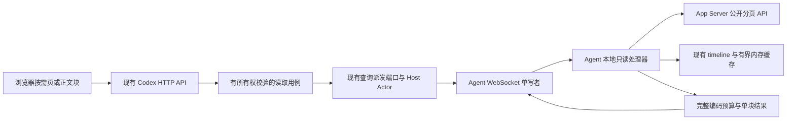

# Codex 消息容量与历史分段传输落地方案

> 编制及实施日期：2026-10-30。性质：设计、源码实施与端到端验收记录。
> 源码实现与本机验收状态见第 18 节；未宣称生产代理、多实例部署或 MSI 已发布。原设计的未验证事项保持显式标记。
> 后端根目录：`E:/python_web_fastapi/work`；前端根目录：`E:/python_web_fastapi/typescript-web-nuxt`。
> 下文后端路径相对后端根目录，前端路径明确标记。任务清单在本文维护，不另建平行清单。

## 1. 目标、结论与实施边界

目标是消除正常历史读取导致 Agent 永久受阻的问题，并使历史总量、单个正文总量能够超过单条 WebSocket 消息限制，同时让内存、队列和控制消息延迟保持有界。

采用以下组合，不将“把 4 MiB 调大”当作最终容量方案：

1. 修复进程级 WebSocket 限额与业务限额冲突，当前兼容上限保持 4 MiB。
2. 历史从事实源按需读取，页面同时受条数和完整编码字节数约束。
3. 大条目在列表中只返回安全摘要与受控引用，展开时按范围拉取正文。
4. 每次正文读取返回一块，复用现有查询派发、`command_id` 和单写者发送路径。
5. 通过有限在途字节预算、有限缓存和取消传播形成背压；不建立第二套可靠消息协议。
6. 新能力明确协商，旧端继续使用旧模型；源头不支持的读取能力明确拒绝。

4 MiB 不是 WebSocket 协议极限。它是本项目当前 Agent 业务预算及配置模型上限。分块也不意味着无限制：总会话量可以增长，但每次读取、缓存总量、在途总量、处理时间及正文可用生命周期均有限。

当前方案不新增消息队列、对象存储、正文数据库、正文 Redis 缓存、持久化传输 outbox、恢复扫描或通用传输状态机。真正的大文件、附件和导出使用独立 HTTP 数据通道是后续方向，不进入本次必要实现闭包。

## 2. 已知事实与证据边界

### 2.1 事故链路

前序会话对北京时间 2026-10-30 当天记录的只读检查发现：客户端四次在运行阶段收到关闭码 1009，随后归类为 `protocol_invalid`，界面显示“协议不兼容”，连接进入 `blocked`。消息过大与版本不兼容被错误合并。

完整因果链为：

```text
历史结果按 Agent 业务预算生成
  → Uvicorn 只允许 64 KiB 的完整入站消息
  → 大于该限额的消息在应用收到前被关闭
  → 客户端看到 1009
  → 被映射为 protocol_invalid
  → 停止自动恢复并显示版本不匹配
```

具体被拒绝消息的类型和精确字节数没有截获；历史读取与失败时间高度相关，不能将某个确定载荷大小写成现场事实。网络超时、连接替换及票据超时仍是独立问题，不承诺本方案消除全部连接故障。

前序本机同版本 Uvicorn/websockets 回环实验报告：64 KiB 上限下，65,536 字节通过，65,537 字节关闭；96 KiB 数据拆成六个协议 frame 仍失败，拆成六条独立消息成功。原始实验产物未落盘，不作为后续发布验收证据；实施前按第 12 节重新运行并保存版本、脚本、配置和结果。

### 2.2 当前源码与修改理由

| 当前 owner | 已核实行为 | 需要改变的边界 |
|---|---|---|
| `src/cli/run_web_server.py`，`WebServerRuntimeProjection.from_stream_runtime` | 只从 stream 配置生成全进程 `ws_max_size` | 进程入口汇总已启用 WebSocket 接收预算 |
| `config/runtime/stream_runtime/stream_runtime_production.toml` | 普通流预算为 65,536 字节 | 保留该业务预算，不用它隐式约束 Agent |
| `config/runtime/codex_control_runtime/codex_control_runtime_base.toml` | Agent 4 MiB、Browser 1 MiB | 维持独立入口预算并落实检查 |
| `src/infrastructure/codex_agent/agent_configuration.py` | `max_app_server_line_bytes` 的 Pydantic 上限为 4 MiB | 将上游 JSONL 预算和网络预算解耦 |
| `src/infrastructure/codex_agent/agent_connection_policy.py` | 1009 与 1002/1003/1007 等统一分类 | 1009 独立为消息超限 |
| `src/infrastructure/codex_agent/agent_control_channel.py` | 网络预算复用上游行预算；历史和结果组装集中在此 | 组合现有能力，不继续堆积正文读取实现 |
| `src/infrastructure/codex_agent/agent_thread_history_reader.py` | `itemsView=full`、每次一个 turn；单 item 超预算会失败 | 源头 item 分页及大条目摘要 |
| `src/infrastructure/codex_agent/agent_command_executor.py` | 容量 registry 可提前将 `includeTurns` 置为 false | 总 rollout 大小不得否定已支持的有界分页 |
| `src/infrastructure/codex_agent/agent_event_batcher.py` | delta 正文计数不等于完整 envelope 大小；单大 delta 未拆分 | 按最终编码计数，按事件语义处理大字段 |
| `src/infrastructure/codex_agent/agent_snapshot_builder.py` | 使用固定 4,096 字节预留 | 改为真实编码验证与有界页面构造 |
| `src/core/codex_contract/app_server_product_contract.py` | 文本 1,048,576 字符、delta 65,536 字符上限 | 摘要和分割必须先于严格模型构造 |
| `src/infrastructure/codex/codex_agent_gateway.py` | v2 typed result 桥接到 `CodexAgentCommandResult` | 新结果必须进入显式映射分支 |
| `src/infrastructure/codex/codex_host_actor.py` | 查询命令存在特定白名单和断线等待清理 | 正文读取属于查询，并闭合取消及离线路径 |
| `src/api/endpoint_codex_control/route_codex_realtime.py` | 浏览器接收循环尚未落实独立接收预算 | 提升底层上限后仍要保护该入口 |

### 2.3 官方资料与适用判断

| 资料 | 可采用的结论 | 不应外推的结论 |
|---|---|---|
| [RFC 6455 §5.4](https://www.rfc-editor.org/rfc/rfc6455.html#section-5.4) | frame 分片不改变 message 边界；应用数据通常不能插入另一消息的分片之间 | 协议分片自动解决应用完整消息限额 |
| [Uvicorn Settings](https://www.uvicorn.org/settings/) | `ws-max-size` 是可配置消息上限，具体支持取决于 WebSocket 实现 | 默认 16 MiB 就是所有业务的最佳值 |
| [websockets Memory and buffers](https://websockets.readthedocs.io/en/stable/topics/memory.html) | 有界缓冲、背压与避免 bufferbloat | 队列越大越稳定 |
| [gRPC Flow Control](https://grpc.io/docs/guides/flow-control/) | 发送完成与远端业务消费完成不同，必须限制在途量 | 本项目必须引入 gRPC |
| [Azure Claim-Check](https://learn.microsoft.com/en-us/azure/architecture/patterns/claim-check) | 大正文与引用分离适合消息系统 | 必须把正文持久化到服务端 |
| [S3 Multipart Upload](https://docs.aws.amazon.com/AmazonS3/latest/userguide/mpuoverview.html) | 大文件需要分段重试、校验与生命周期治理 | 会话历史必须重建一个 multipart 服务 |

选择理由：项目已有历史窗口、查询派发、单写者队列和内存缓存。补齐它们的容量边界比引入全新传输基础设施侵入更低，也能直接解决首屏、大条目、控制消息排队和慢消费者问题。

## 3. 目标调用链与模块责任



| 责任 | 归属 | 不允许承担的职责 |
|---|---|---|
| 跨进程预算、内容引用与块结果模型 | `src/core/codex_contract` | 读取文件、访问数据库、调用 HTTP |
| 所有权、线程范围、查询编排 | `src/application/codex` + 现有 ports | 引入 FastAPI Request 或 infrastructure 实例 |
| 路由、参数校验、response envelope | `src/api/endpoint_codex_control` | 直接读取 Agent 缓存或正文文件 |
| 网络 codec、session、Host Actor | `src/infrastructure/codex` | 解释正文业务内容或建立第二事实源 |
| 上游读取、正文定位、窗口缓存、调度 | `src/infrastructure/codex_agent` | 读取未授权任意路径、替代 App Server 权威事实 |
| 全进程 WebSocket 启动预算 | `src/cli/run_web_server.py` | 让普通流业务 owner 决定其他通道限额 |
| 用户展开、取消、虚拟列表与内存回收 | Nuxt Codex 模块 | 持久化完整会话或自行延长执行租约 |

这是局部启动修复加有范围的跨模块契约演进。公共模型、查询调用链和前端行为均须验证；无需数据库迁移。不要借此整体重写 Agent 控制通道或会话 UI。

## 4. 第一交付：修复容量冲突与错误分类

### 4.1 Uvicorn 投影

将 `WebServerRuntimeProjection.from_stream_runtime` 改为显式接收启动所需配置的工厂，例如 `from_runtime_settings`。方法名仅为建议，职责必须实现：

```python
# 示意；正式类型与模块启用来源沿用当前 AppSettings。
enabled_receive_limits = []
if stream_enabled:
    enabled_receive_limits.append(stream.websocket_max_message_bytes)
if codex_agent_enabled:
    enabled_receive_limits.append(codex.max_agent_frame_bytes)
if codex_browser_enabled:
    enabled_receive_limits.append(codex.max_browser_frame_bytes)
process_limit = (
    max(enabled_receive_limits)
    if enabled_receive_limits
    else WEB_SERVER_DISABLED_WEBSOCKET_SAFE_MAX_MESSAGE_BYTES
)
```

- 模块是否启用从现有运行时模块配置读取，不在 CLI 另造启用注册表。
- 空集合采用命名的有限安全默认 `WEB_SERVER_DISABLED_WEBSOCKET_SAFE_MAX_MESSAGE_BYTES = 65_536`；它仅作为没有启用 WebSocket 入口时的启动安全值，不启用任何入口，也不覆盖已启用入口的预算。
- 当前启用集合下结果应为 4,194,304 字节；不得设为 `None` 或无限大。
- ping、优雅停机等原有参数保留现有 owner；不借本修复改变租约超时。
- 所有入口在 JSON 解析前按 UTF-8 字节检查业务预算；应用检查不能阻止底层先分配最多进程上限，容量核算应包含这部分。
- 明确 Uvicorn WebSocket backend，核查该版本 `ws_max_size`、`ws_max_queue` 实际支持与语义；不可把库不同实现的 queue/frame/message 概念混算。
- 不仅看 Compose 中运行了某容器，还要验证实际启动命令确实走该 CLI。

### 4.2 浏览器与普通流入口

在 `route_codex_realtime.py` 的接收循环先执行独立的 `max_browser_frame_bytes` 校验，再处理允许的消息。当前若只允许忽略文本，也必须限制大小；二进制、格式与不支持类型按现有协议语义拒收，不建立第二套消息格式。

普通流仍执行自己的 64 KiB 限额。真实测试必须证明提高 Uvicorn 上限不会把该接口的业务限额同步放大。

### 4.3 1009 与恢复语义

在 `AgentConnectionIssue` 增加 `MESSAGE_TOO_LARGE = "message_too_large"`，同步连接状态契约、诊断、UI 文案和客户端错误映射。

错误判断顺序必须先识别关闭码 1009 和 `CodexConnectionFrameTooLargeError`，再走宽泛 `ValueError` 分支，防止被父类型重新吞进 `protocol_invalid`。

- 远端 1009：消息超过通道限额；真实字节数未知时记录 `unknown`，不伪造。
- 本地大小检查失败：在入队前拒绝当前消息，记录完整编码大小与限额；不关闭健康连接。
- 非查询控制消息超限：明确失败，不能静默截断审批或执行内容。
- 第一交付保留安全的停止行为，只修正诊断；不将 1009 直接加入无限重连白名单。
- 完整分段能力启用后，历史或正文读失败只终止当前查询；未知来源的 1009 仍不能自动重发同一载荷。
- 已进入等待退出分支的旧 Agent 不会因服务端配置改变自动恢复；发布说明要求用户通过现有入口重启 Agent 一次。

## 5. 容量预算：定义、配置与完整编码

### 5.1 预算不混用

| 预算 | 作用范围 | 初始处理 |
|---|---|---|
| `max_app_server_line_bytes` | App Server 单行 JSONL 入站 | 保留当前 4 MiB 硬边界，不在第一交付放宽 |
| `max_control_message_bytes`（新增 Agent 本地配置） | Agent 控制连接完整消息 | 兼容初值 4 MiB，独立于 JSONL |
| `max_agent_frame_bytes`（现有服务端字段） | 服务端 Agent 入口完整消息 | 保留外部名称，文档明确实际是 message |
| `history_page_max_bytes`（新增） | 单个完整历史页结果 | 候选 128/256 KiB，需 autotuner 晋升 |
| `content_chunk_max_message_bytes`（新增） | 单个完整正文块结果 | 候选 16/32/64 KiB，需 autotuner 晋升 |
| `query_inflight_max_bytes`（新增） | 当前连接查询结果的预留总预算 | 候选 128/256/512 KiB，不当作已验证默认值 |
| 现有 writer queue 字节/条数预算 | 所有待发消息 | 继续双限，校验改为关联网络预算 |
| 现有历史 cache 字节/TTL 预算 | Agent 进程内正文存活 | 统一计数，引用不延长原正文存活时间 |

原有 `writer_queue_max_bytes >= 2 * max_app_server_line_bytes` 等约束应改为网络实际最大消息的关系；不能只新增字段而继续让源读取预算决定发送队列。

配置闭包包含 `raw_application_settings.py`、runtime contract、TOML、配置加载/校验、Agent 本地配置解析及相关测试。若配置缺省用于旧文件迁移，必须有明确默认值和上限检查，不静默忽略未知配置。

### 5.2 完整字节数是唯一传输判据

共享机械 helper 只负责序列化和大小计算，不持有历史裁剪策略。建议放在现有 codec 边界，避免 domain 依赖网络实现。

```python
encoded = codec.encode_complete_message(message)  # 与 writer 实际发送完全相同
wire_bytes = len(encoded.encode("utf-8")) if isinstance(encoded, str) else len(encoded)
if wire_bytes > effective_message_limit:
    raise CodexConnectionFrameTooLargeError(...)
await writer.enqueue_encoded(encoded, size_bytes=wire_bytes)
```

- 计入 header、UUID、时间戳、JSON 键、转义字符、正文和所有外层包装。
- 检查后复用同一编码产物，避免再次编码时字段变化、预算失准或额外大对象副本。
- 以解压后的完整消息为预算，不用压缩后网络流量绕过上限。
- HTTP 返回路径另计完整 `ResponseEnvelope`；不能以 Agent envelope 大小替代 HTTP envelope 大小。
- UTF-8 字节与字符数量分开处理；中文、emoji、反斜线、换行和控制字符是必测输入。
- 首次组装可按剩余预算预估，最终必须精确编码；超限时减少条目或缩小块，而不是固定扣 4,096 字节。
- 元数据本身已超限时返回可识别容量错误；不得反复输出空页与同一 cursor。

### 5.3 预算协商

连接双方分别声明接收上限；服务端向 Agent 发送的上限取服务端发送政策与 Agent 接收能力的较小值，反方向同理。

新协商内容至少包括 `max_receive_message_bytes`、`history_page_max_bytes`、`content_chunk_max_message_bytes` 与正文读取能力。服务端返回有效预算；对端声明的接收能力可以大于本端发送政策，应按两者最小值计算有效预算，不因此拒连。仅在声明非法、有效预算不能容纳最小合法 envelope，或 ack 中的有效预算超过双方能力与本端政策的合法交集时拒绝协商。

不要让客户端任意放大服务端预算，也不要把 heartbeat/lease 时间作为容量协商的一部分。

## 6. 协议演进与旧版本兼容

### 6.1 必须采用显式子协议

当前 v2 Pydantic 模型普遍使用 `extra="forbid"`。不能在现有 hello 上直接添加字段后发送给旧端，也不能认为可选字段就天然兼容。

建议新增 `codex-agent.v2.bounded-content` 子协议，沿用 v2 公共头及现有命令关联。新名字代表一个封闭扩展集合：现有执行租约连续性、现有历史窗口以及本方案预算和正文读取能力。不要把这些特性隐含在版本字符串比较中。

1. 新 Agent 按优先顺序 offer 新子协议及仍支持的现有子协议。
2. 新服务器只在自身启用且客户端 offer 时选择新子协议。
3. `websocket.accept(subprotocol=...)` 完成后才选择对应严格模型和 codec。
4. 旧协议继续使用原 hello、原 result、原快照；不发送新增字段或新判别类型。
5. 新协议扩展 hello/ack 采用专属严格 detail 模型或专属 codec 分支，不能放宽旧模型为任意字典。
6. 新协议下允许 `content.read` 查询以及新摘要结果；旧协议明确 capability unavailable。

协议选择闭包包括 `route_codex_agent_connect.py`、Agent `connect(...subprotocols=...)`、codec registry、connection registry/session、gateway 和调度端口能力查询。新协议必须明确继承旧子协议承载的 lease/history 能力，避免切换后误失现有功能。

当前 `CodexConnectionLease` 只有 `history_windows` 等既有能力，没有本方案预算字段；应在注册连接时保存新能力及有效预算，并绑定同一个 connection epoch。新连接替换、撤销或断线立即使旧能力失效，派发不能读取前一代连接的预算。

### 6.2 兼容矩阵

| Server | Agent | 前端 | 行为 |
|---|---|---|---|
| 新 | 旧 | 旧/新 | 旧协议和旧模型；前端不展示不可用正文入口 |
| 旧 | 新 | 旧 | 协商旧协议；不发送新 hello 字段；容量故障仍依赖服务端先修复 |
| 新 | 新 | 旧 | 保留旧 HTTP 响应投影，不强迫旧前端解析新判别类型 |
| 新 | 新 | 新 | 协商成功且上游能力成立时启用有界分页/正文读取 |
| 新但关闭新能力 | 新 | 新 | 重新连接后旧协议；有界失败提示，不退回无限制全量读取 |

HTTP 也需要显式能力边界。建议新前端历史请求带 `content_mode=bounded`；服务端只有在请求选择且 Agent 支持时返回含摘要/引用的版本化 DTO。旧请求继续原 DTO 投影。新接口独立返回 `schema_version`，同步 OpenAPI 和生成类型，不能把新字段当成所有旧客户端都容忍。

Browser HTTP/实时 WebSocket 与 Agent 子协议是两个独立兼容面。实时订阅通过现有 ticket/订阅入口新增显式表示能力，绑定本次浏览器连接；只有新浏览器请求且服务端开启时才发送新增描述字段。旧订阅仍得到原模型允许的有界预览与明确原有截断/不可用语义，不发送新 `kind` 或字段。共享内部产品模型可以演进，但每个订阅输出投影必须按其表示能力选择，不能将新 union 广播给全部旧客户端。HTTP 能力失败时不自动假定实时订阅已升级，反之亦然。

### 6.3 命令和结果不能只改 schema

新增 `AgentContentReadCommandDetail`、`AgentContentReadCommandResult` 等封闭模型，并更新判别联合、`AGENT_COMMAND_PARAM_NAMES` 和请求 digest 输入规则。

`CodexAgentCommandResult` 是当前应用调度消费的桥接形态。必须在 `codex_agent_gateway._to_v1_command_result` 显式映射内容块结果，在用例端使用严格 decoder 恢复强类型；未知结果拒绝，不能落入空字典。这个桥用于当前内部调用，不意味着向 v1 连接发送新结果。

`content.read` 是 Agent 本地只读能力，不能机械映射为上游不存在的 `content/read` 方法。`agent_command_policy.py` 查询白名单、executor 的查询分支、Host Actor 离线/等待逻辑、gateway result 路由都必须同时更新。它不得进入写命令 journal、业务 outbox 或执行操作重放链。

## 7. 历史源头分页与能力矩阵

### 7.1 先确认公开源能力

仓库 `protocol/codex_app_server/0.163.0/json-schema/ClientRequest.json` 提供 `thread/items/list` 等候选接口信息；前序现场为 0.145.0。仓库存在新 schema 不等于现场支持，版本号本身也不代替运行时能力验证。

通过 `app_server_manifest_registry.py`、`app_server_schema_manifest_contract.py` 及现有兼容发布验证入口，完成已安装 CLI 版本、schema digest、公开方法、参数和响应形状的合同测试，再将能力交给 Agent adapter。不要运行时猜字段，失败后盲试多种私有方法。

| 实际源能力 | 历史读取策略 | 超大单 item 的结果 |
|---|---|---|
| 仅完整 thread/turn | 保持有界旧路径；超源行上限返回容量不可用 | 不承诺可读，不先读入完整对象再伪装流式 |
| 官方 item 分页，但单 item 只能整体返回 | 页级按需读；单 item 仍受 JSONL/产品模型预算 | 返回摘要可用性及 `source_item_too_large`，不能凭空生成正文引用 |
| 已有合法有界 item 留存在 Agent 内存 | 可以生成短期引用并按范围读 | 总量受缓存预算限制，可淘汰 |
| 官方 range/stream 正文能力经验证可用 | 适配为按需范围读取 | 总正文可大于单消息上限，仍受源服务约束 |
| 能力未知、digest 不匹配、方法不存在 | 明确 `content_capability_unavailable` | 不读取私有 rollout 绕过事实源 |

支持矩阵是发布声明的一部分。允许先交付可验证的分页收益；若上游不提供大单 item 的有界读取，就明确保留该限制，不能把“总历史可超 4 MiB”宣传成“任意单条正文均可读取”。

### 7.2 修改历史 reader 的具体策略

1. 元数据与正文分开请求，首屏不发完整 `includeTurns=true` 全量请求。
2. 支持公开 items 分页时，使用稳定 item 标识和上游 cursor；遵从公开排序语义。
3. 每页同时满足 `limit`、最终网络 page budget 和源请求预算。
4. 页面填满时返回前进 cursor；至少有一个合法条目或明确错误，不允许空页死循环。
5. 单条无法内联时先构造摘要与内容可用性，再进入严格产品模型；不能先触发 `MAX_TEXT_CHARS` 校验失败。
6. 保留现有 revision/cursor 防混页语义；上游变化立即返回 stale，前端重读首屏。
7. 修改 executor 的容量 registry 早退：只约束旧 full-history fallback，不因整个 rollout 文件大就跳过支持的 item 分页。
8. 对 `/history/items` 的指定条目重载同样应用有界策略；不能保留一个绕过分页预算的重载入口。
9. 页面数量增加时，源读取条目数与已请求页近似增长，禁止每页重复从头读全历史。

`app_server_protocol_adapter.py` 已存在 `_bounded_text` 截断行为；生成摘要时必须在裁剪前保留可靠源标识及真实完整性信息。截断后的字符串不能伪装成完整正文并产生可续读引用。现有 `/history/items` 以稳定 item ID 重载且拒绝 offset，该契约保持不变，范围读取使用下面的新独立端点。

## 8. 大条目引用、范围读取与失败契约

### 8.1 内容描述模型

在 `src/core/codex_contract` 新增领域明确的 `agent_content_contract.py`，将内容描述作为受支持产品条目的显式可选字段，而不是 `dict[str, Any]` 插袋。

建议模型字段：

```text
ContentDescriptor
  field: 受支持正文域枚举，例如 output/text/diff
  preview: 有界文本摘要
  availability: inline | readable | unavailable
  content_ref: readable 时必填，其余不填
  revision: 与正文版本绑定的不可变版本标识
  total_bytes: 已知时为 UTF-8 总字节数，未知为 null
  expires_at: readable 引用的最迟失效时间
  unavailable_reason: unavailable 时的稳定错误原因
```

正式实现使用 `availability` 判别联合（inline/readable/unavailable），不使用一组可以任意混配的 optional 字段。inline 只能携带完整有界正文及其版本；readable 必须有 preview、content_ref、revision、expires_at，不能有 unavailable_reason；unavailable 必须有明确原因且禁止提供 content_ref。text、output、diff 继续保留各自条目类型与必要结构，描述只替代其中可展开的正文域，不把整条产品模型压平为字符串。

字段限制来源应集中：host/item/thread/field 复用当前产品契约上限与枚举；token 长度从现有签名 envelope 最大 claims 编码推导并在新契约定义常量；preview 使用产品文本上限与页面预算中较小值；requested_bytes 受已协商 chunk 预算及最小合法正文/UTF-8 规则约束；offset/total_bytes 为非负且不超过双方安全整数范围的整数；TTL 不超过实际缓存生命周期。所有跨语言数字上限均必须落进 schema，拒绝 JS 精度丢失，不能散落魔法值。

摘要只作用于可展开正文。命令名称、审批决策对象、目标路径、安全相关参数等不能被摘要替代后继续可操作。无法完整、安全呈现审批信息时，该审批保持明确不可提交状态，并给出可执行的诊断。

### 8.2 content_ref 的信任边界

正文引用是不透明定位符，不是权限凭证。服务端对浏览器暴露的 token 使用现有签名能力和用途隔离，绑定：`owner_subject_id`、`host_id`、`workspace_key`、`thread_id`、`item_id`、`field`、`revision`、`expires_at`，以及 Agent 返回的受控 opaque handle。

- token 不包含正文和任意磁盘路径；不允许 URL、文件路径或 shell 参数成为读取定位器。
- 每次 HTTP 请求重新验证登录主体、当前 host/thread 所有权和读取权限；持有 token 不绕过撤销。
- Agent handle 只定位当前受控缓存条目或已验证的公开上游资源，并再次检查 workspace/thread/item/revision 范围。
- token 不写入日志、指标 label 或浏览器持久存储；若经 URL 参数传递必须脱敏，因此正文读使用 POST JSON body 更合适。
- 签名使用现有基础能力和专属用途，不另造密码算法。host 迁移、解绑或撤销立即使旧上下文失效。

### 8.3 HTTP 契约

在现有 `CodexThreadRouteCatalog` 增加只读 POST：

```text
POST /codex/hosts/{host_id}/threads/{thread_id}/history/items/{item_id}/content/read
Content-Type: application/json

{
  "content_ref": "opaque-token",
  "revision": "expected-revision",
  "offset": 0,
  "requested_bytes": 16384
}
```

路径按现有统一 API prefix 挂载。POST 仅用于避免引用进入 URL，不产生业务写操作，不要求幂等写入键，不持久化正文。

成功响应使用现有 `ResponseEnvelope[CodexContentChunk]`，data 建议为：

```json
{
  "kind": "codex_content_chunk",
  "schema_version": "1.0",
  "revision": "opaque-content-revision",
  "offset": 0,
  "next_offset": 12,
  "text": "example text",
  "eof": false,
  "total_bytes": null
}
```

`requested_bytes` 是正文 UTF-8 字节的请求上限；服务端还要按完整 HTTP/Agent envelope 大小缩小正文，不能承诺总消息大小恰等于该值。具体最小值、最大值来自有效配置和 schema；非法值返回 422，不让用户任意请求大块。

成功返回 HTTP 200 的项目 envelope，不使用 HTTP 206/Content-Range 表达 JSON 中正文的字节范围。路径 item_id 必须与签名引用一致。正文 revision 绑定不可变的字段表示，独立于历史页面的 history revision；历史排序变化不应被误当成正文同一版本，而正文变化也不能仅靠页面 revision 间接判断。

### 8.4 offset 与 UTF-8 规则

- offset/next_offset 均是未压缩原始正文的 UTF-8 字节位置，不是字符下标、UTF-16 下标或 JSON 字符串位置。
- 默认只支持文本正文；不在第一版混入 base64 二进制块。
- 返回的 text 必须在 Unicode 码点边界结束，保持有效 UTF-8。
- `next_offset = offset + len(text.encode("utf-8"))`；客户端使用返回值，不自己按 JS `text.length` 推算。
- 请求 offset 落在多字节字符内部时明确拒绝，不向前/向后静默取整。
- 非 EOF 的成功结果必须让 next_offset 前进；预算容不下一个码点及 envelope 时返回明确错误。
- offset 等于已知总长度时允许空 EOF；超过已知长度返回范围错误。
- 先校验 revision，再读取范围；不允许为旧 revision 返回新正文片段。

### 8.5 引用生命周期与缓存

复用 `AgentThreadHistoryWindowCache` 的 TTL/LRU/失效代次和 `agent_timeline_store.py` 的权威产品数据，不为正文再保留完整复制。

当前历史缓存默认 5 分钟、64 MiB；这是现有事实，不代表目标调优结果。新增描述或句柄必须与实际正文计入同一或显式汇总的硬字节预算，不能使用大量零计数引用掩盖真实内存。

正文从已有合法源读取后，只有保留成功且预算允许才声明 readable。若缓存拒收或条目已被淘汰，返回 unavailable/expired；不能先交付无法读取的引用。

线程事件、revision 改变、显式失效、Agent 停止和缓存淘汰同步使引用失效。异步读取完成后核对 `invalidation_generation`，避免过期结果重新写活。引用 TTL 不得长于其正文保留期。

同一 Agent 进程仍保留正文且 revision 未变时，可在重连后从返回 offset 重新请求；不保证跨进程重启续传。禁止新增正文磁盘、数据库、Redis、localStorage 或 IndexedDB 副本来补足该承诺。

### 8.6 失败行为

错误统一进入现有 `CodexErrorCode`、`HttpFaultException` 和 response presenter；下表为拟新增语义名，实施时按现有枚举风格定义，不散落裸字符串。

| 场景 | 建议 HTTP | 稳定语义 | 客户端行为 |
|---|---:|---|---|
| 未登录 | 401 | 现有认证错误 | 进入现有登录恢复 |
| 权限不足/跨 owner | 403 或现有不泄露资源存在的 404 | 现有授权错误 | 停止读取，不自动换 host |
| 参数非法 | 422 | 现有校验错误 | 修正请求，不重试同请求 |
| revision 变化 | 409 | `content_revision_stale` | 丢弃相关旧块，重取描述 |
| 引用过期/淘汰/Agent 重启 | 410 | `content_reference_expired` | 重取条目描述后重新展开 |
| offset 越界或不在 UTF-8 边界 | 416 | `content_range_invalid` | 停止该读；不循环重试 |
| 不支持源能力 | 409 | `content_capability_unavailable` | 显示当前版本不可读取的原因 |
| 源单条超过读取能力 | 413 | `source_item_too_large` | 显示容量限制，不显示协议不兼容 |
| Agent 离线 | 503 | 现有主机离线语义 | 保留摘要，允许用户稍后重试 |
| 全局/连接额度已满 | 429 | `content_read_overloaded` | 遵守有界 Retry-After，取消优先 |
| 读取 deadline 超时 | 504 | `content_read_timeout` | 结束当前读，不关闭整条 WS |
| 内容完整编码仍超限 | 413 | `message_too_large` | 不入队；缩块只在明确安全范围内进行 |

认证和权限错误不泄露其他用户引用是否存在；诊断可保留内部原因，公开 message 遵守当前项目安全策略。

## 9. 查询派发、调度、背压与取消

### 9.1 复用现有查询闭包

新增 `ReadCodexContentUsecase`，构造函数接收现有 control/dispatch port 和内容引用 codec，复用线程所有权校验。若共享所有权读取需要抽取，只做局部 owner 内收敛，不建万能查询服务。

调用链必须闭合：

```text
RouteCatalog → DependencyContextAccessor → ApplicationContainer
  → ReadCodexContentUsecase → CodexAgentCommandDispatchPort
  → CodexHostActor → AgentCommandV2Mapper → Agent 本地 content.read handler
  → typed result → gateway 显式映射 → usecase 严格结果解码 → ResponseEnvelope
```

增加端口能力查询时按 host 当前连接读取，不能缓存已经断线的协商结果。应用层只依赖端口，新增用例接入 `FastApiAppAssembler`、应用容器构建、route context 和直接 accessor；不是只把模型和 endpoint 壳提交。

### 9.2 最小背压设计

首版每个正文视图只发一个未完成 pull 请求。收到并消费后再请求下一块。服务端和 Agent 对全部读请求设置统一的并发条数和在途字节上限；额度按该请求可返回的最坏预算预留，在完成、取消、超时及断线路径释放。

预算覆盖全链路：源 JSONL 缓冲、源模型、产品模型、codec 编码、WebSocket 入站、gateway business queue、事件 replay、Host Actor pending、HTTP 响应和浏览器。不能把 sender queue 有界等同于整个系统有界。`codex_agent_gateway.py` 当前 business queue 主要按条数限制，应增加实际消息字节计数和总预算；出队、拒收、取消及连接结束均释放计数。复用现有 heartbeat/execution_stopped 控制消息旁路，不让正文结果进入控制优先级；底层 socket 解析仍共享单通道，必须计入最坏单消息等待。

- 不新增 `transfer.begin/chunk/ack/commit` 协议，不重建 TCP 的可靠有序传输。
- 后续只在 autotuner 证明 RTT 限制明显时允许同正文有限预取；预取块也受同一总预算。
- writer 每次发送一个独立消息后重新调度；审批、lease、heartbeat 在下一次可调度点优先。
- 单写者继续独占 socket，不能让内容任务直接并发 `send()` 绕过队列。
- 历史页本身也是独立消息，需纳入调度延迟测试；不能只调正文块而忽略较大页。
- 控制消息保留现有必要容量；慢读取不能耗尽全部排队额度。
- 若控制流持续繁忙，数据读取可超时返回，不通过延长租约或无限堆积保证吞吐。

背压到源：额度不足时不启动新的 App Server 分页/正文 IO，不能先预读很多页再等 writer 腾空间。

关键执行顺序如下（伪代码表达职责，正式实现复用当前端口和异常体系）：

```python
async def read_one_chunk(command, connection):
    validate_scope_revision_and_deadline(command)
    reservation = await inflight.reserve(effective_result_budget, deadline=command.deadline)
    try:
        # 已校验公开源能力或受控缓存；只读取当前范围，禁止全量预读。
        piece = await content_reader.read_range(command, max_bytes=payload_budget)
        result = build_typed_result(piece, command_id=command.command_id)
        encoded = codec.encode_complete_message(result)
        encoded = fit_by_shortening_at_utf8_boundary(encoded, piece, effective_result_budget)
        await writer.enqueue_and_wait_sent(encoded, deadline=command.deadline)
    finally:
        reservation.release()
```

`fit_by_shortening_at_utf8_boundary` 表达预算内缩短可读正文并重新构造 next_offset/envelope 的策略，不截断已编码 JSON；若最小 envelope 超限则明确失败。若现有 writer 只支持入队返回，预算 ownership 必须转移到队列项并在实际发送/丢弃时释放，不能入队后立即释放。服务端 HTTP 等待有自己的额度和 finally 清理，不将 Agent 已发出视为浏览器已经消费。

### 9.3 取消与断线

浏览器用 `AbortController` 在折叠、切线程、切 host、路由离开时取消请求并停止下一块。服务端请求取消必须回收 Host Actor 中对应 waiter、断线 watcher 和预算预留。

浏览器 Abort 本身不保证 ASGI task 或 Agent IO 自动取消：API/用例需要显式观察请求断开并取消对应等待任务，在 `finally` 中清理 actor pending。Agent 使用命令中的绝对 deadline 限制已送达工作；无法向上游传播取消时最多保留这一块到 deadline，迟到结果丢弃。不要宣称全链路立即停止。

首版不新增远端取消协议：最多允许已经送达的一块有界读取在原 deadline 内结束；结果到达后发现 waiter 已清理则丢弃，不进入重放缓存。若现有上游任务支持安全取消则取消该只读 task，否则仍有严格时间和字节上限。

取消正文不关闭整个控制 WebSocket、不取消正在运行的 turn、不延长 execution lease。lease 到期继续按原安全语义停止执行。

只读块由用户重试时创建新 command_id，保留 content_ref/revision/offset 即可；写命令、审批回复和 turn 操作不因传输失败自动重新执行，继续由原有幂等和执行协议负责。

### 9.4 事件和快照

`agent_event_batcher.py` 按完整 batch 编码预算组包。单 delta 超预算时只能对允许追加的文本按 Unicode 边界拆成有序事件；序号、ACK 和 replay 使用现有事件机制，不另建一套确认。

若源事件语义不是可拆分文本，返回摘要/引用或稳定容量错误，不任意切割结构化事件。审批、路径及安全相关字段严禁截断后继续执行。

`agent_snapshot_builder.py` 按完整 envelope 实测预算分页；保留 continuation 的既有语义与顺序，移除固定 4,096 字节余量作为正确性依据。大正文先转换为描述再构造严格模型，快照不能因为包含一个长输出就反复重连。

`agent_event_replay_buffer.py` 当前 `deque(maxlen=2000)` 只有条数界限，需增加编码字节总量上限。淘汰触发现有 gap/snapshot 恢复语义，不新增重传控制机制；正文 range 查询结果不能进入事件 replay 缓冲。

## 10. 代码修改策略与影响面

| 修改单元 | 文件或符号 | 具体策略及必须同步的消费者 |
|---|---|---|
| 启动预算 | `src/cli/run_web_server.py` | 扩展投影输入，汇总启用入口；测试真实启动参数 |
| 接收限额 | `route_codex_agent_connect.py`、`route_codex_realtime.py`、`codex_connection_session.py`、普通流 handler | 入口独立限额、解析前检查、1009 与本地错误一致 |
| 配置 | `agent_configuration.py`、`codex_runtime_contract.py`、`raw_application_settings.py`、对应 TOML | 分离源/网络预算；验证大小、队列关系与旧配置缺省 |
| 连接错误 | `agent_connection_contract.py`、`agent_connection_policy.py`、`agent_settings_ui.py` | 新增超限原因，诊断文案，避免宽泛异常优先匹配 |
| 新协议 | `agent_protocol_v2_contract.py`、`agent_protocol_codec.py`、Agent connect、Agent route | 子协议 gating、专属模型、预算协商、新命令/result 联合 |
| 产品模型 | `app_server_product_contract.py`、`thread_contract.py` | 新描述字段只进入选择新能力的 DTO；旧投影保留 |
| 源适配 | `app_server_manifest_registry.py`、`app_server_protocol_adapter.py` | 正式 manifest 能力与公开接口合同；不依赖私有数据 |
| 历史读取 | `agent_thread_history_reader.py`、`agent_thread_history_capacity_registry.py`、`agent_command_executor.py` | item 分页、双预算、能力先行、full-history 早退范围收窄 |
| 内容本地读取 | 建议新增 `agent_content_reader.py` | 仅处理受控引用/范围/UTF-8/缓存，不扩张控制通道主类 |
| 缓存 | `agent_thread_history_window_cache.py`、`agent_timeline_store.py` | 引用与正文同生命周期，统一字节计数，generation 防旧结果复活 |
| 查询分派 | `agent_command_policy.py`、`codex_host_actor.py`、`codex_agent_gateway.py`、`codex_agent_command_dispatch_port.py` | 查询白名单、预算预留、typed 映射、取消、离线释放 |
| 连接代次/入站/重放 | `codex_connection_registry.py`、`codex_agent_gateway.py`、`agent_event_replay_buffer.py` | 能力随连接 epoch 失效；业务队列及 replay 同时按字节/条数限额 |
| 应用读取 | `read_thread_snapshot_usecase.py`、`codex_history_pagination.py`、建议新增 `read_codex_content_usecase.py` | 当前主体所有权、签名引用、能力判断与稳定错误 |
| API 与装配 | `route_codex_thread.py`、`contract_codex_control.py`、`dependency_context_accessor.py`、`fastapi_app_assembler.py` 和当前容器 owner | 增加正文读、版本化响应及完整容器接线 |
| 发送与事件 | `agent_control_channel.py`、`agent_event_batcher.py`、`agent_snapshot_builder.py`、session writer | 完整编码大小、单写者、公平调度、无不安全截断 |
| 兼容发布 | `scripts/codex/verify_compatibility_release.py`、`scripts/codex/acceptance/history_window.py` | 能力矩阵和真实历史/正文读取验收 |
| autotuner | 拟新增 `scripts/codex/autotuner/message_capacity/` | 复用 connection autotuner 组织方式，保存候选/每轮指标/晋升依据 |

实现顺序按“纯契约 → 端口与应用语义 → adapter/reader → 组合根/API → 前端 → 真实集成”闭合。旧模型兼容投影集中在既有 mapper/codec，不在路由、前端和 handler 多处复制裁剪逻辑。

## 11. 前端消费与用户体验

前端必须跟随后端 OpenAPI 契约更新类型，不只手改类型断言。历史分页、实时增量与展开正文各自持有当前 thread/revision 上下文，不能将过期响应写进新会话。

- 首屏只加载最新页，向上滚动拉取 cursor；保留现有虚拟列表和锚点行为。
- 大条目显示摘要、总字节数（已知时）及“展开正文”；不可读时显示明确原因。
- 展开后按返回的 next_offset 读取；不自动读取所有页或全部正文。
- 折叠/换线程/换主机时取消读取，释放缓存；不写持久存储。
- 多字节字符、Markdown 代码块及 diff 的分段展示不能破坏原文本；高亮与解析采用可见区/有界片段，避免每到一块重算整份巨文档。
- 数据缓存和 DOM 都应有上限；虚拟列表只控制 DOM，并不自动限制 JS 字符串内存。
- 409 revision stale 清空对应旧块并提示重新读取；410 重新拿描述；503 保留摘要和重试入口。
- 1009 显示容量原因；普通网络断开和协议不兼容保持独立提示。
- 切换到不支持能力的 Agent 后立即隐藏不可用操作，不复用上一个 host 的 capability。

### 11.1 已核对的前端修改闭包

以下路径相对 `E:/python_web_fastapi/typescript-web-nuxt`：

| 文件 | 修改策略 |
|---|---|
| `app/services/api/codex-threads.ts` | 扩展 read/readHistory/readHistoryItems 的有界表示选择，新增正文块只读方法并传入 AbortSignal；复用统一 API envelope |
| `app/types/codex-item.ts`、`app/types/codex-thread.ts` | 新描述和块模型与后端一致，保留旧表示；不能通过 `as` 强行跳过契约 |
| `app/utils/codex-contract-normalizer.ts` | `normalizeCodexTimelineItem` 当前显式重建字段，新描述必须显式校验、保留，防止字段被丢弃 |
| `app/utils/codex-event-validator.ts` | `normalizeDetail` 按订阅版本解析；HTTP/实时入口采用一致的严格正文描述 parser |
| `app/stores/codex-session.ts` | 保留 loadMoreHistory 的 generation；给 reloadTimelineBody 补充同等取消与上下文隔离，避免迟到结果写进新会话 |
| 拟新增 `app/stores/codex-content.ts` | 专管按 host/thread/item/field/revision 分区的短期正文读取、AbortController、在途额度与字节缓存，供时间线/上下文面板共享，不继续膨胀 session store |
| `app/utils/codex-event-reducer.ts` | prependCodexHistoryPage 拒绝跨 revision 混页；restore/evict 对新描述保真；现有 20 MiB/16 MiB 回收阈值与新正文缓存合并核算，不能变成两个独立无限池 |
| `app/utils/codex-content.ts` | 当前 UTF-16 code units 裁剪不能用于网络 offset；预览截断与 UTF-8 范围职责分开，避免孤立代理项 |
| `app/components/codex/CodexTimeline.vue` | 复用 tanstack 虚拟列表和 anchor；页插入/正文高度变化不破坏滚动位置 |
| `CodexTimelineItem.vue`、`CodexTimelineItemBoundary.vue` | 展示可读/不可读描述，展开/折叠接共享正文 store，不复制 fetch 逻辑 |
| `CodexCommandOutput.vue` | 现有整段 pre/复制要明确已加载范围；只复制已加载时标明范围，不能把片段称为完整输出 |
| `CodexContextPanel.vue`、`CodexDiffView.vue` | 同步处理 output/files 的正文描述；diff 高亮限制可见区和片段，不能仍期待无限完整字符串 |
| `app/pages/codex/tasks/[threadId].vue` | 保持现有 anchor 接线，切线程先取消旧读 |
| `app/composables/useCodexRealtime.client.ts`、`app/layouts/codex.vue` | 订阅表示能力、logout/clearSession/切 host 时取消并清空正文引用，防跨用户复用 |

上述组件短文件名均位于 `app/components/codex/`。API TypeScript 泛型只提供编译期帮助，不等于运行时验证；新增字段需由同一 parser 覆盖 HTTP 和 realtime，而不是服务层直接信任任意 JSON。

完整复制/下载超大正文不属于默认自动行为。若 UI 保留“复制全部”，仅在所有块完整加载且当前 revision 一致、总大小在浏览器批准预算内时启用；否则显示可操作范围，不能为了复制无界拼接。

## 12. 验证矩阵与完成条件

### 12.1 目标测试落点

优先扩展已有测试：

```text
test/unit_test/test_agent_event_batcher_unit.py
test/unit_test/test_agent_thread_history_window_cache_unit.py
test/unit_test/test_read_codex_thread_snapshot_usecase_unit.py
test/unit_test/test_codex_connection_session_unit.py
test/unit_test/test_agent_control_channel_connection_unit.py
test/contract_test/test_codex_agent_protocol_phase2_contract.py
test/contract_test/test_codex_history_capacity_contract.py
test/boundary_test/test_codex_product_event_capacity_boundary.py
test/boundary_test/test_app_server_jsonrpc_capacity_boundary.py
test/path_test/test_agent_snapshot_capacity_path.py
test/exception_test/test_agent_control_channel_reconnect_exception.py
```

新增正文能力的测试按现有 unit/contract/interface/boundary/path 分类放置，不把全部语义塞进一个大 E2E。真实传输测试必须启动与生产相同 backend 的 Uvicorn；FastAPI TestClient 不能证明 `ws_max_size` 行为。

### 12.2 必须通过的正确性断言

| 场景 | 必须断言 |
|---|---|
| 原事故复现 | 64 KiB 下 65,537 字节失败，4 MiB 预算下同一合法消息通过 |
| 上限边界 | 4 MiB 完整消息通过，4 MiB+1 被有界拒绝，分类为消息超限 |
| 协议 frame 与 message | 多 frame 同 message 仍受总限制，多独立 message 可传同样总量 |
| 其他入口 | Agent 上限提高后普通流仍 64 KiB，Browser 仍遵守自身限额 |
| 完整编码 | 中文、emoji、JSON 转义、大 header、metadata 都计入；检查与实际发送一致 |
| 旧/新双方矩阵 | 未选新子协议不出现任何新字段，旧严格模型可解码 |
| typed result 桥 | content result 经 gateway/actor/usecase 不丢字段、不变空字典 |
| 上游支持矩阵 | 未提供 items/range 能力时明确 unavailable，不尝试私有文件兜底 |
| 源头分页 | 大历史首屏读取量受页预算限制；整 rollout 大不触发有界分页的错误跳过 |
| 大单 item | 严格产品模型构造前完成摘要；源超限明确拒绝，不导致进程断线 |
| 总量超过 4 MiB | 支持源上逐页/逐块读取总量超过 4 MiB，单消息始终在预算内 |
| 超大条目能力真实性 | 内存可 seek 的合成 fixture 只证明分块逻辑；无官方 range 时不得据此宣称真实 CLI 支持超过源上限的单 item |
| cursor/revision | 并发更新不混页、不重复项、不丢项；过期 cursor 有明确响应 |
| UTF-8 范围 | 中文/emoji 边界正确；内部字节 offset 拒绝；非 EOF 必前进 |
| 安全范围 | owner/host/thread/item/field 篡改、过期 token、撤销后请求均拒绝 |
| cache 失效 | TTL/LRU/事件/重启均使引用失效，旧异步响应不能复活 |
| 取消 | 中止单读释放 waiter/额度，最多一块有界尾流，无整 WS 关闭 |
| 慢消费者 | 队列与缓存不随总历史持续增长，源侧停止新读 |
| 公平调度 | 页/块发送后 lease/heartbeat/审批可调度，无无限数据连发 |
| 安全执行 | 传输重试不延长 lease，不重放 turn.start/approval 等写命令 |
| 快照/事件 | 大 delta 有序拆分，现有 ACK/replay 语义保留，审批绝不静默截断 |
| 浏览器 | 展开、折叠、滚动、切线程/host、过期/离线均正确，JS 内存及 DOM 有界 |
| 正文保密 | 服务端日志/诊断/DB/Redis/磁盘无新增正文；浏览器无持久化全文 |

### 12.3 正式验证入口

后端最终完整门在 `E:/python_web_fastapi/work` 执行：

```powershell
uv run nox -s static offline regression
```

公共契约更新同时运行项目既有 drift 检查；只在新契约已接受后更新基线。需要真实 PostgreSQL/Redis/Compose 的测试不得改为 skip 或 fake 来通过。

前端最终门使用仓库 `package.json` 声明的 `pnpm release:check`，目标浏览器测试使用当前 Playwright `chromium` 项目。必须保留 writer 目标自查、fresh checker 独立检查和真实环境 normal path 的最终证据；文档本身不声称这些门已运行。

已核实的前端目标测试命令（在前端根目录执行，随新增正文用例补充相同 owner 的测试）：

```powershell
pnpm exec vitest --project unit --run tests/unit/codex-event-reducer.test.ts
pnpm exec vitest --project nuxt --run tests/nuxt/codex-api.spec.ts tests/nuxt/codex-session.spec.ts tests/nuxt/codex-timeline.spec.ts tests/nuxt/codex-context-panel.spec.ts tests/nuxt/codex-task-context-route.spec.ts tests/nuxt/codex-realtime.spec.ts
pnpm exec playwright test tests/e2e/codex-mobile.spec.ts tests/e2e/codex-connection.spec.ts --project=chromium
pnpm release:check
```

当前 Playwright 采用 1 worker，默认隔离服务地址为 `127.0.0.1:3320` 且不复用已存在服务。遵守当前配置，不为通过测试偷偷连接另一环境；真实 Compose 链路需要明确授权并验活的目标。目标测试增加正文展开、缓存回收、跨 revision 和旧浏览器表示场景后才具有本方案验收意义，仅运行旧测试不代表新能力被覆盖。

真实链路至少覆盖浏览器 → HTTPS/Caddy → Uvicorn → Agent WSS → 实际支持版本的 App Server。保存版本、协商子协议、有效预算、请求类型、字节数和脱敏日志。不得将浏览器网络模拟当作 Agent 链路限速；Agent 链路需受控网络/代理故障注入。

## 13. autotuner 与参数晋升

涉及参数选择时，在 `scripts/codex/autotuner/message_capacity/` 实现，不凭感觉修改生产默认值。复用现有 `scripts/codex/autotuner/connection/` 的 runner/report 组织方式，不复用不相关的连接评分公式。

建议文件职责：

```text
candidates.toml   候选范围及不可违反的约束
scenarios.py      大历史、大条目、慢接收端与控制消息并发负载
run.py            配置组合、固定 seed、隔离执行与资源清理
evaluate.py       硬正确性过滤、性能比较与候选淘汰
report.py         最优/失败配置比较、适用边界与是否继续投入
```

候选范围是实验输入，不是已验证推荐值：chunk 完整消息 16/32/64 KiB；history page 128/256 KiB；在途预算 128/256/512 KiB。组合不满足最小 envelope、队列关系、全局容量预算时直接排除并记录原因。

负载至少包含 ASCII、中文/emoji、转义密集文本、大 diff、多小 item、单大 item、历史实时更新、多个并发展开、取消与离线。网络 profile 包含局域网、普通 WAN、高 RTT、低带宽和接收暂停；保留未参与选择的 held-out 组合用于最终验证。

每轮记录：源码 commit/工作树差异指纹、CLI/schema/backend 版本、机器资源、参数、seed、数据规模、网络 profile、成功/错误分类、首屏时延、控制消息 P50/P95/P99、吞吐、源读取次数、队列峰值、RSS/JS heap 峰值、取消回收时间及失败原因。

提议性能目标需在实施前用基线验证可实现性，不能冒称已有业务 SLO：

- 同一网络和数据集下首屏不劣于修复后的分页基线，期望明显减少源读取字节。
- 批量数据传输期间控制消息 P99 排队等待提议不超过 500 ms；极低带宽下需按单块不可抢占时间解释可实现下界。
- 取消后的预算和 waiter 在既定请求 deadline 内完全回收；浏览器立即停止发下一块。
- 持续增加总历史时，RSS 与 JS heap 在配置容量附近稳定，不呈与总历史线性增长。

先淘汰正确性、权限、租约或容量有任何失败的配置，再比较延迟和内存，在满足这些约束后比较吞吐。至少多轮不同 seed/profile 重复支持才扩大规模；held-out 负载失败的配置不得晋升。

报告必须包含最优配置与代表失败配置对比、失败原因、稳定性、适用网络范围、路线是否值得继续投入及下一轮调整依据。没有稳定收益就保留上一已验证配置，不因它是最后一次实验而接受。

运行产物写入项目当前受控测试结果/证据目录；runner 接受显式 output 参数。正文样本使用合成或脱敏输入，不把真实会话内容写进报告。

## 14. 发布、灰度与回滚

### 14.1 发布顺序

1. 首先发布服务端启动限额修复和入口独立检查，保留旧协议支持；以旧 Agent 真实大消息验证修复。
2. 发布服务端新协议/HTTP 契约支持，但新能力默认关闭；新旧模型矩阵必须通过。
3. 发布新 Agent，允许 offer 新协议，未协商时严格回落；源能力以 manifest 和合同测试为准。
4. 发布新前端，依能力显示正文入口，旧 host 保持旧路径和清晰限制提示。
5. 对受控 host 开启新子协议和有界读取，先验证原事故线程再验证合成大历史；不向生产投放超大攻击性测试载荷。
6. 观察容量错误、控制消息延迟、内存、取消回收和用户历史可用性；满足全部硬门及已批准性能目标才扩大。

灰度开关由现有运行配置 owner 承载，不另造注册中心。修改需重启才能生效的配置必须按实际加载机制发布，不假设动态热更新。

### 14.2 回滚矩阵

| 回滚对象 | 顺序与动作 | 不变量 |
|---|---|---|
| 前端正文体验 | 关闭正文展开入口，恢复旧 API 请求模式 | 已运行任务和控制连接保持现有语义 |
| 新内容能力 | 停止新读请求，等待有界在途读完成/超时，再关闭新能力并重新协商 | 旧协议不接收新字段；未完成旧引用明确过期 |
| Agent 新版本 | 服务端先停止选择新子协议，再按现有安装发布机制回退 | 服务端仍支持旧 Agent；写命令不重放 |
| Server 新协议版本 | 先禁新能力，确认新连接均可回落，再回退到保留容量修复的基线 | 不把全局上限恢复到错误的 64 KiB |
| CLI 升级 | 先关闭依赖新源方法的能力，再回退 CLI/manifest | 不向旧 CLI 调用不存在的方法 |

本方案没有数据库迁移，也不应新增需要数据回迁的正文存储。回滚配置、安装包版本和协议组合需在预发布验证，不以“理论可回退”作为完成证据。

## 15. 可执行任务清单

所有项目均为待实施项。依赖表示代码交付顺序，不是新的运行时任务调度机制。每项 owner 指代码职责，实施者应让同一语义修改闭包保持单 writer。

- [x] **固定基线与重现原故障**。Owner：后端运行时/测试；依赖：无；修改面：目标传输测试、受控证据；验收：保存 Uvicorn/websockets/backend、64 KiB 边界及协议分片对照结果，能重复失败与通过。
- [x] **修复启动限额投影**。Owner：CLI/配置；依赖：基线；修改面：`run_web_server.py` 与配置投影测试；验收：当前启用配置产生 4 MiB，未启用模块不影响限额，真实启动入口使用该值。
- [x] **闭合各入口接收限制**。Owner：API/session；依赖：启动修复；修改面：Agent route、Browser realtime route、普通流 handler；验收：各入口独立边界、解析前拒收和资源回收通过。
- [x] **修复超限错误分类与 UI**。Owner：连接契约/Agent UI；依赖：基线；修改面：connection contract/policy/settings UI 及消费者；验收：1009、本地超限均不再显示协议不兼容，其他错误语义不回归。
- [x] **解耦源读取与网络预算**。Owner：配置/transport；依赖：启动修复；修改面：Agent configuration、runtime/raw settings、TOML、writer 校验；验收：调整源预算不会隐式改变网络预算，旧配置合法加载。
- [x] **建立最终编码预算 helper**。Owner：codec/session；依赖：预算解耦；修改面：codec 和实际 writer；验收：最终发送复用已计数字节，中文/转义/envelope 极值正确。
- [x] **完成新子协议和严格模型**。Owner：core contract/codec；依赖：预算定义；修改面：v2 contract、registry、route/client 协商；验收：新旧矩阵通过，未协商绝不出现扩展字段，lease/history 能力不丢失。
- [x] **验证上游能力并登记支持矩阵**。Owner：App Server adapter；依赖：基线；修改面：manifest/schema/compatibility tests；验收：真实版本公开 items/range 方法及失败语义被合同测试证明，未知能力明确不可用。
- [x] **改造源头分页与容量早退**。Owner：Agent history；依赖：源能力、编码预算、新协议；修改面：history reader/executor/capacity registry；验收：大总历史按页读取，整 rollout 大小不错误禁止新分页，单 item 超限有界失败。
- [x] **实现正文描述与短期引用**。Owner：产品契约/Agent cache；依赖：源能力、新协议；修改面：content contract、product/thread models、cache/timeline；验收：摘要先于严格模型，正文与引用同生命周期且无新增持久化。
- [x] **实现 Agent 本地正文范围读取**。Owner：Agent reader/executor；依赖：引用；修改面：拟新增 content reader、查询分类；验收：UTF-8 offset、revision、EOF、失效、deadline 正确，不调用不存在上游方法。
- [x] **闭合查询派发和 typed result 桥**。Owner：dispatch/host actor/gateway；依赖：内容模型；修改面：command policy、mapper、port、actor、gateway；验收：真实 query 往返结果无丢失、无写 journal、断线取消释放 waiter。
- [x] **实现用例、HTTP 与完整装配**。Owner：application/API；依赖：派发闭包；修改面：content usecase、route/contract/container/accessor；验收：每次请求鉴权、token 范围、稳定错误和 response envelope、接口全链路通过。
- [x] **落实有界在途与公平调度**。Owner：session/Agent transport；依赖：正文读取与编码预算；修改面：现有 queue/reader、gateway business queue、event replay buffer 调用点；验收：全链路按字节/条数限额，无额度时不读源，取消/超时归还，控制消息可调度，lease 不延期。
- [x] **修复事件批次与快照预算**。Owner：Agent event/snapshot；依赖：编码预算、描述模型；修改面：batcher/snapshot builder/control channel；验收：大 delta 顺序正确，完整 envelope 合规，审批不得截断。
- [x] **完成前端有界历史和正文体验**。Owner：Nuxt Codex；依赖：HTTP 契约与能力；修改面：生成类型、service、history composable/store、timeline 展开组件；验收：真实浏览器加载/展开/取消/切换/失效正确且内存有界。
- [x] **实施 autotuner 并产出参数依据**。Owner：性能测试；依赖：端到端能力完成；修改面：`scripts/codex/autotuner/message_capacity/`；验收：每轮元数据、优劣对比、跨 profile 重复、held-out 验证和是否继续路线结论齐全。
- [ ] **完成安全、兼容和故障矩阵**。Owner：契约/集成测试；依赖：全部代码闭包；修改面：目标 tests 与 acceptance；验收：第 12 节硬断言全部通过，实际外部依赖无隐藏 skip。
- [ ] **执行完整质量门与独立复核**。Owner：交付根线程/未参与写入的 checker；依赖：最终代码和目标测试；修改面：仅证据；验收：后端 Nox、前端 release、Chromium、真实链路证据匹配最后源码。
- [ ] **验证灰度与回滚并更新运行文档**。Owner：发布/运行文档；依赖：质量门；修改面：现有 Agent 发布、连接命令和 API 文档；验收：服务端先行、旧端兼容、能力关闭/回退演练、原故障线程恢复成立。

## 16. 最终接受标准

只有下列条件全部满足，才能宣称本方案完成，而不是“已把上限调到 4 MiB”：

1. 原容量冲突修复，错误提示准确，现有通道限制与权限不下降。
2. 支持的源版本可以在有界内存中读取总量超过 4 MiB 的历史或正文；不支持的源能力诚实呈现。
3. 所有新契约已进入真实正常路径、严格 codec、内部映射桥、应用装配和前端消费者。
4. 无正文新增持久化，无跨 owner/host/thread 读取，无租约延期或写命令误重放。
5. 控制消息调度、取消、慢消费者和引用失效通过真实测试。
6. 参数由可复现实验晋升，文档明确硬正确性门与实际批准的性能目标。
7. 新旧版本发布与回滚均经过验证，证据对应最终源码和配置。

如果上游仍只能整体返回超大单条 item，最终报告必须明确这一残余限制及其所需上游能力；不能用提高内存、读取私有 rollout 或隐藏失败来宣称无限容量。

## 17. 直接源码导航

以下为已落地的执行链入口；实施记录、验收证据和保留限制见第 18 节。

- [Web Server 启动投影](../../src/cli/run_web_server.py)
- [Agent 配置及源行上限](../../src/infrastructure/codex_agent/agent_configuration.py)
- [Agent 连接分类](../../src/infrastructure/codex_agent/agent_connection_policy.py)
- [v2 严格契约](../../src/core/codex_contract/agent_protocol_v2_contract.py)
- [网络 codec 与命令 mapper](../../src/infrastructure/codex/agent_protocol_codec.py)
- [gateway typed result 桥](../../src/infrastructure/codex/codex_agent_gateway.py)
- [Host Actor 查询等待](../../src/infrastructure/codex/codex_host_actor.py)
- [有界历史与既有时间线衔接](../../src/infrastructure/codex_agent/agent_bounded_history_reader.py)
- [正文读取及描述](../../src/infrastructure/codex_agent/agent_content_reader.py)
- [连接内只读查询入口](../../src/infrastructure/codex_agent/agent_content_query_handler.py)
- [旧协议历史源读取](../../src/infrastructure/codex_agent/agent_thread_history_reader.py)
- [历史窗口缓存](../../src/infrastructure/codex_agent/agent_thread_history_window_cache.py)
- [HTTP 历史读取用例](../../src/application/codex/read_thread_snapshot_usecase.py)
- [线程 HTTP 路由](../../src/api/endpoint_codex_control/route_codex_thread.py)
- [现有 connection autotuner](../../scripts/codex/autotuner/connection/run.py)
- [前端 API 消费](../../../typescript-web-nuxt/app/services/api/codex-threads.ts)
- [前端历史与实时状态](../../../typescript-web-nuxt/app/stores/codex-session.ts)
- [前端 timeline reducer](../../../typescript-web-nuxt/app/utils/codex-event-reducer.ts)


## 18. 源码实施与验收记录（2026-10-30）

### 18.1 实际执行链与唯一权威

- 进程入口 `WebServerRuntimeProjection.from_runtime_settings` 汇总启用端点：Agent 4 MiB、Browser 1 MiB、普通 stream 64 KiB。使用 Uvicorn `websockets` 后端；业务入口仍单独校验。
- 新连接子协议 `codex-agent.v2.bounded-content` → bounded hello/ack 取预算交集 → registry lease → Host Actor 有界查询 → AgentQueryScheduler → 公开源分页/既有内存缓存 → 同一个单写者 → typed result bridge → 用例所有权/短期签名引用 → HTTP → Nuxt 同一 normalizer。
- 正文 POST 每次只返回一块，UTF-8 字节 offset，409/410/416/429/503/504 分别表达版本、引用、范围、背压、离线、超时。HTTP 断开取消服务端 waiter；Agent 仅允许已经开始的一块/页在原 deadline 内结束；连接与租约结束立即取消本连接查询。
- Agent 查询与副作用命令使用同一协议入口，独立的有界只读调度防止阻塞审批和中断。服务器按 host、全进程字节/请求数准入；HTTP 响应从查询开始到实际发送结束保留预算，发送直接使用已计量 UTF-8 字节。
- 既有 history cache 扩展正文类型，TTL/LRU/失效与字节预算统一，计入 payload、key、entry 的空间估算；无正文数据库、对象存储或第二套可靠消息协议。重放与浏览器订阅队列新增字节约束。
- 快照/页/块按完整编码计量。HTTP 签入引用后再次计量，超限时从同一游标缩页重读，避免丢项。批量 item reload 不允许返回半个成功集合；超容量显式拒绝。
- App Server 0.145 使用公开 turn 分页；0.162/0.163 的冻结契约登记 item 分页，0.163 已用真实进程验证。turn 状态来自不加载正文的公开 turn 元数据，禁止推测为 completed。0.145 的默认清单遗漏 config/account/turns 方法已补齐；新建且未物化的线程保持原空会话语义，进程客户端使用该版本审核目录。
- 超大 delta 先拆再构造严格模型；结构化事件按实际消息容量判断。审批命令、路径、策略不再静默截断；无法安全表示的审批明确向原生请求返回容量错误，不让用户批准被改写的执行参数。
- 前端正文 store 限制四个并发读取、4 MiB 总缓存及每个视图 256 KiB 滚动窗口，与 timeline 20/16 MiB 回收机制共同记账；折叠/离开/切换/失效取消与释放。复制入口明确为“已加载片段”。同 revision 的引用刷新不会清空正在阅读的正文。重新加载既支持 evicted 条目，也支持 unavailable/失效引用；复用同一 normalizer，并拒绝请求期间已被更新的旧条目响应。
- 实时 `item/completed` 的既有完整产品数据先交给 `AgentTimelineStore`，传输摘要不覆盖本机事实。历史统一先读不含正文的 turn 元数据：有本机覆盖时按其稳定 ID/顺序分页；无覆盖时按该版本公开 item/turn 能力分页。查询内复用当前 turn，避免每个 item 重读同一元数据/整轮源。
- 超过既有产品文本上限而只保留描述的条目，回源按完整正文 revision 精确核对，只更新正文描述，保留原消息 ID、角色、状态和结构字段；不新增正文磁盘副本，也不把文本相同的用户消息改成助手消息。端到端已覆盖不同公开源 ID、同内容不同角色、缓存失效后 1,050,016 字节正文恢复。
- 前端正文监听逐个比较 host/thread/item/revision/availability，避免历史刷新生成新 descriptor 对象时误收起；全局缓存清理同步释放视图身份。历史并发失效在首屏/重载也返回 409，不冒充服务端 500。
- “状态”消息取消独立图标、旋转提示和分隔卡片，使用回复同款行容器、间距、字号、Markdown 与布局，仅以次级文字色区分；单条 Codex 浏览器 E2E 已验证状态消息为 15px/28px 且不再渲染 spinner。

正文类型的生成入口：`python scripts/codex/generate_content_contract.py --generate`。它从真实路由 OpenAPI 导出所需 schema，固定 `openapi-typescript@7.13.0` 生成前端类型，不维护手工平行字段清单。

### 18.2 已保存证据

本机交付闭环于 2026-10-30 17:07（Asia/Shanghai）完成：下表三个产品端到端报告与最终容量实验均为 `passed: true`，前端最终构建/类型编译通过。验收仅创建并清理隔离线程；未部署、打包或修改现有用户线程。原有其他工作区改动保留。第 15 节涉及全部发布环境的未验收总项仍不冒充通过。

| 证据 | 范围与结论 |
|---|---|
| `artifacts/codex-content/full-capacity-chain.json` | 真实 Codex 0.163 + HTTPS/WSS；公开 item 分页、UTF-8、非法范围、篡改引用、旧表示；另有明确标注的合成源接缝，32 项共 5,376,054 字节、4 页、最大 HTTP 页 129,035 字节，逐字重建、四路续读、429、取消、失效/重载；另验证实时捕获、本机稳定身份、不同角色同内容不串项，以及 1,050,016 字节正文失效后回源；普通流 65,537 字节与 Browser 1 MiB+1 分别 1009；关闭新能力后重连回退旧协议且租约有效 |
| `artifacts/codex-content/browser-chain.json` | 真实 Codex 0.145 + 生产 Nuxt + Chromium；正文中文/emoji/转义逐字一致，展开/继续/折叠/路由切换，桌面与 390px 移动端，实时连接和输入框可用 |
| `artifacts/codex-content/reply-regression.json` | 真实浏览器发送、长回复重载/展开、逐条流式渲染、真实命令审批/输出、中断、断线重连保留草稿、刷新后四轮状态及命令历史一致、移动端；旧 CLI 历史不保留工具正文，独立核对原始 CLI 完成通知，未用浏览器自报替代 |
| `artifacts/codex-content/capacity-final-verified/report.json`、`artifacts/codex-content/capacity-final-verified/report.md` | 18 组候选，3 组容量关系不成立被过滤；15 组 × 两个 seed × 两种 receiver profile = 60 轮真实 TCP 传输，另 9,437,380 字节 held-out；64 KiB/4 MiB 精确边界、协议 frame 分片失败与独立消息成功对照 |
| `artifacts/codex-content/frontend-build.log`、`frontend-compile.log` | Nuxt 构建及 TypeScript 编译；未运行单元测试套件 |

验收中的已定位失败与修正：实时摘要曾覆盖本机完整 item，且新分页未接入稳定身份；现复用原时间线。路由返回时 descriptor 对象刷新触发数组引用监听误收起，现逐字段监听。最终回复复验曾出现上游仅两条集中 delta、完成前无浏览器可见中间帧，记录保留在 `reply-regression-batched-delta.json`，不将该轮算作可见流式通过。HTTP 元数据响应不作为历史快照验收；旧 CLI 工具事实由原始通知核对，不要求不存在的历史持久化能力。

可重复入口：

```powershell
.\.venv\Scripts\python.exe -X utf8 scripts/codex/acceptance/windows_connection.py --browser-task --acceptance-report=artifacts/codex-content/reply-regression.json
.\.venv\Scripts\python.exe -X utf8 scripts/codex/acceptance/windows_connection.py --history-window --content-browser --acceptance-report=artifacts/codex-content/browser-chain.json
.\.venv\Scripts\python.exe -X utf8 scripts/codex/acceptance/windows_connection.py --history-window --capacity-scenarios --codex-version=0.163.0 --codex-bin=<0.163.0可执行文件> --acceptance-report=artifacts/codex-content/full-capacity-chain.json
.\.venv\Scripts\python.exe -X utf8 scripts/codex/autotuner/message_capacity/run.py --output artifacts/codex-content/<新的实验目录>
```

### 18.3 参数决策和不落地/未验收项

保留 page 128 KiB / chunk 16 KiB / inflight 256 KiB。16 KiB 配置在 20 轮传输实验中最低吞吐约 4.66 MiB/s、最差控制 P95 约 1.60ms；64 KiB 提高吞吐但增加排队字节。完整产品链路已证明保守配置能容纳两页、正确拒绝额外请求并回收预算。本机回环不能证明远程网络、多主机和浏览器 heap 的最优配置，因此**不晋升激进参数**，不声称得到全系统最优参数。

明确不落地：

1. 任意超过源 JSONL 上限的单 item 正文。未证实公开 range API，不能靠网络分块虚构源能力；当前明确报 `source_item_too_large`。总历史可以通过公开分页增长；受控缓存的大单体传输实验不等于官方 CLI 的大单项读取证明。
2. 新对象存储、正文持久化、传输 outbox、恢复扫描、通用分块状态机、预取。现有入口、缓存和查询生命周期已覆盖需求，无新增权威或后台恢复负担。
3. 独立 checker/subagent、Nox 与单元测试套件，按本次用户明确要求不执行；采用构建、类型编译与端到端验收。

未宣称完成：Docker/Caddy/Redis 多实例与发布 MSI 的真实部署验收，原事故线程逐个恢复（没有本次目标线程身份），0.162 真机运行、多主机峰值 RSS/浏览器 heap 正式基准、所有权限撤销/源故障组合。本次产品验收使用真实 TLS/WSS、产品组合根、隔离 SQLite/本地总线和真实 CLI；后续生产依赖补验结果见 18.4。以上保留为发布环境验收项，不能将第 15 节“所有故障矩阵/发布质量门”打勾或据此声称生产发布闭环。

### 18.4 生产候选发布门复核（2026-10-30）

前端状态行统一样式后再次成功构建生产镜像（image ID `sha256:3510c8958b5d2bd510e5b31cacd1f9f38f38094b22f2293a2228cb047023f3b4`）。单条 Chromium Codex 执行审计 E2E 验证“变更已应用，仍在执行”状态消息使用回复行容器、15px 字号、28px 行高且不含 spinner；该场景后续审批、终端、重连和多视口断言也通过。

本次闭环检查期间 Docker Desktop 可用（Docker Server 28.5.2，Compose v2.40.3）。后端、前端和 Caddy 生产 Compose 合并配置的 `docker compose config --quiet` 均通过；后端候选镜像构建成功（image ID `sha256:99cad5c0feaed61dbfdb234d47f62c4ceccf1fda22bc5883b1d7cbc8dd0ddf61`），前端候选镜像构建成功（image ID `sha256:cfed779e708965275fe3813c1d013bac32f2a03e6838e340d7a2de18e13e0046`）。使用独立 Compose 项目、临时随机凭据与独立数据卷启动 PostgreSQL、Redis、RabbitMQ、迁移、后端、task worker、Nuxt 和 Caddy；迁移完成，所有容器健康检查通过。验收网络使用既有但无容器端点的内部网络 `fastapi-web-edge`（`172.30.0.0/24`），以匹配生产可信代理网段；该网络未被删除或改动。Caddy 使用本机 TLS 证书。

生产形态候选栈的端到端浏览器流程通过：经 Caddy 登录后 `/api/auth/browser/token`、`/api/auth/me`、feature flags、host 查询和 realtime ticket 均返回 200；浏览器收到 `connection.ready`，实时事件还包括 host/workspace snapshot；live/ready 经 Caddy 返回 `ready=true`。普通注册用户读取审批接口返回 403，符合权限边界。隔离环境没有已注册 Agent，因此任务页显示“当前没有可用主机”，没有声称完成真实 Agent 回复、历史内容读取或容量场景的生产依赖组合验收。候选栈、专用卷、容器、网络与临时凭据在验收后清理；两张本地候选镜像也不作为发布产物保留。

公网健康检查在本次复核中连续三轮不稳定：`/health/live` 三次均在 TLS 握手或响应阶段超时；`/health/ready` 仅一次在 1.55 秒返回 200，其余两次分别在 TLS 握手和 10 秒响应等待中超时。生产 agent runtime 仍指向 0.1.45。0.1.46 MSI 和清单摘要彼此匹配（MSI SHA-256 `0e984e13cf855de6992b4522ec220fe79d70f50215a02b5dfb3f234d69f33516`，清单 SHA-256 `83dfe986fee34ad90472c3434e8a9dcac951ecf38b55d29e72a0307735d2324e`），但清单记录源码 `source_revision=00aa4d6feb291614238c1cd4b97d8c67b30393e0`、`source_dirty=true`；MSI 未签名，符合内部包通道而不满足正式签名通道。它不是绑定最终提交的发布产物。

结论为 **NO-GO**：公网 live/ready 不稳定；最终提交对应的干净来源 Agent 安装包尚未构建；生产 PostgreSQL 新鲜备份的可读/恢复证据缺失；真实 Agent 连接生产组合后的回复、历史内容读取与容量链路也未验收。隔离生产形态栈通过不能替代这些门禁。当前不生成 0.1.47 发布目录、不提交/推送/发布、不操作服务器。解除门禁后须基于精确提交构建后端/前端 CI 镜像和干净来源 Agent 包，完成真实 Agent 端到端验收；服务器更新前通过既有 `deploy/production.sh update` 生成备份并检查其摘要与 `pg_restore --list`，随后再确认 live/ready 和业务链路。
