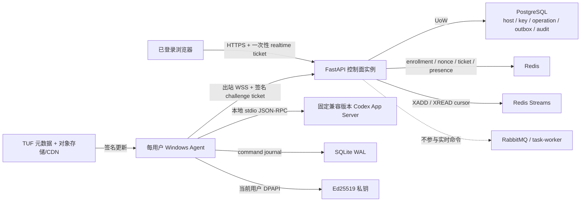
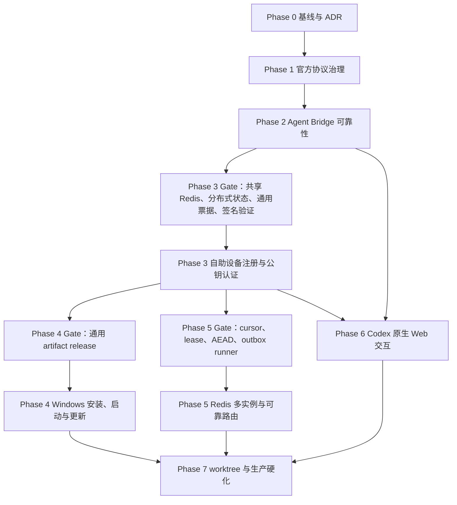

# Codex-first 远程控制产品化执行方案

> 文档状态：仓库执行与回归完成，外部生产验收待完成
>
> 创建日期：2026-08-07
>
> 适用仓库：`E:\python_web_fastapi\work`、`E:\python_web_fastapi\typescript-web-nuxt`
>
> 规范基线：`docs/standard/编码规范.md`、`docs/standard/命名规范.md`、`docs/standard/测试规范.md`
>
> 执行状态：2026-08-08 已完成仓库内源码、测试、文档与 Docker 回归；需要 clean Windows、真实签名/供应链、灾备/容量、外部渗透、canary 或持续 30 天数据的条目继续保持未勾选。

## 1. 目标

本方案用于把当前“需源码和手工 TOML 才能连接单台 Windows 主机”的 Codex 控制能力，演进为可由网站注册用户自助安装、绑定、管理自己电脑的多租户产品。执行内核以官方 Codex App Server 为唯一协议事实来源，保留 Agent 本地 `stdio JSON-RPC`，在现有分层、事务、鉴权、流式基础设施上补齐协议治理、可靠 Bridge、设备公钥认证、Windows 发布、多实例路由和完整 Web 交互。

本方案不是设计建议集合。后续代码任务必须按阶段勾选、测试和回写；未满足阶段完成判定时，不得进入依赖该阶段的生产发布。

### 1.1 最终用户闭环

1. 用户在网站注册并登录。
2. 用户在“Codex 设置/电脑”中获取 Windows Agent 安装程序并发起“添加电脑”。
3. Agent 首次启动生成设备密钥，显示短期用户码和验证地址；二维码只承载验证地址及用户码。
4. 用户在已登录浏览器中核对电脑名和设备指纹并批准。
5. Agent 用设备私钥签名服务端挑战，换取一次性、短时 WebSocket ticket，并从宿主机主动建立 WSS。
6. Agent 在当前 Windows 用户会话中启动受版本约束的 `codex app-server --stdio`，只暴露允许的工作区。
7. 用户可在浏览器创建、恢复、控制 Codex 任务，处理审批、diff、plan、interrupt、compact 等原生交互。
8. 断线、API 多实例切换或浏览器重连后，命令依靠稳定 `command_id` 去重，事件依靠 cursor 重放或权威 snapshot 收敛。
9. 用户可重命名、撤销电脑，查看兼容性、诊断和更新状态；撤销后旧设备私钥不能再换取连接 ticket。

### 1.2 非目标

- 不把浏览器、FastAPI 或公网直接连接到 App Server WebSocket。
- 不把 RabbitMQ、Funboost 或 `task-worker` 放入实时 Codex 命令投递链路。
- 不在本轮自行实现 Codex 协议、Codex 执行内核或 Git 实现。
- 不默认以 `LocalSystem` Windows Service 运行个人用户 Agent。
- 不把完整官方 schema 生成成手写运行时模型，也不把原始 App Server JSON-RPC 透传给浏览器。
- 不在缺少威胁模型和密钥恢复设计时宣称端到端加密；本方案默认 WSS、设备公钥认证、服务端最小化留存和敏感命令载荷加密落库。
- 不把远程 Codex 功能与后台普通任务队列、管理员控制台或通用缓存接口做不必要耦合。

## 2. 参考优先级与使用边界

| 优先级 | 参考 | 本项目只借鉴的内容 | 不直接复制的内容 |
| --- | --- | --- | --- |
| 1 | [openai/codex app-server](https://github.com/openai/codex/tree/main/codex-rs/app-server) | 初始化、官方 schema、thread/turn/item、审批、错误和容量语义 | experimental App Server WebSocket、公网接入产品设计 |
| 2 | [CC Pocket](https://github.com/K9i-0/ccpocket) | Bridge、断线恢复、离线发送、多会话、worktree、文件和 diff UX | 单租户直连认证模型 |
| 3 | [lezi-fun/codex-webui](https://github.com/lezi-fun/codex-webui) | 真实 Codex 交互、审批、diff、Markdown、文件边界 | 浏览器直连本机服务的部署假设 |
| 4 | [remote_codex](https://github.com/lanchoxie/remote_codex) | `browser -> relay -> host-agent -> app-server` 拓扑 | 裸露公网、弱认证、手工安装 |
| 5 | [Agmente](https://github.com/rebornix/Agmente) | App Server Client 抽象、线程恢复 | bearer/Cloudflare 作为设备注册体系 |
| 6 | CodexBridge / OpenClaw Codex | 线程绑定、审批转发、模型和计划控制 | 消息平台特有的会话与权限模型 |
| 补充 | NetBird、Vibe Kanban | 设备注册、公钥身份、Agent 发布与升级工程 | 与 Codex 无关的业务协议和网络平面 |

约束：当参考项目与当前固定版本官方 schema 冲突时，以 `protocol/codex_app_server/<version>/manifest.json` 和对应官方生成物为准；当参考项目与本仓库分层或安全规范冲突时，以 `docs/standard` 为准。

## 3. 当前基线与必须保留的能力

### 3.1 已有基建

| 能力 | 当前实现 | 本方案处理 |
| --- | --- | --- |
| Web/API | FastAPI、Pydantic | 保留；路由仅校验、授权和调用 use case |
| 分层 | `core <- domain <- application <- infrastructure <- api` | 保留；由 import-linter 持续约束 |
| 数据库 | SQLAlchemy、Alembic、PostgreSQL、UoW | 保留；operation、host、workspace、thread、audit 继续以 PostgreSQL 为事实源 |
| 实时状态 | Redis、一次性 realtime ticket、流式状态端口 | 复用 Redis 生命周期与 ticket；在现有流状态端口上扩展 Redis Streams 游标语义，Codex 只增加窄适配器 |
| 后台任务 | RabbitMQ、Funboost、task-worker | 保留但排除在实时 Codex 命令路径之外 |
| Agent | Python asyncio、`websockets`、SQLite WAL journal、Windows keyring | 保留运行模型；后续打包为独立 Windows 程序 |
| Codex | Agent 启动 `codex app-server --stdio` | 保留并作为唯一 App Server 连接方式 |
| 命令可靠性 | PostgreSQL 稳定 `operation_id`/`command_id`，Agent journal 去重 | 保留；多实例阶段增加加密 outbox 和 Redis 路由通知 |
| 前端 | Nuxt 4、Vue 3、Pinia、Vitest、Playwright、TanStack Vue Virtual | 保留；扩展设备管理和 Codex 原生控制 |

### 3.2 已确认缺口

- `src/infrastructure/codex/codex_pairing_service.py` 的配对状态为进程内内存，无法支持多实例和重启恢复。
- `src/infrastructure/codex/codex_step_up_grant_service.py` 的 step-up grant 为进程内内存，不可作为分布式安全凭据。
- 设备认证依赖长时 bearer token；当前二维码/配对语义不能作为公开 SaaS 的设备身份方案。
- `CodexConnectionRegistry` 和 `CodexBrowserEventHub` 只知道当前进程拥有的 socket。
- Agent 仍要求源码、Python、`uv` 和手工 TOML，没有签名安装、自动启动和可信更新链。
- Agent v1 稳定协议仍含 `command_type + params`、`capabilities`、snapshot 子项等裸字典。
- 浏览器事件序号绑定单次浏览器连接，不能跨 API 实例提供稳定 cursor。
- 前端设置页只有 realtime 状态，host API 只有列表，用户无法自助绑定、重命名、撤销或诊断电脑。

## 4. 全局工程约束

### 4.1 分层与依赖

1. `core` 仅放跨进程稳定数据契约、值对象和无外部依赖常量。
2. `domain` 只放状态机、授权策略、兼容性规则和业务错误，不访问数据库、Redis、网络或进程。
3. `application` 用 use case 编排业务流程，只依赖按用例最小化的 `Protocol` port；禁止依赖 `api` 或 `infrastructure`。
4. `infrastructure` 实现 PostgreSQL、Redis、WebSocket、DPAPI、App Server、TUF、Git 等适配器，不依赖 `api`。
5. `api` 只负责 HTTP/WebSocket 契约、身份与 scope、输入映射、use case 调用和错误呈现。
6. 依赖装配继续经过 `FastApiAppAssembler`、`DependencyContextAccessor`、`SharedResourceMount` 及其现有生命周期，不在 route 中构造 repository、Redis client 或 runtime。
7. 前端 API client、Pinia store、纯 reducer/validator、页面组件分离；组件不得直接拼接后端 URL 或解析原始 JSON-RPC。

### 4.2 类型、命名与代码组织

- 外部输入、API、配置、跨进程消息使用 Pydantic `BaseModel` 且默认 `extra="forbid"`。
- 内部不可变结果优先 dataclass；必须保持 mapping 协议时使用 `TypedDict`。
- 稳定命令和事件必须使用可判别联合，不允许新增 `dict[str, Any]`、`Record<string, unknown>` 作为已知结构。
- 允许在 App Server 适配器最外层短暂接收 `JsonValue`，但必须在进入 application 或浏览器协议前解析为受支持的强类型 detail。
- 类名按角色使用 `Port`、`Repository`、`Policy`、`Service`、`Gateway`、`Registry`、`Store`；禁止新增含糊的 `Manager`、`Helper`、`Common`、`Utils`。
- 函数名先确定基础动作、编排、分发、转换或校验角色；复杂流程由 use case 的 `execute` 编排，原子动作使用明确动词。
- 不为“未来可能复用”提前创建公共抽象；只有已有第二个稳定调用方时才抽取通用实现。

### 4.3 事务与一致性

- UoW 是 PostgreSQL 唯一事务边界；只有 UoW 可 `commit`、`rollback`、`flush`、`dispose`。
- repository 只读写和暴露数据库错误，禁止自行提交或回滚。
- host、device key、operation、command outbox 和审计需要原子写入时必须在同一 UoW 中完成。
- PostgreSQL 是 operation/command 状态事实源；Redis 只保存短时 enrollment、nonce、ticket、presence、路由和有界事件流。
- Redis 的认证、挑战、ticket、nonce 语义全部 fail-closed；Redis 不可用时不得回退到本机内存或长期 bearer。
- 所有会被网络重试的 mutation 必须有稳定幂等键或命令 ID；未知超时后的非幂等 App Server mutation 不得盲目重发。

### 4.4 安全和隐私

- 浏览器用户 JWT 与 Agent 设备身份严格分流；Agent 不能使用用户 access/refresh token。
- 用户码不是凭据；设备码、challenge、ticket 必须高熵、短时、单次消费，日志只记录摘要。
- QR 不含 API key、device token、refresh token、私钥或可直接建立 WebSocket 的 ticket。
- 设备私钥只在宿主机生成，服务端只保存 Ed25519 公钥和指纹。
- Windows 私钥默认以当前用户 DPAPI 保护；禁止 `CRYPTPROTECT_LOCAL_MACHINE` 和明文 TOML/keyring token 回退。
- 远程命令只能引用已登记 `workspace_key`；控制面不接收任意宿主机绝对路径，Agent 再做 canonical path、root containment 和 symlink/junction 检查。
- Markdown 使用现有安全渲染器；不启用任意 HTML。diff、命令输出和日志不得进入 `v-html`。
- 指标、日志、审计禁止记录 prompt、token delta、文件正文、私钥、设备码和签名；只记录 ID、摘要、容量、耗时、结果和错误码。
- 更新产物必须通过 TUF 元数据和 Authenticode 双重验证；生产签名密钥不进入仓库、镜像或 CI 普通 secret。

### 4.5 实时与容量

- token delta 仅按兼容事件类型批处理，默认窗口 `75 ms` 或累计 `4096` 字符任一先到即 flush。
- item/turn 完成、审批打开/关闭、diff 完成、plan 完成、错误和中断是顺序屏障，必须先 flush 相关 delta。
- Agent 事件使用 `agent_event_epoch + event_seq`；浏览器事件使用 Redis stream cursor。二者不是同一个序号域。
- 断线重放必须有容量上限、TTL 和明确 gap；超出窗口后请求权威 snapshot，不允许无限内存或 Redis 留存。
- SQLite WAL 只持久化命令 journal 和最小恢复元数据，不持久化 prompt/delta 明文。
- 配置容量进入 `codex_control_runtime` 强类型配置并校验，不散落魔法数字。

### 4.6 统一基建优先规则

每个阶段在写 Codex 代码前必须按以下顺序决策，并把结论写入阶段证据：

1. **直接复用**：现有统一能力已经满足语义时，只增加业务配置、业务契约或薄适配器，不新增同类实现。
2. **扩展统一能力**：现有能力缺少通用且稳定的原子语义，并且当前仓库已有第二个真实使用场景时，先在 `core`/通用 `infrastructure`/资源生命周期中补齐统一契约与实现。
3. **增加业务适配器**：统一能力通过独立测试和装配验收后，Codex adapter 才能组合该能力并表达 host、command、enrollment 等业务语义。
4. **保留特有实现**：只有 App Server JSON-RPC、Agent journal、Codex 状态机、workspace/worktree 等业务语义不能被其他模块合理复用时，才放入 `codex`/`codex_agent`。

统一基建不得反向依赖 Codex contract、Codex error code 或 Codex 配置；Codex application 也不得直接依赖 Redis client、Lua、AESGCM、TUF client 或 outbox runner。业务 use case 只依赖语义化窄 port，基础设施 adapter 在装配层组合统一能力。

新增统一能力必须同时具备：强类型 core contract、memory/fake 测试实现（适用时）、生产 adapter、强类型 runtime 配置、`SharedResourceMount` 生命周期、初始化/异常/边界/集成测试和运维指标。缺少任一项时，不得宣称“基建已完成”。

### 4.7 禁止重复造轮子门禁

任何计划任务在创建新 contract、port、service、store、runner、client、连接池或目录前，必须完成以下 Gate；Gate 证据是对应任务勾选的前置条件：

1. **仓库检索**：使用 `rg --files` 和 `rg` 检索同义职责、父协议、构造入口、配置、生命周期及测试 fixture，不得只按计划类名搜索。至少覆盖 `src/core`、`src/application/ports`、`src/infrastructure`、`test`、`pyproject.toml` 和 `uv.lock`。
2. **成熟能力检索**：检查 Python/Windows 标准能力、当前直接依赖和经过维护性/许可证/安全性审核的成熟库。Redis 命令使用 `redis-py`，密码原语使用 `cryptography`，更新信任链使用 `python-tuf`，Windows 保护使用 DPAPI，安装使用 WiX/Authenticode，Git 隔离使用 `git worktree`；禁止自行实现这些底层算法或协议。
3. **四选一结论**：每项只能标记 `reuse`、`extend`、`extract`、`specific` 之一。`reuse` 不加同类实现；`extend` 优先原地扩展现有契约和全部实现，确无契约时也只能在已有能力族/资源生命周期内补缺失原语；`extract` 先以 characterization test 冻结旧行为，再把现有调用方迁到抽取结果；`specific` 必须证明语义只属于 Codex/Agent 且不伪装成通用基建。
4. **新增证明**：只有现有能力或成熟依赖确实缺少所需的原子性、fencing、机密性、恢复或生命周期语义，且组合现有能力仍不能正确满足时，才允许新增代码。证据必须包含候选方案、拒绝原因、并发/故障反例、第二个真实调用方；若属于安全或生命周期原语且暂时只有一个业务调用方，必须改由协议无关 contract fixture 验证，并在 ADR 中记录“禁止提前扩展”的范围。
5. **薄适配约束**：对成熟库只编写强类型 contract、依赖注入、业务映射、生命周期和可观测性；不得复制算法、协议状态机、下载器、解析器或客户端。官方 Codex schema 通过生成和窄映射消费，不手抄官方协议实现。
6. **单轨迁移**：发现现有同职责实现时，优先补 characterization test 后原地扩展或抽取。允许 feature flag 下的有界双轨迁移，但 ADR 必须写明默认切换、旧路径停发、删除日期和删除测试；禁止新旧实现永久并存。
7. **自动门禁**：import-boundary、production implementation allowlist、共享 contract fixture、class-inheritance/structural-conformance 和资源生命周期测试必须阻止第二套同职责实现绕过装配层。仅有代码评审意见不能代替自动测试。

每阶段证据必须增加 `复用审计` 段，逐项记录：`需求语义 / 检索命令与命中 / 标准库或第三方候选 / 四选一结论 / 复用或修改文件 / 新增理由 / 旧实现退出条件 / ADR 与测试`。任一字段为空时，不得创建新的统一抽象；后续发现已有等价实现时，必须停止该任务并先修订方案。

## 5. 目标架构



### 5.1 技术栈与明确选择

| 领域 | 选择 | 原因 | 明确不选 |
| --- | --- | --- | --- |
| App Server transport | Agent 本地 `codex app-server --stdio` | 官方稳定主路径，避免 experimental WebSocket | 浏览器/后端直连 App Server WebSocket |
| 官方协议治理 | 官方 `generate-json-schema` 快照 + manifest SHA-256 + 手写窄适配器 | 可审计、可版本并存、运行时模型不被全量 schema 污染 | wildcard 版本即放行、全量生成进业务模型 |
| Agent 协议 | v1/v2 并行迁移；Pydantic 可判别联合 | 零停机迁移、拒绝未知字段、消除裸 dict | 原地破坏 v1、透传 JSON-RPC |
| 设备密钥 | Ed25519，`cryptography`；PKCS8 私钥由当前用户 DPAPI 保护 | 小密钥、签名验证成熟、与用户会话绑定 | 长期 bearer、二维码 API key、LocalMachine DPAPI |
| Enrollment | OAuth device authorization 语义；Redis TTL + Lua CAS，PG 最终记录 | 适合无浏览器 Agent，短码不成为凭据，多实例一致 | 进程内 pairing map、轮询时发长期 token |
| Agent runtime | Python 3.11+、asyncio、websockets、PyInstaller one-folder | 最大复用当前 Agent，便于诊断和可控升级 | 用户安装 Python/uv、PyInstaller one-file 默认解压 |
| Windows autostart | per-user MSI + Task Scheduler logon trigger | Codex 登录和工作区属于当前用户，不要求管理员 | 默认 LocalSystem service |
| MSI | WiX Toolset v4 + Authenticode | 企业可部署、支持修复/卸载/升级 | 未签名 zip、脚本修改注册表 |
| 更新 | `python-tuf` 客户端 + TUF repository + staged channel + rollback | 防篡改、冻结/回滚保护、可分批 | 仅 HTTPS 下载 latest.exe、只校验 SHA 文本 |
| 更新分发 | S3 兼容对象存储/CDN，API 只返回渠道和状态 | 大文件与 API 解耦，支持缓存和断点续传 | PostgreSQL BLOB、FastAPI 进程直接分发 MSI |
| 多实例 presence | Redis TTL lease，`host_id -> instance_id + connection_epoch` | 与 socket 所有权对齐，自动过期 | DB status 单独判断在线、本机 map 冒充分布式状态 |
| 跨实例命令 | PG 加密 command outbox + Redis Streams 路由通知 + Agent journal | 崩溃恢复、低延迟、端到端稳定 command_id | RabbitMQ/task-worker 实时投递、只把 payload 放 Redis |
| 载荷加密 | AES-256-GCM，窄 `CodexCommandPayloadCipherPort`，密钥来自现有 key family | 机密性、完整性、轮换可追踪 | 自制密码算法、复用 JWT signing key |
| 浏览器事件 | Redis Streams `XADD/XREAD` + 有界 trim/TTL + snapshot fallback | 多实例 cursor 和有界 replay | 仅进程内 seq、无限事件持久化 |
| Web | Nuxt 4、Vue 3、Pinia、TanStack Vue Virtual、Vitest、Playwright | 延续当前实现和测试工具 | 引入第二套状态库/组件框架 |
| worktree | 可选 `git worktree`，Agent 侧窄 port + 显式策略 | 使用成熟 Git 行为并隔离任务 | 自行实现 Git、默认无界创建 worktree |

#### 5.1.1 新增部署资源与依赖

- PostgreSQL、Redis、RabbitMQ 继续复用现有部署；不新增第二套数据库、缓存或消息队列。
- 新增一个 S3 兼容对象存储/CDN 作为 MSI、Agent bundle、Codex bundle 和 TUF metadata 的发布源。优先使用托管 S3/R2/Azure Blob 等价服务，不在 API 容器内自建文件服务器。
- 新增生产代码签名能力：EV/组织代码签名证书对应的硬件令牌或托管签名服务，以及离线保管的 TUF root/targets 阈值密钥。它们属于发布基础设施，不进入应用数据库。
- `cryptography` 必须从当前 constraint/transitive 状态提升为后端/Agent 的直接运行依赖；`tuf`（python-tuf）是 Agent 更新直接依赖；PyInstaller 和 WiX v4 只进入构建环境。具体版本在 Phase 1/4 兼容验证后锁定，禁止无上限依赖。
- Windows DPAPI 适配器优先使用 Python 标准库 `ctypes` 调用系统 API，避免仅为 DPAPI 引入完整 `pywin32`；若兼容验证证明必须引入，先回写依赖与打包影响。

#### 5.1.2 基建复用与新增判定

| 能力 | 审核结论 | 统一层实现 | Codex 层允许内容 |
| --- | --- | --- | --- |
| 配置与生命周期 | **直接复用** | 现有 Pydantic runtime envelope、`AppSettingsLoader`、`SharedResourceLifecycle/Accessor/Mount` | 增加强类型 Codex policy 和显式 factory，不在 route/runtime 私建资源 |
| PostgreSQL/UoW/repository | **直接复用** | 现有 SQLAlchemy、Alembic、`SqlAlchemyUnitOfWork` 和 session-bound repository factory | 新增 device key/command outbox 业务表与 repository；事务仍只由 UoW 提交 |
| 审计、日志、指标、trace | **直接复用** | 现有 audit/logging/Prometheus/OpenTelemetry 和敏感文本脱敏 | 增加稳定事件名、低基数指标和 correlation fields，不建 Codex 日志系统 |
| 出站 HTTP 与 URL 安全 | **直接复用** | 现有 `SharedAsyncHttpClient`、outbound runtime 和 `OutboundUrlSafetyValidator` | artifact release/doctor 注入 transport 和 allowlist policy，不直接 `httpx.AsyncClient()` |
| WebSocket admission/stream transport | **直接复用** | 现有 streaming runtime、ticket、connection guard、session capacity | Codex route 只提供 typed event source/adapter 和业务 authorization |
| 一次性流/WSS ticket | **直接复用并补通用 record-consume** | 现有 `StreamAccessTicketService`、`StreamStateStorePort`、memory/Redis store | 只提供 operation/audience、device principal，并把 generic envelope 映射到 API；删除重复的 `CodexRealtimeTicketService` |
| 敏感值摘要 | **直接复用** | 现有 `SensitiveDigestService` | 只传 device_code/user_code 等原文，业务层不自行选择 HMAC key |
| HTTP 限流 | **直接复用** | 现有 `RateLimitGuard`、`CacheNamespace.RATE_LIMIT` | 新增 enrollment/challenge 策略和维度，不写 Codex limiter |
| Redis key 规则 | **直接复用并扩展枚举** | 现有 `CacheKeyBuilder` 和封闭 `CacheNamespace` | 只声明 Codex 专用 namespace/片段，不拼接 key 字符串 |
| 密钥族与轮换 | **直接复用** | 现有 `KeyManagementService`、`DistributedLockProvider` | 注册独立 command-payload key family；禁止读取 JWT key |
| step-up grant | **复用统一单次票据并迁移 async port** | 在 `application/security` 用 `StreamAccessTicketService` 实现现有 `StepUpGrantPort`，purpose 映射为 operation，使用同一原子消费 | host revoke 只调用 async port；移除进程内 Codex grant 和独立摘要/存储逻辑 |
| Redis 连接与分布式状态 | **需要先统一现有基建再扩展** | 新增 canonical Redis runtime 和共享 sync/async Redis resource；现有 cache/stream store 改为注入 client；其上新增原子状态/CAS/script executor | enrollment/challenge adapter 持有 typed 状态和业务 Lua；不得读取 URL 或创建 Redis 连接池 |
| 带 fencing token 的租约 | **需要新增统一基建** | 在 `core/concurrency_contract` 与 `infrastructure/concurrency` 增加 async fenced lease store | host presence adapter 把 host/instance/epoch 映射为 lease，不自写通用 lease 算法 |
| opaque cursor 事件流 | **扩展现有统一流基建，不新增第二套 port/store** | 只新增 `cursor_stream_contract.py`；扩展现有 `StreamStateStorePort`、`MemoryStreamStateStore`、`RedisStreamStateStore`、`DeferredStreamStateStore` 的 versioned cursor 方法，Redis v2 内部使用 Streams，v1 list replay 保持有界兼容 | browser event、dispatch signal 只做 typed payload、owner/route 授权适配；禁止 `CursorStreamStorePort` 和平行 cursor store 类 |
| AEAD envelope | **需要新增统一基建** | 新增 `core/cryptography_contract` 和 `infrastructure/cryptography` 的 AES-256-GCM envelope cipher | `CodexCommandPayloadCipherPort` adapter 只定义 AAD 字段和 command payload codec |
| outbox 扫描/唤醒/退避 | **需要抽取统一基建** | 从现有 `TaskExecutionOutboxPublisher` 提取 transport-neutral runner；task 与 Codex 各自保留表、repository 和 delivery adapter | Codex 只能定义 ACK 完成条件、重试策略和 Redis/WSS delivery，不复用 RabbitMQ transport |
| 制品下载、TUF、版本切换 | **需要新增统一基建** | 新增 `artifact_release` contract/runtime：catalog、download、verify、stage、activate、rollback | Codex Agent coordinator 只选择 Agent/Codex targets、doctor 健康门和 rollout 状态 |
| DPAPI 设备私钥 | **Agent 特有基础设施** | Agent 内 `DeviceKeyStorePort` + Windows DPAPI adapter | 不上升为服务端共享资源，不与 Web JWT/key ring 混用 |
| App Server、journal、delta batch、workspace/worktree | **Codex 特有能力** | 不新增通用基建 | 保留在 `codex_agent`，但继续使用统一日志、配置、并发和测试规范 |

新增/抽取统一基建的必要性已限定如下，实施时不得扩大范围：

| 能力 | 当前实现为什么不能直接满足 | 允许的最小自有代码 | 必须复用的成熟底层 |
| --- | --- | --- | --- |
| shared Redis resource | `RedisCacheStore` 与 `RedisStreamStateStore` 分别拥有连接/关闭职责，继续增加消费者会重复 pool 和配置 | 抽取一个 sync/async client 生命周期 owner，并把现有两个 store 先迁入 | `redis-py` 连接池、现有 runtime/mount/key builder |
| atomic distributed state | 同步 `CacheStore` 不提供 async versioned CAS/脚本执行；ticket store 只负责单次票据与 replay | 协议无关 state/version/result contract、script executor 与 memory/Redis adapter | `redis-py`、Redis Lua 原子执行、现有 shared Redis/key builder |
| signature verifier | 现有 key management/digest 只管理密钥族和摘要，没有非对称签名验证契约 | 通用 verify request/result port 与 Ed25519 薄 adapter | `cryptography` Ed25519 verify；不实现曲线、编码或比较算法 |
| stream cursor v2 | 现有 list replay 是连接恢复窗口，不提供跨实例 opaque cursor/trim gap 语义 | 只增加 cursor data contract，并原地扩展现有 port 与 memory/Redis/deferred 实现 | `redis-py` Redis Streams、现有 streaming runtime/resource slot |
| async fenced lease | `DistributedLockProvider` 没有 read/owner epoch/fencing token，不能阻止旧 socket 对新 owner 产生陈旧写 | lease contract、原子 acquire/renew/release/read adapter 与 fence validation | `redis-py`、Redis 原子脚本；保留现有同步 lock 调用方 |
| AEAD envelope | `KeyManagementService` 管理 key family/rotation，但不提供内容加密、AAD、nonce/tag envelope | envelope/AAD/usage budget/lifecycle adapter | `cryptography` HKDF/AESGCM 与现有 key management；不实现密码算法 |
| reliable outbox runner | `TaskExecutionOutboxPublisher` 已有 wakeup/scan/shutdown，但与 task transport 绑定，复制会产生第二个恢复循环 | 从现有类抽取 runner，先迁移 task adapter，再增加 Codex adapter | 现有 task publisher/repository/UoW/线程生命周期 |
| artifact release runtime | 仓库没有可信 metadata、下载验证、stage/activate/rollback 供应链；普通 HTTP 下载不具备更新安全语义 | 强类型 catalog/orchestrator/staging/activation/rollback 与 Windows 薄 adapter | `python-tuf`、现有 HTTP/URL safety、`hashlib`、`WinVerifyTrust`、WiX/Authenticode |

明确不新增：第二套 cursor port/store/resource slot、Codex ticket/digest/limiter/key builder、Codex Redis pool、Codex outbox loop、第二套 HTTP client/TUF parser/密码算法、第二套数据库/缓存/消息队列。若实现阶段的源码已经补齐上表某项缺口，则对应任务自动降级为 `reuse` 或 `extend`，先修订本文，不得按旧方案继续创建文件。

#### 5.1.3 统一资源装配边界

- 服务端新增 shared Redis/distributed-state、fenced lease 和 AEAD 资源必须先装入 `SharedResourceLifecycle`，由 `SharedResourceAccessor` 暴露稳定基础设施入口；cursor v2 继续由现有 streaming resource set/state store 暴露，不增加第二个 cursor 资源槽；不得由 route、store 或 `CodexControlRuntime.build()` 根据 URL 临时创建连接池。artifact release 属于宿主机 Agent 运行时，必须装入 Agent root composition/lifecycle，不进入 FastAPI `SharedResourceMount`。
- `CodexResourceFacade` 只负责以当前 UoW 创建 Codex repository，以及用统一资源构造 Codex adapter。它不能成为任意 Redis/AES/TUF 操作的公共服务定位器。
- `FastApiAppAssembler` 只做显式依赖组合；`DependencyContextAccessor` 只暴露完成装配的 use case/port，不向 route 暴露 Redis、cipher、outbox runner。
- 通用资源 shutdown 顺序固定为：停止业务 producer/dispatcher -> drain 有界任务 -> 关闭 stream/subscriber -> 关闭共享 async Redis/HTTP client -> 释放数据库资源。初始化测试必须锁定顺序。
- 统一 contract 不包含 `host_id`、`command_id`、Codex capability 或 Codex error code；业务 adapter 不把裸 `dict` 传入统一层。

### 5.2 三个事实源

| 状态 | 事实源 | 可重建来源 |
| --- | --- | --- |
| 用户、host、device key、operation、command outbox、审批审计 | PostgreSQL | 数据库备份与迁移 |
| enrollment、nonce、ticket、presence、路由、短时浏览器事件 | Redis | PostgreSQL + Agent snapshot；Redis 丢失时安全失效 |
| 本机命令已接收/执行/未知结果 | Agent SQLite journal | Agent 自身；控制面不得猜测非幂等结果 |
| thread/turn/item 当前真实状态 | Codex App Server + Agent snapshot | `thread/read` 等受支持读取方法 |

### 5.3 状态机

**Enrollment**

`pending_user -> approved -> challenge_issued -> consumed`；终态还包括 `denied`、`expired`、`cancelled`。每个转换通过 Redis Lua 比较当前状态和版本；重复 approve 对同一用户幂等，跨用户必须拒绝；`consumed` 后设备码、challenge 和 ticket 均不可复用。

**Host connection**

`enrolling -> offline -> online -> offline`；版本或 digest 不支持时为 `incompatible`，撤销为 `revoked`。`online` 必须同时满足 PostgreSQL 未撤销、版本兼容、Redis presence 未过期且目标实例持有匹配 epoch 的本地 socket。

**Command/operation**

`accepted -> dispatch_pending -> agent_accepted -> running -> completed|failed|unknown|cancelled`。HTTP 幂等键只负责复用 operation；`command_id` 跨网络重发稳定。Agent 只有在 journal 落盘后才发送 `agent_accepted`。未知超时不得伪装成 failed 或重新创建命令。

## 6. 稳定契约设计

### 6.1 Agent protocol v2 envelope

计划在 `src/core/codex_contract/agent_protocol_v2_contract.py`（计划新增）定义：

- `CodexAgentFrameV2`：`protocol_version="2.0"`、`message_id`、`message_type`、`sent_at` 和可判别 `detail`。
- `CodexAgentHelloV2`：host、agent/codex 版本、schema digest、受控 capability 枚举列表、设备 key id。
- `CodexAgentCommandV2`：稳定 command/operation/host ID、request digest、deadline、可判别 command detail。
- command detail 至少包含 `thread.start`、`turn.start`、`turn.interrupt`、`thread.compact`、`approval.reply`、`state.snapshot.request`。
- event detail 至少包含 thread/turn/item 生命周期、兼容 delta batch、plan、diff、审批、错误、snapshot、gap。
- `CodexAgentEventBatchV2`：`agent_event_epoch`、`first_seq`、`last_seq`、有序 events；服务端返回累计 ACK。
- `CodexAgentReplayRequestV2`：`agent_event_epoch`、`after_seq`；若 epoch 不同或已 trim，返回 `snapshot_required`。

迁移要求：v1 和 v2 使用独立 parser/mapper，共享领域状态和 use case，不在单个函数中堆叠大量 `if version`。v1 只进入兼容维护，所有新能力只加 v2；移除 v1 必须有使用率为零的观测证据和单独 ADR。

### 6.2 兼容矩阵

兼容判定键为：

`(agent_protocol_version, codex_version, app_server_schema_digest, capability_set)`

结果为强类型枚举：

- `compatible`：允许声明 capability 覆盖范围内的读写。
- `read_only`：只允许 doctor、snapshot、读取和升级，不允许 Codex mutation。
- `upgrade_required`：Agent 自身过旧，允许更新通道，不允许任务 mutation。
- `blocked`：未知 digest、撤销设备、无支持协议或安全策略不满足，关闭连接。

禁止仅凭 `allowed_codex_versions = ["0.145.*"]` 放行未知 schema digest。未知 digest 对 mutation 必须 fail-closed。

### 6.3 HTTP API 目标面

以下路径是计划契约，实施时放在现有 `/codex` 模块下并沿用 scope/ownership 体系：

| 方法与路径 | 作用 | 授权/安全 |
| --- | --- | --- |
| `POST /codex/device-authorizations` | Agent 创建 device authorization | 未登录 Agent；IP/device 限流；返回 device_code、user_code、verification URI、interval、expiry |
| `POST /codex/device-authorizations/token` | Agent 在 body 中提交 device_code 并轮询授权状态 | device_code 禁止进入 URL/access log；固定节流；不返回长期 bearer |
| `POST /codex/device-authorizations/verification` | 浏览器在 body 中提交 user_code 并读取待确认设备摘要 | 登录用户 + `codex:host_manage`；不泄漏 device_code |
| `POST /codex/device-authorizations/verify` | 批准或拒绝设备 | 登录用户 + `codex:host_manage` + CSRF/同站策略 + 审计；幂等键 |
| `POST /codex/agent/challenges` | 已批准设备申请签名 challenge | key id + 限流；Redis fail-closed |
| `POST /codex/agent/connection-tickets` | 提交签名并换取一次性 WSS ticket | 校验 Ed25519、nonce、host/key 状态；ticket 单次消费 |
| `GET /codex/hosts` | 列出当前用户电脑及实时兼容状态 | `codex:read`；PG 与 Redis presence 叠加 |
| `PATCH /codex/hosts/{host_id}` | 重命名电脑、调整允许的非安全展示配置 | owner + `codex:host_manage` + `If-Match`/version |
| `DELETE /codex/hosts/{host_id}` | 撤销电脑和所有有效 device key | owner + `codex:host_manage` + step-up；幂等 |
| `GET /codex/hosts/{host_id}/diagnostics` | 查看脱敏 doctor、版本、更新时间 | owner + `codex:read`；不返回路径和环境密钥 |
| `POST /codex/hosts/{host_id}/keys/rotate` | 设备密钥轮换握手 | 已认证设备 + 用户确认或受控恢复流程 |

HTTP 错误使用现有 fault envelope。离线错误文案必须说明“使用原 `Idempotency-Key` 重试”，响应可返回已创建的 `operation_id`、`retryable=true` 和 `retry_after_seconds`，但不得把 `command_id` 当作浏览器可直接调用的重试入口。

### 6.4 PostgreSQL 目标模型

| 表 | 关键字段 | 约束 |
| --- | --- | --- |
| 现有 `codex_host` | 增加 enrollment/compatibility/update 展示所需字段时保持 version 乐观锁 | owner 查询索引；revoked 为终态；不保存私钥 |
| 新增 `codex_host_device_key` | `key_id`、`host_id`、`enrollment_id`、`algorithm`、`public_key`、`fingerprint`、`status`、`approved_at`、`last_authenticated_at`、`revoked_at`、`version` | `(host_id,fingerprint)` 与非空 enrollment_id 唯一；只允许 Ed25519；历史 key 可审计 |
| 新增 `codex_command_outbox` | `command_id`、`operation_id`、`host_id`、`payload_schema_version`、`key_family/key_id`、`nonce`、`ciphertext`、`payload_digest`、`state`、`attempt`、`next_attempt_at`、`expires_at` | 与 operation 同 UoW 写入；不保存明文；claim 使用行锁/`SKIP LOCKED` |
| 可选新增 `codex_agent_release_state` | host 当前 channel、target/current version、rollout bucket、last check/result | 仅当更新状态查询不能由 host 字段稳定表达时新增，Phase 4 ADR 决定 |

迁移必须提供 upgrade/downgrade、索引、外键删除语义、历史 bearer 凭据迁移窗口和生产大表锁评估。禁止把短时 device_code、nonce、challenge、WSS ticket 放入 PostgreSQL 长期保存。

### 6.5 Redis key/stream 目标

所有 key 通过封闭命名空间和 builder 生成，动态片段使用 UUID 或摘要，不含 token 原文：

| 命名空间 | 结构 | TTL/容量 | 不可用策略 |
| --- | --- | --- | --- |
| `codex:enrollment:<digest>` | hash + Lua CAS | 10 分钟，消费即删/墓碑短留 | fail-closed |
| `codex:user-code:<digest>` | user_code digest -> enrollment digest | 与 enrollment 一致 | fail-closed |
| `codex:challenge:<digest>` | host/key/nonce/expiry | 60 秒，单次消费 | fail-closed |
| `codex:agent-ticket:<digest>` | host/key/intended instance | 30 秒，单次消费 | fail-closed |
| `codex:presence:<host_id>` | instance/connection epoch/compatibility/lease version | `3 * heartbeat`，原子续约 | fail-closed 判离线 |
| `codex:dispatch:<instance_id>` | Redis Stream，仅含 command_id/host_id/route epoch | 有界 trim + 24h TTL | PG outbox 恢复 |
| `codex:events:<owner_digest>` | Redis Stream，产品事件 envelope | 容量和 TTL 配置；trim 后 gap | snapshot 恢复 |

## 7. 阶段依赖与发布顺序



- Phase 4 与 Phase 5 可在 Phase 3 完成后并行开发，但生产开放自助注册必须同时满足 Phase 4、Phase 5。
- Phase 6 可在 Phase 2/3 后开发，不能绕过 capability/compatibility 判定直接显示控制项。
- Gate 是对应 Phase 内的强制前置里程碑，不单独发布业务功能；Gate 的通用 contract、实现、生命周期和非业务 fixture 未通过时，后续 Codex task 保持未勾选。
- 每阶段单独 feature flag、迁移和回滚说明；不得以未完成的后续阶段为当前阶段验收条件。

## 8. 清单回写规则

### 8.1 勾选协议

- `[ ]`：未完成或未取得完整证据。
- `[x]`：代码已实现、该项要求的测试已通过、证据已写回本文对应阶段。
- 被阻塞的任务保持 `[ ]`，在任务下一行写 `阻塞：原因 / 负责人或依赖 / 复查日期`，不得用勾选表示“已知晓”。
- 仅写代码、仅写测试、仅人工验证都不能勾选完整任务。
- 任务范围发生变化时，先修改本文任务与判定，再实施代码；禁止实现后用模糊描述覆盖原验收标准。

### 8.2 每阶段证据模板

每阶段末尾必须回写：

```text
完成日期：
代码 revision/commit：
数据库 migration：无 / revision id（upgrade、downgrade 结果）
Agent protocol/schema：无 / version + digest
复用审计：需求语义 / rg 命中 / 成熟候选 / reuse|extend|extract|specific / 新增理由 / 旧实现退出条件
后端测试命令与结果：
前端测试命令与结果：
Windows/真实环境证据：
安全检查与结果：
性能/容量结果：
回滚演练：
残余风险与后续任务：
```

## 9. Phase 0：基线冻结与架构决策

### 9.1 目标与依赖

在不改运行行为的前提下冻结当前协议、故障、容量和测试基线，形成后续迁移可对比的 ADR 与证据。依赖：无。

### 9.2 技术选择

- 使用现有 pytest/Vitest/Playwright 和真实 Docker PostgreSQL、Redis 环境采集基线。
- ADR 放入 `docs/design_docs`，schema 证据继续放 `protocol/codex_app_server/<version>`。
- 使用 OpenTelemetry/Prometheus 现有基建定义指标名称，不在本阶段引入新的可观测性平台。

### 9.3 任务清单

- [x] 盘点并记录 v1 Agent frame、浏览器 realtime event、HTTP host/thread/approval 接口和 PostgreSQL Codex 表字段，生成“当前/目标/迁移阶段”对照表。
- [x] 在 `docs/design_docs` 新增 ADR：App Server 仅允许 Agent 本地 stdio，明确 experimental WebSocket 不进入生产架构。
- [x] 新增 ADR：设备身份选择 Ed25519 + current-user DPAPI，记录 key rotation、丢失设备和撤销语义。
- [x] 新增 ADR：PostgreSQL operation/outbox + Redis presence/Streams，RabbitMQ 不进入 realtime path。
- [x] 新增 ADR：per-user MSI + Task Scheduler，说明不默认 LocalSystem service 的用户身份原因。
- [x] 新增 ADR：更新采用 Authenticode + TUF + 对象存储/CDN，记录 root/targets key custody。
- [x] 新增“统一基建复用审计”ADR，逐项记录仓库 `rg` 命中、标准库/当前依赖/成熟库候选、`reuse / extend / extract / specific` 四选一结论、第二使用方、新增反例、旧实现退出条件和禁止依赖方向。
- [x] 建立生产基础设施实现清单与职责 allowlist，至少覆盖 streaming state store、Redis pool owner、ticket、distributed lock/lease、cipher、outbox runner、HTTP client 和 artifact downloader；计划新增 `test/boundary_test/test_infrastructure_capability_allowlist_boundary.py`，以 AST/import graph 和装配入口枚举识别相同职责类、直接 client 构造与重复 resource slot，失败时要求先更新 ADR，禁止仅靠类名字符串匹配。
- [x] 计划新增 `test/boundary_test/test_generic_infrastructure_import_boundary.py`，验证 `distributed_state/streaming/concurrency/cryptography/outbox/artifact_release` 不导入 Codex；计划新增或扩展 class-inheritance/structural-conformance fixture，所有 port 生产实现必须跑同一行为契约。
- [x] 为 `StreamAccessTicketService` 与 `CodexRealtimeTicketService` 写行为对照测试，确认 generic ticket 能覆盖浏览器和 Agent audience 后，制定删除重复 Codex 服务的迁移步骤。
- [x] 为现有 `TaskExecutionOutboxPublisher` 写 characterization test，冻结 wakeup、rescan、错误隔离和 shutdown 语义，作为后续抽取 transport-neutral runner 的基线。
- [x] 记录当前 cache、stream、distributed lock 分别创建 Redis 连接的数量、同步/异步边界和 shutdown owner，形成共享 async Redis resource 的迁移约束。
- [x] 建立 import boundary 目标：`infrastructure/streaming|concurrency|cryptography|outbox|artifact_release` 禁止导入 `src.core.codex_contract`、`src.application.codex` 和 `src.infrastructure.codex`。
- [x] 新增 threat model，至少覆盖盗取 user_code/device_code、二维码泄露、重放签名、Redis 劫持、旧 key、恶意 workspace path、事件泄露、更新供应链和租户越权。
- [x] 对 `codex_pairing_service.py`、`codex_step_up_grant_service.py`、`codex_connection_registry.py`、`codex_browser_event_hub.py` 的进程局部语义写出边界测试，防止后续误认为已分布式。
- [x] 固定当前 host 离线 + 原 Idempotency-Key 重试契约，记录 operation 数、稳定 command_id 和 dispatch_attempt 基线。
- [ ] 用真实浏览器跑通登录、刷新、host 列表、创建任务、发送消息、断网重连、审批和页面刷新，保存 request_id、截图和后端/Agent 关联日志摘要。
- [x] 记录 Agent 当前启动条件：源码、Python、uv、TOML、Codex 登录、控制面 URL 和 Docker 到宿主机网络路径。
- [x] 定义初始 SLO/SLI：在线 presence 收敛、命令接受延迟、首 token 延迟、断线恢复时长、gap/snapshot 比率、审批往返、Agent 崩溃恢复。
- [x] 定义隐私数据分类和保留期：PostgreSQL、Redis、Agent SQLite、日志、安装遥测分别列出允许字段和禁止字段。
- [x] 建立 Phase 0 evidence 文件，记录所有命令、版本、schema digest、Docker compose 状态和已知失败，不修改证据以掩盖失败。

### 9.4 测试与校验

- 单元/路径/异常/边界：补齐当前兼容性、离线幂等、进程内 registry 和容量基线。
- 初始化：验证 Docker 配置、Agent TOML 和 Codex runtime 配置的当前装配。
- 接口/契约：冻结 v1 frame、HTTP fault、realtime schema。
- 集成：真实 PostgreSQL、Redis、fake App Server 和 WSS；RabbitMQ 只验证没有被 Codex runtime 依赖。
- 浏览器：Playwright 使用真实前后端容器与宿主机 Agent，不以全 mock E2E 代替。

建议命令：

```powershell
uv run pytest -q test/unit_test test/path_test test/exception_test test/boundary_test -k codex
uv run pytest -q test/contract_test test/interface_test -k codex
uv run pytest -q test/integration_test -k "codex or app_server"
uv run nox -s static
Set-Location E:\python_web_fastapi\typescript-web-nuxt
pnpm test -- --run
pnpm test:e2e -- --grep "Codex"
```

### 9.5 约束与完成判定

禁止改变生产协议、认证或状态机，也禁止在 Phase 0 预先抽象没有第二使用方的能力。完成条件：ADR/threat model/基线证据齐全；统一基建复用矩阵已由源码检索、成熟候选评估和第二使用方或获准的协议无关 fixture 证明；生产实现 allowlist 可自动阻止平行实现；真实浏览器链路可复现；所有新增冻结测试通过；已知失败被明确记录；不存在预先勾选项。

## 10. Phase 1：官方协议治理与强类型兼容层

### 10.1 目标与依赖

把官方 Codex App Server schema 变成可重复生成、可审计、可并存、未知变更 fail-closed 的兼容基线，并引入 Agent protocol v2。依赖：Phase 0。

### 10.2 目标文件

- 现有：`protocol/codex_app_server/<version>`、`src/core/codex_contract/*`、`src/infrastructure/codex_agent/app_server_jsonrpc_client.py`、`app_server_approval_protocol_probe.py`。
- 计划新增：`scripts/codex/generate_app_server_schema.py`、`src/domain/codex/codex_compatibility_policy.py`、`src/application/ports/codex_app_server_compatibility_port.py`、`src/infrastructure/codex_agent/app_server_protocol_adapter.py`、`src/core/codex_contract/agent_protocol_v2_contract.py`。
- 计划测试：`test/contract_test/test_codex_agent_protocol_v2_contract.py`、`test/contract_test/test_codex_app_server_schema_manifest_contract.py`、`test/unit_test/test_codex_compatibility_policy_unit.py`、`test/integration_test/test_app_server_protocol_adapter_integration.py`。

### 10.3 技术实现

1. schema generator 先执行 `codex --version`，再执行 `codex app-server generate-json-schema --out <temp>`；输出先进入临时目录，通过完整性检查后原子移动到版本目录。
2. manifest 保存 Codex 精确版本、生成命令、生成 UTC、目标平台、关键 combined schema 文件原始字节 SHA-256、受支持方法/capability 清单和审核状态。
3. CI 在固定 Codex artifact 上重生成并比较 manifest/digest；差异必须以新版本目录和兼容性审查提交，禁止覆盖旧快照。
4. runtime compatibility policy 读取已审核 manifest 形成只读矩阵，不在业务代码中散落版本字符串。
5. v2 command/event 使用判别联合；App Server adapter 只映射产品实际使用的方法。未知 notification 只产生受限 protocol warning，不携带原始 payload。
6. JSON-RPC `-32001` 仅在 App Server 明确返回时按照 method retry classification 做有界指数退避和 jitter；未知 timeout 的 mutation 返回 `unknown`，不自动重放。

### 10.4 任务清单

- [x] 定义 schema snapshot manifest Pydantic 模型和 JSON Schema，未知字段拒绝，digest 固定为 SHA-256 小写十六进制。
- [x] 实现 schema 生成脚本的临时目录、命令失败、版本不匹配、缺文件、digest 和原子发布流程。
- [x] 在 `protocol/codex_app_server` 增加维护说明：添加版本、审核差异、弃用版本、紧急回滚和许可证要求。
- [x] 把现有 `0.145.0` 快照纳入新 manifest 校验，不修改官方生成内容。
- [x] 建立受支持 App Server method catalog，标注 read/mutation、idempotency、overload retry、ordering barrier、所需 capability。
- [x] 实现 `CodexCompatibilityPolicy`，输入精确 tuple，输出 `compatible/read_only/upgrade_required/blocked` 和机器可读 reason code。
- [x] 将 `allowed_codex_versions` 从唯一判断降为外围约束，未知 schema digest 的 mutation 必须拒绝。
- [x] 定义 v2 hello/ack/heartbeat、typed command detail、event batch/ack/replay/snapshot 契约。
- [x] 将 capability 从自由字典收敛为枚举集合和带版本的 typed capability detail。
- [x] 给 snapshot 中 threads、pending commands 和 approval display summary 定义强类型模型，消除已知稳定裸 dict。
- [x] 新增 v1/v2 独立 codec/mapper；连接握手协商版本，禁止 route/use case 直接判断 JSON 字段。
- [x] 给 `app_server_jsonrpc_client.py` 增加 method retry classification、`-32001` 有界退避、deadline 和 unknown outcome 语义。
- [x] 实现窄 `AppServerProtocolAdapter`，将官方 thread/turn/item/approval/error 映射为产品 contract。
- [x] 对未知 notification、未知 enum、缺字段、额外字段和超大 payload 设置明确 warning/block 策略。
- [x] 添加 CI schema drift job；没有受审 manifest 的新 Codex 版本不能进入 release matrix。
- [x] 添加兼容性指标：连接 tuple、决策、reason、未知 notification 计数；标签不得包含 host/user 高基数 ID。
- [x] 更新 Agent hello 和 host snapshot 持久化映射，保留旧字段读取兼容。
- [x] 回写精确支持矩阵和每个 digest 的验证证据。

### 10.5 必需测试

- unit：兼容 tuple、capability 子集、版本上下界、method retry classification。
- path：schema 生成成功、v1 握手、v2 握手、read-only 兼容路径。
- exception：命令失败、生成器退出非零、`-32001` 超出预算、unknown timeout。
- boundary：未知 digest、未知 method、最大 frame、deadline、额外字段、非法 seq。
- initialization：manifest 目录读取、配置矩阵、缺失版本启动策略。
- contract：每类 v2 frame round-trip、discriminator、`extra=forbid`、旧 v1 fixtures。
- integration：fake App Server 对真实 stdio client 的 initialize、thread/turn/item、审批、overload 和 process restart。
- static：import-linter 保证 application 不依赖 schema 生成目录或 infrastructure adapter。

### 10.6 禁止项与完成判定

禁止浏览器消费官方生成 TypeScript；禁止全量 schema 进入 application；禁止 wildcard 放行未知 digest；禁止对未知超时 mutation 重试。完成条件：固定版本可重复生成相同 digest；新旧协议并存；支持方法全部有 typed adapter 和 contract test；未知 digest mutation 实测 fail-closed；static 和阶段测试全部通过。

## 11. Phase 2：Agent Bridge 可靠性、诊断与恢复

### 11.1 目标与依赖

把现有 Agent control channel 提升为可诊断、有界批处理、可 ACK/replay、进程重启后可由 snapshot 收敛的 Bridge。依赖：Phase 1。

### 11.2 目标文件与技术选择

- 修改：`agent_control_channel.py`、`agent_command_executor.py`、`agent_command_journal.py`、`agent_snapshot_builder.py`、`agent_workspace_registry.py`、`app_server_process_supervisor.py`。
- 计划新增：`agent_doctor.py`、`agent_event_batcher.py`、`agent_runtime_health_contract.py`；从 `AgentControlChannel._event_buffer/_event_gap` **抽取** `agent_event_replay_buffer.py`，不是增加第二个 buffer。连接 epoch/ACK 游标默认扩展现有 `state.sqlite` 与 journal schema，不预先新增独立 `agent_connection_state_store.py` 或第二个 SQLite owner。
- asyncio 单 writer task 负责 WSS frame 顺序；delta batcher 只输出到 writer queue，不允许多个 callback 并发 `send`。
- replay buffer 为有界内存；只把 epoch/last acknowledged seq 和 journal 恢复元数据写 SQLite，不落 prompt/delta 正文。

### 11.3 任务清单

- [x] 完成 Phase 2 复用审计：doctor 网络探测复用标准库/现有 `websockets`，replay buffer 结论为从 `AgentControlChannel` `extract`，连接恢复元数据结论为扩展现有 Agent state database；记录控制面 `CodexAgentEventBuffer` 属于不同序号域和不同进程，不能误复用为 Agent 发送缓冲。
- [x] 定义 doctor typed result：Agent/Codex 版本、schema digest、Codex 登录状态、App Server initialize、控制面 DNS/TLS/WSS、时钟偏差、DPAPI、SQLite、可写目录和 workspace policy。
- [x] 实现 `doctor` CLI/内部命令，退出码区分健康、用户可修复、兼容性阻断、网络故障；输出默认脱敏。
- [x] 给 `run_codex_host_agent` 增加 `doctor` 子命令或独立清晰入口，不在运行主循环中堆叠诊断分支。
- [x] 定义 `agent_event_epoch` 生成和重启规则，保证同一进程严格递增 seq，新进程使用新 epoch。
- [x] 实现兼容 delta method 白名单和 `75 ms / 4096 chars` 双阈值 batcher。
- [x] 实现 ordering barrier：item/turn completion、approval、plan/diff completion、error、interrupt 前 flush。
- [x] 实现单 writer bounded queue、背压指标和容量策略；控制事件不得被 token delta 饿死。
- [x] 实现累计 ACK，重连后按服务端 `after_seq` 重放；重复事件由 `(epoch,seq)` 去重。
- [x] replay buffer trim 时发送 typed gap + snapshot_required，不传内部 deque 状态。
- [x] 把现有 `AgentControlChannel._event_buffer/_event_gap/_flush_buffer` 迁移到抽取后的有界 replay buffer，并先跑 characterization test；迁移完成后删除 channel 内旧 deque 路径，禁止双写或两个 buffer 永久并存。
- [x] epoch/last ACK 只写入现有 `state.sqlite`。若直接扩展 `AgentCommandJournal` 会破坏职责，经 ADR 批准后可先抽取单一 `AgentStateDatabase` connection/schema/lifecycle owner，再让 journal 与窄 connection-state repository 共享；任何方案都不得打开第二个同路径连接或建立第二套 migration/version owner。
- [x] Agent 进程重启后构建权威 snapshot，包含受限 workspace、活跃/最近 thread、pending journal command、pending approval 代次。
- [x] 明确 snapshot 分页/容量：超限时返回 typed omission 和 continuation，不允许超出 `max_agent_frame_bytes`。
- [x] 扩展 journal 状态以区分 received、executing、completed、failed、unknown；非幂等执行崩溃恢复为 unknown/recovery_required。
- [x] 验证 journal 在发送 command ACK 前已 durable commit，重复 command_id 返回 replayed 而不重复调用 App Server。
- [x] App Server 崩溃时关闭旧 approval、递增 instance id、重建 snapshot；旧代次审批回复必须拒绝。
- [x] 控制 channel 重连使用有界指数退避和 jitter，认证失败/撤销/不兼容不得无限快速重试。
- [x] workspace registry 对 root 做 realpath/canonical path 和 symlink/junction containment；快照只上报 display name、key 和 fingerprint。
- [x] 新增安全日志与指标：reconnect、batch size、queue saturation、replay count、gap、snapshot time、journal replay，不记录正文。
- [x] 配置全部进入 `agent_configuration.py` 强类型模型，给最小/最大值和跨字段校验。
- [ ] 回写真实 Windows 断网、睡眠唤醒、App Server kill、Agent kill 和控制面重启恢复证据。

### 11.4 必需测试

- unit：batch boundary/barrier、queue fairness、epoch/seq、journal state、doctor decision。
- path：正常发送、短断线重放、长断线 gap+snapshot、App Server restart、重复 command。
- exception：WSS send 失败、SQLite locked/corrupt、App Server EOF、approval stale、doctor TLS/DNS 失败。
- boundary：0/最大 delta、Unicode 字符计数、最大 queue/frame、snapshot pagination、workspace junction escape。
- initialization：配置默认值、无 Codex、无登录、首次 SQLite、DPAPI 不可用。
- contract：v2 batch/ack/replay/snapshot 与控制面 fixtures。
- integration：fake App Server + 真实子进程 stdio + SQLite WAL + 本地 WSS server。
- performance：持续 delta 下控制事件 p95 延迟、内存上界、恢复时间。

### 11.5 禁止项与完成判定

禁止无限 buffer、delta 明文落 SQLite、多个协程直接写同一 WSS、自动重试 unknown mutation、channel 与 replay class 双 buffer、同一 Agent state 文件多个连接/版本 owner。完成条件：复用审计完成且旧内嵌 buffer 已删除；命令 ACK 前 journal 落盘可证明；5 类真实故障均能重放或 snapshot 收敛；容量测试不超配置；doctor 可给出用户可操作结果；阶段回归通过。

## 12. Phase 3：自助设备注册、公钥认证与电脑管理

### 12.1 目标与依赖

替换进程内 pairing 和长期 bearer 为多实例安全的 device authorization、设备公钥、签名 challenge 和一次性 WSS ticket，并提供网站电脑管理闭环。依赖：Phase 2。

### 12.2 后端目标边界

- 通用 core/infrastructure：计划新增 `src/core/redis_resource_contract/*`、`src/core/distributed_state_contract/*`、`src/infrastructure/distributed_state/*`、`src/infrastructure/resource_slot/shared_redis_resource.py`、`src/core/cryptography_contract/signature_contract.py`、`src/infrastructure/cryptography/ed25519_signature_verifier.py` 和 `config/runtime/redis_resource_runtime/*`。
- 通用 streaming/security：扩展现有 `StreamAccessTicketService` 的按摘要原子消费并返回绑定记录能力，`StreamStateStorePort` 共享 async Redis resource；在计划新增的 `src/application/security/stream_step_up_grant_service.py` 用 generic ticket 实现 async `StepUpGrantPort`，删除进程内 Codex grant 和重复 Codex realtime ticket service。
- Codex core：计划新增 `device_authorization_contract.py`、`device_key_contract.py`；Agent connection ticket 直接复用 generic stream ticket contract，不再新增 Codex ticket contract。
- domain：计划新增 `device_authorization_state_policy.py`、`device_key_state_policy.py`，扩展 Codex error code。
- application ports：计划新增 `codex_device_authorization_store_port.py`、`codex_device_key_repository_port.py`、`codex_agent_challenge_store_port.py` 和通用 `signature_verifier_port.py`；扩展 host repository 仅限稳定 host 写操作。
- application use cases：计划新增 create/poll/read/decide authorization、issue/verify challenge、list/update/revoke host、rotate key 用例。
- Codex infrastructure：计划新增 enrollment/challenge adapter 和 device key repository；adapter 组合共享 async Redis/script executor 与通用 Ed25519 verifier，不拥有 Redis pool 或密码算法。
- api：现有 `endpoint_codex_agent` 和 `endpoint_codex_control` 下增加独立 contract/route provider，保持 route 薄。

### 12.3 前端目标边界

- 修改 `app/pages/codex/settings/index.vue`，拆出电脑列表和添加电脑入口。
- 修改 `app/services/api/codex-hosts.ts`、`app/types/codex-host.ts`。
- 计划新增 `app/services/api/codex-device-authorizations.ts`、`app/stores/codex-hosts.ts`、`app/types/codex-device-authorization.ts`。
- 计划新增验证页 `app/pages/codex/devices/verify.vue` 和组件 `CodexComputerList.vue`、`CodexComputerRow.vue`、`CodexComputerEnrollmentDialog.vue`、`CodexDeviceFingerprint.vue`、`CodexComputerDiagnostics.vue`。

### 12.4 技术实现核心细节

1. **统一基建 Gate**：先完成 canonical Redis runtime、shared sync/async Redis resource、atomic state/script executor、generic stream ticket record-consume、async step-up ticket adapter、通用 Ed25519 verifier 的 contract、memory/fake、Redis adapter、生命周期和集成测试。Gate 未通过不得编写 enrollment route/use case。
2. shared Redis resource 是 Redis URL、认证、TLS、connect timeout、sync/async pool budget 和 shutdown 的唯一 owner。现有 `RedisCacheStore` 注入 sync client，`RedisStreamStateStore` 与 distributed-state adapter 注入 async client；各 store 不再 `Redis.from_url` 或关闭共享 client。
3. Agent 生成 Ed25519 keypair，提交公钥、display name、platform 和 nonce proof 创建 authorization；device_code 至少 256 bit 随机，user_code 只用于定位且具有短 TTL 和尝试次数限制。
4. Codex enrollment adapter 持有 typed state 和业务 Lua，通过统一 script executor 原子完成 create、poll throttle、approve/deny、challenge consume；客户端轮询遵守 `interval` 和 `slow_down`。通用 executor 不理解 enrollment 状态。
5. 浏览器批准采用可重试 Saga：Redis CAS `pending_user -> approving`；同一 UoW 按非敏感 `enrollment_id` 幂等创建 pending host/device key 并写安全审计；提交后 Redis CAS `approving -> approved`。最后一步失败返回可重试 503，重复批准依据 enrollment_id 复用数据库记录。授权过期遗留的 pending key 由明确 cleanup 用例撤销，不能认证。
6. Agent 获取 challenge 后签名 canonical bytes：协议版本、challenge id、nonce、host id、key id、issued/expiry、audience。Codex use case 组织 canonical message，通用 signature verifier 只校验算法、公钥、消息和签名。
7. connection ticket 使用 `StreamAccessTicketService`，`subject_id=key_id`、`operation_name=codex.agent.connect`；消费后回查 PG key/host 并校验 hello，不把 host/key detail 塞入 generic ticket payload。
8. 旧 bearer 只在配置化迁移窗口内可用，连接后提示 rotate/enroll；新注册绝不发 bearer。窗口结束删除接受路径和 token 数据。

### 12.5 任务清单

- [x] 完成 Phase 3 复用审计：shared Redis 结论为 `extract`（现有 cache/stream 两个 pool owner 收敛），ticket/digest/rate-limit/key builder 结论为 `reuse/extend`，atomic state 结论为在统一 Redis/distributed-state 能力族内 `extend`；用 enrollment、challenge/revocation 两类真实状态转换证明其不应塞入 cache、stream ticket 或 distributed lock。
- [x] 定义 canonical `redis_resource_runtime` 强类型配置：URL/认证/TLS、connect/operation timeout、sync/async pool budget、health probe 和 production validator；`REDIS_URL` 只映射这一处。
- [x] 迁移 `cache_runtime`、`stream_runtime` 中重复的 Redis URL/密码/连接参数：业务 runtime 只保留自身 policy/capacity/key prefix，连接信息来自 shared Redis resource；提供有界配置迁移并删除永久双配置。
- [x] 新增 `SharedRedisResource`，只由 `SharedResourceLifecycle` 创建、探测和关闭 sync/async client；通过 `SharedResourceAccessor` 向 infrastructure factory 提供，不向 application/api 暴露。
- [x] 重构 `RedisCacheStore` 注入 shared sync client，删除私有 `Redis.from_url` 和 close owner；回归 cache、rate limit、distributed lock、token binding 和 Redis key ring。
- [x] 新增通用 atomic state contract、memory 实现、Redis 实现和 script executor；统一 key 继续经 `CacheKeyBuilder`/封闭 namespace 构造。
- [x] 重构 `RedisStreamStateStore` 注入 shared async client，删除其私有 `Redis.from_url`/pool owner，同时保持 v1 ticket/replay 契约不变。
- [x] 给 `StreamAccessTicketService` 增加通用 `consume_record`，复用现有 `StreamStateStorePort.consume_ticket_record`，返回受信 subject/operation/client binding；不得增加业务 detail 字典。
- [x] 用 `StreamAccessTicketService` 替换 `CodexRealtimeTicketService`，为 browser 和 Agent 定义不同 operation/audience；删除重复 digest/issue/consume 逻辑。
- [x] 将 `StepUpGrantPort.issue/consume` 迁移为 async，并实现基于 `StreamAccessTicketService` 的通用 adapter；purpose 映射 operation，替换 `codex_step_up_grant_service.py`，不再新增独立 Redis grant store。
- [x] 由 `FastApiAppAssembler`/resource facade 显式注入 ticket、step-up、signature verifier 和 Codex enrollment use cases；移除 Codex realtime/host route 中临时构造 service 或读取底层 state store 的行为。
- [x] 新增通用 `SignatureVerifierPort` 和 Ed25519 adapter；实现必须直接委托 `cryptography` 的 Ed25519 verify，不自写曲线、编码或常量时间比较；adapter 不读取 host/repository，Codex use case 不直接 import `cryptography`。
- [x] 明确复用 `SensitiveDigestService`、`RateLimitGuard`、`CacheKeyBuilder`；为 enrollment policy 增加配置/namespace，不新增 Codex 摘要器、限流器或 key builder。
- [x] 完成上述统一基建的 unit、path、exception、boundary、initialization、class-inheritance、配置硬迁移和真实 Redis integration，证明整个进程只有 shared resource 拥有 Redis clients 后，再开始以下 Codex 任务。
- [x] 定义 authorization、device key、challenge 的 Pydantic 契约、枚举、错误码和状态机；connection ticket 只定义 Codex operation/audience 映射并复用 generic stream ticket envelope。
- [x] 将 `cryptography` 声明为直接运行依赖并锁定经审计版本；禁止依赖偶然的传递安装。
- [x] 定义 user_code 格式、熵、可读字符集、错误尝试上限、poll interval、TTL 和 rate-limit 容量；用配置模型约束。
- [x] 新增 `codex_host_device_key` ORM、repository port/impl 和 Alembic migration，包含唯一键、索引、版本和撤销字段。
- [x] 实现 Codex enrollment key policy，调用统一 key builder 和 `SensitiveDigestService`；动态 code 只有摘要进入 key 和日志。
- [x] 实现 Codex enrollment Redis adapter 的业务 Lua：创建、按 user_code 查询、approve、deny、poll、consume、expire；通过统一 script executor 执行，并发状态转换只有一个成功。
- [x] 实现 create authorization 用例；不得在未认证请求中创建最终 owner 绑定。
- [x] 实现浏览器 read/decide 用例，校验 `codex:host_manage`、当前用户、指纹展示和幂等键。
- [x] 实现批准 Saga：Redis `approving` CAS、host + pending device key + audit 同一 UoW、Redis `approved` CAS；以 enrollment_id 保证重试不重复创建。
- [x] 实现过期 pending enrollment 清理和重新授权恢复；pending host/key 不能申请 challenge、ticket 或显示为 online。
- [x] 实现 deny/expire/cancel，保证以后不能由相同 device_code 换取 challenge。
- [x] 实现 challenge issue/verify 和 Ed25519 canonical message；签名校验委托通用 verifier。
- [x] 用 `StreamAccessTicketService` 实现一次性 Agent WSS ticket；browser/Agent 使用不同 operation/audience，共享原子单次消费和 Redis lifecycle。
- [x] 修改 Agent authentication handshake，先 ticket 后 hello；hello 的 host/key 必须与 ticket 一致。
- [x] 实现 host rename，使用 version/`If-Match` 防丢失更新。
- [x] 实现 host revoke，在同一 UoW 撤销 host 和所有 device key；提交后主动关闭本实例 socket并发布跨实例 revoke 控制事件。
- [x] 定义窄 `CodexAgentRevocationSignalPort` adapter；revocation generation 保存于统一 atomic state store，并在 heartbeat/lease renew 时校验，通知丢失也不能让旧 key 持续在线。
- [x] host revoke 注入统一 async `StepUpGrantPort` adapter，删除进程内 Codex grant；不得在 route 创建 grant/ticket service。
- [x] 增加 key rotation：新 key pending、旧 key 签名证明、用户确认、切换、宽限期、旧 key revoke；不覆盖历史公钥行。
- [x] 增加 enrollment/challenge/ticket/revoke 的用户、IP、host、key 维度限流和安全事件。
- [x] 增加 `/codex/hosts` 的 presence/compatibility/update/doctor typed 字段，禁止 `capabilities: Record<string, unknown>` 扩展。
- [x] 前端实现电脑 Pinia store 和 API client；错误按业务码映射，不解析中文 message 进行分支。
- [x] 前端实现添加电脑向导、验证页、设备指纹核对、批准/拒绝、过期/轮询/slow_down 状态。
- [x] 前端实现电脑列表、online/offline/incompatible/update 状态、重命名、撤销二次确认和 step-up。
- [x] 前端刷新后从 API 恢复设备管理状态，不把 device_code 或签名材料持久化到 localStorage/Pinia persisted state。
- [x] 移除新流程对 pairing code/device bearer 的依赖，设置旧 bearer 使用指标和明确移除日期。
- [x] 进行租户 A/B 越权、重放、暴力 user_code、撤销后重连、Redis 重启、数据库提交与 Redis 更新竞争测试。
- [ ] 回写 migration、旧凭据数量、迁移窗口、撤销演练和真实第二台 Windows 电脑绑定证据。

### 12.6 必需测试

- unit：状态机、canonical signature bytes、fingerprint、host rename/revoke、ownership。
- path：create -> approve -> challenge -> ticket -> WSS；deny、expire、rotate、revoke。
- exception：Redis/PG 失败、重复 consume、坏签名、过期 challenge、stale version、审计失败。
- boundary：code 熵/长度/尝试次数、clock skew、并发 approve、额外字段、跨租户 host/key。
- initialization：Redis namespace/TTL、crypto provider、migration、旧 bearer flag。
- interface：每个 HTTP 状态的 401/403/404/409/410/422/429，WebSocket ticket audience。
- contract：Agent enrollment/connection v2 与前后端 types；OpenAPI 变化。
- integration：真实 Redis Lua + PostgreSQL UoW + 两个 FastAPI 实例并发。
- infrastructure regression：generic stream ticket/admin task stream、cache/lock/key management、resource startup/shutdown 均不得因共享 async Redis 改造回归。
- frontend unit/Nuxt：store、API、验证/过期/撤销 UI、无 localStorage secret。
- Playwright：用户注册/登录后添加两台电脑、批准、在线、撤销、刷新页面状态仍正确。

### 12.7 禁止项与完成判定

禁止 API key 入二维码、短码直接认证、内存 fallback、Agent 保存用户 token、私钥上传、只在 UI 隐藏越权 host；也禁止 Codex adapter 自建 Redis pool、ticket service、摘要器、限流器、key builder 或 Ed25519 算法实现。完成条件：统一基建 Gate 独立通过且无 Codex 反向依赖；两个 API 实例下注册/批准/连接可用；重放和跨租户测试拒绝；撤销在 presence TTL 内强制下线；浏览器刷新不丢状态且不保存敏感码；旧 bearer 有量化迁移/移除计划；真实第二台主机完成闭环。

## 13. Phase 4：独立 Windows Agent、自动启动与可信更新

### 13.1 目标与依赖

用户不需要后端源码、Python、`uv` 或 TOML 即可安装、绑定和自动运行 Agent；更新可验证、可灰度、可回滚。依赖：Phase 3。

### 13.2 技术实现和发布拓扑

- **统一基建 Gate**：先完成与业务无关的 artifact catalog、TUF refresh、download、hash/signature verify、stage、activate、health callback、commit/rollback contract 和 Windows adapter；Codex Agent 只在 Gate 后增加 target 选择与 doctor callback。
- PyInstaller one-folder 产出 Agent、嵌入 Python runtime 和所需库。
- 默认随 Agent release 捆绑经过校验的官方 Windows `codex.exe` 固定版本和许可证清单，避免依赖用户的 Node/npm；企业模式可显式选择外部 Codex 路径，但必须通过兼容矩阵。
- WiX v4 构建 per-user MSI，安装到 `%LOCALAPPDATA%\Programs\CodexRemoteAgent`，数据在 `%LOCALAPPDATA%\CodexRemoteAgent`。
- Task Scheduler 以当前用户登录触发、延迟启动、单实例；卸载时移除任务，不删除用户明确保留的诊断/配置前先确认。
- 私钥文件使用 current-user DPAPI 和当前用户 ACL；设备 display 配置与密钥分离。
- 更新通过 TUF root/timestamp/snapshot/targets 元数据，target 再验证 Authenticode；按 stable/beta channel 和确定性 rollout bucket 灰度。
- 更新器先下载到 staging、校验并停止版本化 Agent；稳定签名 launcher 从原子更新的 `active-version.json` 选择 `versions/<version>`，健康检查失败恢复 last-known-good。不得覆盖仍被 Windows 锁定的运行中 EXE。

### 13.3 计划文件

- `packaging/windows/agent.spec`、`packaging/windows/wix/*`、`packaging/windows/scripts/*`（计划新增）。
- `src/core/artifact_release_contract/*`、`src/infrastructure/artifact_release/*`、`src/infrastructure/artifact_release/windows/*`、`config/runtime/artifact_release_runtime/*`（计划新增统一制品发布基建）。
- `src/application/ports/agent_device_key_store_port.py`、`src/infrastructure/codex_agent/windows_dpapi_device_key_store.py`、`codex_agent_update_coordinator.py`、`agent_single_instance_lock.py`（计划新增 Agent 特有 port/adapter）。
- `src/cli/run_codex_host_agent.py`（修改），新增首次启动/doctor/enroll/update 子命令边界。
- Codex current/target/capability policy 继续进入 `codex_control_runtime`；对象存储 endpoint、TUF trusted root、download/staging/rollback 等通用配置进入 `artifact_release_runtime`，不得互相复制。CI release workflow 以仓库现有 CI 平台实际目录为准。

### 13.4 任务清单

- [x] 完成 Phase 4 build-vs-buy 审计：TUF 必须 `reuse python-tuf`，HTTP 必须 `reuse` 现有 outbound client/URL guard 或先 `extract` 出可由 API 与 Agent 共用的 transport-neutral client，SHA-256 使用标准库，Authenticode 使用 Windows `WinVerifyTrust`/签名工具链，WiX/PyInstaller/Git 均使用成熟工具；逐项记录禁止自研的算法和协议状态机。
- [x] 定义通用 artifact identity、platform、architecture、channel、version、digest、signature、TUF target metadata、activation state 和 rollback result contract，禁止出现 Codex 字段。
- [x] 定义 artifact release runtime 判别配置和安全校验：trusted root、repository URL allowlist、下载上限、超时、代理、staging、保留版本数、健康门与 rollback 预算。
- [x] 为 `python-tuf` Updater、现有共享 HTTP/outbound safety、标准库 `hashlib.sha256` 和 Windows `WinVerifyTrust` 编写薄 adapter，并实现项目特有的 staging store；不得实现 TUF metadata parser/rollback-freeze state machine、第二套 HTTP client、SHA 算法或证书链验证算法。
- [x] 实现通用 release orchestrator：resolve -> download -> verify -> stage -> activate -> health callback -> commit/rollback；阶段结果为强类型且可恢复。
- [x] 实现 stable launcher/version activation adapter；通用层只操作已验证 artifact/version，不理解 Agent、App Server 或 workspace。
- [x] 为 Agent bundle 与 Codex bundle 两类真实 target 编写独立 adapter/fixture，证明通用制品基建不是只有一个调用方的提前抽象。
- [x] 将通用 artifact release resource 纳入 Agent runtime 生命周期和测试装配；后端只提供 release catalog/status use case，不持有 Agent 本地 staging 状态。
- [x] 完成 artifact release Gate 的 unit、path、exception、boundary、contract 和 fake repository/真实 TUF integration 后，再开始下列 Codex Agent 打包任务。
- [x] 定义 `DeviceKeyStorePort`，实现 current-user DPAPI store；单元测试使用 fake port，不把 Windows ctypes 传播到应用逻辑。
- [x] 定义 Agent 目录、文件、ACL、日志轮转、SQLite、staging 和 last-known-good 约定。
- [x] 实现首次启动：生成 key -> enrollment -> doctor -> workspace selection -> 后台连接，支持取消和安全重试。
- [x] 实现非交互后台入口和交互 setup/doctor 入口，二者共享 use case，不复制认证逻辑。
- [x] 增加单实例锁，重复 Task Scheduler 启动不产生两个 Agent/App Server。
- [ ] 制作 PyInstaller one-folder spec，显式列 hidden imports/data files，关闭不需要模块，生成 SBOM。
- [ ] 将 `tuf` 声明为 Agent 直接运行依赖，将 PyInstaller/WiX 声明为仅构建依赖，并在 lockfile/SBOM 中固定。
- [ ] 固定官方 Codex Windows artifact 获取来源、SHA-256、版本和许可证；CI 只从允许源下载并验证。
- [ ] 将 `codex.exe` 与 schema manifest/compatibility matrix 同 release 绑定，禁止 MSI 动态下载未审核 latest。
- [x] 制作 WiX per-user MSI：安装、修复、升级、卸载、ARP 元数据、日志、退出码和无管理员权限路径。
- [ ] 注册 Task Scheduler logon trigger，设置工作目录、延迟、失败重启和当前用户；禁止保存用户密码。
- [ ] MSI 安装后启动 setup UI/验证地址，不在安装日志中输出 device_code、ticket 或私钥。
- [x] 配置 Authenticode 签名流水线；生产证书私钥使用硬件/托管签名服务，CI 只获得受限签名权限。
- [ ] 设计并部署 TUF root/timestamp/snapshot/targets 角色，root/targets 阈值签名和离线备份按 ADR 执行。
- [x] 由 `CodexAgentUpdateCoordinator` 组合通用 release orchestrator，选择 Agent/Codex targets 并提供 doctor 健康 callback；不得再次实现 refresh/download/verify。
- [x] 通用 TUF client 覆盖过期 metadata、freeze、rollback、mix-and-match 和镜像中断；Codex coordinator 只映射结果到 Agent 状态。
- [x] 实现 staged rollout：按 host 稳定哈希 bucket、channel、暂停、强制最低安全版本和回退版本。
- [x] 实现原子升级和健康门：新 Agent 必须完成自检、读取 key/journal、启动 App Server 并连接，超时恢复旧目录。
- [x] 实现稳定 `agent-launcher.exe`、版本目录和 `active-version.json` 原子替换；launcher 自身升级只通过签名 MSI 的受控升级路径。
- [x] 更新前保留兼容 SQLite migration/backup；新版写入不可逆 schema 前必须证明旧版回滚可读或提供双写窗口。
- [x] 后端/前端显示 current/target version、channel、last check、last result、security deadline，用户不能绕过强制撤销版本。
- [ ] 构建 clean Windows VM 测试矩阵：普通用户、无 Python/Node/uv、首次安装、已有 Codex 登录、未登录、升级、降级、卸载、睡眠/重启。
- [ ] 做 Windows Defender/SmartScreen、签名链、SBOM、依赖漏洞和安装日志敏感信息检查。
- [ ] 发布 runbook：证书轮换、TUF root rotation、紧急暂停、坏版本回滚、最低版本封禁。
- [ ] 回写 EXE/MSI hash、签名验证输出、TUF metadata version、VM 视频/日志摘要和回滚时间。

### 13.5 必需测试

- unit：配置迁移、rollout bucket、update decision、DPAPI port、single-instance decision。
- path：首次安装绑定、登录自启、正常更新、健康门、回滚、卸载。
- exception：签名无效、TUF 过期/回滚、下载中断、磁盘不足、文件占用、DPAPI 解密失败。
- boundary：路径含空格/中文、长用户名、代理、clock skew、最低版本、channel 切换。
- initialization：clean VM、无 Codex 登录、首次/重复启动、Task Scheduler 修复。
- contract：release manifest、TUF target custom metadata、Agent/backend update status。
- integration：真实对象存储/CDN、TUF repository、Windows 签名验证、升级后 WSS。
- security/static：SBOM、`pip-audit`、Bandit、Authenticode、恶意 target/metadata 测试。
- infrastructure boundary：`artifact_release` 禁止导入 Codex 模块；共享 HTTP、outbound URL guard、日志脱敏和 lifecycle 回归。

### 13.6 禁止项与完成判定

禁止未签名 MSI、下载 latest、生产自签名证书、LocalSystem 默认服务、安装后要求源码/uv、更新失败留半安装状态；禁止自写 TUF parser/安全状态机、HTTP client、hash/签名算法，也禁止在 `codex_agent` 中复制 downloader、staging 或 rollback 实现。完成条件：build-vs-buy 审计和 artifact release Gate 无 Codex 依赖且由 Agent/Codex 两类 target 验证；clean VM 普通用户从 MSI 到在线任务全程成功；重启自动上线；坏更新可自动回滚；TUF 攻击样例全部拒绝；EXE/MSI 双签名有效；发布和应急 runbook 完整。

## 14. Phase 5：Redis 多实例 presence、可靠命令路由与事件 cursor

### 14.1 目标与依赖

任何 FastAPI 实例都能接受用户请求并把命令可靠路由到持有 Agent socket 的实例；浏览器可跨实例重连和重放。依赖：Phase 3；生产开放还依赖 Phase 4。

### 14.2 技术实现核心细节

- **统一基建 Gate**：先在现有 stream state store 中完成 versioned opaque cursor、再完成 async fenced lease、AEAD envelope cipher 和 transport-neutral outbox runner，并让现有通用 stream/task outbox 回归通过；Gate 未通过不得实现 Codex 多实例 adapter。
- 本机 `CodexConnectionRegistry` 只持有本进程 socket，key 为 `(host_id, connection_epoch)`。
- host presence 组合通用 fenced lease store；Redis 原子 acquire/renew/release 与 fence token 由统一并发基建负责，旧 epoch 不能续约或删除新 lease。
- 创建 mutation 时，operation 与 AES-GCM 加密 command outbox 在同一 UoW 落库，commit 后触发 Codex runtime dispatch wakeup。
- 通用 AEAD envelope cipher 负责算法、nonce、tag、key descriptor 和 envelope contract；`CodexCommandPayloadCipherPort` adapter 使用独立 managed key family，并构造包含 command_id、operation_id、host_id、schema version、payload digest 的 AAD。
- 通用 outbox runner 只负责 wakeup、bounded scan、claim callback、退避、异常隔离和 shutdown；task adapter 继续投递 Local/Funboost/RabbitMQ，Codex adapter 以 Agent durable ACK 作为接受条件，两者不共享 transport 或业务表。
- dispatcher 从 PG claim 到期 row，读取 presence；本实例直接发送，远端实例向 `codex:dispatch:<instance_id>` XADD 仅含引用和 route epoch。
- 目标实例读取引用后回查/解密 PG outbox，核对 lease epoch，再发送 Agent。Agent journal 对重复 command_id 去重。
- Redis publish 后或实例崩溃不等于完成；只有 Agent durable ACK 才将 outbox 标为 accepted。reconciler 对超时 pending 按稳定 command_id 重投。
- browser event 与远端 dispatch signal 都组合现有 `StreamStateStorePort` 的 v2 cursor 能力；Codex adapter 负责 owner/route authorization 和 typed payload。cursor 是 opaque string，业务层不得解析 Redis stream ID；trim/gap 或 epoch 变化时发送 snapshot_required。

### 14.3 目标文件

- application ports 计划新增：`codex_host_presence_port.py`、`codex_command_outbox_repository_port.py`、`codex_command_payload_cipher_port.py`、`codex_dispatch_signal_port.py`、`codex_realtime_stream_port.py`。
- 通用 core/ports 计划新增或扩展：只新增 `src/core/stream_contract/cursor_stream_contract.py`、`src/core/concurrency_contract/fenced_lease_contract.py`、`src/core/cryptography_contract/aead_envelope_contract.py`；修改现有 `src/application/ports/stream_state_store_port.py`，明确禁止新增 `cursor_stream_store_port.py`。
- 通用 infrastructure 计划新增：`src/infrastructure/concurrency/redis_fenced_lease_store.py`、`src/infrastructure/cryptography/aes_gcm_envelope_cipher.py`、`src/infrastructure/outbox/reliable_outbox_runner.py`；cursor 只修改现有 `memory_stream_state_store.py`、`redis_stream_state_store.py`、`deferred_stream_resources.py`，不得新增 `MemoryCursorStreamStore`、`RedisCursorStreamStore` 或第二个 cursor 资源槽。
- Codex infrastructure 计划新增：`codex_host_presence_adapter.py`、`codex_dispatch_signal_adapter.py`、`codex_realtime_stream_adapter.py`、`codex_command_payload_cipher_adapter.py`、`codex_command_outbox_dispatcher.py`、`codex_command_reconciler.py`。这些 adapter 不拥有 Redis/AES/outbox loop 实现。
- persistence 计划新增：`codex_command_outbox_orm_model.py`、repository 实现、Alembic migration。
- 修改：`task_execution_outbox_publisher.py`（适配通用 runner，保持 transport 不变）、现有 streaming state store/contract fixture、`streaming_runtime_factory.py`、`SharedResourceLifecycle`、`codex_control_runtime.py`、`codex_connection_registry.py`、`codex_browser_event_hub.py`、`execute_thread_command_usecase.py`、`list_hosts_usecase.py`、realtime route/client/store。
- 测试计划新增：`test/contract_test/test_stream_state_store_v2_contract.py`、`test/class_inheritance_test/test_stream_state_store_implementation_contract.py`、`test/regression_test/test_task_execution_outbox_runner_regression.py`；复用 Phase 0 的 infrastructure allowlist/import boundary 测试，不再创建 Codex 专用的同类架构测试框架。

### 14.4 任务清单

- [x] 先运行 streaming 复用审计并写入 ADR：证明现有 `StreamStateStorePort`、`MemoryStreamStateStore`、`RedisStreamStateStore`、`DeferredStreamStateStore` 已承担 ticket + replay 状态职责，结论必须为 `extend`；将 `cursor_stream_store_port.py` 和平行 cursor store 类列入禁止实现清单。
- [x] 只在 `src/core/stream_contract/cursor_stream_contract.py` 定义通用 versioned cursor contract：opaque cursor、append result、read window、trim/gap、owner-agnostic stream key、TTL/容量；扩展现有 `StreamStateStorePort` 的 v2 方法，禁止暴露 Redis stream ID 结构。
- [x] 原地扩展现有 memory/Redis state store，Redis v2 使用 `redis-py` 的 XADD/XREAD/XTRIM 并复用 Phase 3 shared async Redis client；保留 v1 list replay 的有界兼容窗口，不新建 pool、port 或 store class。
- [x] 修改现有 `DeferredStreamStateStore` 转发 v2 方法，保持 `StreamingRuntimeResourceSet.state_store` 这一资源槽不变；用同一组协议无关 fixture 证明非 Codex 事件可 append/read/replay/gap。
- [x] 完成 fenced lease 复用审计：以 characterization test 证明现有同步 `DistributedLockProvider` 缺少 async `read/owner/epoch/fencing token` 且无法阻止旧连接写入；评估成熟库后仅在没有满足 fencing 语义的受维护实现时，才允许基于 `redis-py` 与原子 Lua 增加统一 adapter。
- [x] 定义通用 async fenced lease contract：resource key、owner、单调 fence token、expiry、acquire/renew/release/read；实现 memory/Redis adapter。
- [x] 保留现有同步 `DistributedLockProvider` 供已有同步调用方使用；记录其与 async fenced lease 的语义差异，禁止为追求统一强行破坏迁移。
- [x] 定义通用 AEAD envelope contract 和 cipher API，组合现有 `KeyManagementService`；直接使用 `cryptography` 的 HKDF-SHA256 与 AESGCM，按 key family/purpose/context 派生 256-bit key，envelope 只含 key id 不含 key material；项目代码只处理 AAD/envelope/lifecycle/usage budget，不实现密码原语。
- [x] 从 `TaskExecutionOutboxPublisher` characterization baseline 提取 `ReliableOutboxRunner`，统一 wakeup/rescan/batch/backoff/error isolation/shutdown，业务 adapter 提供 claim/deliver/outcome callback。
- [x] 让现有 task outbox adapter 先接入 runner并回归 Local/Funboost/RabbitMQ 行为；generic runner 不导入 task 或 Codex contract。
- [x] 为 Codex outbox 定义独立 adapter，ACK 表示 accepted、timeout 表示 deferred、unknown 表示人工/快照恢复；不得复用 task published 语义。
- [x] 将现有 stream state store 的 v2 配置、fenced lease、AEAD factory 和 outbox runner 纳入统一资源生命周期；不得为 cursor 增加新 resource slot，锁定 startup/drain/shutdown 顺序和容量指标。
- [x] 新增共享 stream contract fixture，参数化验证 memory/Redis/deferred 的 v1 ticket/list replay 与 v2 cursor 行为；新增 production implementation allowlist 和 import-boundary 测试，证明只有现有三种 state store 且通用层无 Codex 导入。
- [x] 完成统一基建 unit、path、exception、boundary、initialization、class-inheritance/structural-conformance 和真实 Redis/PG integration，并回归普通 streaming/admin task 与 task outbox；取得 Gate 证据后再开始下列 Codex 任务。
- [x] 定义 presence lease model、lease version/epoch、TTL、acquire/renew/release/read port 和错误语义。
- [x] 实现 `CodexHostPresenceAdapter`，把 host/instance/connection epoch 映射到 fenced lease；证明旧 socket disconnect 不会删除新 lease。
- [x] 修改 host online 判定为 PG 未撤销 + compatibility + fresh Redis lease；DB status 只作审计/最后已知状态。
- [x] 定义 command outbox 状态机、重试分类、过期、unknown 和清理策略。
- [x] 新增 outbox ORM/migration/repository，在 operation 创建 UoW 内保存加密 payload。
- [x] 新增独立 Codex command key family 配置、轮换和密钥保留期；不复用 JWT/日志 key。
- [x] 实现 `CodexCommandPayloadCipherAdapter`，用通用 AEAD cipher 和独立 key family 完整绑定 IDs/schema/digest；不直接调用 AESGCM。
- [x] 修改 `ExecuteThreadCommandUsecase` 为 prepare operation/outbox -> UoW commit -> signal dispatch；use case 不读取 Redis client。
- [x] 实现 outbox claim，使用 `FOR UPDATE SKIP LOCKED` 或现有等价 UoW 能力，避免多 dispatcher 同时拥有 row。
- [x] 实现本地/远端路由选择；本地 registry 发送前再次核对 epoch，远端 stream message 不含命令明文。
- [x] 用现有 `StreamStateStorePort` v2 方法实现每实例 dispatch signal reader 的 startup/shutdown、consumer identity、claim timeout 和 stream TTL；adapter 只处理 route epoch/command reference。
- [x] 实现 Agent durable ACK 后 outbox 状态更新；ACK 重复幂等，stale epoch 只记录指标。
- [x] 实现 reconciler：超时、实例崩溃、Redis 丢通知后从 PG 重投；unknown mutation 不生成新 command_id。
- [x] 修改离线 HTTP fault，返回同一 operation reference 和 Idempotency-Key 重试提示；同 key 只增加 dispatch attempt。
- [x] 定义浏览器 realtime v2 event 的 `stream_epoch/cursor/event_id`，与 Agent seq 明确分域。
- [x] 用现有 `StreamStateStorePort` v2 方法实现 Codex owner event adapter；授权在写入和读取两端校验 owner，业务层不调用 XADD/XREAD。
- [x] 扩展现有 realtime ticket 绑定 owner、audience、cursor 权限和一次消费；跨实例可验证。
- [x] 前端 realtime store 使用 cursor，重复 event_id 去重；gap 后读取 thread/host snapshot，再从新 cursor 恢复。
- [x] 删除 `CodexBrowserEventHub` 作为事实源的职责，只保留本地 fan-out adapter 或替换为 distributed stream adapter。
- [x] 增加实例优雅停机：停止接收新 dispatch、释放自己 epoch 的 lease、等待有界 ACK、未完成交给 reconciler。
- [x] 增加指标：presence churn、route stale、outbox age/attempt、dispatch latency、decrypt failure、stream lag/trim/gap/replay。
- [x] 增加数据清理：completed outbox 依据审计保留期删除 ciphertext；不得先删仍可重试 command。
- [ ] 使用两个以上 API 容器执行 Agent 连接实例 A、HTTP 命中 B、浏览器从 A 切 B、实例 kill、Redis restart 测试。
- [ ] 压测 host/event/command 容量并回写配置值、p95/p99、内存、Redis stream 长度和 PG outbox backlog。

### 14.5 必需测试

- unit：lease epoch、route decision、cipher AAD、outbox policy、cursor reducer。
- path：local dispatch、remote dispatch、stale route、reconcile、browser replay/snapshot。
- exception：Redis down、PG deadlock、decrypt/tag failure、stream trimmed、instance killed、ACK timeout。
- boundary：并发同幂等 key、lease expiry race、最大 ciphertext/frame、cursor 起止、key rotation。
- initialization：runtime resources、dispatcher/reader lifecycle、disabled mode、graceful shutdown。
- interface/contract：HTTP operation/fault、Agent ACK、browser event v2、v1 migration。
- integration：真实 PostgreSQL + Redis + 两个 FastAPI 进程 + WSS Agent。
- performance：预定并发 Agent/turn 下的 dispatch 和 event SLO；故障恢复 backlog 清零时间。
- infrastructure regression：现有 stream state store 的 v1/v2 共享 contract fixture、production implementation allowlist、普通 streaming/admin task、distributed lock/key rotation、task outbox Local/Funboost/RabbitMQ 和 shared resource lifecycle 全部回归。

### 14.6 禁止项与完成判定

禁止把 socket 存 Redis、只靠 DB `online`、Redis 消息携带明文 prompt、RabbitMQ dispatch、发布 Redis 后立即标 completed；禁止新增 cursor port/store/resource slot，禁止 Codex adapter 自建 Redis Streams、lease Lua、AES-GCM 或独立 rescan loop。完成条件：统一基建 Gate 独立通过，stream production implementation allowlist 仅含现有 memory/Redis/deferred，实现 v1/v2 共享契约；task/stream/admin 现有调用方完成回归且通用层无 Codex 依赖；跨实例命令、事件和 revoke 均实测；kill 任意单实例不丢稳定命令；Redis 通知丢失可由 PG outbox 恢复；事件 trim 明确 snapshot；加密 key rotation 和 decrypt failure 有演练；SLO 达标。

## 15. Phase 6：Codex 原生 Web 交互与长会话体验

### 15.1 目标与依赖

在 typed product protocol 上补齐用户期望的 Codex 控制，不让 UI 猜测 App Server 字段；长会话和移动端保持可用。依赖：Phase 2、Phase 3；多实例发布依赖 Phase 5。

### 15.2 技术实现和 UI 边界

- 官方 method 先在 Agent adapter 映射为 typed command/event，再由后端 ownership/capability policy 暴露。
- 继续使用 Pinia 按 host/thread/realtime/approval 分 store；纯 event reducer 保持无副作用并可单测。
- 继续使用 `@tanstack/vue-virtual`；修正动态高度、anchor preservation、历史分页和 streaming row 测量。
- diff 增加 unified/split mode segmented control；大 diff 分文件和虚拟化，不一次性渲染全部 DOM。
- Markdown 继续 `markdown-it` 安全配置，禁止 HTML、危险 URL 和不受控外链。
- model、reasoning、sandbox、plan 使用 typed option/capability，unsupported 控件不可提交且说明来源于兼容状态。

### 15.3 任务清单

- [x] 建立产品 command/event catalog 与 Phase 1 App Server method catalog 的一一映射和 ownership/capability 要求。
- [x] 完成 command/file-change/permissions 三类审批的 typed detail、risk、过期、accept/decline/cancel 和 stale instance 行为。
- [x] 审批 UI 显示命令摘要、工作区、文件范围、网络/额外 root 权限；不展示原始未清洗 JSON。
- [x] 完成 diff 数据模型：file path、change kind、hunk、line number、binary/large/truncated 状态。
- [x] 扩展 `CodexDiffView.vue` 为 unified/split segmented control，支持逐文件导航和大 diff 虚拟化。
- [x] 完成 plan event/state，支持计划步骤、状态、解释和实时更新；不把 plan 当 Markdown 裸文本猜测。
- [x] 完成 model/reasoning/sandbox/approval policy 控制，选项从 Agent capability snapshot 获取并由后端再次验证。
- [x] 完成 `turn.interrupt`，按钮幂等、pending/confirmed/stale 状态清楚，不用前端直接假设已中断。
- [x] 完成 `thread.compact`，显示 operation 状态和 compact 后 snapshot；禁止在未支持 capability 时发送。
- [x] 完成 thread resume/list/read/history pagination，Codex snapshot 为事实源，PG thread index 只做索引和 ownership。
- [x] 完成受限项目目录选择，只列 Agent 上报 allowed workspace roots；不提供任意路径文本框。
- [x] 如保留文件读取，定义 read-only typed API、大小/MIME/根目录/secret pattern 限制和显式审计；不做通用远程文件系统。
- [x] 扩展 realtime event validator，所有已知 event detail 使用 discriminated TypeScript union，删除稳定 `unknown` 分支。
- [x] 修正 optimistic message：同 Idempotency-Key 保留到成功/取消；operation 状态与 UI message 分离；重连按 snapshot reconciliation。
- [x] 完成长会话历史分页、动态行高虚拟化、滚动 anchor、用户离底提示和跳至最新按钮。
- [x] 对高频 delta 做 store 侧按 item 累积，不为每个 token 创建独立 timeline item。
- [x] 完成移动端审批、diff、composer、sidebar 和虚拟列表布局，所有工具按钮使用现有 Lucide 图标和 tooltip。
- [x] 审查 Markdown URL、代码块、超长单词、ANSI 输出、diff 路径、二进制和恶意 HTML。
- [x] 增加断线/离线/不兼容/升级中 UI；禁用 mutation 的同时仍允许读取已缓存 snapshot。
- [x] 增加无障碍：键盘焦点、审批 dialog、tab/segmented semantics、aria live 节流、颜色对比。
- [ ] 使用真实网站完整执行：新建、连续消息、审批三类、diff 切换、plan、interrupt、compact、刷新、断网、长会话、移动端。
- [ ] 记录浏览器 console/network 错误为零、截图、性能 profile、1000+ item DOM 节点上界和交互延迟。

### 15.4 必需测试

- backend unit/path/exception/boundary：每个 command policy、mapper、capability、ownership、stale operation。
- backend interface/contract/integration：HTTP + Agent + fake App Server 完整 command/event round-trip。
- frontend unit：diff parser/view model、Markdown sanitizer、event reducer、virtual anchor、optimistic reconciliation。
- frontend Nuxt：stores、pages、approval dialogs、control capability、refresh/auth boundary。
- Playwright desktop/mobile：完整真实流程、键盘操作、长会话、断网重连、页面刷新。
- performance：1000+ item、持续 delta、大 diff 下 DOM 数、CPU、内存和输入响应。
- security：恶意 Markdown/diff/path/event payload、跨租户 thread/approval、过期 approval。

### 15.5 禁止项与完成判定

禁止 raw JSON-RPC 到浏览器、`v-html` 展示 Codex 输出、任意宿主机路径、只靠按钮禁用做授权、每 token 一个组件。完成条件：catalog 中每项有 typed 全链路和测试；三类审批、diff、plan/model/reasoning/sandbox/interrupt/compact 均真实验证；1000+ item 性能达标；desktop/mobile 无重叠、无 console error、刷新/断网可恢复。

## 16. Phase 7：可选 worktree 隔离与生产硬化

### 16.1 目标与依赖

在核心产品闭环稳定后增加可选任务工作树隔离，完成容量、安全、隐私、灾备和公开注册上线门。依赖：Phase 4、Phase 5、Phase 6。

### 16.2 技术选择

- worktree 使用系统 Git CLI 的受控 argv 调用，不使用 shell 字符串，不自行实现 Git。
- 默认关闭；用户按 workspace 开启，策略包括 base branch、managed root、并发上限、容量、TTL 和 cleanup。
- E2EE 单独做 threat model/ADR 和原型评审。本阶段不因“有 AES-GCM outbox”声称服务器不可读。
- 公网防护复用现有认证、速率限制、安全事件、审计、OpenTelemetry、Prometheus 和部署入口。

### 16.3 任务清单

- [x] 定义 `GitWorktreePort` 和 typed create/list/remove/prune result；Agent command 只传 workspace key、thread id 和策略，不传命令字符串。
- [x] 实现 managed root、canonical containment、目录命名、branch collision、repo lock 和跨进程锁。
- [x] worktree create 在 thread start 前完成；失败不创建半状态 thread，清理失败进入可观测 pending cleanup。
- [x] 定义用户保留、归档、删除、TTL、磁盘水位和活跃任务保护策略。
- [x] 实现 cleanup reconciler，不删除非本系统 marker 的目录，不对未提交修改自动强删。
- [x] 前端提供按 workspace 的 isolation toggle、容量/清理状态和明确 destructive confirmation。
- [ ] 增加多用户、多 repo、同 branch、磁盘不足、Agent crash、Windows 文件占用和符号链接攻击测试。
- [ ] 完成公网注册 abuse controls：enrollment/user/IP/ASN 速率、异常 fingerprint、安全告警和人工冻结入口。
- [x] 完成租户数据访问审计：host、workspace、thread、operation、approval、event stream 每条查询均验证 owner。
- [x] 完成秘密扫描和日志审查，证明 prompt/delta/device code/signature/private key 不进入日志与指标。
- [ ] 完成数据保留/删除：账号删除、host revoke、outbox ciphertext、Redis stream、Agent 本地数据分别有策略和证据。
- [ ] 完成备份恢复：PG 恢复后 Redis 空状态下所有设备安全离线并可重新 challenge，不自动信任旧 presence。
- [ ] 完成 Redis 故障、PG failover、API rolling restart、CDN/TUF 故障、证书轮换、时钟异常演练。
- [ ] 完成容量测试：目标在线 Agent、活跃 turn、delta throughput、outbox backlog、event replay、DB/Redis 指标均有阈值。
- [x] 定义 SLO 告警和错误预算；SLO 不达标时自动暂停 rollout，不扩大 Agent 更新渠道。
- [x] 对 E2EE 编写单独 threat model：服务器信任边界、审批/审计/搜索冲突、多设备密钥、恢复、元数据泄露；评审通过前不实施。
- [ ] 完成隐私政策、安装许可、Codex 第三方许可、遥测 opt-in/opt-out 和数据导出说明。
- [ ] 进行外部安全评审/渗透测试，关闭高危和中危远程执行/越权问题。
- [ ] 执行生产 canary：内部用户 -> 受邀用户 -> 小比例公开注册 -> 全量，每级有停止条件和回滚演练。
- [ ] 删除 v1 Agent protocol 和旧 bearer 前验证 30 天使用率为零、所有受支持 Agent 已升级，并单独提交迁移 ADR。
- [ ] 回写最终架构图、API/schema、运维 runbook、灾备结果、SLO、渗透结果和残余风险。

### 16.4 必需测试与完成判定

- worktree：unit/path/exception/boundary/integration，真实 Windows Git 仓库。
- 安全：租户越权矩阵、重放、secret leakage、供应链、依赖扫描、外部渗透。
- 稳定：rolling restart、PG/Redis 故障、断网/睡眠、update rollback、backup restore。
- 容量：至少以批准的目标容量持续运行一个完整 soak 窗口，期间无无界增长和数据错序。
- 发布：Playwright 真实公网-like 环境完成注册到任务闭环，且监控、审计、撤销和回滚均可操作。

完成条件：worktree 默认关闭且隔离/清理安全；公开注册 threat model 控制落地；灾备和 canary 达标；高/中危问题清零或有经批准的不可利用证明；v1/旧 bearer 按证据移除；文档与实际部署一致。

## 17. 文件实施图

以下仅列关键边界；标注“计划”的文件可在对应阶段新增，实际命名变更必须先回写本文。

```text
work/
  protocol/codex_app_server/<version>/              # 现有：官方生成快照；Phase 1 扩展 manifest 治理
  scripts/codex/                                     # 计划：schema 生成与校验
  src/core/redis_resource_contract/                  # 计划：统一 Redis 连接运行时契约
  src/core/distributed_state_contract/               # 计划：统一原子状态契约
  src/core/cryptography_contract/                    # 计划：统一签名/AEAD envelope 契约
  src/core/artifact_release_contract/                # 计划：统一制品与发布状态契约
  src/core/stream_contract/                          # 修改：增加 v2 opaque cursor contract
  src/core/concurrency_contract/                     # 修改：增加 async fenced lease
  src/core/codex_contract/                           # 现有：跨进程契约；计划增加 protocol v2/device auth
  src/domain/codex/                                  # 现有：状态策略；计划增加 compatibility/enrollment/key
  src/application/codex/                             # 现有：用例；计划增加 device auth/host manage/dispatch 编排
  src/application/ports/                             # 现有：语义化窄端口；禁止出现 Redis/AES/TUF client
  src/infrastructure/distributed_state/              # 计划：共享 async Redis 原子状态/script executor
  src/infrastructure/streaming/                      # 修改：现有 memory/Redis/deferred state store 增加 v2 cursor
  src/infrastructure/concurrency/                    # 修改：通用 async fenced lease
  src/infrastructure/cryptography/                   # 计划：通用 Ed25519 verifier/AES-GCM envelope
  src/infrastructure/outbox/                         # 计划：transport-neutral reliable outbox runner
  src/infrastructure/artifact_release/               # 计划：通用 TUF/download/stage/activate/rollback
  src/infrastructure/resource_slot/                  # 修改：共享 sync/async Redis resource
  src/infrastructure/resource_mount/                 # 修改：统一资源生命周期和显式 facade
  src/infrastructure/codex/                          # 现有：只增加 presence/stream/cipher/outbox 业务适配
  src/infrastructure/codex_agent/                    # 现有：doctor/batcher/DPAPI/update 协调/worktree 特有实现
  src/infrastructure/persistence/orm_model/          # 计划：device key、command outbox
  src/infrastructure/persistence/repository_impl/    # 修改：对应 repository 实现
  src/infrastructure/persistence/alembic/versions/   # 计划：分阶段 migration
  src/api/endpoint_codex_agent/                      # 修改：authorization/challenge/ticket/WSS
  src/api/endpoint_codex_control/                    # 修改：host management/realtime/typed controls
  config/runtime/redis_resource_runtime/             # 计划：Redis 连接/认证/TLS/pool 唯一配置
  config/runtime/artifact_release_runtime/           # 计划：通用制品信任/下载/回滚配置
  config/runtime/codex_control_runtime/              # 修改：Codex 容量、兼容、业务策略，不重复连接配置
  packaging/windows/                                 # 计划：PyInstaller/WiX/signing inputs
  test/{unit,path,exception,boundary,...}_test/      # 按测试规范增加各阶段测试
  docs/design_docs/                                  # ADR、threat model、执行证据

typescript-web-nuxt/
  app/types/codex-*.ts                               # 修改：typed host/device/realtime/commands
  app/services/api/codex-*.ts                        # 修改/计划：host 与 device authorization API
  app/stores/codex-*.ts                              # 修改/计划：host/realtime/session/approval
  app/pages/codex/settings/index.vue                 # 修改：电脑管理
  app/pages/codex/devices/verify.vue                 # 计划：设备批准
  app/components/codex/*                             # 修改/计划：设备、审批、diff、长会话控件
  tests/unit tests/nuxt tests/e2e                    # 各阶段前端测试
```

## 18. 全局测试矩阵与执行顺序

### 18.1 每个功能的最低测试集合

严格按 `docs/standard/测试规范.md`：每个功能至少有单元、路径、异常和边界测试；涉及配置/生命周期增加初始化测试；涉及 HTTP/CLI/WSS 增加接口测试；涉及 Agent/浏览器/跨进程协议增加契约测试；涉及 PostgreSQL/Redis/App Server/Windows runtime 增加集成测试；涉及对外行为增加用法规约或 E2E。

每个“统一基建 Gate”还必须增加 class-inheritance/import-boundary 测试和协议无关 fixture；存在现有第二调用方时必须同时回归：ticket 使用 admin/generic streaming，outbox runner 使用 task outbox。新建 artifact release 以 Agent bundle、Codex bundle 两类 artifact target 和 fake third-party artifact fixture 验证通用性；cursor/fenced lease/AEAD 使用协议无关 fixture。不能只用 Codex 业务测试证明通用能力。

### 18.2 固定执行顺序

1. 最小失败测试：只运行当前任务新增/修改测试，先看到预期失败。
2. 统一基建 Gate：先运行 generic contract/adapter/lifecycle/integration 和非 Codex 调用方回归，证据通过后才执行 Codex adapter 任务。
3. 阶段测试：运行该 Phase 的 unit/path/exception/boundary/contract/interface。
4. 依赖集成：启动明确依赖，运行 PostgreSQL/Redis/App Server/Windows/Playwright 集成。
5. 静态检查：后端 `uv run nox -s static`；前端 format/lint/typecheck；扫描通用基建对 Codex 的禁止依赖。
6. 全量回归：后端 `uv run pytest`；前端 `pnpm verify` 或按资源拆分后完整执行。
7. 真实故障/浏览器验收：不能用 unit mock 结果代替。

### 18.3 后端标准命令

```powershell
Set-Location E:\python_web_fastapi\work
uv run pytest -q <本任务最小测试文件>
uv run pytest -q test/unit_test test/path_test test/exception_test test/boundary_test
uv run pytest -q test/contract_test test/interface_test test/initialization_test
docker compose up -d postgres redis
uv run pytest -q test/integration_test -m "postgres or redis or integration"
uv run nox -s static
uv run pytest
```

说明：实际 Compose service 名以 `compose.yml` 为准；执行前必须核对，不得复制命令后假定服务存在。RabbitMQ 测试只用于证明已有后台任务未回归，不作为 Codex 实时链路依赖。

### 18.4 前端标准命令

```powershell
Set-Location E:\python_web_fastapi\typescript-web-nuxt
pnpm format:check
pnpm lint
pnpm typecheck
pnpm test:unit -- --run
pnpm test:nuxt -- --run
pnpm test:coverage
pnpm build
pnpm test:e2e
```

### 18.5 Windows release 标准检查

```powershell
Get-AuthenticodeSignature <agent.exe>
Get-AuthenticodeSignature <installer.msi>
Get-FileHash -Algorithm SHA256 <agent.exe>
Get-FileHash -Algorithm SHA256 <installer.msi>
```

另外必须执行 TUF attack fixtures、clean VM install/upgrade/rollback、SBOM 和依赖漏洞扫描；命令以 Phase 4 release workflow 最终实现回写。

## 19. 可观测性与 SLO 验收

上线前须把 Phase 0 数值替换为批准值；以下指标维度不得包含 user_id/host_id/thread_id 等高基数标签：

| SLI | 初始验收目标 | 证据 |
| --- | --- | --- |
| fresh Agent heartbeat 到 host online | p95 <= 3 秒 | presence metric + trace |
| HTTP operation commit 到 Agent durable ACK | 同区网络 p95 <= 1 秒 | operation/command correlation |
| 短断线恢复且无 snapshot | 30 秒断线后 p95 <= 5 秒 | replay metric |
| API 单实例故障恢复 | presence TTL + 10 秒内重新路由 | kill 实例演练 |
| event gap | 正常运行 0；trim/故障必须有 snapshot | gap/snapshot counter |
| Agent/update 内存 | 在批准 soak 容量内无持续增长 | process/Redis/PG profile |
| 租户越权 | 0 可利用路径 | 自动矩阵 + 外部评审 |

关联日志必须包含 request_id、operation_id、command_id、connection epoch/route epoch 的非敏感字段；不得依赖中文 message 关联链路。

## 20. 发布、迁移与回滚总策略

1. 先部署读兼容的后端和数据库迁移，再发布支持 v2 的 Agent，最后开启前端新入口。
2. `agent_protocol_v2_enabled`、`device_public_key_auth_enabled`、`distributed_codex_routing_enabled`、`codex_native_controls_enabled` 分开控制；flag 必须进入强类型配置且有初始化测试。
3. bearer 迁移采用“接受旧连接但不再签发 -> 提示绑定新 key -> 统计降为零 -> 关闭接受 -> 删除代码/数据”的有界窗口。
4. browser realtime v2 先双读/可选发，再切默认；不做永久双写。切换和移除日期写入 ADR。
5. 数据库 downgrade 不得删除仍在使用的数据；破坏性 cleanup 放到至少一个稳定发布之后的独立 migration。
6. Redis 丢失的预期行为是设备临时离线、ticket/challenge 失效、浏览器 snapshot 恢复，不是认证 fail-open。
7. Agent 坏版本通过 TUF 暂停和 last-known-good 回滚；最低安全版本封禁必须仍允许安全更新通道。
8. 每次 rollout 先内部、再受邀、再小比例，监控 error budget、outbox age、gap 和 auth failure，超过阈值自动停止。

## 21. 最终总任务清单

- [x] 统一基建复用审计完成，所有 `reuse / extend / extract / specific` 判定均有源码检索、成熟候选、第二使用方或获准 fixture、旧实现退出条件和自动门禁证据。
- [x] shared sync/async Redis resource、atomic state、generic ticket、step-up、signature verifier Gate 完成且无 Codex 反向依赖。
- [x] 现有 stream state store 的 v2 cursor、fenced lease、AEAD envelope、reliable outbox runner Gate 完成，production implementation allowlist 与 generic stream/admin task/task outbox 回归通过。
- [x] artifact release/TUF/download/stage/activate/rollback Gate 完成，由 Agent/Codex 两类 artifact target 验证。
- [ ] Phase 0：基线、ADR、threat model 和真实浏览器证据完成。
- [x] Phase 1：官方 schema 治理、兼容矩阵和 Agent protocol v2 完成。
- [x] Phase 2：Agent doctor、delta batching、ACK/replay/snapshot 和 journal 恢复完成。
- [x] Phase 3：自助设备注册、Ed25519 challenge、一次性 ticket 和电脑管理 UI 完成。
- [ ] Phase 4：签名 MSI、per-user 自动启动、TUF 更新和回滚完成。
- [ ] Phase 5：Redis presence、多实例 command outbox 路由和浏览器 cursor 完成。
- [ ] Phase 6：Codex 原生审批/diff/plan/control 和长会话体验完成。
- [ ] Phase 7：可选 worktree、生产硬化、灾备、容量和公开注册门完成。
- [x] 后端全量 pytest、static、真实依赖集成全部通过并回写。
- [x] 前端 unit/Nuxt/coverage/build/Playwright 全部通过并回写。
- [ ] Windows clean VM 安装、重启、升级、回滚、卸载矩阵全部通过并回写。
- [ ] 安全评审、隐私保留、许可证、SBOM、签名和供应链证据全部完成。
- [x] 所有文档、OpenAPI、协议 manifest、runbook 与最终源码/部署一致。

### 21.1 2026-08-08 统一回归记录

- `[x]` 只表示仓库内实现、契约、文档和可执行测试已经取得证据；需要外部环境或持续观测的条目保持 `[ ]`。
- 冻结 digest：JSON Schema `86501505d7a626582cd7ded6eee36ab6bbaae30fd5d5c1021c0330e3f99d8109`；TypeScript `125dea8051ad1d8ae9c9c527e30d1d6aada2965fd1e77771f7c18806c77a6724`。
- 后端：`uv run nox -s static` 通过；offline `926 passed, 5 warnings`；regression `1077 passed, 241 warnings`；合并覆盖率 `85.35257049984318%`。
- 前端：`pnpm verify` 与 Nuxt production build 通过；Vitest `28 files / 140 tests`；Playwright `7 passed`；statements `73.94%`，branches `66.53%`。
- Docker：`docker compose -f compose.yml up -d --build` 成功；app/PostgreSQL/Redis/RabbitMQ healthy；Alembic head `202608081000`；容器 `cryptography 50.0.0`；镜像包含 `protocol/`。
- 未验收：真实浏览器 request-id/截图/关联日志、真实 Windows 故障矩阵和第二台电脑、无 Python clean VM、Defender/SmartScreen、生产 Authenticode/TUF key custody、真实 CDN/TUF/灾备/容量演练、外部渗透、生产 canary，以及删除 v1 所需的连续 30 天使用率证据。

### 21.2 2026-08-08 主机撤销流程回归

- [x] 将增强授权用途收敛为 `StepUpGrantPurpose` / `AuthStepUpPurpose` 封闭枚举，并显式区分高风险审批与主机撤销用途。
- [x] 删除未装配的进程内 `CodexStepUpGrantService`，生产与测试装配统一使用基于通用单次流票据的 `StreamStepUpGrantAdapter`。
- [x] 主机撤销继续以 UoW 作为唯一事务边界，在同一事务中撤销主机和全部设备公钥，提交后再发布跨实例撤销信号。
- [x] 前端主机撤销显式申请 `codex.host.revoke` 增强授权；审批页面显式申请 `codex.high_risk_approval`，禁止通过默认用途隐式绑定操作。
- [x] 修复 `/auth/step-up` 被错误纳入前端公开接口清单的问题，确保增强授权请求始终携带 bearer；密码错误保留在撤销弹窗内供安全重试，不再进入全局错误页。
- [x] 完成后端契约、接口、PostgreSQL 集成、静态、offline 和 regression 回归：定向契约/接口 `6 passed`，主机原子撤销集成 `1 passed`；`nox -s static` 通过；offline `930 passed, 1 deselected, 5 warnings`；regression `1083 passed, 241 warnings`，总覆盖率 `85.81455064194009%`。
- [x] 完成前端 format、lint、typecheck、Vitest、coverage、production build 和 Playwright 回归：`pnpm verify` 通过；Vitest `28 files / 142 tests`；statements `74.25%`、branches `66.89%`；Playwright `7 passed`。
- [x] 在真实浏览器完成两台旧主机的正式撤销并刷新页面验证持久化：`f35ed97a-07d1-468e-b32d-eb62defa5c31` 由 `version=43868` 收敛为 `revoked/version=43869`，历史 `workspace=1`、`thread=30`、`operation=79`、`approval_audit=3` 全部保留；残留 `enrolling` 主机 `6fb2ce54-344e-4688-95e6-fe2bbd7d17ce` 收敛为 `revoked/version=2`，且原本无业务关联。两台主机均无服务端设备公钥记录，因此不存在仍可申请 challenge 的有效旧 key；后端关联日志确认两次 `POST /auth/step-up` 与 `POST /codex/hosts/{host_id}/revoke` 均返回 `200`。
- [x] 更新 Windows Host Agent 使用文档，明确正式撤销、历史保留、重新绑定、错误重试和旧 `enrolling` 记录处理流程。

### 21.3 2026-08-08 实时事件版本不兼容回归

- `[x]` 定位手动启动后页面报错“Codex实时事件schema_version不兼容”：后端与源码前端均已冻结为 `schema_version=2.0`，运行中的旧前端镜像仍携带 `1.0` 校验器，属于旧镜像而非后端事件契约漂移。
- `[x]` 前端 `compose.yml` 增加 `pull_policy: build`，`docker compose up -d` 会先按当前源码重建镜像；已真实重建并确认容器 healthy，产物内实时事件版本为 `2.0`。
- `[x]` 新增实时事件当前版本接受、旧版本拒绝和 Docker 构建策略回归测试；前端单元 2 文件 18 测试通过，后端 Codex 实时链路 8 测试通过。
- `[x]` 前端 README 与 Codex 远程控制文档补充旧标签页、强制刷新和容器健康检查排障步骤。

### 21.4 2026-08-08 本地 Agent 版本阻塞回归

- [x] 定位旧 v1 TOML 缺失 `control_plane_api_url` 且仍使用 `credential_id`，确认不能通过兼容字段绕过 v2 设备授权。
- [x] 核对本机 `codex-cli 0.146.1` 生成 275 个 schema 文件且 digest 与冻结 `0.145.0` 不一致，确认未知 manifest 必须拒绝。
- [x] 修复 App Server 探针读取 `header/detail` manifest，使用 `0.145.0` 真实探针通过 initialize、model/list、thread/list、thread/start/read、thread/delete。
- [x] 运行时版本白名单收敛为仓库唯一已审核版本 `0.145.0`，并补充本地 Docker、设备授权、Agent 在线后创建任务的使用流程。
- [x] Windows Agent v2 设备授权与浏览器端到端任务执行：已使用一键脚本完成设备批准、`doctor` 五项诊断和真实任务消息闭环。

### 21.5 2026-08-08 批准接口外键回归

- [x] 定位请求 `2c7a2300-9d11-4018-b007-cb16c8bd6878` 对应的 500：新主机、设备公钥和批准审计在同一事务加入时，PostgreSQL 先写审计记录，触发 `codex_device_authorization_audit.host_id` 外键失败。
- [x] 修复批准持久化顺序：新主机加入后由 UoW 显式 `flush()`，随后写入设备公钥和审计，最终仍只执行一次 `commit()`，保持原子性。
- [x] 增加真实 PostgreSQL 批准回归，确认 `codex_host`、`codex_host_device_key`、`codex_device_authorization_audit` 三张表完整落库。
- [x] 使用修复源码重建 Docker `app` 容器，`app`、PostgreSQL、Redis、RabbitMQ 均 healthy，`/health/ready` 返回 200。
- [x] Windows Agent v2 设备授权与浏览器端到端任务执行：已批准新设备并保持本机 Agent `run` 进程运行，真实任务执行成功。

### 21.6 2026-08-08 Windows Agent 真实任务闭环回归

- [x] 修复 v2 `setup` 将空的旧凭据字段写成字符串 `"null"`：配置持久化统一排除空值，真实配置不再生成无效 `legacy_credential_id`。
- [x] 修复 `doctor` 按协议版本检查凭据：v2 只校验当前用户 DPAPI 设备私钥，v1 才检查旧 Credential Manager 凭据；缺失凭据收敛为诊断失败项，不再导致 CLI 异常退出。
- [x] 修复创建操作与 command outbox 的 PostgreSQL 外键顺序：operation 加入同一 UoW 后显式 `flush()`，再写加密 outbox，最终仍只由 UoW 执行一次提交。
- [x] 修复控制面重启时 Agent 因 HTTP 传输层瞬时断开退出：`httpx.TransportError` 纳入有界重连策略，安全拒绝类握手错误仍然终止。
- [x] 修复 v2 command 强类型映射改变 `request_digest`：可选字段保留“缺省/显式提供”语义，`turn.start` 恢复冻结的 `text_elements`，`turn.steer` 恢复 `expectedTurnId`，`thread.start` 完整承载强类型 worktree 策略，审批命令显式携带版本；未知或无法无损保存的字段直接拒绝。
- [x] 修复 v2 `command_result.reference` 使用 snake_case 裸映射导致新线程无法落入控制面索引：Gateway 统一映射回应用层冻结的 `thread/turn.id + status` 结果形态，保证 `thread.start` 完成后立即物化远程线程。
- [x] 新增并通过 command v1 -> v2 wire -> v1 全命令摘要不变测试，以及对应路径、异常、边界、契约和真实 PostgreSQL 回归：v2 mapper 契约/单元/路径/异常/边界 `28 passed`，相关 Agent 控制、outbox、审批和 turn 集成 `16 passed`。
- [x] 修复控制面重启窗口内会话先结束、握手或快照仍继续发送的生命周期竞态：会话停止改用明确的可重试连接异常，握手等待同时监听会话退出，所有初始化发送前校验当前代次仍然存活。
- [x] 新增长期连接停止、握手前断线、握手后快照前断线的单元、路径、异常和边界测试；定向连接生命周期回归 `13 passed`。
- [x] 修复同一 Agent 进程重连时服务端把累计事件 ACK 错误重置为零并拒绝后续事件的问题：服务端复用统一原子状态按 host 持久化强类型 `event_epoch + after_seq`，逐事件 CAS 推进，typed gap 可显式跨越已声明缺口；控制面游标丢失时 Agent 轮换 epoch 并以权威快照恢复。
- [x] 新增事件游标原子状态、跨连接累计 ACK、ACK 回退轮换 epoch、typed gap 的单元、路径、异常、边界、契约与集成测试；游标专项 `9 passed`，阶段相关集成 `3 passed`，`uv run nox -s static` 通过。
- [x] 修复重连风暴命中设备挑战 `429` 后 Agent 直接退出：HTTP 票据阶段按状态码分类，`408/425/429/5xx` 进入既有指数退避，`403` 等凭据拒绝仍然终止。
- [x] 修复控制面错误解释 v2 Agent ACK 状态：`CodexHostActor` 使用 `AgentCommandJournalState` 和集中常量认可 `received/executing/accepted/completed/failed`，不再把已接受并执行的 `thread.read` 误判为“Agent未确认Codex查询命令”；未知状态继续 fail-closed，并补充 `executing` ACK 与资源回收单元回归。
- [x] 使用 Docker 项目环境和真实 Windows Agent 完成创建任务、发送固定消息并收到 `REMOTE_CODEX_OK` 的浏览器端到端闭环；随后发送 `REMOTE_CODEX_REGRESSION_OK` 并收到同文响应，刷新页面后两轮正文仍完整恢复。最新 `turn.start` operation `c0796459-c43c-4094-b382-31d1d17a83e9`、command `4c4f026d-a28b-48ad-a261-aa91960b715c` 和 outbox `beaf7c5f-e43d-4dec-b517-3011988afb3c` 均为 `completed`，outbox `dispatch_attempt=1`，thread `019fe08e-2950-7e20-b377-0775243afcfd` 为 `idle`。
- [x] 完成 Windows Host Agent 使用文档、真实测试结果、环境证据和残余风险回写：Docker 四项依赖 healthy，`/health/ready` 返回 200，Windows `doctor` 五项通过；后端离线全量 `981 passed, 1 deselected`，真实依赖全量 `1137 passed`、覆盖率 `85.72830230993496%`，`uv run nox -s static` 通过；前端 `pnpm verify` 完成 Prettier、ESLint、typecheck、Vitest `142 passed`、覆盖率、Nuxt production build 和 Playwright `7 passed`。

## 22. 方案完成判定

只有同时满足以下条件，整个方案才能标记完成：

1. 任意已注册用户无需源码、Python、`uv`、手工 TOML 或管理员权限，能在 clean Windows 主机完成安装、设备批准、Codex 登录/诊断、工作区选择和自动上线。
2. 至少两名租户、每名至少两台主机的越权矩阵全部拒绝；撤销、key rotation、重放和 code 暴力测试通过。
3. 至少两个 FastAPI 实例下，HTTP 命中非 socket 所有实例仍可投递；kill 实例、Redis 通知丢失和浏览器切实例均不丢稳定 command，事件可 replay 或 snapshot。
4. 官方未知 schema digest 不允许 mutation；支持版本/method/capability 均有 manifest、typed adapter 和契约证据。
5. Agent/App Server/网络/浏览器/更新的真实故障演练满足批准 SLO，且不存在无界队列、事件流、outbox 或本地数据增长。
6. command payload 加密落库、设备私钥 DPAPI、一次性 ticket、TUF、Authenticode、租户 ownership 和日志脱敏均通过自动和人工安全验证。
7. 三类审批、diff、plan、model、reasoning、sandbox、interrupt、compact、长会话和移动端在真实网站完成端到端验收。
8. 每个阶段的日期、revision、migration、测试命令/结果、真实环境证据、回滚和残余风险均已回写，所有勾选项可由证据复核。
9. 通用 `distributed_state`、`streaming`、`concurrency`、`cryptography`、`outbox`、`artifact_release` 不依赖任何 Codex 模块；Codex adapter 不拥有 Redis pool、通用 Lua/lease 算法、AES/TUF/downloader/outbox loop；streaming 不存在第二个 cursor port/store/resource slot；import-boundary、生产实现 allowlist、共享 contract fixture 和资源生命周期测试持续通过。
