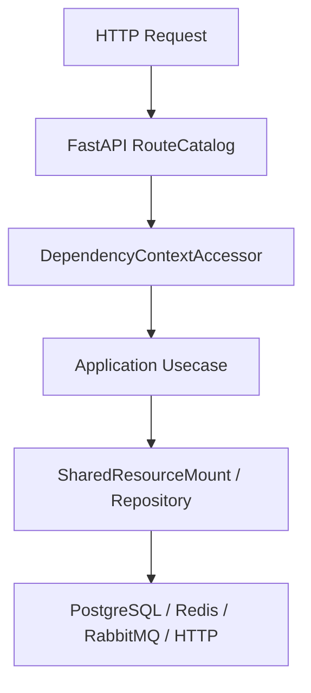

# 项目摘要

## 1. 文档目的
说明项目的真实定位、主要能力和当前代码边界，帮助接手者建立整体判断。

**最后更新范围**：覆盖项目入口、主要目录、依赖、部署入口、配置树和测试分层。

## 2. 适用读者
- 新人开发者
- 后端开发者
- 测试维护者
- 运维部署人员
- 安全审查人员

## 3. 关联源码
| 路径 | 作用 |
| --- | --- |
| `src/main.py` | 应用入口。 |
| `src/api/asgi_entry.py` | ASGI 工厂。 |
| `src/api/fastapi_app_assembler.py` | 应用装配器。 |
| `config/app_base.toml` | 基础应用配置。 |
| `pyproject.toml` | Python 版本、依赖和 pytest 配置。 |
| `Dockerfile` | 容器镜像入口。 |
| `compose.yml` | 本地服务编排。 |
| `compose.production.yml` | 生产环境 Compose 覆盖。 |

## 4. 核心结论
- `src/main.py` 暴露 `app = create_app()`，真实装配由 `FastApiAppAssembler` 完成。
- HTTP API 由 `src/api/web_module_manifest.py` 声明模块，再由 `WebBundleCatalog` 动态载入 provider。
- 用例层在 `src/application`，基础设施实现集中在 `src/infrastructure`。
- 持久化以 SQLAlchemy ORM 和 Alembic 迁移为主，当前配置默认使用 PostgreSQL。
- 生产容器仍由 `Dockerfile` 启动 `uvicorn src.main:app`；生产 Compose 通过 `compose.production.yml` 覆盖依赖服务端口暴露、Redis/RabbitMQ 凭据和生产环境变量。
- 测试目录按 `unit_test`、`contract_test`、`interface_test`、`integration_test`、`boundary_test`、`exception_test`、`initialization_test`、`path_test`、`convention_usage_test`、`class_inheritance_test` 分层。

## 5. 结构说明
`src` 下的代码呈现 API 接口层、应用层、核心契约、领域常量、基础设施实现和 CLI 入口等边界；`config` 提供 app、modules、runtime 三类配置；`test` 对关键契约、类继承约束和运行路径做分层验证。

## 6. 工作流程

## 7. 关键实现
| 组件 | 文件 | 职责 |
| --- | --- | --- |
| `create_app` | `src/api/asgi_entry.py` | 构建 FastAPI 应用。 |
| `FastApiAppAssembler.__call__` | `src/api/fastapi_app_assembler.py` | 加载配置、装配资源、绑定中间件和路由。 |
| `WebModuleManifestRegistry.list_entries` | `src/api/web_module_manifest.py` | 声明可用 Web 模块。 |

## 8. 如何修改或扩展
1. 先判断改动属于 API、usecase、runtime、data 还是 test。
2. 沿本说明书对应章节修改代码、配置和测试。
3. 更新本目录中对应主题文档，并在 `README.md` 保持入口可达。

## 9. 测试覆盖
| 测试类型 | 文件 | 验证内容 |
| --- | --- | --- |
| unit | `test/unit_test/test_fastapi_app_assembler_unit.py` | 验证 FastAPI 装配器行为。 |
| contract | `test/contract_test/test_http_contract.py` | 验证 HTTP 契约模型。 |
| interface | `test/interface_test/test_http_interface.py` | 验证 HTTP 接口表面。 |

## 10. 常见问题
- 本目录不替代历史执行方案；历史方案只作为背景资料。
- 待确认：当前仓库未发现 CI workflow，持续集成命令需由维护者确认。

## 11. 维护备注
修改项目范围、运行时或部署方式时，同步检查 README、架构、部署、测试和维护章节。

## 12. 相关文档
- [项目文档总览](../README.md)
- [快速启动](quick_start.md)
- [仓库地图](repository_map.md)
