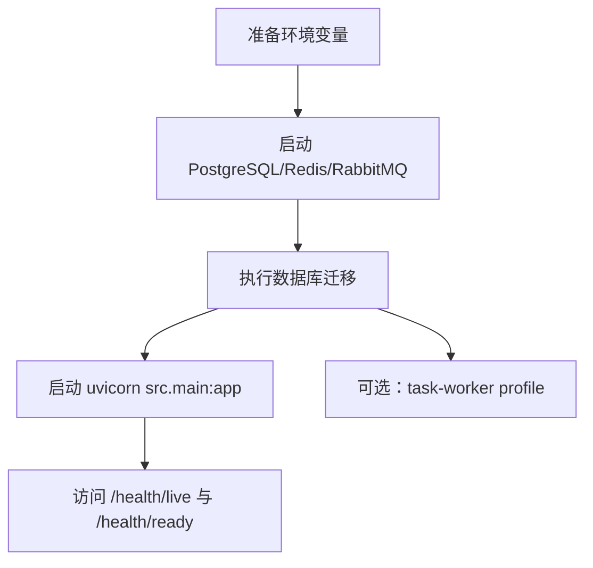

# 快速启动

## 1. 文档目的
说明本地和容器化启动路径，避免把 `.env` 中的真实敏感值写入文档。

**最后更新范围**：覆盖 `pyproject.toml`、`Dockerfile`、`compose.yml`、`compose.production.yml`、Web/任务 worker 进程、CLI 初始化命令与 CI 质量入口。

## 2. 适用读者
- 新人开发者
- 后端开发者
- 测试维护者
- 运维部署人员
- 安全审查人员

## 3. 关联源码
| 路径 | 作用 |
| --- | --- |
| `pyproject.toml` | 依赖和 pytest 配置。 |
| `Dockerfile` | 镜像构建和 `uvicorn src.main:app` 启动命令。 |
| `compose.yml` | 本地 PostgreSQL、Redis、RabbitMQ、migration、app 服务。 |
| `compose.production.yml` | 生产环境 Compose 覆盖：关闭依赖服务宿主机端口、启用生产环境变量和 Redis/RabbitMQ 凭据。 |
| `src/cli/run_database_migrations.py` | 数据库迁移 CLI。 |
| `src/cli/create_initial_admin.py` | 初始管理员 CLI。 |
| `src/cli/run_task_worker.py` | 独立任务消费进程入口。 |
| `.github/workflows/quality.yml` | 仓库持续集成的依赖服务与完整 nox 门禁。 |

## 4. 核心结论
- 本地依赖由 `uv.lock` 固定，`pyproject.toml` 要求 Python `>=3.11`；本机安装依赖可运行 `uv sync --frozen`。
- 容器入口执行 `uvicorn src.main:app --host 0.0.0.0 --port 8000`。
- 本机直接启动可使用 `.\.venv\Scripts\python.exe -m uvicorn src.main:app --host 127.0.0.1 --port 8000`；接口统一前缀默认为空，健康检查路径为 `/health/live` 和 `/health/ready`。
- Docker 本地启动先按仓库根目录 `.env.docker.example` 准备 `.env`，再运行 `docker compose --env-file .env up --build`。生产环境使用 GitHub Actions 构建的不可变镜像，完整流程以 [生产环境 CI 镜像部署与运维指南](../../生产环境Docker一键部署与长期运维指南.md) 为准，生产服务器不得执行 `up --build`。
- `compose.yml` 中 migration 服务先运行 `python -m src.cli.run_database_migrations`。
- 任务消费者是可选 Compose profile：`docker compose --env-file .env --profile task-worker up --build` 会额外运行 `python -m src.cli.run_task_worker`。该服务在基础 Compose 中也显式设置 `APP_ENV=production`，因此会按生产校验要求读取数据库、Redis、RabbitMQ、JWT 等环境变量；不要把它当作开发内存后端的附属线程。
- `compose.production.yml` 需与 `compose.yml` 叠加使用；它将 `APP_ENV` 设为 `production`，移除 PostgreSQL/Redis/RabbitMQ 的宿主机端口暴露，应用端口仍由 `compose.yml` 的 `APP_HOST_PORT` 控制。
- 开发环境默认配置使用内存缓存和本地消息后端；`compose.yml` 的 `migration` 服务会注入 `REDIS_URL` 和 `RABBITMQ_URL`，但 `app` 服务仍按开发配置使用内存缓存。生产环境配置切到 Redis/RabbitMQ，并要求通过环境变量注入 `REDIS_URL` 与 `RABBITMQ_URL`。
- 快速本地测试可用 `.\.venv\Scripts\python.exe -m pytest -q`；与仓库 CI 对齐的完整质量入口是 `uv sync --frozen --group dev` 后执行 `uv run nox -s static offline regression`，它需要与 workflow 相同类别的 PostgreSQL、带认证 Redis 和 RabbitMQ 测试资源。
- 生产环境 `.env` 真实值不得写入文档，只记录变量名和示例格式。

## 5. 结构说明
开发可使用本机 Python/uv 或 Docker Compose；配置加载由 `AppSettingsLoader` 按“基础层 TOML -> 环境层 TOML -> 非 production 的 `.env` -> 进程环境变量”合并，进程环境变量最后覆盖。

## 6. 工作流程

## 7. 关键实现
| 组件 | 文件 | 职责 |
| --- | --- | --- |
| `DatabaseMigrationCli.run` | `src/cli/run_database_migrations.py` | 执行 Alembic upgrade head。 |
| `InitialAdminCli.run` | `src/cli/create_initial_admin.py` | 创建初始管理员。 |
| `DotenvSettingsLoader.load` | `src/infrastructure/settings/dotenv_settings_loader.py` | 非 production 读取 `.env`。 |

## 8. 如何修改或扩展
1. 新增启动前置资源时更新 `compose.yml`、`compose.production.yml` 和 `Dockerfile`。
2. 新增必需环境变量时更新 `environment_variables.md` 和示例 env 文件。
3. 新增健康检查路径时同步 `Dockerfile` HEALTHCHECK 和 `health_api.md`。

## 9. 测试覆盖
| 测试类型 | 文件 | 验证内容 |
| --- | --- | --- |
| initialization | `test/initialization_test/test_runtime_initialization.py` | 验证运行时初始化。 |
| integration | `test/integration_test/test_migration_job_integration.py` | 验证迁移 CLI。 |
| interface | `test/interface_test/test_local_startup_interface.py` | 验证本地启动接口边界。 |

## 10. 常见问题
- 如果启动时报数据库不可达，检查 `DATABASE_URL`、PostgreSQL 容器健康状态和端口。
- 如果生产环境启动失败，检查 `JWT_SECRET`、`DATABASE_URL`、`REDIS_URL`、`RABBITMQ_URL` 是否由外部注入。

## 11. 维护备注
启动方式变化时，同步检查 `Dockerfile`、Compose 文件、CLI 文档、运维检查清单和历史 Docker 指南链接。

## 12. 相关文档
- [项目文档总览](../README.md)
- [环境变量](../07_configuration_deployment/environment_variables.md)
- [故障排查](../10_maintenance/troubleshooting.md)
