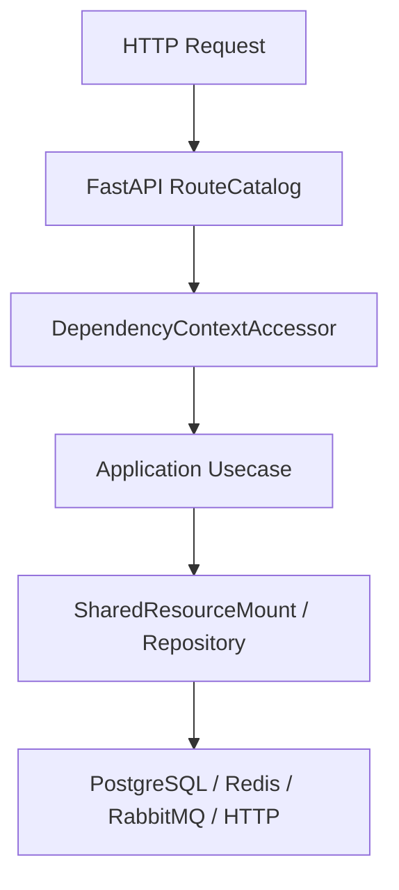

# 仓库地图

## 1. 文档目的
说明仓库主要目录的职责边界，帮助维护者快速定位代码。

**最后更新范围**：覆盖根目录、`src`、`config`、`test` 和 `docs` 的当前结构。

## 2. 适用读者
- 新人开发者
- 后端开发者
- 测试维护者

## 3. 关联源码
| 路径 | 作用 |
| --- | --- |
| `src/api` | HTTP API、路由、契约、Web 模块注册。 |
| `src/application` | 用例层和应用端口。 |
| `src/cli` | 数据库迁移和初始管理员等命令行入口。 |
| `src/core` | 跨层核心契约。 |
| `src/domain` | 领域常量、角色、scope、错误码。 |
| `src/infrastructure` | 运行时和外部资源实现。 |
| `config` | app、modules、runtime 三类 TOML 配置树。 |
| `test` | 按 `unit_test`、`contract_test`、`interface_test`、`integration_test`、`boundary_test`、`exception_test`、`initialization_test`、`path_test`、`convention_usage_test`、`class_inheritance_test` 分层的测试。 |

## 4. 核心结论
- `src/api/endpoint_*` 每个模块通常包含 `route_*.py` 和 `contract_*.py`。
- `src/application/ports` 定义应用层依赖端口，基础设施通过 `SharedResourceMount` 适配。
- `src/cli` 当前提供 `run_database_migrations` 与 `create_initial_admin` 两类运维初始化入口。
- `src/infrastructure/testing` 下 fake/test support 只用于测试。
- `config` 由 `AppSettingsLoader` 按基础层再环境层合并，缺失的环境覆盖文件会被跳过。
- `docs/project_manual` 是当前说明书，原有 `/docs` 历史文档保留不移动。

## 5. 结构说明
目录按职责分层，不按技术包简单堆叠；API、应用、核心契约、基础设施和测试之间保持可追溯引用。

## 6. 工作流程

## 7. 关键实现
| 组件 | 文件 | 职责 |
| --- | --- | --- |
| `ApplicationModuleName` | `src/core/http_contract/web_bundle_contract.py` | 定义 Web 模块名。 |
| `WebModuleManifestRegistry` | `src/api/web_module_manifest.py` | 维护模块清单。 |
| `AppSettingsLoader` | `src/infrastructure/settings/app_settings_loader.py` | 加载配置树。 |

## 8. 如何修改或扩展
1. 新增 API 模块放入 `src/api/endpoint_*`。
2. 新增应用行为放入 `src/application`，端口放入 `src/application/ports`。
3. 新增外部资源实现放入 `src/infrastructure` 并补测试。

## 9. 测试覆盖
| 测试类型 | 文件 | 验证内容 |
| --- | --- | --- |
| path | `test/path_test/test_fast_development_skeleton_path.py` | 验证骨架路径约定。 |
| unit | `test/unit_test/test_web_module_manifest_unit.py` | 验证 Web 模块清单。 |
| convention_usage | `test/convention_usage_test/test_end_to_end_usage.py` | 验证端到端用法约定。 |
| class_inheritance | `test/class_inheritance_test/test_runtime_contract_inheritance.py` | 验证运行时契约继承约定。 |

## 10. 常见问题
- 待确认：`src/temp` 当前存在但未从核心装配链路确认用途。

## 11. 维护备注
目录调整时同步更新本文件、README、开发指南和路径测试。

## 12. 相关文档
- [项目文档总览](../README.md)
- [命名规范](../../standard/命名规范.md)
- [新增 API](../09_development_guide/adding_new_api.md)
