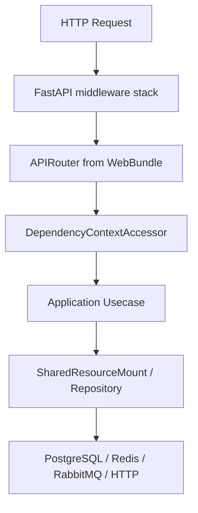

# 架构总览

## 1. 文档目的
解释项目为什么采用 API/应用/契约/基础设施分层，以及请求和资源如何穿过这些层。

**最后更新范围**：覆盖入口、装配器、Web 模块、应用容器、中间件链、可选指标出口和运行时资源门面。

## 2. 适用读者
- 新人开发者
- 后端开发者
- 测试维护者
- 运维部署人员
- 安全审查人员

## 3. 关联源码
| 路径 | 作用 |
| --- | --- |
| `src/main.py` | ASGI 入口。 |
| `src/api/asgi_entry.py` | `AsgiApplicationFactory`。 |
| `src/api/web_bundle_catalog.py` | Web 模块 provider 汇总。 |
| `src/api/web_module_manifest.py` | Web 模块清单与后台边界策略。 |
| `src/api/fastapi_app_assembler.py` | `FastApiAppAssembler`。 |
| `src/infrastructure/fastapi_route_composer.py` | 按启用模块挂载 `WebBundle.router`。 |
| `src/infrastructure/fastapi_lifespan_orchestrator.py` | 生命周期上下文。 |
| `src/infrastructure/resource_mount` | 资源启动、释放和访问器刷新协作对象。 |
| `src/infrastructure/resource_slot` | 数据库和 HTTP 共享资源槽。 |
| `src/infrastructure/shared_resource_mount.py` | 运行时资源门面。 |

## 4. 核心结论
- 应用入口极薄，`src/main.py` 只调用 `create_app()`。
- `FastApiAppAssembler.__call__` 是配置加载、资源门面、异常呈现、中间件、可选 Prometheus 指标、路由和 OpenAPI 的装配中心。
- Web 模块由 `WebModuleManifestRegistry` 声明、`WebBundleCatalog` 加载 provider，再由 `FastApiRouteComposer.compose` 按 `settings.app.modules.enabled` 和 `settings.runtime.web.api_prefix` 挂载 `APIRouter`。
- 路由模块不直接创建数据库或缓存连接，而是通过 `DependencyContextAccessor` 从 `request.app.state.container` 读取用例、`ResponseEnvelopeFactory`、`RequestExecutionBridge` 和 `SharedResourceMount`。
- 同步主干用例通过 `RequestExecutionBridge.run_sync` 执行；该桥接器按运行时契约选择线程池卸载或原生异步执行，并在线程池策略下降低阻塞事件循环风险。
- 生产任务执行与 Web 进程分离：Web `app` 写入 Outbox 并可靠发布，`task-worker` profile 通过相同任务注册契约消费 RabbitMQ，二者可独立横向扩容。

## 5. 结构说明
架构由接口层 `src/api`、应用层 `src/application`、核心契约 `src/core`、领域常量 `src/domain`、基础设施 `src/infrastructure` 组成。

## 6. 工作流程

## 7. 关键实现
| 组件 | 文件 | 职责 |
| --- | --- | --- |
| `AsgiApplicationFactory.__call__` | `src/api/asgi_entry.py` | 把 ASGI 创建请求转给装配器。 |
| `FastApiAppAssembler._build_application_container` | `src/api/fastapi_app_assembler.py` | 集中创建用例对象。 |
| `FastApiRouteComposer.compose` | `src/infrastructure/fastapi_route_composer.py` | 按配置挂载启用模块的 `APIRouter`。 |
| `FastApiMiddlewarePlan.build_bindings` | `src/infrastructure/fastapi_middleware_plan.py` | 生成中间件计划，装配器反向调用 `add_middleware` 以保持计划顺序。 |
| `FastApiAppAssembler._bind_prometheus_metrics` | `src/api/fastapi_app_assembler.py` | 按指标配置绑定 HTTP 指标中间件和指标出口路由。 |
| `SharedResourceMount.startup` | `src/infrastructure/shared_resource_mount.py` | 初始化运行时资源。 |

## 8. 如何修改或扩展
1. 新增能力先判断是否属于 route、usecase、core contract 或 infrastructure adapter。
2. 跨层调用优先经过端口或资源门面，不让 route 直接掌握底层资源生命周期。
3. 补充对应测试并更新本说明书中相关专题。

## 9. 测试覆盖
| 测试类型 | 文件 | 验证内容 |
| --- | --- | --- |
| unit | `test/unit_test/test_fastapi_app_assembler_unit.py` | 装配器单元验证。 |
| initialization | `test/initialization_test/test_runtime_initialization.py` | 运行时初始化验证。 |
| path | `test/path_test/test_web_execution_path.py` | Web 执行路径验证。 |

## 10. 常见问题
- 生产部署已提供独立 `task-worker` profile；未启用该 profile 时 Web 发布和 Outbox 恢复仍可运行，但队列不会由本栈消费。

## 11. 维护备注
任何入口、装配器或运行时门面变更，都要同步更新架构、后端装配、运行时生命周期和部署文档。

## 12. 相关文档
- [项目文档总览](../README.md)
- [分层架构](layered_architecture.md)
- [FastAPI 应用装配](../02_backend/fastapi_app_assembly.md)
