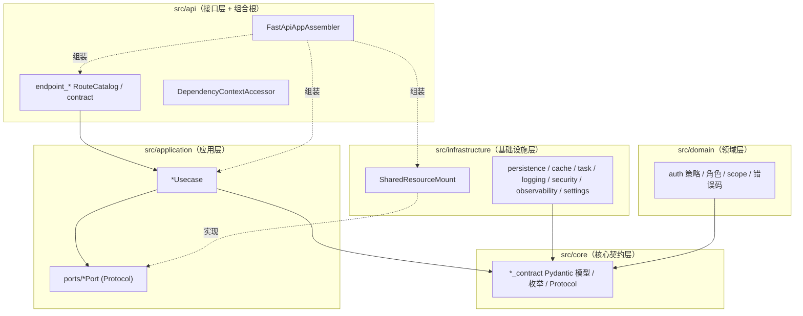

# 架构总览

## 1. 这是什么

本文是整个后端骨架的架构入口文档：解释项目由哪些层组成、一个 HTTP 请求与一条后台任务分别如何穿过这些层、运行时资源（数据库/缓存/消息/日志/安全）由谁创建和管理，以及这些决定背后的取舍。读完本文应该能回答三个问题：

1. 代码放在哪一层才是对的？
2. 一个请求从进入到返回经过了哪些对象？
3. 为什么装配、资源、契约要拆成现在这个样子？

**最后更新范围**：基于当前 `src/` 全量源码，覆盖入口、装配器、Web 模块清单、应用容器、中间件链、OpenTelemetry/Prometheus 可观测性接线、运行时资源门面与任务运行时拓扑。文件数与行数会持续变化，不作为架构契约。

## 2. 设计思想与动机

本项目采用"端口与适配器（Hexagonal）+ 组合根（Composition Root）+ 契约信封（Envelope Contract）"的组合：

- **端口与适配器**：应用用例依赖 `src/application/ports` 中的 Protocol、`src/core` 契约与 `src/domain` 领域事实，不知道 SQLAlchemy、Redis、RabbitMQ、FastAPI 的存在。基础设施实现这些端口，替换外部组件时不应迫使用例改为依赖具体实现。
- **Web 组合根**：Web 进程的主对象图集中在 `FastApiAppAssembler`（`src/api/fastapi_app_assembler.py`）；`AsgiApplicationFactory` 负责参数转发，`DependencyContextAccessor` 负责从已装配容器读取依赖。这里的“集中”是代码组织约定，不是 import-linter 的逐文件白名单：`pyproject.toml` 只强制四条层级禁令，`src/api` 作为最外层可依法依赖内层。CLI 和资源门面也会组装各自局部对象图。
- **版本化契约**：许多运行时配置、日志事件、任务注册、告警规则与资源操作结果采用 `header + detail` 的 Pydantic 信封模式；HTTP 响应则是 `header + data`，`RequestScope` 等简单契约不使用信封。信封通常以 kind/schema_version 和判别联合约束 header/detail 一致，`extra="forbid"` 让未知字段尽早失败，但不能把这一模式误称为全部结构化数据的唯一形状。
- **单一运行时快照**：所有可热更新的运行时状态（配置、HTTP 客户端、任务运行时、鉴权依赖）打包进一个 frozen 的 `RuntimeBundle`，读取方通过 `SharedResourceMount.read_runtime_bundle()` 拿到同一代（generation）的一致快照，避免热更新过程中读到"新配置+旧连接池"的撕裂状态。

为什么不用常见的全局 `Depends(get_db)` + 模块级单例？因为该风格把资源生命周期分散到路由和依赖函数里，热更新、优雅停机、按环境替换实现都会变得不可控。本项目刻意把资源生命周期收敛到 `SharedResourceMount` 一个门面之后。

## 3. 关联源码

| 路径 | 作用 |
| --- | --- |
| `src/main.py` | ASGI 入口，仅 `app = create_app()` 一行有效逻辑。 |
| `src/api/asgi_entry.py` | `AsgiApplicationFactory`，把入参转发给装配器；模块级单例 `create_app`。 |
| `src/api/fastapi_app_assembler.py` | 组合根 `FastApiAppAssembler` 与 `ApplicationContainer`（约 40 个用例字段）。 |
| `src/api/web_module_manifest.py` | `WebModuleManifestRegistry`：9 个 Web 模块的集中清单与后台边界策略。 |
| `src/api/web_bundle_catalog.py` | `WebBundleCatalog`：按 manifest 动态 import provider 并做一致性校验。 |
| `src/infrastructure/fastapi_route_composer.py` | 按 `app.modules.enabled` 挂载 `WebBundle.router`。 |
| `src/infrastructure/fastapi_lifespan_orchestrator.py` | lifespan 上下文，驱动资源 startup/shutdown 与 `app.state.ready`。 |
| `src/infrastructure/shared_resource_mount.py` | 五个门面 Mixin 组合成的运行时资源总门面。 |
| `src/infrastructure/resource_mount/` | 资源生命周期、启动器、释放器、访问器刷新器与各域门面。 |
| `src/infrastructure/resource_slot/` | 数据库会话管理器与同步/异步 HTTP 客户端资源槽。 |
| `pyproject.toml` | import-linter 分层契约（4 条 forbidden 规则）。 |

## 4. 分层与职责

各层职责与禁区：

| 层 | 职责 | 禁区 |
| --- | --- | --- |
| `src/core` | 纯契约：Pydantic 模型、StrEnum、Protocol、异常类型。 | 禁止 import api/application/domain/infrastructure（import-linter 强制）。唯一例外：`web_bundle_contract.WebBundle` 显式持有 `fastapi.APIRouter`，作为 Web 装配交接契约。 |
| `src/domain` | 领域事实：授权策略常量（`admin_route_authorization_policy.py`）、`AuthRoleKey`/`AuthScopeCode`/`AuthErrorCode` 枚举、`AccessTokenPolicy`。 | 禁止依赖 api/application/infrastructure。 |
| `src/application` | 用例编排 + 端口定义。用例通过 `runtime_port`（Protocol）拿依赖，通过 `UnitOfWork` 控制事务。 | 禁止依赖 api/infrastructure；不接收 FastAPI `Request`，需要请求信息时接收 `RequestScope` 等 core 契约对象。 |
| `src/api` | HTTP 适配（route/contract）、Web 模块清单、组合根。 | 路由不直接创建数据库/缓存连接，不写事务逻辑。 |
| `src/infrastructure` | 一切外部资源适配与 FastAPI 粘合件（middleware、exception presenter、lifespan）。 | import-linter 仅禁止依赖 `src/api`；实现应用端口时通常依赖 `application/ports`，当前仓储映射和资源门面也会引用少量 application 命令/守卫类型。 |

## 5. 核心实现：一个请求的完整旅程

1. **进程启动**：uvicorn 加载 `src.main:app` → `create_app()`（`AsgiApplicationFactory`）→ `FastApiAppAssembler.__call__` 按以下顺序装配：
   加载配置（`AppSettingsLoader`）→ 校验启用模块（`WebBundleCatalog.validate_enabled_modules`）→ 构建 logger → 构建 `SharedResourceMount`（含任务绑定注册）→ 构建 `SettingsReloadCoordinator` → 构建 `ApplicationContainer`（集中 new 出全部用例）→ 创建 `FastAPI` 实例（`OrjsonDocumentResponse` 为默认响应类、`FastApiLifespanOrchestrator` 为 lifespan）→ 绑定异常呈现器 → 绑定中间件计划 → 按指标配置绑定 Prometheus 出口 → `FastApiRouteComposer.compose` 挂载启用模块路由 → 绑定 OpenAPI 表面。
   该阶段会读取 TOML/环境变量并构建 logger 等本地对象，但**尚未连接 PostgreSQL、Redis、RabbitMQ 或出站 HTTP 客户端等运行时外部资源**；`app.state.ready = False`。
2. **lifespan 进入**：`ApplicationLifespanContext.__aenter__` 调 `SharedResourceMount.startup()`，由 `RuntimeResourceBootstrapper` 按序初始化 HTTP → 数据库（含可选 Alembic 迁移与 bootstrap admin）→ 日志 → 缓存与安全基础设施 → 消息与任务运行时。任一步失败则标记 failed、执行 shutdown 并让进程启动失败（fail-fast）。成功后 `app.state.ready = True`。
3. **请求进入**：OTel 关闭时，Starlette 栈是 `ServerErrorMiddleware` → 可选 Prometheus HTTP 指标 → `FastApiMiddlewarePlan` 项目链（可选 CORS→RequestScope→PayloadGuard→AuthenticationBinding→RateLimit→SecurityHeader→ElapsedProbe→可选 AccessLog）→ `ExceptionMiddleware` → FastAPI 内部层/路由。OTel 开启时，当前 instrumentation 会重写栈构建，在原用户栈外再包默认 `ServerErrorMiddleware`、`OpenTelemetryMiddleware`、带项目 catch-all 的 `ServerErrorMiddleware` 与异常记录层，而不是简单插入一项用户 middleware。详见[请求生命周期](request_lifecycle.md)。
4. **路由执行**：路由函数通过 `DependencyContextAccessor.read_route_context(request)` 从 `request.app.state.container` 读取用例与 `ResponseEnvelopeFactory`；需要授权的路由用 `read_authorized_principal(request, requirement)` 执行角色/scope 断言。
5. **用例执行**：同步用例经 `RequestExecutionBridge.run_sync(execution_name=..., callable_object=...)` 卸载到专用线程池，避免阻塞事件循环。基础/开发配置为 `threadpool`、8 worker + 32 pending、2s 排队超时、15s 执行超时；测试覆盖为 4 + 8、1s、5s，部署时应以合并后的运行时配置为准。容量获取超时返回 503 `system.capacity.exhausted`，已提交执行超时返回 504 `system.request.timeout`。
6. **持久化**：用例内 `runtime_port.create_unit_of_work()` 开工作单元，仓储用同一 `PersistenceSession` 读写，业务成功才 `commit()`，异常路径 `rollback()`，`finally` 中 `dispose()`。
7. **响应返回**：正常与异常路径都产出 `ResponseEnvelope{header{code,message,request_id,trace_id}, data}`，异常由 `FastApiExceptionPresenter` 统一转换。

**任务链路**（与请求链路分离）：Web 进程接收派发请求后，在同一事务中写任务执行记录 + Outbox（`TaskExecutionStore.reserve_with_outbox`），提交后由 `TaskExecutionOutboxPublisher` 发布到消息总线；生产环境由独立 `task-worker` 容器（`src/cli/run_task_worker.py`，强制 `worker_enabled=true`）消费 RabbitMQ 队列。二者共享同一套任务注册契约，可独立横向扩容。详见[任务运行时](../04_infrastructure/task_runtime.md)。

## 6. 关键设计取舍（为什么这样设计）

| 取舍 | 选择 | 原因 |
| --- | --- | --- |
| 路由如何拿依赖 | 单一 `DependencyContextAccessor` 读 `app.state.container`，授权守卫仍用 FastAPI `Depends` 声明 | 依赖读取路径集中；`TestAppFactory` 可通过 settings、数据库引擎工厂和任务绑定替换装配输入，路由无需各自维护资源工厂。 |
| 同步用例 vs async | 用例保持同步 + 线程池桥接，而非全面 async | 数据库驱动（psycopg 同步连接池）、密码哈希（argon2 CPU 密集）都是阻塞操作；有界线程池 + 显式超时给出可推理的背压模型，避免"假 async 真阻塞"卡死事件循环。 |
| 模块启用 | 配置 `app.modules.enabled` + manifest 双向校验 | 配置写错模块名启动即失败（列出可用模块名）；启用了但没挂载成功也失败（`FastApiRouteComposer` 反向核对）。 |
| 资源热更新 | `SettingsApplyTransaction` 原子切换候选资源 | 新配置先构建/探活候选资源，成功才一次性发布新 `RuntimeBundle` 并延迟释放旧资源；失败回滚旧快照并发配置安全事件。 |
| 后台权限 | 领域层集中声明 `RouteAuthorizationRequirement`，manifest 声明边界策略并启动时交叉校验 | 权限事实源唯一（`admin_route_authorization_policy.py`），新增后台模块漏配策略会在启动时报 `ADMIN_BOUNDARY_POLICY_MISMATCH`。 |
| 响应序列化 | orjson（`OrjsonDocumentResponse`） | 项目明确选择 `orjson.dumps`，并把正常与错误 JSON renderer 收敛到同一响应类；性能收益应以项目基准为准，不在架构契约中承诺倍数。 |

## 7. 如何使用本架构

- 新增业务接口：按[新增 API](../09_development_guide/adding_new_api.md) 走 contract → usecase → port → route catalog → manifest 的顺序。
- 新增外部资源：按[新增运行时组件](../09_development_guide/adding_new_runtime_component.md) 在 `SharedResourceMount` 补安装/清理/状态标记/getter，四处都不能漏。
- 判断代码归属：数据形状/枚举 → core；业务规则常量 → domain；流程编排 → application；HTTP 细节 → api；外部 IO → infrastructure。

## 8. 注意事项

- `FastApiAppAssembler` 是 Web 主组合根，但不是仓库中唯一允许 `new` 对象的位置；CLI、测试工厂和 `SharedResourceMount` 的资源生命周期组件各自有局部组装职责。评审应拦截的是在路由/用例中绕过既有端口和生命周期门面直接创建外部资源。
- `ApplicationContainer` 与 `RouteDependencyContext` 的字段是逐一显式声明的（当前约 40 个用例）；新增用例必须同时更新 `_build_application_container` 与 `DependencyContextAccessor.read_route_context`，漏一处启动即 TypeError，属于有意的 fail-fast。
- import-linter 契约在 `uv run nox -s static` 中执行；绕过分层的 import 无法通过 CI。
- `src/infrastructure/testing`（fake 与测试支撑）只允许被测试与 `TestAppFactory` 引用，禁止进入生产装配路径。

## 9. 测试覆盖

| 测试类型 | 文件 | 验证内容 |
| --- | --- | --- |
| unit | `test/unit_test/test_fastapi_app_assembler_unit.py` | 装配顺序、容器构建、指标绑定开关。 |
| unit | `test/unit_test/test_web_module_manifest_unit.py` | manifest 一致性与后台边界策略。 |
| initialization | `test/initialization_test/test_runtime_initialization.py` | 资源启动顺序与失败标记。 |
| path | `test/path_test/test_web_execution_path.py` | 请求主链路端到端路径。 |
| integration | `test/integration_test/test_app_integration.py` | 真实依赖下的完整应用启动。 |

## 10. 相关文档

- [项目文档总览](../README.md)
- [分层架构](layered_architecture.md)
- [请求生命周期](request_lifecycle.md)
- [运行时资源生命周期](runtime_resource_lifecycle.md)
- [FastAPI 应用装配](../02_backend/fastapi_app_assembly.md)
- [架构决策](design_decisions.md)
