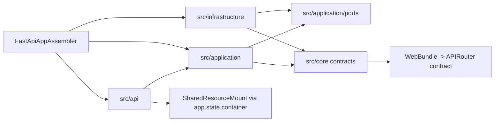

# 依赖方向

## 1. 文档目的
说明项目内允许的依赖方向，帮助评审避免反向依赖和基础设施泄漏。

**最后更新范围**：覆盖应用端口、核心契约、基础设施实现、WebBundle 契约、UnitOfWork/PersistenceSession 事务会话契约和路由调用方式。

## 2. 适用读者
- 新人开发者
- 后端开发者
- 测试维护者

## 3. 关联源码
| 路径 | 作用 |
| --- | --- |
| `src/application/ports` | 应用层端口。 |
| `src/core/*_contract` | 核心契约。 |
| `src/core/http_contract/web_bundle_contract.py` | `WebBundle` 契约；当前显式承载 FastAPI `APIRouter`。 |
| `src/core/persistence_contract/unit_of_work_contract.py` | `UnitOfWork` 契约；通过 `PersistenceSession` 协议暴露最小事务会话能力。 |
| `src/application/ports/auth_runtime_port.py` | 鉴权用例端口；仓储工厂方法沿用 `PersistenceSession` 类型。 |
| `src/infrastructure/shared_resource_mount.py` | 端口实现与资源门面。 |
| `src/api/fastapi_app_assembler.py` | 依赖汇聚和对象注入。 |
| `src/api/dependency_context_accessor.py` | 接口层读取应用容器。 |

## 4. 核心结论
- 应用用例依赖端口，不依赖 FastAPI Request。
- 基础设施可以依赖 core/application 端口并实现它们。
- route 负责 HTTP 适配，可读取用例但不直接处理数据库事务。
- 当前存在一个有意的 HTTP 契约例外：`src/core/http_contract/web_bundle_contract.py` 的 `WebBundle` 持有 `fastapi.APIRouter`，用于把 Web 模块清单、provider 和装配器连接起来；该耦合不应扩散到普通业务契约或应用用例。
- 持久化契约统一通过 `UnitOfWork.get_session()` 返回 `PersistenceSession` 协议，并由 `AuthRuntimePort` 的仓储工厂方法接收该协议；普通用例仍只通过 `UnitOfWork`、仓储契约和端口工作，不直接 import ORM model、SQLAlchemy `Session` 或基础设施实现。
- `FastApiAppAssembler` 是依赖汇聚点，可以同时 import API provider、application usecase、core contract 和 infrastructure adapter；用例本身仍通过端口接收 `SharedResourceMount` 提供的能力。
- 测试 fake 位于 `src/infrastructure/testing`，只用于测试和测试应用工厂。

## 5. 结构说明
主链路依赖方向是 API -> application -> ports/core；infrastructure 实现 ports/core 并由装配器注入。装配层作为组合根允许跨层引用。核心层中的 WebBundle 契约是为了注册 `APIRouter` 的 HTTP 表面契约，持久化契约中的 `PersistenceSession` 是事务会话边界；这些例外不代表普通业务契约可以依赖 FastAPI、ORM model、SQLAlchemy `Session` 或基础设施实现。

## 6. 工作流程

## 7. 关键实现
| 组件 | 文件 | 职责 |
| --- | --- | --- |
| `ApplicationPortEnvelope` | `src/application/ports/application_port_contract.py` | 描述应用端口信息。 |
| `WebBundle` | `src/core/http_contract/web_bundle_contract.py` | 承载 Web 模块名和 `APIRouter`，供 provider 与装配器交接。 |
| `UnitOfWork` | `src/core/persistence_contract/unit_of_work_contract.py` | 事务端口。 |
| `AuthRuntimePort` | `src/application/ports/auth_runtime_port.py` | 通过 `UnitOfWork` 和 `PersistenceSession` 创建鉴权仓储。 |
| `SharedResourceMount.create_unit_of_work` | `src/infrastructure/shared_resource_mount.py` | 提供事务实现。 |

## 8. 如何修改或扩展
1. 新增外部依赖时先定义端口或复用 core contract。
2. 不要让 usecase import 具体 ORM model、SQLAlchemy `Session`、基础设施实现或 FastAPI Request；需要事务会话时沿用 `UnitOfWork` 暴露的 `PersistenceSession` 边界。
3. 新增 Web 模块时通过 manifest/provider 输出 `WebBundle`，不要在装配器之外散落 `include_router`。
4. 在 review checklist 中检查依赖方向。

## 9. 测试覆盖
| 测试类型 | 文件 | 验证内容 |
| --- | --- | --- |
| unit | `test/unit_test/test_application_port_boundary_unit.py` | 应用端口边界。 |
| boundary | `test/boundary_test/test_hard_migration_module_boundary.py` | 模块与运行时边界。 |
| path | `test/path_test/test_runtime_path.py` | 运行时路径。 |

## 10. 常见问题
- 如果出现循环 import，优先检查 route/usecase/infrastructure 边界是否互相穿透。

## 11. 维护备注
变更端口和依赖方向时同步更新架构决策与评审清单。

## 12. 相关文档
- [项目文档总览](../README.md)
- [评审清单](../09_development_guide/review_checklist.md)
