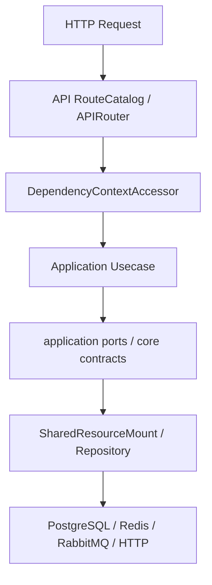

# 分层架构

## 1. 文档目的
说明 API、应用、核心契约、领域和基础设施层的职责边界。

**最后更新范围**：覆盖 `src/api`、`src/application`、`src/core`、`src/domain`、`src/infrastructure` 和 Web 模块装配边界。

## 2. 适用读者
- 新人开发者
- 后端开发者
- 测试维护者

## 3. 关联源码
| 路径 | 作用 |
| --- | --- |
| `src/api` | 接口层。 |
| `src/application` | 用例层。 |
| `src/application/ports` | 应用端口。 |
| `src/core` | 核心契约。 |
| `src/core/http_contract/web_bundle_contract.py` | Web 模块契约，当前承载 `APIRouter`。 |
| `src/core/persistence_contract/unit_of_work_contract.py` | 工作单元契约，当前通过 `PersistenceSession` 协议描述事务会话能力。 |
| `src/domain/auth` | 认证领域策略、角色、scope 和错误码常量。 |
| `src/infrastructure` | 基础设施适配。 |

## 4. 核心结论
- 接口层负责 HTTP 入参、响应契约和权限依赖。
- 应用层负责业务用例编排，不直接绑定 FastAPI；需要请求信息时接收 `RequestScope` 等 core 契约对象，而不是 FastAPI `Request`。
- 核心契约层提供 Pydantic 模型、抽象端口和枚举；其中 `WebBundle` 是当前 Web 装配契约例外，显式持有 `fastapi.APIRouter` 以连接 manifest/provider 和装配器；`UnitOfWork` 仅暴露 `PersistenceSession` 最小会话协议，不向 core 契约泄漏具体 ORM 会话类型。
- 领域层目前集中在 `src/domain/auth`，承载认证策略、角色键、scope code 和错误码等领域事实。
- 基础设施层实现数据库、缓存、任务、日志、安全等外部资源适配。

## 5. 结构说明
`src/application/ports` 中的 Protocol 让用例依赖抽象；`SharedResourceMount` 同时实现多个应用端口并对接具体 infrastructure。认证和持久化链路中，普通用例通过 `UnitOfWork`、仓储契约和端口拿到 `PersistenceSession` 会话边界，不直接 import ORM model 或 SQLAlchemy `Session`。Web 路由由 `src/api` 中的 `*RouteCatalog` 生成 `APIRouter`，再通过 `WebBundleProvider` 输出给装配器统一挂载。

## 6. 工作流程

## 7. 关键实现
| 组件 | 文件 | 职责 |
| --- | --- | --- |
| `AdminIdentityPort` | `src/application/ports/admin_identity_port.py` | 管理员身份用例依赖端口。 |
| `AuthIdentityRepository` | `src/core/persistence_contract/auth_identity_repository_contract.py` | 认证身份仓储契约。 |
| `UnitOfWork` | `src/core/persistence_contract/unit_of_work_contract.py` | 事务边界与会话生命周期契约。 |
| `WebBundle` | `src/core/http_contract/web_bundle_contract.py` | Web 模块名与 `APIRouter` 的交接契约。 |
| `AdminIdentityRepositoryImpl` | `src/infrastructure/persistence/repository_impl/admin_identity_repository_impl.py` | 仓储实现。 |

## 8. 如何修改或扩展
1. 新增业务先写应用层输入/输出对象和用例。
2. 如果用例需要外部资源，先定义或复用端口。
3. 在基础设施层实现端口并通过装配器注入。
4. 新增 HTTP 模块时补 route catalog、bundle provider 和 manifest，不在业务用例里引入 FastAPI 类型。

## 9. 测试覆盖
| 测试类型 | 文件 | 验证内容 |
| --- | --- | --- |
| unit | `test/unit_test/test_application_port_boundary_unit.py` | 验证应用端口边界。 |
| contract | `test/contract_test/test_http_contract.py` | 验证核心 HTTP 契约。 |
| class_inheritance | `test/class_inheritance_test/test_runtime_contract_inheritance.py` | 验证运行时契约继承。 |

## 10. 常见问题
- 如果 route 直接访问 ORM，会破坏分层；当前主链路通过用例和端口访问资源。

## 11. 维护备注
新增或移动层级边界时，同步更新开发指南和测试目录说明。

## 12. 相关文档
- [项目文档总览](../README.md)
- [依赖方向](dependency_direction.md)
- [应用端口](../03_application_domain/application_ports.md)
