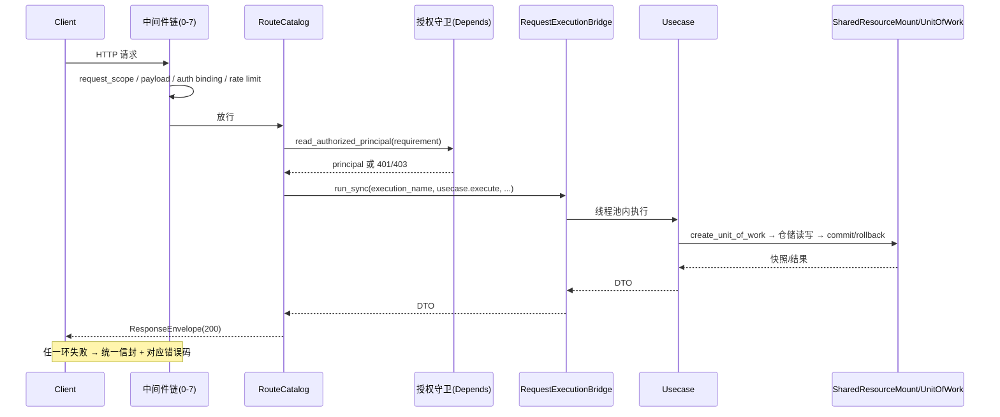

# 请求生命周期

## 1. 这是什么

逐步追踪一个 HTTP 请求从 TCP 连接进入 uvicorn，到穿过全部中间件、路由授权依赖、用例、线程池桥接、仓储，最终以统一响应信封返回的完整链路。排查"请求为什么慢/为什么 401/为什么没有 request_id"时，本文给出每一步的挂载点与对应文件。

**最后更新范围**：覆盖 `FastApiMiddlewarePlan` 的 7 个项目中间件与可选 CORS、可选 Prometheus HTTP 指标层、OTel 接线、Starlette 两层异常中间件、`DependencyContextAccessor`、`RequestExecutionBridge` 容量模型与异常出口。

## 2. 中间件链：顺序与语义

`FastApiMiddlewarePlan.build_bindings`（`src/infrastructure/fastapi_middleware_plan.py`）生成一个**按请求进入顺序排列**的 `Middleware` 列表，装配器用 `app.user_middleware = [*bindings, *app.user_middleware]` 一次性前插，保证计划内部“列表顺序 = 入站顺序”。完整 ASGI 栈还包含框架层与可观测性层：

- OTel 关闭：`ServerErrorMiddleware(项目 Exception catch-all)` → 可选 `PrometheusHttpMetricsMiddleware` → 下表计划层 → `ExceptionMiddleware(具体异常映射)` → `AsyncExitStackMiddleware` → 路由。
- OTel 开启：当前 `opentelemetry-instrumentation-fastapi` 会重写 `build_middleware_stack`，形成 `ServerErrorMiddleware(OTel 自身故障兜底)` → `OpenTelemetryMiddleware` → `ServerErrorMiddleware(项目 Exception catch-all)` → OTel `ExceptionHandlerMiddleware`（记录 span 异常后重抛）→ 可选 Prometheus → 下表计划层 → `ExceptionMiddleware` → `AsyncExitStackMiddleware` → 路由。

OTel 包装由 instrumentation 库管理，不写入 `middleware_trace`；升级 FastAPI/Starlette/OTel 时应重新核对库实现，不能只凭 trace 头推断完整 ASGI 栈。

| 序 | 中间件 | 文件 | 职责 | 条件 |
| --- | --- | --- | --- | --- |
| 0 | `CORSMiddleware` | starlette | 按 `runtime.web.cors.*` 处理预检与响应头 | `cors.enabled=true` 时插入最前 |
| 1 | `RequestScopeMiddleware` | `middleware_chain/request_scope_middleware.py` | 生成/透传 `X-Request-ID`、读取 trace id（OTel 开启读 `traceparent`，否则读 `X-Trace-ID`）、构建 `request.state.request_scope`、初始化 `middleware_trace`，并将作用域绑定到 contextvar（供出站 HTTP 钩子、日志构建器读取），响应时回写 `X-Request-ID`/`X-Trace-ID` | 始终 |
| 2 | `PayloadGuardMiddleware` | `payload_guard_middleware.py` | 双重请求体限制：`content-length` 头超过 `runtime.web.max_request_body_bytes` 直接 413；缺失/非法/伪小长度时用 `PayloadLimitedReceive` 流式累计字节兜底，超限信号转 413 统一信封并发安全事件。响应已开始写时无法换包，信号上抛，最外层只能记录异常而不能重写已发送响应 | 始终 |
| 3 | `AuthenticationBindingMiddleware` | `authentication_binding_middleware.py` | 提取 Bearer → 解码 access token → 经线程池查库校验主体存在/启用、令牌会话存在/主体一致/未吊销/未过期 → 绑定 `request.state.authenticated_principal`；可选 Token-IP 绑定校验。**无效 Bearer 立即 401**；未携带令牌放行，由路由级守卫决定是否要求认证 | 始终 |
| 4 | `RateLimitMiddleware` | `rate_limit_middleware.py` | 中间件始终进入并追加 trace；若 flow_control 与 ip_block 都关闭则立即放行，否则按路径+方法解析策略，委托 `SecurityProtectionGuard.evaluate_request` 组合 IP 封禁与滑动窗口限流；拒绝时 429 + `Retry-After`，缓存故障按配置 fail mode 处理 | 中间件始终挂载，防护逻辑按运行时开关启停 |
| 5 | `SecurityHeaderMiddleware` | `security_header_middleware.py` | 响应阶段追加 `X-Content-Type-Options`/`X-Frame-Options`/`Referrer-Policy`/`Permissions-Policy`，按配置追加 HSTS/CSP；`include_middleware_trace_header=true` 时输出 `X-Middleware-Trace` | 始终（头受配置控制） |
| 6 | `ElapsedProbeMiddleware` | `elapsed_probe_middleware.py` | 入站先开始 perf_counter，内层返回后才写 `request.state.elapsed_milliseconds` 与响应头 `X-Elapsed-Ms` | 始终 |
| 7 | `AccessLogMiddleware` | `access_log_middleware.py` | 内层返回后构建结构化访问日志事件（route_name、状态码、`elapsed_milliseconds`）投入日志缓冲；**按当前顺序它先于外层 ElapsedProbe 的回程赋值执行，因此读到默认 `0.0`** | `runtime.web.enable_access_log=true` |

若 `runtime.metrics.header.enabled=true` 且 `include_http_metrics=true`，装配器在业务链**之后**再 `add_middleware(PrometheusHttpMetricsMiddleware)`；按 Starlette 语义它位于最外层，记录的耗时覆盖整条下游链路，路径标签用路由模板（如 `/admin/users/{subject_id}`）保证低基数。

`middleware_trace` 是各中间件向 `request.state.middleware_trace` 追加自身名字形成的执行轨迹（`request_scope,payload_guard,authentication_binding,rate_limit,security_header,elapsed_probe,access_log`），测试用它断言链路顺序，生产可通过配置暴露成响应头调试。

**响应回程与短路边界**：只有已经进入的外层中间件能处理短路响应。比如 PayloadGuard 的 413 仍经过 RequestScope（以及可选 CORS/Prometheus）回程，所以可回写请求 ID；它不会经过更内层的 SecurityHeader、ElapsedProbe、AccessLog。认证 401 与限流 429 同理。路由内 `HttpFaultException`/422 由最内侧 `ExceptionMiddleware` 转响应后，会正常沿已进入的全部用户中间件回程。

## 3. 路由与授权

路由函数体是薄适配：

1. `DependencyContextAccessor.read_route_context(request)` 一次性读出 `RouteDependencyContext`（request_scope、response_factory、request_execution_bridge、全部用例、authorization_guard、resource_mount、reload_coordinator）。
2. 需要登录的路由在 `add_api_route(dependencies=[Depends(self.require_xxx)])` 上声明守卫；守卫内部调用：
   - `read_authenticated_principal(request)`：优先抛出中间件暂存的 `auth_fault`；无主体则 401 `auth.token.invalid`（"缺少访问令牌"）。
   - `read_authorized_principal(request, requirement)`：在认证之上执行 `AuthorizationGuard.assert_requirement`，按领域层 `RouteAuthorizationRequirement` 断言角色与 scope；失败发出 `authorization_denied` 安全事件并抛 403 `auth.authorization.permission_denied`。
3. 请求体校验由 contract 模型（`extra="forbid"` + 字段约束）完成，失败走 `RequestValidationError` → 422 统一信封。

**关键安全语义**：认证中间件只"绑定"主体，不做强制；每个受保护路由必须自带 `Depends` 守卫。令牌里的 roles/scopes 只是快照展示，授权真值来自数据库当前状态（中间件每次查库重建 principal），因此改权限/禁用账号即刻生效，不必等令牌过期。

## 4. 用例执行与线程池桥接

同步用例调用统一走：

```python
result = await context.request_execution_bridge.run_sync(
    execution_name="default_sync_usecase",
    callable_object=context.issue_access_token_usecase.execute,
    credential_input=credential_input,
)
```

`RequestExecutionBridge`（`src/infrastructure/request_execution_bridge.py`）的容量模型：

- 容量上限 = `max_workers + max_pending_requests`，用 `asyncio.BoundedSemaphore` 承载；获取信号量等待超过 `queue_wait_timeout_seconds` → 503 `system.capacity.exhausted`。基础/开发配置是 8+32、2s；测试配置是 4+8、1s，不能把基础值当作所有环境固定默认。
- 拿到槽位后 `loop.run_in_executor` 提交线程池，`asyncio.wait_for(asyncio.shield(future), offload_timeout_seconds)` → 超时 504 `system.request.timeout`。基础/开发为 15s，测试为 5s。shield 保证 HTTP 等待超时不会取消已经运行的同步函数；容量槽由 future 的 done callback 在真实执行完成时释放。
- `header.enabled=false`、`execution_name` 与策略名不匹配，或 native-async 策略收到普通同步返回值时，会回退到同一个有界 executor，但单次执行等待使用代码常量 `REQUEST_EXECUTION_DEFAULT_TIMEOUT_SECONDS`；这些分支会打 warning。
- native-async 策略只在 callable 返回 awaitable 时原生等待；`propagate_cancellation=false` 使用 `asyncio.shield` 隔离调用方取消。该路径不占线程池 semaphore。
- 在途量/容量比作为 `fastapi_runtime_saturation_ratio{resource="request_thread_pool"}` 指标暴露。

## 5. 异常出口一览

| 出口 | 触发 | 状态码/错误码 |
| --- | --- | --- |
| `FastApiExceptionPresenter.handle_http_fault` | 用例/守卫抛 `HttpFaultException` | 原样状态码 + `exc.error_code`，记结构化异常日志（无 traceback） |
| `handle_request_validation` | Pydantic 校验失败 | 422 `system.request.invalid` |
| `handle_unexpected_exception` | 任何逃出用户中间件/路由栈的未捕获异常 | 500 `system.internal.unexpected`，由最外层 `ServerErrorMiddleware` 调用，记含 traceback 的脱敏结构化日志，对外不暴露细节；框架随后仍重新抛出供服务器记录 |
| `PayloadGuardMiddleware` | 请求体超限 | 413 `system.request.payload_too_large` + 安全事件 |
| `AuthenticationBindingMiddleware` | 无效 Bearer / Token-IP 不匹配 | 401 `auth.token.*`，直接短路返回统一信封 |
| `RateLimitMiddleware` | 限流/封禁/缓存故障(fail_closed) | 429（限流，带 Retry-After）或守卫抛出的故障码 |

上述代码可控出口都复用 `ResponseEnvelopeFactory`。唯一重要例外是下游已发出 `http.response.start` 后才发现流式请求体超限/发生未预期异常：HTTP 响应已开始，框架不能再替换为统一信封，异常会继续上抛。catch-all 500 由最外层直接发送，也不会重新穿过 RequestScope/SecurityHeader 等用户中间件的响应阶段，因此不能承诺它具有这些中间件追加的响应头；信封 body 内仍使用已建立的 request scope（若缺失则用 `request-scope-missing`）。

## 6. 完整时序



## 7. 注意事项

- `BaseHTTPMiddleware` 系中间件（RequestScope、AuthenticationBinding、RateLimit、SecurityHeader、ElapsedProbe、AccessLog）会把请求包一层 `call_next`；`PayloadGuardMiddleware` 是纯 ASGI 实现，因为它必须替换 `receive` 通道。新增中间件如需操作请求体流，参照 payload guard 的纯 ASGI 写法。
- 认证绑定查库走的是与业务相同的线程池（`AUTH_BINDING_REQUEST_EXECUTION_NAME = default_sync_usecase`），高并发下鉴权与业务共享 40 容量，压测调参时要一起考虑。
- 不要在路由函数里直接 `await` 长同步逻辑或绕过 bridge 调用用例——那会阻塞事件循环，`X-Elapsed-Ms` 会显示所有并发请求一起变慢。
- 当前中间件入站顺序是 `ElapsedProbe → AccessLog`，回程顺序相反，导致 AccessLog 在 elapsed 状态写入前读取并记录 `0.0`。这不是文档中的理想化耗时；修复代码时应把 AccessLog 放到 ElapsedProbe 外层（入站在它之前），或让 AccessLog 独立计时，并同步路径测试与本文。
- 修改 `RequestScope` 字段需同步 `RequestScopeMiddleware`、`ResponseEnvelopeFactory` 使用点与 contract 测试。

## 8. 测试覆盖

| 测试类型 | 文件 | 验证内容 |
| --- | --- | --- |
| unit | `test/unit_test/test_request_execution_bridge_unit.py` | 容量、超时、回退语义。 |
| interface | `test/interface_test/test_http_interface.py` | 响应头、信封、middleware trace。 |
| interface | `test/interface_test/test_rate_limit_http_interface.py` | 429 与 Retry-After。 |
| unit | `test/unit_test/test_fastapi_exception_presenter_unit.py` | 422/500 对外脱敏与普通 logger 边界。 |
| path | `test/path_test/test_web_execution_path.py` | 主链路端到端。 |

## 9. 相关文档

- [项目文档总览](../README.md)
- [中间件链](../02_backend/middleware_chain.md)
- [异常处理](../02_backend/exception_handling.md)
- [响应信封](../02_backend/response_envelope.md)
- [鉴权与授权](../04_infrastructure/authentication_and_authorization.md)
