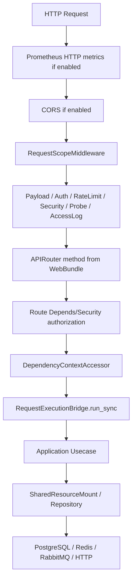

# 请求生命周期

## 1. 文档目的
追踪一个 HTTP 请求从中间件、路由、用例到资源门面的执行顺序。

**最后更新范围**：覆盖中间件计划、可选 Prometheus 指标、DependencyContextAccessor、RequestExecutionBridge、认证绑定和统一响应。

## 2. 适用读者
- 新人开发者
- 后端开发者
- 测试维护者

## 3. 关联源码
| 路径 | 作用 |
| --- | --- |
| `src/infrastructure/fastapi_middleware_plan.py` | 中间件绑定顺序。 |
| `src/infrastructure/middleware_chain` | 请求作用域、载荷防护、认证、限流、安全头、耗时探针和访问日志中间件。 |
| `src/infrastructure/observability/prometheus_metrics_route.py` | 可选 Prometheus HTTP 指标中间件和指标出口。 |
| `src/api/dependency_context_accessor.py` | 路由依赖读取。 |
| `src/infrastructure/fastapi_route_composer.py` | 将启用 Web 模块的 `APIRouter` 挂载到应用。 |
| `src/infrastructure/request_execution_bridge.py` | 同步用例桥接。 |
| `src/core/http_contract/response_envelope_contract.py` | 统一响应信封。 |

## 4. 核心结论
- `FastApiMiddlewarePlan.build_bindings` 生成业务中间件计划；装配器反向调用 `app.add_middleware`，使请求按计划顺序经过 CORS（可选）、`RequestScopeMiddleware`、`PayloadGuardMiddleware`、`AuthenticationBindingMiddleware`、`RateLimitMiddleware`、`SecurityHeaderMiddleware`、`ElapsedProbeMiddleware` 和可选 `AccessLogMiddleware`。
- 如果启用 `runtime.metrics.header.enabled` 且 `include_http_metrics` 为真，`FastApiAppAssembler._bind_prometheus_metrics` 会在业务中间件之后再调用 `add_middleware(PrometheusHttpMetricsMiddleware)`；按 Starlette 语义该指标中间件位于更外层，用于记录完整下游链路耗时。
- `RequestScopeMiddleware` 创建 `request.state.request_scope` 和 `middleware_trace`，并把 `X-Request-ID`、`X-Trace-ID` 写回响应。
- `AuthenticationBindingMiddleware` 解析合法 Bearer、绑定 `authenticated_principal`，并会对无效 Bearer 立即返回统一信封；后台权限仍由路由级 `Depends/Security` 通过 `DependencyContextAccessor.read_authorized_principal` 校验。
- 路由通过 `DependencyContextAccessor` 从 `request.app.state.container` 读取用例、响应工厂、请求执行桥接器和资源门面。
- 多数同步用例通过 `RequestExecutionBridge.run_sync` 执行；桥接器会按运行时契约选择线程池或原生异步，并在名称不匹配、策略禁用或目标函数不适配时回退到默认线程池。
- 响应统一由 `ResponseEnvelopeFactory.build` 包装。

## 5. 结构说明
请求进入 FastAPI 后依次经过可选 Prometheus 指标外层、业务中间件链、由 `FastApiRouteComposer` 挂载的 `APIRouter` 方法、路由级授权依赖、应用用例、资源门面/仓储，最后回到统一响应信封。异常响应由 `FastApiExceptionPresenter` 或中间件内的故障响应构造统一表面。

## 6. 工作流程

## 7. 关键实现
| 组件 | 文件 | 职责 |
| --- | --- | --- |
| `RequestScopeMiddleware` | `src/infrastructure/middleware_chain/request_scope_middleware.py` | 创建请求作用域。 |
| `AuthenticationBindingMiddleware` | `src/infrastructure/middleware_chain/authentication_binding_middleware.py` | 解析 Bearer、绑定认证主体并保留鉴权故障。 |
| `PrometheusHttpMetricsMiddleware` | `src/infrastructure/observability/prometheus_metrics_route.py` | 可选记录 HTTP 方法、路由模板、状态码和耗时。 |
| `DependencyContextAccessor` | `src/api/dependency_context_accessor.py` | 读取容器、用例和请求上下文。 |
| `RequestExecutionBridge.run_sync` | `src/infrastructure/request_execution_bridge.py` | 在线程池或原生异步策略中执行用例调用。 |
| `ResponseEnvelopeFactory.build` | `src/core/http_contract/response_envelope_contract.py` | 生成统一响应。 |

## 8. 如何修改或扩展
1. 新增请求上下文字段时修改 `RequestScope` 和 `RequestScopeMiddleware`。
2. 新增同步用例调用时优先使用 `RequestExecutionBridge.run_sync`。
3. 新增需要认证或授权的接口时，在 route catalog 上补 `Depends/Security`，不要只依赖认证中间件。
4. 新增响应字段时同步 contract、route 和接口测试。

## 9. 测试覆盖
| 测试类型 | 文件 | 验证内容 |
| --- | --- | --- |
| unit | `test/unit_test/test_request_execution_bridge_unit.py` | 验证同步桥接。 |
| interface | `test/interface_test/test_http_interface.py` | 验证 HTTP 响应表面。 |
| path | `test/path_test/test_web_execution_path.py` | 验证 Web 执行路径。 |

## 10. 常见问题
- 如果请求没有 `request_id`，检查 `RequestScopeMiddleware` 是否被绑定。

## 11. 维护备注
修改请求链路时同步检查中间件、异常处理、响应信封和 API 文档。

## 12. 相关文档
- [项目文档总览](../README.md)
- [中间件链](../02_backend/middleware_chain.md)
- [响应信封](../02_backend/response_envelope.md)
