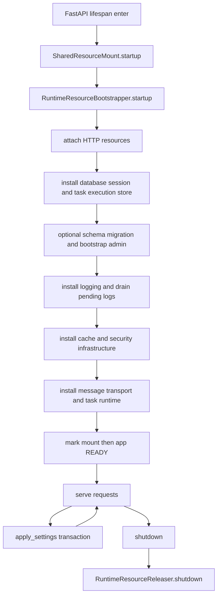

# 运行时资源生命周期

## 1. 文档目的
说明数据库、缓存、任务、日志、安全和 HTTP 客户端等资源如何启动、热更新和释放。

**最后更新范围**：覆盖 `FastApiLifespanOrchestrator`、`SharedResourceMount.startup/shutdown/apply_settings`、`resource_mount` 协作对象和 `resource_slot` 资源槽。

## 2. 适用读者
- 后端开发者
- 运维部署人员
- 安全审查人员

## 3. 关联源码
| 路径 | 作用 |
| --- | --- |
| `src/infrastructure/fastapi_lifespan_orchestrator.py` | FastAPI lifespan 入口。 |
| `src/infrastructure/shared_resource_mount.py` | 运行时资源启动、释放和配置应用。 |
| `src/infrastructure/resource_mount` | 资源挂载契约、启动器、释放器和访问器刷新器。 |
| `src/infrastructure/resource_slot` | 数据库会话、同步/异步 HTTP 客户端和 HTTP 资源集合。 |
| `src/infrastructure/settings/settings_reload_coordinator.py` | 配置热更新协调。 |

## 4. 核心结论
- `ApplicationLifespanContext.__aenter__` 调用 `SharedResourceMount.startup()`；成功后 `SharedResourceMount._ready=True`，再设置 `app.state.ready=True`。
- 启动失败会把 `app.state.ready` 和 `SharedResourceMount._ready` 置为 false，标记未就绪资源为 failed，并执行 shutdown。
- 资源启动由 `RuntimeResourceBootstrapper.startup` 编排，当前顺序是 HTTP 资源、数据库引擎/会话/任务执行存储、可选数据库迁移和 bootstrap admin、日志、缓存与安全基础设施、消息传输与任务运行时。
- 安全基础设施跟随缓存启动安装，包括分布式锁、密钥管理、客户端 IP 解析、安全事件构造、限流/IP 封禁/风险信号/Token 绑定防护和出站 URL 安全钩子，并分别标记 `shared_distributed_lock`、`shared_key_management`、`shared_security_protection` ready。
- `SharedResourceMount.apply_settings` 以 `SettingsApplyTransaction` 原子切换候选 HTTP 资源、任务注册/消息总线/调度器、认证运行时依赖、日志级别、出站 URL 安全钩子和消息运行时状态；失败时关闭候选资源并回滚到旧快照，回滚失败会记录在结果载荷，应用失败还会写配置安全事件。
- `RuntimeBundle` 是 frozen 快照包，集中承载 settings、HTTP accessor、task accessor、运行时依赖和 generation；公开请求/任务/管理端读取通过 `SharedResourceMount.read_runtime_bundle()` 获取单一快照，避免在热更新中混读新旧 settings 与资源。
- HTTP/task accessor 挂载、卸载、任务运行时安装、清理和任务绑定重建均在 reload lock 内切换 `RuntimeBundle`；候选资源探活成功后一次性发布新快照，旧资源由延迟释放逻辑清理。
- `RuntimeResourceReleaser.shutdown` 按尽力释放策略执行，实际顺序是日志 flush、任务、缓存/安全、数据库、HTTP、消息传输、日志；释放失败会收集到 `RuntimeResourceReleaseEnvelope.detail.failures`，并由 `SharedResourceMount.get_last_resource_release_result()` 暴露最近一次释放结果。
- 运行时状态通过 `RuntimeResourceState` 暴露给健康检查和系统概览。

## 5. 结构说明
资源生命周期由 FastAPI lifespan 驱动。`SharedResourceMount` 是对外稳定门面，内部委托 `RuntimeResourceBootstrapper` 初始化资源、`RuntimeResourceReleaser` 释放资源、`RuntimeAccessorRefresher` 刷新鉴权与日志访问器快照。数据库、缓存、任务、日志、安全、HTTP 客户端和消息传输都通过资源状态表标记 starting/ready/stopped/failed。运行期读取面以 `RuntimeBundle` 为唯一一致性边界；需要跨 settings、HTTP accessor、task accessor 的读取必须先取同一个 bundle，再从 bundle 内部读取字段。

## 6. 工作流程

## 7. 关键实现
| 组件 | 文件 | 职责 |
| --- | --- | --- |
| `ApplicationLifespanContext.__aenter__` | `src/infrastructure/fastapi_lifespan_orchestrator.py` | 启动资源并标记 ready。 |
| `SharedResourceMount.startup` | `src/infrastructure/shared_resource_mount.py` | 初始化共享资源。 |
| `RuntimeResourceBootstrapper.startup` | `src/infrastructure/resource_mount/runtime_resource_bootstrapper.py` | 按顺序挂载 HTTP、数据库、日志、缓存/安全、消息和任务资源。 |
| `SharedResourceMount.apply_settings` | `src/infrastructure/shared_resource_mount.py` | 构造候选资源并用事务提交或回滚热更新。 |
| `SharedResourceMount.read_runtime_bundle` | `src/infrastructure/shared_resource_mount.py` | 在 reload lock 内读取当前 frozen `RuntimeBundle` 快照。 |
| `SharedResourceMount.shutdown` | `src/infrastructure/shared_resource_mount.py` | 释放共享资源。 |
| `RuntimeResourceReleaser.shutdown` | `src/infrastructure/resource_mount/runtime_resource_releaser.py` | 先 flush 运行时日志，再尽力释放任务、缓存/安全、数据库、HTTP、消息和日志资源。 |
| `RuntimeAccessorRefresher.refresh` | `src/infrastructure/resource_mount/runtime_accessor_refresher.py` | 刷新鉴权与日志访问器快照。 |

## 8. 如何修改或扩展
1. 新增资源时在 `SharedResourceMount` 中补安装、清理、状态标记和 getter。
2. 启动顺序变化要同步 `RuntimeResourceBootstrapper`、状态标记和健康/系统概览展示。
3. 释放顺序变化要同步 `RuntimeResourceReleaser`，并保留 best-effort 失败收集语义。
4. 热更新资源变化要同步 `apply_settings` 的候选构建、提交、回滚和关闭旧资源逻辑。
5. 新增公开读取入口时先确认是否需要从 `read_runtime_bundle()` 读取 settings/accessor，避免跨字段混读。
6. 补初始化、边界、并发读取和异常测试。

## 9. 测试覆盖
| 测试类型 | 文件 | 验证内容 |
| --- | --- | --- |
| unit | `test/unit_test/test_resource_mount_lifecycle_unit.py` | 资源挂载生命周期。 |
| path | `test/path_test/test_runtime_path.py` | 热更新并发 dispatch/read 混合状态一致性。 |
| initialization | `test/initialization_test/test_runtime_initialization.py` | 运行时初始化。 |
| exception | `test/exception_test/test_runtime_exception.py` | 运行时异常路径。 |

## 10. 常见问题
- 如果 `/health/ready` 返回未就绪，优先检查资源状态和启动日志。

## 11. 维护备注
资源生命周期变更必须同步更新基础设施专题、运维清单和故障排查。

## 12. 相关文档
- [项目文档总览](../README.md)
- [配置热更新](../04_infrastructure/configuration_system.md)
