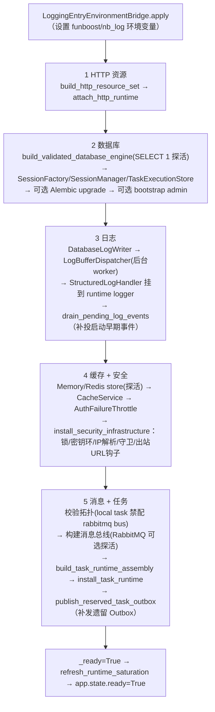

# 运行时资源生命周期

## 1. 这是什么

详解共享运行时资源（HTTP 客户端、数据库、日志、缓存+安全基础设施、消息传输、任务运行时）的**启动顺序、热更新事务、释放顺序**，以及承载这一切的三个协作对象：`RuntimeResourceBootstrapper`（启动）、`SettingsApplyTransaction`（热更新）、`RuntimeResourceReleaser`（释放）。排查启动失败、热更新回滚、优雅停机丢日志问题时以本文为准。

**最后更新范围**：覆盖 `shared_resource_lifecycle.py`（1646 行核心）、bootstrapper、releaser、accessor refresher、`RuntimeBundle` 快照模型与 10 个资源状态项。

## 2. 设计思想与动机

1. **fail-fast 启动**：任何资源初始化失败都让进程起不来，而不是"降级带病运行"。判断依据是：缺数据库/缓存的骨架服务对外行为不可预测，不如让编排系统（compose healthcheck / K8s probe）看到失败并重启。
2. **门面稳定、协作对象可换**：`SharedResourceMount` 对外提供稳定 getter/installer；启动、释放、刷新的流程逻辑分别抽到独立对象，避免一个上帝类；但状态（各资源实例引用）仍集中在 lifecycle Mixin 中，保证单一事实源。
3. **热更新 = 构建候选 → 原子切换 → 延迟释放**：绝不"就地修改"运行中的资源。新配置先构建全套候选资源并探活，成功后一次性替换 `RuntimeBundle` 引用（持 `_reload_lock`），旧资源等新快照发布后才关闭——正在使用旧连接的请求可以自然完成。
4. **一致性读取**：`RuntimeBundle` 是 frozen dataclass，携带 `generation` 自增代号。任何需要同时读 settings + HTTP accessor + task accessor 的代码必须先 `read_runtime_bundle()` 拿同一快照再取字段，禁止分别读取（会撕裂）。

## 3. 资源清单与状态机

10 个命名资源（`shared_resource_constants.py`），状态机为 `RuntimeResourceStatus`：`created → starting → ready → stopping → stopped`，失败进 `failed`：

| 资源名 | 内容 |
| --- | --- |
| `shared_http_client` / `shared_async_http_client` | httpx 同步/异步客户端 + `RequestExecutionBridge`（打包在 `SharedHttpResourceSet`） |
| `shared_database` | SQLAlchemy Engine + `SqlAlchemySessionFactory` + `SharedDbSessionManager` + `TaskExecutionStore` |
| `shared_logging` | `DatabaseLogWriter` + `LogBufferDispatcher` + `StructuredLogHandler` |
| `shared_cache` | `MemoryCacheStore` 或 `RedisCacheStore` + `CacheService` + `AuthFailureThrottle` |
| `shared_distributed_lock` / `shared_key_management` / `shared_security_protection` | 随缓存一起安装的安全基础设施（锁、密钥环、限流/封禁/风控/Token 绑定守卫、出站 URL 安全钩子） |
| `shared_task_message_transport` | `LocalMessageBus` 或 `RabbitMqMessageBus`（含启动探活） |
| `shared_task_dispatcher` | 任务调度器 + Outbox 发布器 + bootstrap 快照 |

状态表通过 `get_runtime_states()` 暴露给 `/health/ready` 与 `/system/info`。

## 4. 启动流程（RuntimeResourceBootstrapper.startup）

顺序依赖的原因：日志要落数据库所以排在数据库后；安全守卫全部以缓存为存储所以随缓存装；任务执行记录在数据库、消息要探活所以最后。启动早期（日志运行时就绪前）发出的结构化事件先进 `_pending_log_events` 列表，第 3 步结束后统一补投。

生产环境两条硬约束在启动路径强制：`bootstrap_admin.enabled=true` + production → 拒绝启动（引导管理员只允许 CLI `create_initial_admin` 执行）；`cache.backend=memory` + production → 拒绝启动（认证节流必须分布式）。

失败处理：`startup()` 捕获异常后把所有非 ready/stopped 资源标记 `failed`（附原因），执行一次 shutdown 释放已启动部分，再向上抛出——lifespan 因此失败，进程退出。

## 5. 热更新事务（apply_settings）

`SharedResourceMount.apply_settings(settings)` 在 `_reload_lock`（RLock）内执行 `_apply_settings_locked`：

1. **快照当前**：从当前 `RuntimeBundle` 取旧 HTTP 资源、任务注册/总线/调度器/Outbox、旧运行时依赖（密码哈希器、JWT 服务、节流器）。
2. **构建候选**：新 HTTP 资源集（新连接池）、新 `TaskRegistrationRegistry`（重放 worker supervisor 里已恢复的绑定）、新消息总线（RabbitMQ 会重新探活）、新任务运行时装配、新鉴权依赖集。
3. **提交（commit_action）**：`generation+1` → 更新 settings holder → 发布新 `RuntimeBundle` → 刷新 auth/logging 访问器 → 更新日志级别 → 重建出站 URL 安全验证器并重挂钩子 → 重新标记消息/任务资源状态 → 刷新饱和度指标 → 手动 flush 日志。旧资源加入 `RetiredRuntimeResources` 列表，事务成功后**延迟释放**（关闭旧 HTTP 池、旧 Outbox 发布器、旧调度器、旧总线）。
4. **回滚（rollback_action）**：关闭候选资源，恢复旧 settings/accessor/依赖/日志级别/资源状态，返回已回滚资源名列表。
5. 失败时 `result.failure_reason` 写入配置安全事件（`config_security_rejected`，audit_critical 级即时落库）。

哪些键允许热更新、哪些必须重启由 `config/app_base.toml` 的 `app.reload.hot_reload_allowed / restart_required` 声明，`SettingsReloadCoordinator` 在构建候选时做 diff 分类并拒绝含 restart_required 变更的热更新请求（详见[配置系统](../04_infrastructure/configuration_system.md)）。

## 6. 释放流程（RuntimeResourceReleaser.shutdown）

尽力而为（best-effort）：每一步用 try/except 包裹，失败收集进 `RuntimeResourceReleaseEnvelope.detail.failures`，不中断后续步骤。实际顺序：

1. `runtime_log_flush`：把缓冲日志全部刷盘（此时数据库还活着）。
2. `shared_task_dispatcher`：关 Outbox 后台线程 → 关调度器 → 关消息总线引用。
3. `shared_cache`：关缓存连接并连带置空全部安全基础设施（锁/密钥/守卫），四个资源标记 stopped。
4. `shared_http_client`：卸载并关闭 HTTP 资源集。
5. `shared_task_message_transport`：关消息总线（资源未就绪的 `RESOURCE_NOT_READY` 故障容忍）。
6. `shared_database`：标记 stopped（连接尚不关闭）。
7. `shared_logging`：标记 stopped → 最后一次手动 flush → 移除结构化 handler、停缓冲 worker。
8. `database_connection_finalize`：`clear_database_runtime()` 真正关闭会话管理器与引擎。

数据库分两步关的原因：第 7 步日志最终刷盘仍需数据库连接。最近一次释放结果可经 `get_last_resource_release_result()` 读取，供停机诊断。

## 7. 怎么用

- **读配置/资源**：任何运行期读取先 `bundle = mount.read_runtime_bundle()`，再 `bundle.settings...` / `bundle.http_accessor.resource_set...`。不要缓存 bundle 跨请求使用（热更新后就旧了），也不要分次读取。
- **新增资源**：在 lifecycle Mixin 加实例字段 + `install_x/clear_x/get_x` 三件套 → bootstrapper 选启动位次并标记状态 → releaser 选释放位次 → 若参与热更新，接入 `_apply_settings_locked` 的候选构建/提交/回滚 → 状态表补资源名 → 补 initialization/exception 测试。
- **触发热更新**：走 `/admin/settings/reload`（GET candidate → POST reload）或进程重启；不要直接调 `apply_settings` 绕过 diff 校验。

## 8. 注意事项

- `_reload_lock` 是 RLock，`read_runtime_bundle` 也要拿锁——它只保护"引用切换"瞬间，读取本身极快；但不要在持 bundle 的情况下做长阻塞再回来切换资源。
- 热更新后旧 `RequestExecutionBridge` 上仍在执行的调用会自然完成（延迟释放保证）；但 `close()` 对旧线程池是 `cancel_futures=True`，长任务应有自身超时。
- `mark_runtime_resource_*` 只改状态表，不做实际 IO；实际 IO 与状态标记必须成对出现，否则健康检查会说谎。
- Outbox 后台重扫线程（`task-execution-outbox-publisher`）与日志缓冲 worker（`log-buffer-dispatcher-worker`）都是 daemon 线程，靠 shutdown 流程显式 join；跳过 shutdown 直接 kill -9 会丢失未刷缓冲日志（audit_critical 事件除外，它们是同步落库）。

## 9. 测试覆盖

| 测试类型 | 文件 | 验证内容 |
| --- | --- | --- |
| unit | `test/unit_test/test_resource_mount_lifecycle_unit.py` | 安装/清理/状态标记生命周期。 |
| initialization | `test/initialization_test/test_runtime_initialization.py` | 启动顺序与失败标记。 |
| path | `test/path_test/test_runtime_path.py` | 热更新并发 dispatch/read 一致性。 |
| exception | `test/exception_test/test_runtime_exception.py` | 启动/释放异常路径与失败收集。 |

## 10. 相关文档

- [项目文档总览](../README.md)
- [配置系统与热更新](../04_infrastructure/configuration_system.md)
- [任务运行时](../04_infrastructure/task_runtime.md)
- [日志运行时](../04_infrastructure/logging_runtime.md)
- [故障排查](../10_maintenance/troubleshooting.md)
