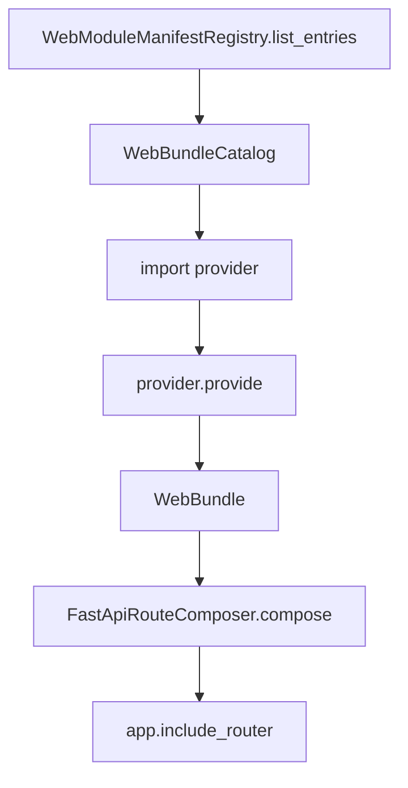

# API 模块注册

## 1. 文档目的
说明 endpoint 模块如何通过 manifest、provider 和 bundle catalog 被装配进 FastAPI。

**最后更新范围**：覆盖 `src/api/web_module_manifest.py`、`src/api/web_bundle_catalog.py` 和 endpoint provider。

## 2. 适用读者
- 新人开发者
- 后端开发者
- 测试维护者

## 3. 关联源码
| 路径 | 作用 |
| --- | --- |
| `src/api/web_module_manifest.py` | 模块清单和后台边界策略。 |
| `src/api/web_bundle_catalog.py` | provider 导入、校验和 bundle 构建。 |
| `src/core/http_contract/web_bundle_contract.py` | WebBundle 和 ApplicationModuleName。 |
| `src/infrastructure/fastapi_route_composer.py` | 按启用模块挂载路由。 |
| `config/app_base.toml` | `app.modules.enabled` 配置。 |

## 4. 核心结论
- 当前 manifest 声明 9 个 Web 模块：health_probe、auth_access、system_overview、security_protection、admin_task、admin_settings、admin_log、admin_identity、admin_audit。
- `WebBundleCatalog.validate_enabled_modules` 会拒绝未知模块名。
- `WebBundleCatalog` 构建 provider 前会校验重复模块名、空 provider 路径、空 route tag，以及 manifest 与 provider 输出的 `module_name` 是否一致。
- 默认 `WebBundleCatalog()` 会用内置 manifest 构建目录，并额外调用 `WebModuleManifestRegistry.validate_admin_boundary_authorization()` 校验后台边界策略与集中授权事实源；注入 `manifest_entries` 的测试场景只执行通用 manifest/provider 校验。
- manifest 条目自身的 `enabled=false` 会让 catalog 跳过 provider；运行时 `app.modules.enabled` 由 `FastApiRouteComposer.compose` 再过滤实际挂载的 bundle。
- 后台模块策略分为 public、business_admin、ops_only，并与集中授权要求校验。
- `FastApiRouteComposer.compose` 只挂载 `app.modules.enabled` 中启用的模块。

## 5. 结构说明
每个 endpoint provider 继承 `WebBundleProvider`，返回 `WebBundleProviderEnvelope`。该信封包含 `header.module_name`、`detail.provider_name` 和 `bundle`；真正挂载到 FastAPI 的 `APIRouter` 位于 `bundle.router`，模块业务键位于 `bundle.module_name`。

API 层不再保留 provider 装饰器注册入口，模块发现以 `WebModuleManifestRegistry.list_entries` 中的 provider import path 为事实源。

## 6. 工作流程

## 7. 关键实现
| 组件 | 文件 | 职责 |
| --- | --- | --- |
| `WebModuleManifestRegistry.list_entries` | `src/api/web_module_manifest.py` | 声明内置模块。 |
| `WebModuleManifestRegistry.validate_admin_boundary_authorization` | `src/api/web_module_manifest.py` | 校验后台模块边界与授权要求一致。 |
| `WebBundleCatalog._load_provider_type` | `src/api/web_bundle_catalog.py` | 按 import path 动态导入 provider。 |
| `FastApiRouteComposer.compose` | `src/infrastructure/fastapi_route_composer.py` | 按配置挂载路由。 |

## 8. 如何修改或扩展
1. 新增 `src/api/endpoint_xxx/contract_xxx.py` 和 `route_xxx.py`。
2. 新增 `ApplicationModuleName` 枚举值。
3. 在 `WebModuleManifestRegistry.list_entries` 增加 provider import path 和 route tag。
4. 按需更新 `config/app_*.toml` 的 `app.modules.enabled`。
5. 如新增后台模块，同步 `AdminBoundaryPolicy`、后台模块名集合和集中授权要求。
6. 补 `test/unit_test/test_web_module_manifest_unit.py`、`test/unit_test/test_web_module_registry_boundary_unit.py` 或接口测试。

## 9. 测试覆盖
| 测试类型 | 文件 | 验证内容 |
| --- | --- | --- |
| unit | `test/unit_test/test_web_module_manifest_unit.py` | manifest 约束。 |
| unit | `test/unit_test/test_web_module_registry_boundary_unit.py` | Web 模块注册边界。 |
| interface | `test/interface_test/test_admin_ops_modules_disabled_interface.py` | 模块禁用接口行为。 |

## 10. 常见问题
- 如果启动时报未知 Web 模块，检查 `config/app_*.toml` 与 `ApplicationModuleName` 是否同步。

## 11. 维护备注
新增或禁用模块时，同步更新 API 总览、README 文档地图和接口测试。

## 12. 相关文档
- [项目文档总览](../README.md)
- [新增 API](../09_development_guide/adding_new_api.md)
