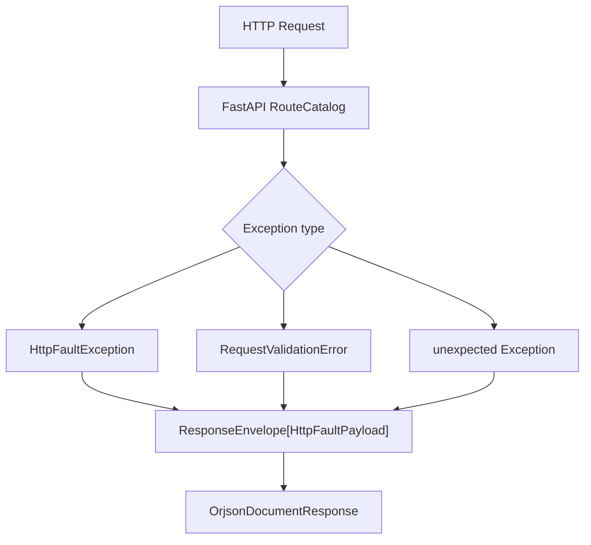

# 异常处理

## 1. 文档目的
说明 HTTP 异常如何转换为统一错误响应和日志。

**最后更新范围**：覆盖 `FastApiExceptionPresenter`、`HttpFaultException` 和错误码契约。

## 2. 适用读者
- 新人开发者
- 后端开发者
- 测试维护者

## 3. 关联源码
| 路径 | 作用 |
| --- | --- |
| `src/infrastructure/fastapi_exception_presenter.py` | 异常处理绑定。 |
| `src/core/exception_contract/http_fault_contract.py` | 业务 HTTP 异常。 |
| `src/core/exception_contract/error_code_catalog_contract.py` | 成功和核心错误码。 |
| `src/domain/auth/auth_error_code.py` | 鉴权错误码。 |
| `src/domain/auth/admin_identity_error_code.py` | 管理员身份错误码。 |

## 4. 核心结论
- 业务异常使用 `HttpFaultException` 携带 HTTP 状态和错误码。
- 接口层对认证失败、权限失败、资源未就绪等场景抛出或传播该异常。
- 异常 presenter 绑定 `HttpFaultException`、FastAPI `RequestValidationError` 和兜底 `Exception`，并转换为统一响应。
- 请求校验失败统一返回 422 和 `CoreErrorCode.REQUEST_INVALID`；未预期异常统一返回 500 和 `CoreErrorCode.INTERNAL_UNEXPECTED`。
- 对客户端返回的错误 `data` 来自 `HttpFaultException.to_payload()`，只包含 `kind`、`schema_version`、`status_code`、`error_code`，不会暴露内部 `detail` 或原始异常文本。
- 安全相关失败还会经 `SecurityEventBuilder` 或相关中间件写入安全事件日志；异常 presenter 自身写入结构化异常日志。
- `PayloadGuardMiddleware`、`AuthenticationBindingMiddleware`、`RateLimitMiddleware` 可能在请求到达路由前直接返回统一错误信封。

## 5. 结构说明
异常契约位于 core/domain，表现层由 infrastructure presenter 绑定到 FastAPI 应用。

## 6. 工作流程

## 7. 关键实现
| 组件 | 文件 | 职责 |
| --- | --- | --- |
| `HttpFaultException` | `src/core/exception_contract/http_fault_contract.py` | 统一业务 HTTP 异常。 |
| `FastApiExceptionPresenter.bind` | `src/infrastructure/fastapi_exception_presenter.py` | 注册异常处理器。 |
| `AuthErrorCode` | `src/domain/auth/auth_error_code.py` | 鉴权错误码枚举。 |
| `HttpFaultPayload` | `src/core/exception_contract/http_fault_contract.py` | 对客户端公开的错误响应数据。 |

## 8. 如何修改或扩展
1. 新增错误码先放入合适的 core/domain 枚举。
2. 用例或基础设施抛出 `HttpFaultException`。
3. 不要依赖 `detail` 向客户端返回诊断信息；`detail` 当前只作为内部上下文，不出现在公开错误 payload。
4. 补异常路径测试并更新 API 文档错误码表。

## 9. 测试覆盖
| 测试类型 | 文件 | 验证内容 |
| --- | --- | --- |
| unit | `test/unit_test/test_fastapi_exception_presenter_unit.py` | 异常 presenter。 |
| exception | `test/exception_test/test_runtime_exception.py` | 运行时异常路径。 |
| exception | `test/exception_test/test_security_exception.py` | 安全异常路径。 |
| interface | `test/interface_test/test_http_interface.py` | HTTP 统一响应格式。 |

## 10. 常见问题
- 如果返回不是统一信封，检查异常是否绕过了 `FastApiExceptionPresenter.bind`。

## 11. 维护备注
新增异常类型时同步 API 文档、测试和故障排查。

## 12. 相关文档
- [项目文档总览](../README.md)
- [响应信封](response_envelope.md)
