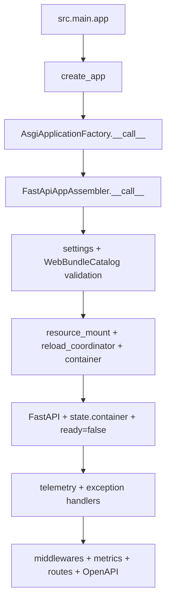

# FastAPI 应用装配

## 1. 文档目的
说明 `create_app` 如何创建 FastAPI 实例、加载配置、绑定资源、中间件、指标和路由。

**最后更新范围**：覆盖 `src/main.py` 到 `FastApiAppAssembler.__call__` 的装配主链路。

## 2. 适用读者
- 新人开发者
- 后端开发者
- 测试维护者

## 3. 关联源码
| 路径 | 作用 |
| --- | --- |
| `src/main.py` | ASGI 入口。 |
| `src/api/asgi_entry.py` | `AsgiApplicationFactory`。 |
| `src/api/task_binding_provider.py` | 默认任务绑定来源。 |
| `src/api/fastapi_app_assembler.py` | `FastApiAppAssembler`。 |
| `src/infrastructure/fastapi_lifespan_orchestrator.py` | 生命周期上下文。 |
| `src/infrastructure/shared_resource_mount.py` | 运行时资源门面。 |
| `src/infrastructure/fastapi_openapi_surface.py` | OpenAPI 表面控制。 |
| `src/infrastructure/fastapi_otel_bridge.py` | FastAPI OpenTelemetry 装配。 |

## 4. 核心结论
- `src/main.py` 只有 `app = create_app()`。
- `AsgiApplicationFactory.__call__` 支持 environment、config_root、settings_overrides、task_bindings。
- `AsgiApplicationFactory` 默认传入 `ApplicationTaskBindingProvider`；provider 提供生产 `task_execution_probe` 强类型绑定，并过滤当前环境配置未声明的任务。显式 `task_bindings` 仍按 strict 模式注册。
- `FastApiAppAssembler.__call__` 依次加载配置、校验启用 Web 模块、创建日志与遥测桥、创建资源门面、构建配置重载协调器、构建容器、创建 FastAPI 应用、挂载容器、标记未就绪、绑定遥测、异常、中间件、指标、路由和 OpenAPI 表面。
- `FastApiRouteComposer.compose` 按 `settings.runtime.web.api_prefix` 统一挂载路由，并把实际挂载的模块回写到 `resource_mount.set_enabled_web_modules`。
- Prometheus 指标由 `runtime.metrics` 控制：可选追加 HTTP 指标中间件，并绑定 metrics 路由。
- OpenAPI URL 在 `settings.app.enable_openapi` 为 false 时关闭。

## 5. 结构说明
`ApplicationContainer` 保存配置持有器、响应工厂、资源门面、配置重载协调器，以及 health/auth/system/admin task/admin settings/admin log/security/admin audit/admin identity 等用例；随后挂载到 `app.state.container`。装配器同时初始化 `app.state.ready = False`，实际就绪状态由生命周期流程推动。

## 6. 工作流程

## 7. 关键实现
| 组件 | 文件 | 职责 |
| --- | --- | --- |
| `FastApiAppAssembler._load_settings` | `src/api/fastapi_app_assembler.py` | 加载配置。 |
| `FastApiAppAssembler._build_fastapi_app` | `src/api/fastapi_app_assembler.py` | 创建 FastAPI 实例。 |
| `FastApiRouteComposer.compose` | `src/infrastructure/fastapi_route_composer.py` | 挂载 WebBundle。 |
| `FastApiAppAssembler._bind_prometheus_metrics` | `src/api/fastapi_app_assembler.py` | 按配置绑定 Prometheus。 |
| `FastApiAppAssembler._resolve_task_bindings` | `src/api/fastapi_app_assembler.py` | 区分显式 strict 绑定与 provider 过滤绑定。 |

## 8. 如何修改或扩展
1. 新增装配依赖时先加入 `ApplicationContainer` 或 `SharedResourceMount`。
2. 保持 `src/main.py` 入口薄化。
3. 新增 OpenAPI 行为时同步 `fastapi_openapi_surface` 和接口测试。
4. 新增 Web 模块时同步 manifest、`ApplicationModuleName`、`app.modules.enabled` 和路由契约文档。

## 9. 测试覆盖
| 测试类型 | 文件 | 验证内容 |
| --- | --- | --- |
| unit | `test/unit_test/test_fastapi_app_assembler_unit.py` | 装配器行为。 |
| unit | `test/unit_test/test_fastapi_openapi_surface_unit.py` | OpenAPI 表面。 |
| unit | `test/unit_test/test_fastapi_otel_bridge_unit.py` | OpenTelemetry 桥接。 |
| initialization | `test/initialization_test/test_runtime_initialization.py` | 应用初始化。 |

## 10. 常见问题
- 如果路由没有出现，检查 `app.modules.enabled` 与 `WebModuleManifestRegistry` 是否一致。

## 11. 维护备注
修改装配时同步更新架构总览、请求生命周期、部署和测试文档。

## 12. 相关文档
- [项目文档总览](../README.md)
- [API 模块注册](api_module_registration.md)
