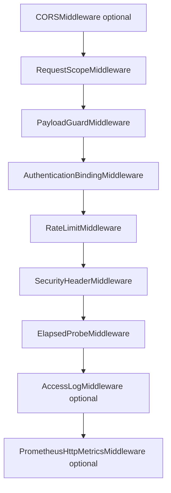

# 中间件链

## 1. 文档目的
说明 FastAPI 中间件绑定顺序、配置来源和职责。

**最后更新范围**：覆盖 `FastApiMiddlewarePlan` 和 `src/infrastructure/middleware_chain`。

## 2. 适用读者
- 新人开发者
- 后端开发者
- 测试维护者
- 安全审查人员

## 3. 关联源码
| 路径 | 作用 |
| --- | --- |
| `src/infrastructure/fastapi_middleware_plan.py` | 中间件计划。 |
| `src/infrastructure/middleware_chain/request_scope_middleware.py` | 请求作用域。 |
| `src/infrastructure/middleware_chain/payload_guard_middleware.py` | 请求体大小保护。 |
| `src/infrastructure/middleware_chain/authentication_binding_middleware.py` | 认证主体绑定。 |
| `src/infrastructure/middleware_chain/rate_limit_middleware.py` | 限流。 |
| `src/infrastructure/middleware_chain/security_header_middleware.py` | 安全响应头。 |
| `src/infrastructure/middleware_chain/access_log_middleware.py` | 访问日志。 |
| `src/infrastructure/observability/prometheus_metrics_route.py` | 可选 HTTP 指标中间件和指标路由。 |

## 4. 核心结论
- `build_bindings` 默认包含请求作用域、payload guard、认证绑定、限流、安全头、耗时探针。
- `enable_access_log` 为 true 时追加 `AccessLogMiddleware`。
- CORS 仅在 `runtime.web.cors.enabled` 为 true 时插入。
- 装配器以 `reversed(bindings)` 调用 `app.add_middleware`，用于抵消 FastAPI/Starlette 的中间件插入行为；请求进入的业务链路顺序仍按 bindings 表达：CORS 可选、请求作用域、payload guard、认证绑定、限流、安全头、耗时探针、访问日志可选。
- `PayloadGuardMiddleware`、`AuthenticationBindingMiddleware` 和 `RateLimitMiddleware` 可在路由前直接返回统一错误信封。
- `AuthenticationBindingMiddleware` 只在携带 Bearer 时解析并绑定主体；未携带令牌的请求会继续进入路由，由路由级依赖决定是否要求认证。
- Prometheus HTTP 指标中间件不在 `FastApiMiddlewarePlan` 中；它由装配器在业务中间件之后按 `runtime.metrics` 单独追加。

## 5. 结构说明
中间件计划构造时读取启动配置与共享资源门面，CORS、访问日志等装配开关来自显式配置。运行期需要访问共享 HTTP、任务、安全等资源时，经由 `SharedResourceMount` 的公开入口读取当前 `RuntimeBundle` 快照；独立中间件只读取其构造时显式注入的配置或 holder。`RequestScopeMiddleware` 负责创建 `request.state.request_scope` 和 `request.state.middleware_trace`，后续中间件会继续追加 trace 名称。

## 6. 工作流程

## 7. 关键实现
| 组件 | 文件 | 职责 |
| --- | --- | --- |
| `FastApiMiddlewarePlan.build_bindings` | `src/infrastructure/fastapi_middleware_plan.py` | 生成中间件绑定。 |
| `PayloadGuardMiddleware` | `src/infrastructure/middleware_chain/payload_guard_middleware.py` | 限制请求体大小。 |
| `RateLimitMiddleware` | `src/infrastructure/middleware_chain/rate_limit_middleware.py` | 调用限流保护。 |
| `AuthenticationBindingMiddleware` | `src/infrastructure/middleware_chain/authentication_binding_middleware.py` | 解析合法 Bearer 并绑定当前主体。 |

## 8. 如何修改或扩展
1. 新增中间件类放入 `src/infrastructure/middleware_chain`。
2. 在 `FastApiMiddlewarePlan.build_bindings` 注册并声明配置依赖。
3. 如果中间件会提前拒绝请求，复用 `ResponseEnvelopeFactory` 和 `HttpFaultException.to_payload()` 构造统一错误信封。
4. 补接口或边界测试验证顺序和行为。

## 9. 测试覆盖
| 测试类型 | 文件 | 验证内容 |
| --- | --- | --- |
| interface | `test/interface_test/test_rate_limit_http_interface.py` | 限流接口行为。 |
| interface | `test/interface_test/test_security_http_interface.py` | 安全 HTTP 行为。 |
| unit | `test/unit_test/test_fastapi_app_assembler_unit.py` | 中间件装配。 |

## 10. 常见问题
- 如果 CORS 不生效，检查 `config/runtime/web_runtime/web_runtime_*.toml` 中 `runtime.web.cors.enabled`。

## 11. 维护备注
中间件变化时同步更新请求生命周期、安全防护和接口测试。

## 12. 相关文档
- [项目文档总览](../README.md)
- [安全防护](../04_infrastructure/security_protection.md)
