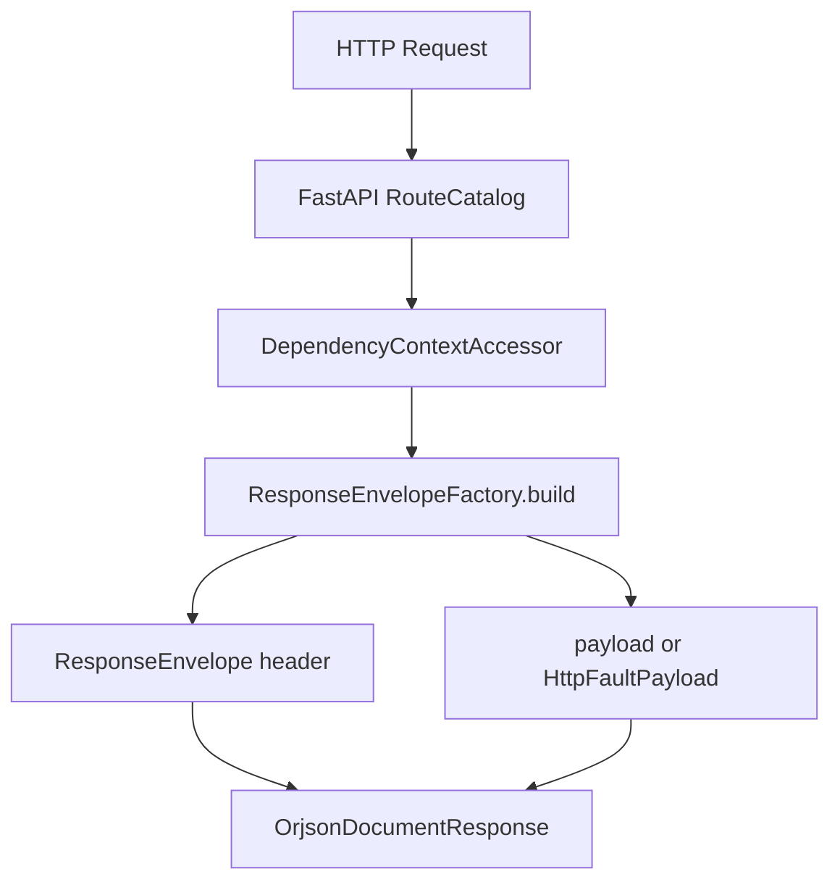

# 统一响应信封

## 1. 文档目的
说明所有 API 如何使用 `ResponseEnvelope` 包装响应头、请求标识和业务数据。

**最后更新范围**：覆盖 `ResponseHeader`、`ResponseEnvelope`、`ResponseEnvelopeFactory`。

## 2. 适用读者
- 新人开发者
- 后端开发者
- 测试维护者

## 3. 关联源码
| 路径 | 作用 |
| --- | --- |
| `src/core/http_contract/response_envelope_contract.py` | 统一响应模型。 |
| `src/core/http_contract/request_scope_contract.py` | 请求作用域。 |
| `src/core/exception_contract/http_fault_contract.py` | 统一错误 payload。 |
| `src/infrastructure/fastapi_exception_presenter.py` | 异常转响应信封。 |
| `src/api/endpoint_*` | 各 API response_model 使用。 |

## 4. 核心结论
- `ResponseHeader` 包含 `code`、`message`、`request_id`、`trace_id`。
- `ResponseEnvelope[T]` 包含 `header` 和 `data`。
- `ResponseEnvelopeFactory.build` 从 `RequestScope` 回填请求链路信息。
- 正常 route 通过 `DependencyContextAccessor.read_response_factory(request).build(...)` 构造响应。
- 错误响应同样使用 `ResponseEnvelope`，其中 `data` 为 `HttpFaultPayload`，公开字段为 `kind`、`schema_version`、`status_code`、`error_code`。
- `ResponseEnvelopeFactory.build` 不推导业务码；调用方必须显式传入 `code` 和 `message`，工厂只负责从 `RequestScope` 回填 `request_id` 与 `trace_id`。
- `FastApiExceptionPresenter`、payload guard、认证绑定和限流中间件都会复用该信封结构返回错误响应。
- API 文档中的响应结构均应引用 contract 文件的真实模型。

## 5. 结构说明
统一响应信封是 HTTP 出口契约，业务 payload 由各 endpoint 的 contract 或 core contract 定义。

## 6. 工作流程

## 7. 关键实现
| 组件 | 文件 | 职责 |
| --- | --- | --- |
| `ResponseHeader` | `src/core/http_contract/response_envelope_contract.py` | 统一响应头。 |
| `ResponseEnvelope` | `src/core/http_contract/response_envelope_contract.py` | 统一响应信封。 |
| `ResponseEnvelopeFactory.build` | `src/core/http_contract/response_envelope_contract.py` | 构造响应。 |
| `HttpFaultPayload` | `src/core/exception_contract/http_fault_contract.py` | 错误响应 data。 |

## 8. 如何修改或扩展
1. 新增 API 时声明 `response_model=ResponseEnvelope[YourPayload]`。
2. 不要在 route 中手写 header 字段，使用 response factory。
3. 新增错误路径时使用 `HttpFaultException` 或复用现有中间件的统一错误信封逻辑。
4. 响应结构变化时补 contract/interface 测试。

## 9. 测试覆盖
| 测试类型 | 文件 | 验证内容 |
| --- | --- | --- |
| contract | `test/contract_test/test_http_contract.py` | 响应信封契约。 |
| interface | `test/interface_test/test_http_interface.py` | 响应格式。 |
| unit | `test/unit_test/test_core_unit.py` | 核心契约单元。 |

## 10. 常见问题
- 如果接口缺少 `request_id`，检查请求作用域中间件和 response factory 调用。

## 11. 维护备注
响应信封变更会影响所有 API，必须同步全量 API 文档和接口测试。

## 12. 相关文档
- [项目文档总览](../README.md)
- [路由契约模式](route_contract_pattern.md)
