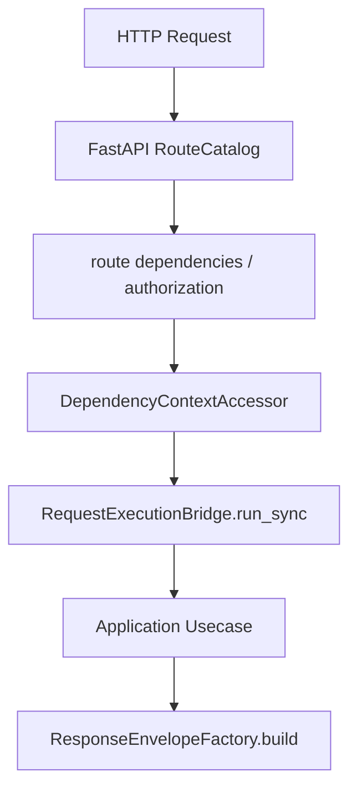

# 路由契约模式

## 1. 文档目的
说明 endpoint 模块中 route、contract、usecase、ResponseEnvelope 的对应关系。

**最后更新范围**：覆盖 `src/api/endpoint_*` 下的 route 和 contract 文件。

## 2. 适用读者
- 新人开发者
- 后端开发者
- 测试维护者

## 3. 关联源码
| 路径 | 作用 |
| --- | --- |
| `src/api/endpoint_auth_access/route_auth_access.py` | 鉴权访问路由。 |
| `src/api/endpoint_auth_access/contract_auth_access.py` | 鉴权请求模型。 |
| `src/api/endpoint_admin_task/route_admin_task.py` | 管理员任务路由。 |
| `src/api/endpoint_admin_task/contract_admin_task.py` | 管理员任务契约。 |
| `src/api/dependency_context_accessor.py` | 路由依赖上下文读取入口。 |
| `src/core/http_contract/request_execution_contract.py` | 同步用例卸载执行契约。 |

## 4. 核心结论
- 路由类命名通常为 `*RouteCatalog`，在 `__init__` 或 `_bind_*_routes` 辅助方法中调用 `router.add_api_route`。
- 请求和响应 Pydantic 模型放在 `contract_*.py`。
- 路由只做 HTTP 适配、权限依赖、调用用例和包装响应。
- 同步用例调用通过 `DependencyContextAccessor.read_request_execution_bridge(request).run_sync(...)` 卸载，默认执行名为 `default_sync_usecase`。
- `DependencyContextAccessor.read_route_context(request)` 从 `app.state.container` 和 `SharedResourceMount` 聚合 route 所需依赖；各 `read_*` 方法是面向路由的窄入口。
- 响应模型使用 `ResponseEnvelope[PayloadOrEnvelope]`，其中 `data` 可以是 endpoint payload，也可以是 endpoint 自己定义的 header/detail 信封。
- 后台受保护路由通过 `Depends(self.require_*)` 和 `HTTPBearer(auto_error=False)` 声明 Bearer 安全面，再由 `read_authorized_principal` 校验集中授权要求。

## 5. 结构说明
每个 endpoint 模块由 `contract_*.py`、`route_*.py`、`*BundleProvider` 组成；后台模块还会依赖 `admin_route_authorization.py`。

## 6. 工作流程

## 7. 关键实现
| 组件 | 文件 | 职责 |
| --- | --- | --- |
| `AuthAccessRouteCatalog.post_token` | `src/api/endpoint_auth_access/route_auth_access.py` | 令牌签发路由。 |
| `AdminTaskRouteCatalog.dispatch_task` | `src/api/endpoint_admin_task/route_admin_task.py` | 管理员任务派发路由。 |
| `AdminIdentityRouteCatalog._read_detail` | `src/api/endpoint_admin_identity/route_admin_identity.py` | 校验请求 detail 类型。 |

## 8. 如何修改或扩展
1. 先定义或扩展 contract 模型。
2. 在 RouteCatalog 中注册路径、方法和 response_model。
3. 通过 `DependencyContextAccessor` 获取用例、`RequestScope`、请求执行桥、响应工厂和必要的授权主体。
4. 同步用例使用 `request_execution_bridge.run_sync`，避免阻塞异步路由。
5. 补 contract/interface/integration 测试并更新 API 文档。

## 9. 测试覆盖
| 测试类型 | 文件 | 验证内容 |
| --- | --- | --- |
| contract | `test/contract_test/test_admin_task_contract.py` | 任务 API 契约。 |
| contract | `test/contract_test/admin_identity/test_admin_identity_contract.py` | 身份 API 契约。 |
| interface | `test/interface_test/test_admin_task_interface.py` | 任务接口行为。 |

## 10. 常见问题
- 如果请求 detail 类型不匹配，`AdminIdentityRouteCatalog._read_detail` 会返回请求无效。

## 11. 维护备注
修改 route/contract 时同步更新 `05_api_reference` 下对应 API 文档。

## 12. 相关文档
- [项目文档总览](../README.md)
- [API 总览](../05_api_reference/api_overview.md)
