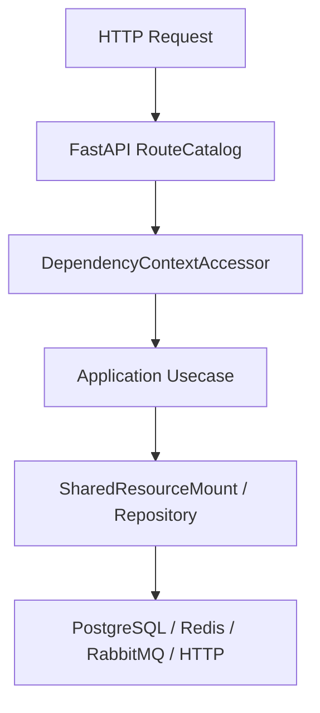

# 后台管理能力

## 1. 文档目的
说明当前后台管理侧可确认的任务、配置、日志、安全、身份和审计能力。

**最后更新范围**：覆盖 `src/application/admin`、`src/application/system_overview_usecase.py`、`src/api/endpoint_admin_*`、`src/api/endpoint_security_protection`、`src/api/endpoint_system_overview` 和 Web 模块清单。

## 2. 适用读者
- 新人开发者
- 后端开发者
- 测试维护者
- 安全审查人员

## 3. 关联源码
| 路径 | 作用 |
| --- | --- |
| `src/application/admin` | 后台管理用例。 |
| `src/api/endpoint_admin_task` | 任务管理 API。 |
| `src/api/endpoint_admin_settings` | 配置热更新 API。 |
| `src/api/endpoint_admin_log` | 日志和安全事件 API。 |
| `src/api/endpoint_admin_identity` | 身份管理 API。 |
| `src/api/endpoint_admin_audit` | 业务审计 API。 |
| `src/api/endpoint_security_protection` | 安全 IP 封禁管理 API。 |
| `src/api/endpoint_system_overview` | 系统概览 API。 |
| `src/api/web_module_manifest.py` | 后台模块边界策略清单。 |

## 4. 核心结论
- 运维控制面模块包括 admin_task、admin_settings、admin_log、security_protection、system_overview，对应 `OPS_ONLY_MODULE_NAMES`。
- 业务后台模块包括 admin_identity、admin_audit，对应 `BUSINESS_ADMIN_MODULE_NAMES`。
- 集中授权要求定义在 `src/domain/auth/admin_route_authorization_policy.py`，并由 `WebModuleManifestRegistry.validate_admin_boundary_authorization` 校验边界策略一致性。
- 身份变更通过 `SecurityEventBuilder.build_admin_identity_changed_event` 记录 `admin_identity_changed` 安全事件；业务审计查询再按白名单把这些身份变更日志映射为 `AdminAuditAction`。

## 5. 结构说明
后台能力由 API route 调用应用层 usecase，再通过 `SharedResourceMount` 或独立 adapter 调用仓储、日志、任务、配置热更新和安全能力。

## 6. 工作流程

## 7. 关键实现
| 组件 | 文件 | 职责 |
| --- | --- | --- |
| `ADMIN_ROUTE_AUTHORIZATION_REQUIREMENTS` | `src/domain/auth/admin_route_authorization_policy.py` | 后台集中授权要求。 |
| `WebModuleManifestRegistry` | `src/api/web_module_manifest.py` | 标记 business_admin 与 ops_only 后台边界。 |
| `AdminIdentityRouteCatalog` | `src/api/endpoint_admin_identity/route_admin_identity.py` | 身份管理路由。 |
| `ListAdminAuditEventsUsecase` | `src/application/admin/audit/list_admin_audit_events_usecase.py` | 审计查询用例。 |
| `ListAdminSecurityIpBlocksUsecase` | `src/application/admin/security_protection/manage_admin_security_ip_blocks_usecase.py` | 安全 IP 封禁查询用例。 |

## 8. 如何修改或扩展
1. 新增后台能力时先明确是业务后台还是运维控制面。
2. 新增授权 requirement 并更新 manifest 边界策略，保持 `BUSINESS_ADMIN_AUTHORIZATION_REQUIREMENTS` / `OPS_ONLY_AUTHORIZATION_REQUIREMENTS` 与模块清单一致。
3. 补 API 文档和 interface/integration 测试。

## 9. 测试覆盖
| 测试类型 | 文件 | 验证内容 |
| --- | --- | --- |
| integration | `test/integration_test/test_admin_smoke_integration.py` | 后台冒烟。 |
| integration | `test/integration_test/test_admin_business_console_smoke_integration.py` | 业务后台冒烟。 |
| interface | `test/interface_test/admin_identity/test_admin_user_interface.py` | 身份接口。 |
| unit | `test/unit_test/test_web_module_manifest_unit.py` | 后台边界策略与集中授权一致性。 |

## 10. 常见问题
- 如果后台接口 403，先核对角色 `admin` 和所需 scope。

## 11. 维护备注
后台能力变更时同步 API 参考、权限文档、安全维护和审计文档。

## 12. 相关文档
- [项目文档总览](../README.md)
- [管理员身份 API](../05_api_reference/admin_identity_api.md)
