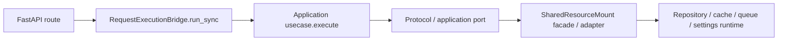

# 应用用例

## 1. 文档范围

本文说明 `src/application` 的用例、命令/查询对象、同步执行模型、事务所有权和错误传播规则。当前代码包含：

- 根目录 6 个 `*_usecase.py`：健康探针、系统概览、令牌签发/刷新/吊销、后台任务派发。
- `src/application/admin` 子树 33 个用例类：任务 5 个、配置 2 个、日志 2 个、安全 IP 封禁 4 个、审计 1 个、身份 19 个（含初始管理员）。
- `AuthorizationGuard`：应用服务，不是 `*Usecase`，负责把领域授权决策转换为 HTTP fault。
- `TaskExecutionProbeHandler`：任务处理器，不属于 HTTP 用例。

## 2. 调用与依赖规则

1. HTTP route 把 Pydantic 请求模型转换为 application dataclass；用例不接收 `Request`、`Depends` 等 FastAPI 类型。
2. 用例均为同步 `execute()`；异步 route 通过 `RequestExecutionBridge.run_sync` 卸载同步工作。
3. 构造参数使用窄端口类型。后台身份、审计、日志和配置用例多为薄委托，用来保持 route 到 application 的稳定边界。
4. 成功返回 core Pydantic 契约、application dataclass 或端口 snapshot；可预期失败抛 `HttpFaultException`，不以 `None` 作为通用失败信号。
5. `HttpFaultException` 的 HTTP 状态和稳定错误码由用例、端口实现或仓储产生，route 通常不改写。

## 3. 用例清单

| 分组 | 用例 | 编排语义 |
| --- | --- | --- |
| 系统 | `HealthProbeUsecase` | 读取 `ApplicationSettingsSnapshot`；`probe_kind=ready` 时按 `ready` 返回 `ready/starting`，其他类型返回 `alive`。 |
| 系统 | `SystemOverviewUsecase` | 映射标题、应用名、版本、环境、启用模块、ready 状态和资源状态。 |
| 鉴权 | `IssueAccessTokenUsecase` | 校验凭据、按需升级密码哈希、签发令牌对并持久化刷新令牌会话。 |
| 鉴权 | `RefreshAccessTokenUsecase` | 校验刷新令牌和数据库会话、执行单次轮换、处理重放并吊销会话族。 |
| 鉴权 | `RevokeTokenSessionUsecase` | 按刷新令牌吊销整个 token session；重复调用复用原吊销时间。 |
| 任务 | `DispatchBackgroundJobUsecase` | 解析注册和重试次数，构造 descriptor/message 后交 `TaskRuntimePort` 派发。 |
| 后台任务 | `List/GetAdminTaskExecutionRecord`、`ReadAdminTaskRuntime`、`ListAdminTaskRegistrations`、`DispatchAdminTask` | 查询执行记录/运行时/注册；管理端派发先按注册绑定的 payload model 校验 JSON，再组合通用派发用例。 |
| 后台配置 | `BuildAdminSettingsReloadCandidateUsecase`、`ApplyAdminSettingsReloadUsecase` | 委托 `AdminSettingsReloadPort` 构建候选或执行 reload。 |
| 后台日志 | `ListAdminLogRecordsUsecase`、`ListAdminSecurityEventsUsecase` | 原样传递强类型过滤对象并返回快照列表。 |
| 后台安全 | `List/Create/Get/ReleaseAdminSecurityIpBlockUsecase` | 委托局部 `AdminSecurityIpBlockRuntimePort` 管理 IP 封禁。 |
| 后台审计 | `ListAdminAuditEventsUsecase` | 传递审计过滤和 offset 分页查询，返回 `AdminAuditEventPage`。 |
| 身份 scope | list/get/create/update/delete 5 个用例 | 委托 `AdminIdentityPort`；更新命令携带 `actor_subject_id` 供自锁保护。 |
| 身份 role | list/get/create/update/replace scopes/delete 6 个用例 | 委托 `AdminIdentityPort`；替换 scopes 命令携带操作者。 |
| 身份 user | list/get/create/update/reset password/replace roles/delete 7 个用例 | `delete` 的应用语义是停用；状态启用复用 `UpdateAdminUserUsecase`。 |
| 初始管理员 | `CreateInitialAdminUsecase` | 要求确认短语 `create-initial-admin`，先哈希密码，再调用最小 `InitialAdminCreatePort`。仅供 CLI 初始化链路。 |

## 4. 三条关键鉴权流程

### 4.1 签发令牌

`IssueAccessTokenUsecase` 的顺序是：

1. `assert_issue_access_token_allowed(username)`。
2. 创建 UoW，在同一 session 中创建身份仓储与刷新令牌仓储。
3. 查用户名；用户不存在、用户停用、密码不匹配均记录失败并统一返回 `401 auth.access.invalid_credentials`，避免账号枚举。
4. 密码哈希策略需要升级时，在同一事务更新 hash。
5. 签发 access/refresh token pair，写刷新令牌 session 行。
6. commit 后清除用户名节流计数；任何业务或非预期异常先 rollback，最后 dispose。

### 4.2 刷新令牌

`RefreshAccessTokenUsecase` 先对 `refresh_token|ip:<client_ip>` 和 `refresh_token|global` 两个主体做节流，再在事务外解码 JWT。进入事务后用 `get_by_token_id_for_update` 锁定刷新令牌行，并依次验证记录存在、subject 一致、session id 一致、未轮换、未吊销、身份存在且启用。

- 正常路径沿用原 `token_session_id` 签发新令牌，先插入新刷新令牌，再把旧令牌标为 rotated/revoked，commit 后清节流。
- 发现 `rotated_to_token_id` 表示重放：吊销同一 session 的令牌族并立即 commit，然后抛 `401 auth.token.reused`。`reuse_revocation_committed` 防止异常处理把这次安全写入回滚。
- 已吊销返回 `401 auth.token.revoked`；主体停用返回 `403 auth.access.account_disabled`。

### 4.3 吊销令牌

`RevokeTokenSessionUsecase` 解码 refresh token 后锁定对应记录并核对 subject/session。不存在或不匹配返回 `401 auth.token.invalid`；首次调用吊销整个 session，重复调用不重复写库并返回原 `revoked_at_epoch`。该接口的幂等性只覆盖“同一有效 JWT 指向已吊销的现存记录”，不是对任意无效 token 返回成功。

## 5. 任务派发编排

`DispatchBackgroundJobUsecase`：

- `job_kind` 为空时读默认值；按当前 task backend 获取已启用注册。
- `task_id`、缺省 `deduplication_key`、缺省 `request_id` 均生成 UUID。
- `retry_limit` 优先级是命令值 > Local/Funboost 注册值 > 运行时默认值。
- payload 由已验证的 Pydantic model `model_dump_json()` 序列化；`request_id`、`trace_id` 写入消息 header。
- `DispatchAdminTaskUsecase` 是显式组合用例：先 `validate_task_payload_json`，再调用通用派发用例。

## 6. 事务所有权

| 场景 | 事务所有者 | 说明 |
| --- | --- | --- |
| 签发、刷新、吊销令牌 | 用例本身 | 用例直接通过 `AuthRuntimePort` 创建 UoW 和仓储。 |
| 后台身份 CRUD | `AdminIdentityResourceFacade` | application 用例是薄委托；门面为每次操作创建/提交/回滚/释放 UoW。 |
| 用户停用、密码重置、角色替换 | `AdminIdentityResourceFacade` | 身份写入与刷新令牌 session 批量吊销处于同一事务。 |
| 后台日志/审计查询 | `LoggingResourceFacade` | 端口实现管理数据库会话；用例不开 UoW。 |
| 配置热更新 | `AdminSettingsReloadAdapter` / `SettingsReloadCoordinator` | 不是数据库 UoW，而是配置快照与资源恢复事务。 |
| 任务派发 | `TaskResourceFacade` 及任务运行时 | 执行记录、Outbox 和发布语义由任务基础设施闭合。 |

因此不能把“所有用例自行创建 UoW”当作约定；真正约定是每条写链只有一个清晰的事务所有者。

## 7. 授权与审计的边界

- `AuthorizationGuard.assert_requirement()` 把 route requirement 转为 policy，调用纯领域求值器；拒绝时抛 `403 auth.authorization.permission_denied`。
- 后台 route 的 dependency 先做 Bearer + role/scope 校验，再进入用例。
- 身份变更审计不是 identity 用例或 `AdminIdentityResourceFacade` 发射的。身份 route 仅在用例成功返回后调用 `_record_identity_change`；配置 reload route 也只在 `result.success=True` 时发射 `settings_reload` 审计事件。
- 这意味着仓储/CLI 直接调用不会自动生成 HTTP 管理审计；失败的身份写操作也不会进入当前业务审计查询结果。

## 8. 扩展检查表

1. 请求 Pydantic 模型只放 API 层；application 输入使用 dataclass 或已有 core 契约。
2. 新能力优先复用窄端口；跨越新的资源边界才新增 Protocol。
3. 明确事务由用例、mount facade 还是专用 coordinator 持有，并覆盖 rollback/dispose。
4. route 通过 `run_sync` 执行同步用例，不在 event loop 直接做同步 IO。
5. 补 unit（用例分支）、interface（HTTP/权限）、contract（信封）或 integration（真实仓储不变式）测试。

## 9. 事实核验测试

| 测试 | 覆盖事实 |
| --- | --- |
| `test/unit_test/test_auth_persistence_unit.py` | 刷新节流主体键、授权求值、认证持久化协作。 |
| `test/path_test/test_runtime_path.py` | 登录、刷新、吊销和主体读取运行路径。 |
| `test/interface_test/test_http_interface.py` | auth HTTP 契约、`/auth/me` 和 token 错误。 |
| `test/unit_test/test_admin_task_usecase_unit.py` | 后台任务查询、运行时汇总和 payload 校验先于派发。 |
| `test/unit_test/test_admin_settings_usecase_unit.py` | candidate、成功、拒绝和回滚结果。 |
| `test/unit_test/test_admin_log_query_unit.py` | 日志查询过滤与不可解析详情映射。 |
| `test/unit_test/admin_audit/test_admin_audit_query_unit.py` | 审计动作白名单、过滤和分页下推。 |
| `test/integration_test/admin_identity/*.py` | 身份 CRUD、自锁、技术/业务角色边界和 session 吊销。 |

## 10. 相关文档

- [应用端口](application_ports.md)
- [领域模型与常量](domain_model_and_constants.md)
- [管理后台能力](admin_business_capabilities.md)
- [新增用例](../09_development_guide/adding_new_usecase.md)
- [事务边界](../06_data/transaction_boundary.md)
