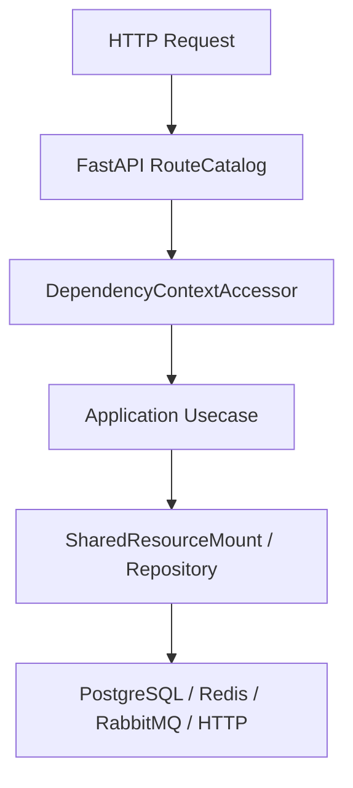

# 应用用例

## 1. 文档目的
说明应用层用例的组织方式、输入输出对象和与端口的关系。

**最后更新范围**：覆盖 `src/application`、`src/application/admin` 和认证、系统概览、身份、任务、配置、日志、安全、审计用例。

## 2. 适用读者
- 新人开发者
- 后端开发者
- 测试维护者

## 3. 关联源码
| 路径 | 作用 |
| --- | --- |
| `src/application/health_probe_usecase.py` | 健康探针用例。 |
| `src/application/system_overview_usecase.py` | 系统概览用例。 |
| `src/application/issue_access_token_usecase.py` | 令牌签发用例。 |
| `src/application/refresh_access_token_usecase.py` | 令牌刷新用例。 |
| `src/application/revoke_access_token_usecase.py` | 令牌会话撤销用例。 |
| `src/application/admin` | 后台管理用例。 |
| `src/application/admin/identity` | 管理员身份 CRUD 用例。 |
| `src/application/admin/security_protection` | 安全 IP 封禁管理用例。 |

## 4. 核心结论
- 应用用例以类封装，例如 `HealthProbeUsecase`、`SystemOverviewUsecase`、`IssueAccessTokenUsecase`、`RefreshAccessTokenUsecase`、`RevokeTokenSessionUsecase`、`DispatchAdminTaskUsecase`。
- 用例依赖端口而不是具体数据库、缓存或 FastAPI 对象。
- 后台身份按 scope/role/user/initial_admin 分目录组织。
- 后台任务覆盖运行时读取、注册列表、执行记录列表/详情和任务派发；后台配置热更新拆成候选构建与应用两个用例。
- 后台日志与安全事件由查询用例读取，安全防护中的 IP 封禁管理包含列表、创建、详情和释放四个用例。
- 业务审计当前由 `ListAdminAuditEventsUsecase` 通过审计查询端口分页读取。
- 装配器在 `ApplicationContainer` 中创建用例实例。

## 5. 结构说明
应用层负责业务编排，输入多为 dataclass/Pydantic command/query，输出为 payload/snapshot/result。

## 6. 工作流程

## 7. 关键实现
| 组件 | 文件 | 职责 |
| --- | --- | --- |
| `IssueAccessTokenUsecase` | `src/application/issue_access_token_usecase.py` | 认证并签发令牌。 |
| `RefreshAccessTokenUsecase` | `src/application/refresh_access_token_usecase.py` | 校验刷新令牌并轮换令牌会话。 |
| `RevokeTokenSessionUsecase` | `src/application/revoke_access_token_usecase.py` | 撤销刷新令牌会话。 |
| `DispatchAdminTaskUsecase` | `src/application/admin/dispatch_admin_task_usecase.py` | 后台任务派发。 |
| `BuildAdminSettingsReloadCandidateUsecase` | `src/application/admin/build_admin_settings_reload_candidate_usecase.py` | 构建配置热更新候选。 |
| `ApplyAdminSettingsReloadUsecase` | `src/application/admin/apply_admin_settings_reload_usecase.py` | 应用配置热更新并返回回滚状态。 |
| `ListAdminSecurityIpBlocksUsecase` | `src/application/admin/security_protection/manage_admin_security_ip_blocks_usecase.py` | 查询安全 IP 封禁记录。 |
| `CreateAdminUserUsecase` | `src/application/admin/identity/user/create_admin_user_usecase.py` | 创建管理员用户。 |

## 8. 如何修改或扩展
1. 新增用例类和输入/输出对象。
2. 如需外部能力，新增或复用 `src/application/ports` 端口。
3. 在 `FastApiAppAssembler._build_application_container` 注入用例。
4. 补 unit 测试和 API/CLI 调用文档。

## 9. 测试覆盖
| 测试类型 | 文件 | 验证内容 |
| --- | --- | --- |
| unit | `test/unit_test/test_admin_task_usecase_unit.py` | 任务用例。 |
| integration | `test/integration_test/admin_identity/test_admin_user_usecase_integration.py` | 用户用例与真实事务。 |
| integration | `test/integration_test/admin_identity/test_admin_role_usecase_integration.py` | 角色用例与真实事务。 |
| integration | `test/integration_test/admin_identity/test_admin_scope_usecase_integration.py` | scope 用例与真实事务。 |
| unit | `test/unit_test/test_admin_settings_usecase_unit.py` | 配置热更新用例。 |
| unit | `test/unit_test/admin_audit/test_admin_audit_query_unit.py` | 审计查询用例。 |

## 10. 常见问题
- 如果 route 无法读取用例，检查 `DependencyContextAccessor` 是否提供对应读取方法。

## 11. 维护备注
用例变更时同步端口、route、API 文档和 unit 测试。

## 12. 相关文档
- [项目文档总览](../README.md)
- [新增用例](../09_development_guide/adding_new_usecase.md)
