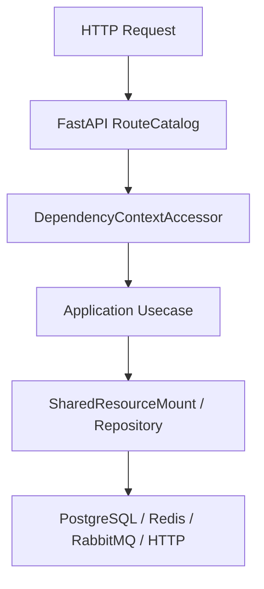

# 鉴权与授权

## 1. 文档目的
说明密码哈希、JWT、刷新令牌、认证绑定和后台路由授权要求。

**最后更新范围**：覆盖当前源码、配置和相关测试；生产拓扑只描述代码与 Compose 可确认部分。

## 2. 适用读者
- 后端开发者
- 运维部署人员
- 安全审查人员

## 3. 关联源码
| 路径 | 作用 |
| --- | --- |
| `src/infrastructure/auth` | 认证基础设施。 |
| `src/api/endpoint_auth_access` | 鉴权访问 API。 |
| `src/domain/auth/admin_route_authorization_policy.py` | 后台权限要求。 |
| `src/domain/auth` | 角色、scope、错误码。 |
| `src/core/auth_contract` | 认证核心契约。 |
| `src/infrastructure/key_management` | JWT 签名密钥族和轮换服务。 |

## 4. 核心结论
- 认证入口包括 `/auth/token`、`/auth/refresh`、`/auth/revoke`、`/auth/me`。
- 后台路由统一要求角色 `admin` 和对应 scope。
- JWT 策略来自 `runtime.auth`；签名材料优先由密钥管理服务的 `jwt_signing` 密钥族提供，并通过 JWT header `kid` 支持历史有效密钥验签。
- 刷新令牌状态持久化到 `auth_refresh_token`。
- `/auth/token`、`/auth/refresh`、`/auth/revoke` 是异步路由中的同步主干调用，统一经 `RequestExecutionBridge` 按 `runtime.web.request_execution` 卸载执行；`/auth/me` 只读取中间件已绑定主体。
- 登录失败会写安全事件并触发风险信号统计；刷新令牌链路捕获到统一 HTTP 故障时会写安全事件，复用场景单独标记为 `AUTH_REFRESH_REUSED`。

## 5. 结构说明
该能力由核心契约、配置模型、基础设施实现和测试共同约束。外部组件差异以 `config/runtime/*` 与 Compose 文件为准。

## 6. 工作流程

## 7. 关键实现
| 组件 | 文件 | 职责 |
| --- | --- | --- |
| `JwtTokenService` | `src/infrastructure/auth/jwt_token_service.py` | JWT 签发和校验。 |
| `AuthorizationGuard` | `src/application/authorization_guard.py` | 授权校验。 |
| `AuthFailureThrottle` | `src/infrastructure/auth/auth_failure_throttle.py` | 通过缓存记录登录/刷新失败计数和锁定状态。 |
| `BootstrapAdminSynchronizer` | `src/infrastructure/auth/bootstrap_admin_synchronizer.py` | 启动期同步引导管理员、角色和 scope 目录。 |

## 8. 如何修改或扩展
1. 先修改核心契约或配置模型。
2. 再修改基础设施实现和 `SharedResourceMount` 挂载/释放逻辑。
3. 按 development/test/production 差异更新 TOML 配置。
4. 补 unit、contract、interface 或 integration 测试。
5. 同步更新本说明书和运维检查清单。

## 9. 测试覆盖
| 测试类型 | 文件 | 验证内容 |
| --- | --- | --- |
| unit | `test/unit_test/test_auth_persistence_unit.py` | 认证持久化。 |
| interface | `test/interface_test/test_security_http_interface.py` | 认证接口安全。 |
| integration | `test/integration_test/admin_identity/test_admin_identity_rbac_integration.py` | RBAC 集成。 |

## 10. 常见问题
- 生产环境不可依赖本地 `.env`，必须使用进程环境变量或部署系统注入。
- 如果依赖外部组件不可用，先区分是 local/test/production 配置差异还是服务健康问题。

## 11. 维护备注
修改运行时能力时，同步检查配置、资源生命周期、测试 support 和部署文档。

## 12. 相关文档
- [项目文档总览](../README.md)
- [配置文件](../07_configuration_deployment/configuration_files.md)
- [故障排查](../10_maintenance/troubleshooting.md)
