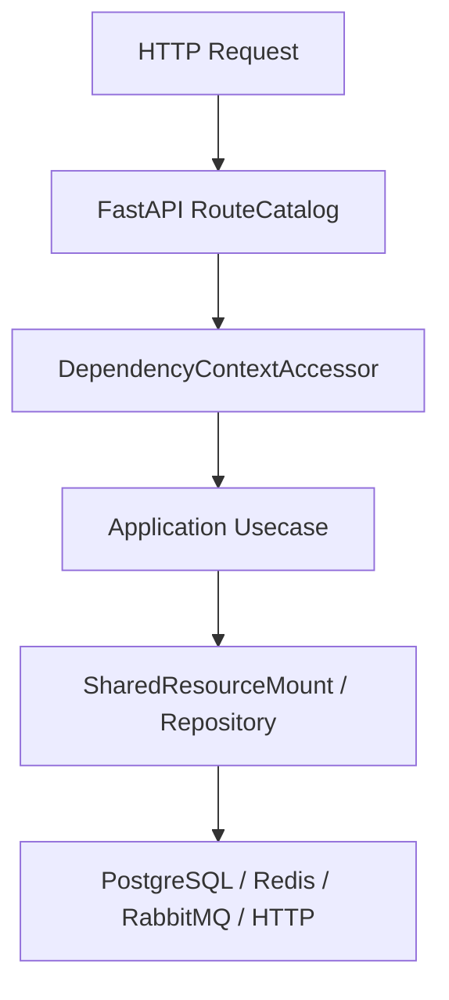

# 缓存运行时

## 1. 文档目的
说明 Memory/Redis 缓存后端、命名空间策略和 fail open/fail closed 行为。

**最后更新范围**：覆盖当前源码、配置和相关测试；生产拓扑只描述代码与 Compose 可确认部分。

## 2. 适用读者
- 后端开发者
- 运维部署人员
- 安全审查人员

## 3. 关联源码
| 路径 | 作用 |
| --- | --- |
| `src/infrastructure/cache` | 缓存实现。 |
| `src/core/cache_contract` | 缓存契约。 |
| `config/runtime/cache_runtime` | 缓存配置。 |
| `src/infrastructure/testing/fake_cache_store.py` | 测试 fake，仅测试用途。 |

## 4. 核心结论
- base/test 默认使用 memory cache，production 使用 Redis。
- auth_throttle 和 rate_limit 策略 fail_closed，query_result 可 fail_open。
- 经 `CacheService` 的业务缓存读写会按 namespace 策略处理 Redis 不可用；直接使用 `CacheStore` 的限流、IP 封禁、分布式锁和密钥环缓存镜像链路按各自守卫/服务处理异常。
- `fake_cache_store.py` 只用于测试。
- 未声明 namespace 的缓存策略默认 fail_closed；TTL 解析顺序为显式 TTL、namespace 默认 TTL、运行时默认 TTL。
- 启动期生产环境禁止 memory cache，Redis 后端会先执行 `assert_available`。
- 分布式锁、鉴权失败节流、限流、IP 封禁和密钥环缓存镜像都复用同一 `CacheStore` 与 `key_prefix`。
- `CacheStore` 契约包含 `compare_and_set_value`，Memory/Redis/Fake/Unavailable 实现保持同一 CAS 语义；Redis 使用 Lua 脚本保证比较与写入原子性。
- 密钥管理的密钥环以数据库 `key_ring_snapshot` 表为权威存储，快照落库前使用运行时外部密钥派生的 Fernet 密钥加密；初始化使用数据库 absent 写入，轮转使用版本摘要 CAS，CAS 失败或密钥环缺失按 fail closed 处理。
- `KEY_RING` 缓存命名空间仅保存数据库权威快照的读穿镜像，Redis 失效、驱逐或清库不会触发重新生成权威密钥环。

## 5. 结构说明
该能力由核心契约、配置模型、基础设施实现和测试共同约束。外部组件差异以 `config/runtime/*` 与 Compose 文件为准。

## 6. 工作流程

## 7. 关键实现
| 组件 | 文件 | 职责 |
| --- | --- | --- |
| `CacheService` | `src/infrastructure/cache/cache_service.py` | 缓存服务。 |
| `RedisCacheStore` | `src/infrastructure/cache/redis_cache_store.py` | Redis 实现。 |
| `CachePolicyResolver` | `src/infrastructure/cache/cache_policy_resolver.py` | 解析 namespace TTL 和失败模式。 |
| `MemoryCacheStore` | `src/infrastructure/cache/memory_cache_store.py` | 本地内存实现，支持 TTL、原子递增和 CAS 操作。 |
| `DatabaseKeyRingStore` | `src/infrastructure/key_management/database_key_ring_store.py` | 基于数据库保存加密密钥环，并为初始化和轮转提供 absent/CAS 写入。 |
| `RedisKeyRingStore` | `src/infrastructure/key_management/redis_key_ring_store.py` | 保留基于 CacheStore 的密钥环存储实现，用于非权威缓存兼容路径和回归测试。 |

## 8. 如何修改或扩展
1. 先修改核心契约或配置模型。
2. 再修改基础设施实现和 `SharedResourceMount` 挂载/释放逻辑。
3. 按 development/test/production 差异更新 TOML 配置。
4. 补 unit、contract、interface 或 integration 测试。
5. 同步更新本说明书和运维检查清单。

## 9. 测试覆盖
| 测试类型 | 文件 | 验证内容 |
| --- | --- | --- |
| unit | `test/unit_test/test_cache_unit.py` | 缓存单元。 |
| unit | `test/unit_test/test_key_management_service_unit.py` | key ring 数据库加密持久化、缓存镜像刷新、CAS、初始化和轮转 fail closed。 |
| integration | `test/integration_test/test_cache_integration.py` | 缓存集成。 |
| path | `test/path_test/test_cache_runtime_path.py` | 缓存路径。 |

## 10. 常见问题
- 生产环境不可依赖本地 `.env`，必须使用进程环境变量或部署系统注入。
- 如果依赖外部组件不可用，先区分是 local/test/production 配置差异还是服务健康问题。

## 11. 维护备注
修改运行时能力时，同步检查配置、资源生命周期、测试 support 和部署文档。

## 12. 相关文档
- [项目文档总览](../README.md)
- [配置文件](../07_configuration_deployment/configuration_files.md)
- [故障排查](../10_maintenance/troubleshooting.md)
