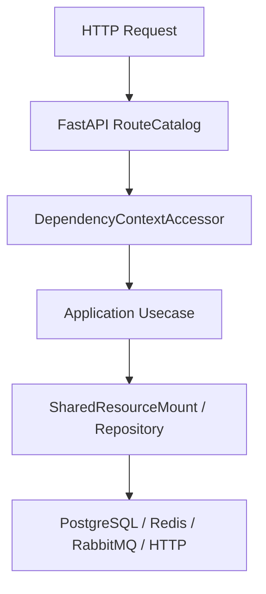

# 配置系统

## 1. 文档目的
说明 TOML、环境变量、非 production `.env` 和热更新协调如何组成配置系统。

**最后更新范围**：覆盖当前源码、配置和相关测试；生产拓扑只描述代码与 Compose 可确认部分。

## 2. 适用读者
- 后端开发者
- 运维部署人员
- 安全审查人员

## 3. 关联源码
| 路径 | 作用 |
| --- | --- |
| `config/app_base.toml` | 基础 app 配置。 |
| `config/app_development.toml` | development 覆盖。 |
| `config/app_test.toml` | test 覆盖。 |
| `config/app_production.toml` | production 覆盖。 |
| `config/runtime/key_management_runtime` | JWT 签名密钥族和轮换配置。 |
| `src/infrastructure/settings/app_settings_loader.py` | 配置加载器。 |
| `src/infrastructure/settings/settings_security_validator.py` | 生产安全校验。 |

## 4. 核心结论
- 配置分为 app、modules、runtime 三大类。
- `APP_ENV` 决定加载 development/test/production。
- 非 production 会读取仓库根 `.env`；production 禁用 dotenv。
- 生产环境必须通过外部环境注入敏感值。
- 文件加载顺序是基础层再环境层，后读到的 TOML 覆盖前面配置；进程环境变量最后覆盖文件和 `.env`。
- 进程环境变量覆盖项包括 `DATABASE_URL`、`REDIS_URL`、`RABBITMQ_URL`、`JWT_SECRET`、`AUTH_BOOTSTRAP_ADMIN_PASSWORD` 和 `RUNTIME_WEB_API_PREFIX`；其中 Redis/RabbitMQ URL 只在对应后端启用时覆盖后端明细。
- `runtime.web.request_execution` 由 `RequestExecutionBridge` 使用，默认以线程池模式执行同步用例，test 超时为 5 秒，base 为 15 秒。
- `runtime.key_management` 随 runtime 配置一起加载，当前三套环境均启用 `jwt_signing` 密钥族；test 轮换间隔和兼容窗口为 3600 秒，base/production 为 7200 秒。
- production 校验要求外部 JWT、数据库、Redis、RabbitMQ 配置齐全，Redis 必须带密码，RabbitMQ 禁止 guest/guest。

## 5. 结构说明
该能力由核心契约、配置模型、基础设施实现和测试共同约束。外部组件差异以 `config/runtime/*` 与 Compose 文件为准。

## 6. 工作流程

## 7. 关键实现
| 组件 | 文件 | 职责 |
| --- | --- | --- |
| `AppSettingsLoader.load` | `src/infrastructure/settings/app_settings_loader.py` | 按环境加载配置。 |
| `SettingsReloadCoordinator.reload` | `src/infrastructure/settings/settings_reload_coordinator.py` | 热更新配置。 |
| `SettingsSecurityValidator` | `src/infrastructure/settings/settings_security_validator.py` | 校验生产安全基线和任务/消息组合一致性。 |
| `RequestExecutionBridge` | `src/infrastructure/request_execution_bridge.py` | 按 Web 运行时配置桥接异步路由与同步主干调用。 |

## 8. 如何修改或扩展
1. 先修改核心契约或配置模型。
2. 再修改基础设施实现和 `SharedResourceMount` 挂载/释放逻辑。
3. 按 development/test/production 差异更新 TOML 配置。
4. 补 unit、contract、interface 或 integration 测试。
5. 同步更新本说明书和运维检查清单。

## 9. 测试覆盖
| 测试类型 | 文件 | 验证内容 |
| --- | --- | --- |
| unit | `test/unit_test/test_dotenv_settings_loader_unit.py` | dotenv 加载。 |
| unit | `test/unit_test/test_settings_security_unit.py` | 安全校验。 |
| unit | `test/unit_test/test_settings_apply_transaction_unit.py` | 配置应用事务。 |

## 10. 常见问题
- 生产环境不可依赖本地 `.env`，必须使用进程环境变量或部署系统注入。
- 如果依赖外部组件不可用，先区分是 local/test/production 配置差异还是服务健康问题。

## 11. 维护备注
修改运行时能力时，同步检查配置、资源生命周期、测试 support 和部署文档。

## 12. 相关文档
- [项目文档总览](../README.md)
- [配置文件](../07_configuration_deployment/configuration_files.md)
- [故障排查](../10_maintenance/troubleshooting.md)
