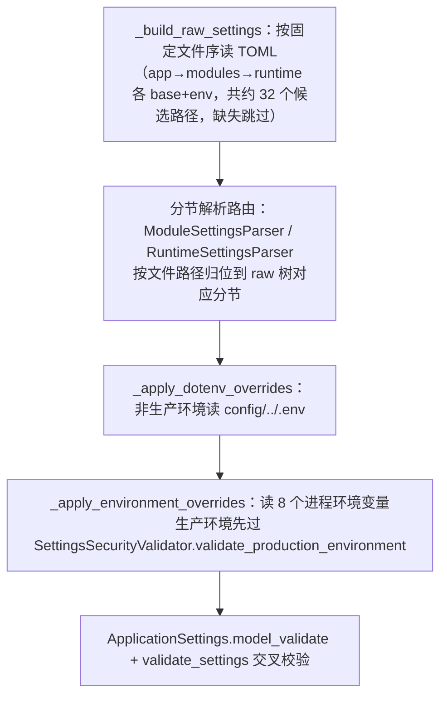

# 配置系统

## 1. 这是什么

详解配置的完整生命周期：TOML 分层文件 → dotenv → 进程环境变量的合并顺序，Pydantic 强类型校验，生产安全强约束，以及运行期热更新（candidate → diff 分类 → 原子应用 → 快照推进/回滚）。任何"改配置为什么没生效/为什么启动失败"的问题从本文入手。

**最后更新范围**：覆盖 `src/infrastructure/settings/` 全部 13 个文件、`config/` 目录结构与 `app.reload` 白名单机制。

## 2. 设计思想与动机

1. **文件分域、环境分层**：配置按能力域拆成约 16 组文件（app、3 组 module、12 组 runtime），每组 `*_base.toml` + `*_{environment}.toml`。域拆分让每个文件短小、评审聚焦；环境层让 dev/test/prod 差异显式可 diff。
2. **合并优先级固定**：`base 文件 < 环境文件 < .env（非生产）< 进程环境变量 < 显式 overrides（仅入参）`。环境变量永远最后覆盖——容器部署替换敏感信息的通道。
3. **全量强类型 + 启动即验**：合并后的原始映射整体进 `ApplicationSettings.model_validate`，全部模型 `extra="forbid"`；拼错键、类型错、约束违反（如 `pool_size < 1`、`api_prefix` 不以 `/` 开头）都在启动时报 `system.config.invalid` 并附完整 Pydantic 错误。
4. **热更新白名单显式声明**：哪些键可热更、哪些必须重启，声明在 `config/app_base.toml` 的 `app.reload.hot_reload_allowed / restart_required` 两个列表；不在任何名单中的变更被视为"不安全"直接拒绝。宁可拒绝也不静默半生效。

## 3. 加载流程（AppSettingsLoader）

被识别的环境变量及落点：

| 环境变量 | 覆盖路径 | 条件 |
| --- | --- | --- |
| `APP_ENV` | 选择环境层（development/test/production） | 无显式 environment 入参时 |
| `DATABASE_URL` | `runtime.database.url` | 恒覆盖 |
| `REDIS_URL` | `runtime.cache.backend_detail.redis_url` | 仅当缓存后端已是 redis |
| `RABBITMQ_URL` | `runtime.message.backend_detail.rabbitmq_url` | 仅当消息后端已是 rabbitmq |
| `JWT_SECRET` | `runtime.auth.jwt_secret` | 恒覆盖 |
| `AUTH_BOOTSTRAP_ADMIN_PASSWORD` | `modules.auth.bootstrap_admin.password_plain` | 恒覆盖 |
| `RUNTIME_WEB_API_PREFIX` | `runtime.web.api_prefix` | 恒覆盖 |
| `LOGGING_ENTRY_PROJECT_NAME` / `LOGGING_ENTRY_LOG_PATH` | `runtime.logging.entry_project_name / entry_log_path` | 恒覆盖 |

dotenv 仅非生产环境生效（生产必须用真实进程环境变量或编排注入），这是显式策略而非疏漏。

## 4. 生产安全强约束（SettingsSecurityValidator）

加载阶段（外部值）：JWT_SECRET 必须存在、≥32 字符、不含 `dev-secret/change-me/test-secret/local-dev` 弱片段；DATABASE_URL/REDIS_URL/RABBITMQ_URL 必须注入；REDIS_URL 必须带密码；RABBITMQ_URL 必须带专用账号且禁 guest/guest。

模型阶段（`validate_settings` 对全部环境执行）：安全运行时一致性（生产 detail 必须为 `production_security` 且 expose_openapi=false、require_external_jwt_secret=true、require_distributed_auth_throttle=true、CORS 禁通配符、trusted_proxy 禁环回 CIDR、出站 URL 安全必须启用且拒绝非 global/metadata 地址并启用域名允许清单）；任务运行时一致性（funboost 必须搭配 rabbitmq 总线与 `RABBITMQ_COMPLEX_ROUTING` broker，本地任务禁配 rabbitmq 总线）。

启动器再补两条：生产禁 bootstrap admin 常驻启用、生产禁内存缓存。

## 5. 热更新机制（SettingsReloadCoordinator）

- **candidate**（`GET /admin/settings/reload/candidate`）：按当前环境重新加载配置（保留启动时的 baseline overrides），返回 `candidate_version`（配置全量 JSON 的 sha256 前 12 位）与完整 digest。版本号 = 内容寻址，同配置必得同版本。
- **reload**（`POST /admin/settings/reload`）：
  1. 展平新旧配置为路径字典做 diff（SecretStr 取原文参与摘要，Enum 取 value）。
  2. 两轮拒绝：变更路径既不在 hot_reload_allowed 也不在 restart_required → 拒绝（"不允许热更新"）；在 restart_required → 拒绝（"必须重启后生效"）。
  3. 通过后回调 `SharedResourceMount.apply_settings`（原子切换事务，详见[运行时资源生命周期](../01_architecture/runtime_resource_lifecycle.md)第 5 节）。
  4. 成功 → `SettingsSnapshotStore.save` 推进快照版本；失败 → 用最近成功快照恢复内存配置，返回 `RELOAD_FAILED:<原因>` 并已发配置安全事件。
- `initialize_snapshot()` 在装配期记录启动基线，保证第一次失败也有回滚锚点。

## 6. 怎么用

- **加一个配置项**：按[新增配置](../09_development_guide/adding_new_config.md)：选文件 → base+env 写值 → Pydantic 模型加字段（含约束与 docstring）→ 需要热更则把路径加进 hot_reload_allowed → 补 unit/contract 测试。
- **本地覆盖**：改 `.env`（参照 `config/.env.example`）或临时设环境变量；不要直接改 base 文件做本地实验。
- **测试注入**：`create_app(settings_overrides={...}, environment=...)`——overrides 是深度合并的叶子覆盖。
- **排查加载失败**：报错 detail 是 Pydantic 完整错误串，含出错路径；对照本文件第 3 节确认值最终来自哪一层。

## 7. 注意事项

- 新增 runtime 配置组需同步 `_collect_file_paths` 的候选路径列表与 raw 树骨架，两处漏改的症状是"文件放了但完全没被读"。
- `hot_reload_allowed` 里的路径必须与展平后的实际路径完全一致（含嵌套信封的 header/detail 全路径），列表中已有大量示例可参照。
- 配置摘要包含 SecretStr 原文（仅内存内计算 sha256，不落盘不外传），因此换密钥会改变 candidate_version——这是预期行为。
- `load_from_mapping` 时必须显式给 environment；隐式环境 + 显式覆盖的组合被装配器拒绝（防"以为在改 dev 实际改了 prod"）。

## 8. 测试覆盖

| 测试类型 | 文件 | 验证内容 |
| --- | --- | --- |
| unit | `test/unit_test/test_app_settings_loader_unit.py` | 合并顺序、环境变量落点。 |
| unit | `test/unit_test/test_settings_security_unit.py` | 生产强约束。 |
| unit | `test/unit_test/test_settings_reload_unit.py` | diff 分类、拒绝、回滚。 |
| path | `test/path_test/test_settings_reload_path.py` | 热更新端到端。 |
| initialization | `test/initialization_test/*` | 各运行时配置装配。 |

## 9. 相关文档

- [项目文档总览](../README.md)
- [配置文件](../07_configuration_deployment/configuration_files.md)
- [环境变量](../07_configuration_deployment/environment_variables.md)
- [新增配置](../09_development_guide/adding_new_config.md)
- [管理员配置 API](../05_api_reference/admin_settings_api.md)
