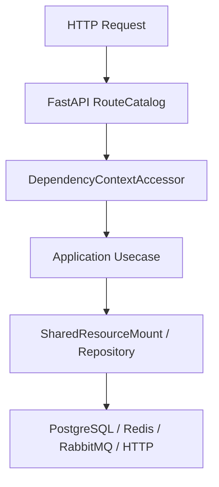

# 分布式锁

## 1. 文档目的
说明 Redis/cache 分布式锁提供者和配置。

**最后更新范围**：覆盖当前源码、配置和相关测试；生产拓扑只描述代码与 Compose 可确认部分。

## 2. 适用读者
- 后端开发者
- 运维部署人员
- 安全审查人员

## 3. 关联源码
| 路径 | 作用 |
| --- | --- |
| `src/infrastructure/concurrency/distributed_lock_provider.py` | 分布式锁门面。 |
| `src/infrastructure/concurrency/redis_distributed_lock_adapter.py` | Redis 锁适配。 |
| `src/core/concurrency_contract/distributed_lock_contract.py` | 锁运行时契约。 |
| `config/runtime/distributed_lock_runtime` | 锁配置。 |

## 4. 核心结论
- 分布式锁配置声明 lease_seconds 和 wait_seconds。
- 实现依赖缓存/Redis 能力，生产环境需保证 Redis 可用。
- 测试覆盖 unit 和 Redis integration。
- `DistributedLockProvider` 使用 `CacheStore` 暴露的 `set_value_if_absent`、`delete_value_if_equals`、`refresh_value_if_equals` 实现获取、owner 匹配释放和续租。
- 锁键使用 `CacheNamespace.DISTRIBUTED_LOCK` 与缓存 `key_prefix` 构造；锁不可用、禁用或获取超时都按 fail_closed 转为 `CACHE_UNAVAILABLE` 类故障。
- 密钥轮换服务读取 `runtime.distributed_lock.detail.lease_seconds` 和 `wait_seconds` 作为轮换锁参数。
- `KeyManagementService` 轮换密钥族时使用 `key_rotation` namespace 和密钥族名 SHA-256 摘要获取独立锁，释放时按 owner 匹配删除。

## 5. 结构说明
该能力由核心契约、配置模型、基础设施实现和测试共同约束。外部组件差异以 `config/runtime/*` 与 Compose 文件为准。

## 6. 工作流程

## 7. 关键实现
| 组件 | 文件 | 职责 |
| --- | --- | --- |
| `DistributedLockProvider` | `src/infrastructure/concurrency/distributed_lock_provider.py` | 分布式锁提供者。 |
| `RedisDistributedLockAdapter` | `src/infrastructure/concurrency/redis_distributed_lock_adapter.py` | Redis 锁实现。 |
| `KeyManagementService` | `src/infrastructure/key_management/key_management_service.py` | 使用分布式锁保护密钥轮换。 |

## 8. 如何修改或扩展
1. 先修改核心契约或配置模型。
2. 再修改基础设施实现和 `SharedResourceMount` 挂载/释放逻辑。
3. 按 development/test/production 差异更新 TOML 配置。
4. 补 unit、contract、interface 或 integration 测试。
5. 同步更新本说明书和运维检查清单。

## 9. 测试覆盖
| 测试类型 | 文件 | 验证内容 |
| --- | --- | --- |
| unit | `test/unit_test/test_distributed_lock_provider_unit.py` | 分布式锁提供者。 |
| contract | `test/contract_test/test_distributed_lock_contract.py` | 锁契约。 |
| integration | `test/integration_test/test_distributed_lock_redis_integration.py` | Redis 锁集成。 |

## 10. 常见问题
- 生产环境不可依赖本地 `.env`，必须使用进程环境变量或部署系统注入。
- 如果依赖外部组件不可用，先区分是 local/test/production 配置差异还是服务健康问题。

## 11. 维护备注
修改运行时能力时，同步检查配置、资源生命周期、测试 support 和部署文档。

## 12. 相关文档
- [项目文档总览](../README.md)
- [配置文件](../07_configuration_deployment/configuration_files.md)
- [故障排查](../10_maintenance/troubleshooting.md)
