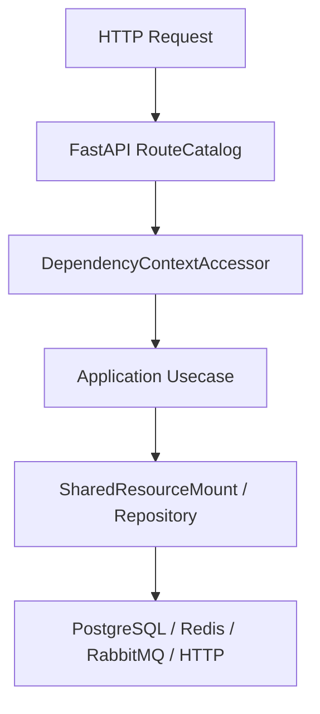

# 日志运行时

## 1. 文档目的
说明结构化日志、数据库日志 sink、缓冲刷新和后台日志查询。

**最后更新范围**：覆盖当前源码、配置和相关测试；生产拓扑只描述代码与 Compose 可确认部分。

## 2. 适用读者
- 后端开发者
- 运维部署人员
- 安全审查人员

## 3. 关联源码
| 路径 | 作用 |
| --- | --- |
| `src/infrastructure/logging` | 日志实现。 |
| `src/core/logging_contract` | 日志契约。 |
| `config/runtime/logging_runtime` | 日志配置。 |
| `src/infrastructure/persistence/orm_model/app_log_record_orm_model.py` | 日志 ORM。 |

## 4. 核心结论
- 默认日志 sink 为 database，表名 `app_log_record`。
- 日志写入经过 `StructuredLogHandler` 和 `LogBufferDispatcher`；派发器在锁内只交换缓冲区，在锁外执行数据库写入，避免慢数据库阻塞 emit 锁。
- 查询侧会对历史不可解析详情使用 `AdminUnparsedLogDetail`。
- 敏感文本由 `SensitiveTextRedactor` 脱敏。
- 标准输出 handler 也使用脱敏 formatter；数据库写入失败时按 `fallback_to_stdout` 决定是否降级输出。
- `LogBufferDispatcher` 写入失败只记录到独立内部 logger，内部 logger 不传播到结构化 handler，避免失败日志递归回灌同一缓冲器。
- base 日志级别为 INFO，test 为 DEBUG；buffer 来自 `runtime.logging.buffer_max_items`，flush interval、batch size 和 retention 来自 `runtime.logging.sink_detail`。
- 第三方入口配置纳入强类型运行时配置：`runtime.logging.entry_project_name` 通过 `LoggingEntryEnvironmentBridge` 驱动 funboost `PROJECT_NAME`，`runtime.logging.entry_log_path` 通过同一桥接器驱动 nb_log 日志目录；容器或部署环境可通过 `LOGGING_ENTRY_PROJECT_NAME`、`LOGGING_ENTRY_LOG_PATH` 覆盖。

## 5. 结构说明
该能力由核心契约、配置模型、基础设施实现和测试共同约束。外部组件差异以 `config/runtime/*` 与 Compose 文件为准。

## 6. 工作流程

## 7. 关键实现
| 组件 | 文件 | 职责 |
| --- | --- | --- |
| `AppLoggerFactory` | `src/infrastructure/logging/app_logger_factory.py` | 构建 logger。 |
| `DatabaseLogWriter` | `src/infrastructure/logging/database_log_writer.py` | 写入数据库。 |
| `LogBufferDispatcher` | `src/infrastructure/logging/log_buffer_dispatcher.py` | 按间隔、批量大小或缓冲上限锁外刷新日志，并使用内部 logger 记录失败。 |
| `SensitiveTextRedactor` | `src/infrastructure/logging/sensitive_text_redactor.py` | 脱敏 URL 凭据、Bearer/JWT 和 key/value 密钥文本。 |
| `LoggingEntryEnvironmentBridge` | `src/infrastructure/logging/logging_entry_environment_bridge.py` | 将强类型 `runtime.logging` 配置写入第三方入口环境变量，并重载已导入的入口模块。 |
| `funboost_config.py` | `funboost_config.py` | 从 `LOGGING_ENTRY_PROJECT_NAME` 读取 funboost 第三方入口项目名。 |
| `nb_log_config.py` | `nb_log_config.py` | 从 `LOGGING_ENTRY_LOG_PATH` 读取 nb_log 第三方入口日志目录并关闭 print patch。 |

## 8. 如何修改或扩展
1. 先修改核心契约或配置模型。
2. 再修改基础设施实现和 `SharedResourceMount` 挂载/释放逻辑。
3. 按 development/test/production 差异更新 TOML 配置。
4. 补 unit、contract、interface 或 integration 测试。
5. 同步更新本说明书和运维检查清单。

## 9. 测试覆盖
| 测试类型 | 文件 | 验证内容 |
| --- | --- | --- |
| unit | `test/unit_test/test_log_writer_unit.py` | 日志写入、锁外刷盘和内部 logger 防递归。 |
| integration | `test/integration_test/test_database_logging_integration.py` | 日志落库。 |
| exception | `test/exception_test/test_logging_exception_path.py` | 日志异常路径。 |

## 10. 常见问题
- 生产环境不可依赖本地 `.env`，必须使用进程环境变量或部署系统注入。
- 如果依赖外部组件不可用，先区分是 local/test/production 配置差异还是服务健康问题。

## 11. 维护备注
修改运行时能力时，同步检查配置、资源生命周期、测试 support 和部署文档。

## 12. 相关文档
- [项目文档总览](../README.md)
- [配置文件](../07_configuration_deployment/configuration_files.md)
- [故障排查](../10_maintenance/troubleshooting.md)
