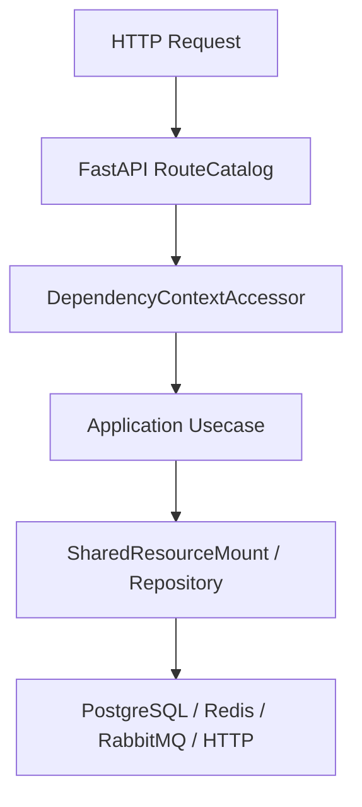

# 可观测性

## 1. 文档目的
说明 Prometheus 指标和 OpenTelemetry FastAPI instrumentation 的接入点。

**最后更新范围**：覆盖当前源码、配置和相关测试；生产拓扑只描述代码与 Compose 可确认部分。

## 2. 适用读者
- 后端开发者
- 运维部署人员
- 安全审查人员

## 3. 关联源码
| 路径 | 作用 |
| --- | --- |
| `src/infrastructure/observability` | Prometheus 指标实现。 |
| `src/infrastructure/fastapi_otel_bridge.py` | OpenTelemetry 桥接。 |
| `src/core/observability_contract` | 指标运行时契约。 |
| `config/runtime/metrics_runtime` | Prometheus 指标配置。 |
| `config/runtime/otel_runtime` | OTel 配置。 |

## 4. 核心结论
- `metrics_runtime_base.toml` 默认 `enabled=false`，路径为 `/metrics`。
- 启用时 `PrometheusMetricsRoute.bind` 注册指标路由。
- `PrometheusHttpMetricsMiddleware` 可记录 HTTP 请求指标。
- `FastApiOtelBridge.instrument_app` 在 otel enabled 时调用 FastAPIInstrumentor。
- test 和 production metrics 覆盖仍保持 disabled；启用后 `/metrics` 不进入 OpenAPI。
- Prometheus 指标包括 `fastapi_request_total`、`fastapi_request_duration_seconds` 和 `fastapi_runtime_ready`，HTTP path 使用 FastAPI route template 控制基数；动态主流程请求如 `/users/123` 记录为 `/users/{subject_id}`，无法解析模板或疑似原始动态路径时归入 `unknown`。
- OTel 默认 no-op；关闭时读取 `X-Trace-ID`，启用时优先从 `traceparent` 读取 trace id。

## 5. 结构说明
该能力由核心契约、配置模型、基础设施实现和测试共同约束。外部组件差异以 `config/runtime/*` 与 Compose 文件为准。

## 6. 工作流程

## 7. 关键实现
| 组件 | 文件 | 职责 |
| --- | --- | --- |
| `PrometheusMetricsRegistry` | `src/infrastructure/observability/prometheus_metrics_registry.py` | 指标注册器。 |
| `FastApiOtelBridge` | `src/infrastructure/fastapi_otel_bridge.py` | OTel 桥接器。 |
| `PrometheusMetricsRoute` | `src/infrastructure/observability/prometheus_metrics_route.py` | `/metrics` 路由和 HTTP 指标中间件。 |
| `FastApiAppAssembler._bind_prometheus_metrics` | `src/api/fastapi_app_assembler.py` | 按 metrics runtime 开关安装中间件和路由。 |

## 8. 如何修改或扩展
1. 先修改核心契约或配置模型。
2. 再修改基础设施实现和 `SharedResourceMount` 挂载/释放逻辑。
3. 按 development/test/production 差异更新 TOML 配置。
4. 补 unit、contract、interface 或 integration 测试。
5. 同步更新本说明书和运维检查清单。

## 9. 测试覆盖
| 测试类型 | 文件 | 验证内容 |
| --- | --- | --- |
| unit | `test/unit_test/test_prometheus_metrics_registry_unit.py` | 指标注册器。 |
| unit | `test/unit_test/test_fastapi_otel_bridge_unit.py` | OTel 桥接。 |
| interface | `test/interface_test/test_metrics_http_interface.py` | 指标 HTTP 接口与动态路由 route template 标签。 |

## 10. 常见问题
- 生产环境不可依赖本地 `.env`，必须使用进程环境变量或部署系统注入。
- 如果依赖外部组件不可用，先区分是 local/test/production 配置差异还是服务健康问题。

## 11. 维护备注
修改运行时能力时，同步检查配置、资源生命周期、测试 support 和部署文档。

## 12. 相关文档
- [项目文档总览](../README.md)
- [配置文件](../07_configuration_deployment/configuration_files.md)
- [故障排查](../10_maintenance/troubleshooting.md)
