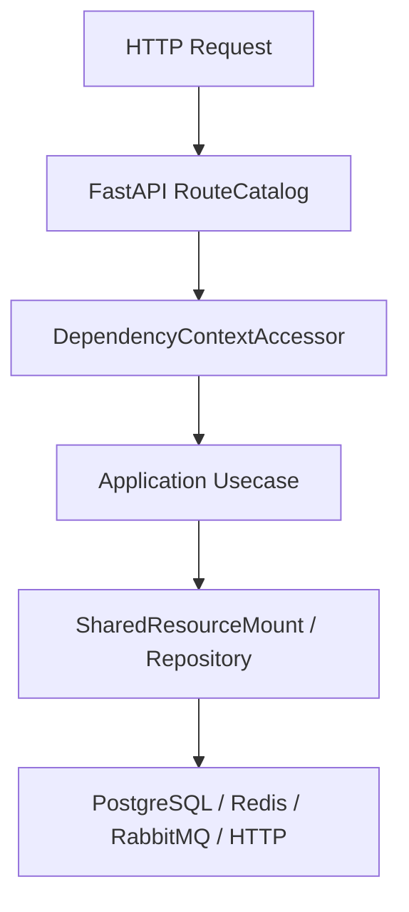

# 出站 HTTP 安全

## 1. 文档目的
说明同步/异步 HTTP 客户端与 SSRF URL 安全校验 hook。

**最后更新范围**：覆盖当前源码、配置和相关测试；生产拓扑只描述代码与 Compose 可确认部分。

## 2. 适用读者
- 后端开发者
- 运维部署人员
- 安全审查人员

## 3. 关联源码
| 路径 | 作用 |
| --- | --- |
| `src/infrastructure/resource_slot/shared_http_client.py` | 同步 HTTP 客户端。 |
| `src/infrastructure/resource_slot/shared_async_http_client.py` | 异步 HTTP 客户端。 |
| `src/infrastructure/security/outbound_url_safety_validator.py` | URL 安全校验。 |
| `src/infrastructure/security/outbound_url_safety_httpx_hook.py` | 请求前 httpx hook。 |
| `src/infrastructure/security/outbound_url_safety_transport.py` | 连接层 IP pinning 与 peer 校验 transport。 |
| `config/runtime/web_runtime` | 出站 HTTP 客户端配置。 |

## 4. 核心结论
- `runtime.web.outbound_http_client` 控制客户端模式和超时。
- `outbound_url_safety` 默认启用，拒绝非 global 地址、私网和元数据地址；production 默认强制目的域名允许清单，空清单表示拒绝全部未显式声明目的域名。
- hook 与连接层 transport 会安装到同步和异步 HTTP 客户端。
- 默认客户端模式为 `sync_http`；同步 `SharedHttpClient` 始终构建，`SharedAsyncHttpClient` 只在 mode 为 `async_http` 时构建。
- URL safety hook 总是安装到同步客户端；只有异步客户端存在时才安装异步 hook。
- 校验器允许 `http`/`https`，拒绝 localhost、私网、link-local、reserved、metadata、非 global 地址和 DNS 解析失败的 host；启用 `enforce_allowed_hostnames` 后，URL、连接目标和 peer 校验路径均会拒绝未在 `allowed_hostnames` 中声明的目的域名；策略关闭时放行但仍可生成 host digest。
- 连接层 transport 会在请求前解析并固定目标 IP，redirect/retry 重新校验；连接建立后校验真实 peer IP，peer 缺失、与固定 IP 不一致或目的域名未被允许时 fail closed。
- 出站 URL 被拒绝时抛出 `REQUEST_INVALID`，所有 DENY 分支都会写入 `ssrf.blocked` 安全事件；host 不可用时使用哨兵摘要。
- 同一 HTTP 资源集合还包含 `RequestExecutionBridge`，用于异步路由调用同步用例时的线程池卸载。

## 5. 结构说明
该能力由核心契约、配置模型、基础设施实现和测试共同约束。外部组件差异以 `config/runtime/*` 与 Compose 文件为准。

## 6. 工作流程

## 7. 关键实现
| 组件 | 文件 | 职责 |
| --- | --- | --- |
| `OutboundUrlSafetyValidator` | `src/infrastructure/security/outbound_url_safety_validator.py` | 校验 URL。 |
| `SyncOutboundUrlSafetyHook` | `src/infrastructure/security/outbound_url_safety_httpx_hook.py` | 同步 hook。 |
| `AsyncOutboundUrlSafetyHook` | `src/infrastructure/security/outbound_url_safety_httpx_hook.py` | 异步 hook。 |
| `SyncOutboundUrlSafetyTransport` | `src/infrastructure/security/outbound_url_safety_transport.py` | 同步连接层 pinning 与 peer 校验。 |
| `AsyncOutboundUrlSafetyTransport` | `src/infrastructure/security/outbound_url_safety_transport.py` | 异步连接层 pinning 与 peer 校验。 |
| `SharedHttpResourceManager` | `src/infrastructure/resource_slot/shared_http_resource_manager.py` | 构建同步/异步 HTTP 客户端和请求执行桥。 |

## 8. 如何修改或扩展
1. 先修改核心契约或配置模型。
2. 再修改基础设施实现和 `SharedResourceMount` 挂载/释放逻辑。
3. 按 development/test/production 差异更新 TOML 配置。
4. 补 unit、contract、interface 或 integration 测试。
5. 同步更新本说明书和运维检查清单。

## 9. 测试覆盖
| 测试类型 | 文件 | 验证内容 |
| --- | --- | --- |
| unit | `test/unit_test/test_outbound_url_safety_validator_unit.py` | URL 校验、peer pinning、peer mismatch 和 peer 缺失 fail closed。 |
| unit | `test/unit_test/test_shared_async_http_client_unit.py` | 异步客户端。 |
| contract | `test/contract_test/test_outbound_http_client_contract.py` | HTTP 客户端契约。 |

## 10. 常见问题
- 生产环境不可依赖本地 `.env`，必须使用进程环境变量或部署系统注入。
- 如果依赖外部组件不可用，先区分是 local/test/production 配置差异还是服务健康问题。

## 11. 维护备注
修改运行时能力时，同步检查配置、资源生命周期、测试 support 和部署文档。

## 12. 相关文档
- [项目文档总览](../README.md)
- [配置文件](../07_configuration_deployment/configuration_files.md)
- [故障排查](../10_maintenance/troubleshooting.md)
