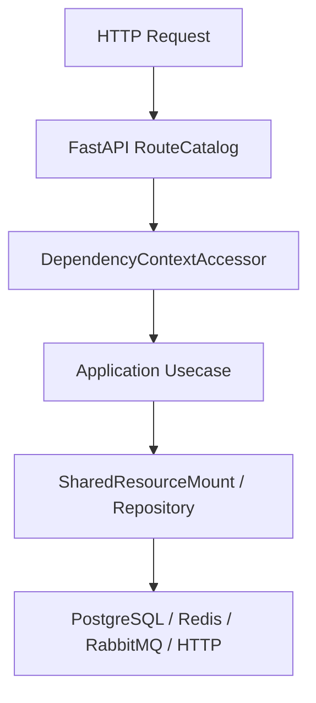

# 持久化与迁移

## 1. 文档目的
说明 SQLAlchemy、UnitOfWork、Repository 和 Alembic 迁移的实现。

**最后更新范围**：覆盖当前源码、配置和相关测试；生产拓扑只描述代码与 Compose 可确认部分。

## 2. 适用读者
- 后端开发者
- 运维部署人员
- 安全审查人员

## 3. 关联源码
| 路径 | 作用 |
| --- | --- |
| `src/infrastructure/persistence/sqlalchemy_engine_factory.py` | 数据库 engine。 |
| `src/infrastructure/persistence/sqlalchemy_session_factory.py` | UnitOfWork 和 session factory。 |
| `src/infrastructure/persistence/orm_model` | ORM 模型。 |
| `src/infrastructure/persistence/alembic` | Alembic 环境和版本。 |
| `src/infrastructure/persistence/repository_impl` | 仓储实现。 |

## 4. 核心结论
- 数据库配置默认 PostgreSQL，生产关闭 `auto_upgrade_on_startup`。
- 事务边界由 `SqlAlchemyUnitOfWork` 管理 commit/rollback/dispose。
- Repository 只接收核心层名义 `PersistenceSession` 对应的 SQLAlchemy 会话，不执行 commit、rollback 或外层会话释放。
- 生产组合根使用 `DatabaseEngineFactory`，离线测试由 `SqliteTestEngineFactory` 显式注入；默认测试数据库是每工厂独立的临时文件 SQLite，引擎释放后删除，避免后台 worker 与业务事务共享单连接。
- 迁移 CLI 使用 `AlembicRunner.upgrade_head`。
- ORM 与迁移需同步维护。
- 启动期只有 `runtime.database.auto_upgrade_on_startup=true` 时才由 `SharedResourceMount.upgrade_database_schema_if_enabled` 自动执行迁移。
- Alembic online 模式使用 `NullPool`，并通过 `connect_args.options=-csearch_path=<schema>` 指定 schema。
- 当前基础设施表包括 `auth_refresh_token`、`app_log_record`、`security_ip_block_record`、`task_execution_record` 以及用户/角色/scope 相关认证表。
- `task_execution_record` 以 `job_kind + deduplication_key` 做唯一约束，用于任务执行去重。
- PostgreSQL JSON 字段在 ORM 中使用通用 `JSON` 加 PostgreSQL 方言变体，确保离线建表不依赖 `JSONB`；刷新令牌时间从无时区数据库读取时统一恢复为 UTC 感知时间。

## 5. 结构说明
该能力由核心契约、配置模型、基础设施实现和测试共同约束。外部组件差异以 `config/runtime/*` 与 Compose 文件为准。

## 6. 工作流程

## 7. 关键实现
| 组件 | 文件 | 职责 |
| --- | --- | --- |
| `SqlAlchemyUnitOfWork` | `src/infrastructure/persistence/sqlalchemy_session_factory.py` | 事务工作单元。 |
| `AlembicEnvironment` | `src/infrastructure/persistence/alembic/env.py` | Alembic 运行环境。 |
| `AlembicRunner` | `src/infrastructure/persistence/alembic_runner.py` | 构建 Alembic 配置并升级到 head。 |
| `TaskExecutionRecordOrmModel` | `src/infrastructure/persistence/orm_model/task_execution_record_orm_model.py` | 任务执行记录和去重约束。 |

## 8. 如何修改或扩展
1. 先修改核心契约或配置模型。
2. 再修改基础设施实现和 `SharedResourceMount` 挂载/释放逻辑。
3. 按 development/test/production 差异更新 TOML 配置。
4. 补 unit、contract、interface 或 integration 测试。
5. 同步更新本说明书和运维检查清单。

## 9. 测试覆盖
| 测试类型 | 文件 | 验证内容 |
| --- | --- | --- |
| integration | `test/integration_test/test_migration_job_integration.py` | 迁移作业。 |
| unit | `test/unit_test/test_auth_persistence_unit.py` | 认证持久化。 |
| integration | `test/integration_test/test_task_execution_record_integration.py` | 任务执行记录。 |

## 10. 常见问题
- 生产环境不可依赖本地 `.env`，必须使用进程环境变量或部署系统注入。
- 如果依赖外部组件不可用，先区分是 local/test/production 配置差异还是服务健康问题。

## 11. 维护备注
修改运行时能力时，同步检查配置、资源生命周期、测试 support 和部署文档。

## 12. 相关文档
- [项目文档总览](../README.md)
- [配置文件](../07_configuration_deployment/configuration_files.md)
- [故障排查](../10_maintenance/troubleshooting.md)
