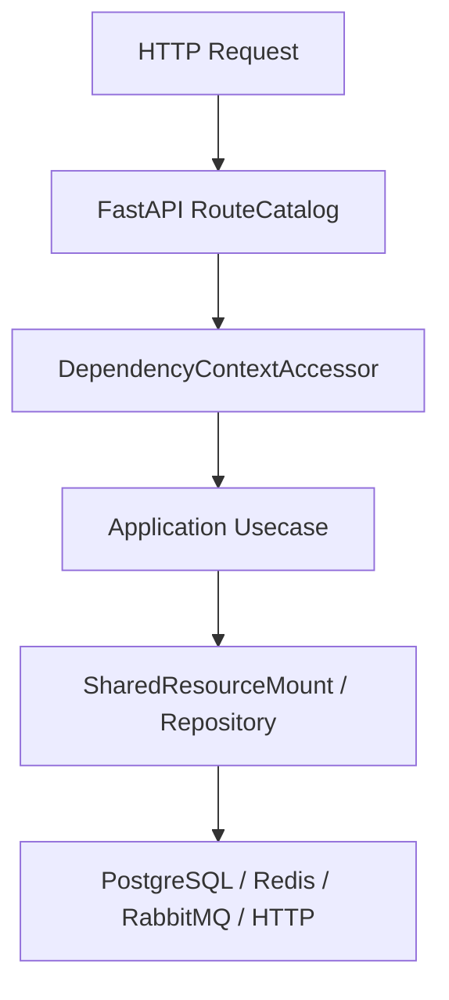

# 安全防护

## 1. 文档目的
说明限流、风险信号、IP 封禁、token binding、SSRF 出站防护和安全事件。

**最后更新范围**：覆盖当前源码、配置和相关测试；生产拓扑只描述代码与 Compose 可确认部分。

## 2. 适用读者
- 后端开发者
- 运维部署人员
- 安全审查人员

## 3. 关联源码
| 路径 | 作用 |
| --- | --- |
| `src/infrastructure/security` | 安全防护实现。 |
| `src/api/endpoint_security_protection` | 安全防护管理 API。 |
| `src/core/security_contract` | 安全契约。 |
| `config/runtime/security_runtime` | 安全运行时配置。 |

## 4. 核心结论
- 安全运行时配置包含 flow_control、risk_control、client_ip、ip_block、token_binding、outbound_url_safety。
- 认证失败会记录安全事件和风险信号。
- IP 封禁记录持久化到 `security_ip_block_record`。
- 出站 HTTP 客户端安装 URL safety hook。
- flow_control 默认 fail_closed，并内置 `/auth/token`、`/auth/refresh` 两条按 `ip_digest + path_method` 计数的限流策略。
- production 安全校验要求关闭 OpenAPI 和公开系统信息、禁止 memory cache、启用外部 JWT 与分布式鉴权节流、禁用 bootstrap admin，并禁止 CORS 通配来源。
- token binding 配置存在但默认/test/production 均为 disabled；启用后当前配置只覆盖 `/auth/me` access token。
- IP 封禁同时使用缓存和数据库记录，管理释放/删除会同步清理缓存。

## 5. 结构说明
该能力由核心契约、配置模型、基础设施实现和测试共同约束。外部组件差异以 `config/runtime/*` 与 Compose 文件为准。

## 6. 工作流程

## 7. 关键实现
| 组件 | 文件 | 职责 |
| --- | --- | --- |
| `SecurityProtectionGuard` | `src/infrastructure/security/security_protection_guard.py` | 综合安全保护。 |
| `SecurityEventBuilder` | `src/infrastructure/security/security_event_builder.py` | 安全事件构建。 |
| `RateLimitGuard` | `src/infrastructure/security/rate_limit_guard.py` | 基于缓存执行限流计数。 |
| `IpBlockGuard` | `src/infrastructure/security/ip_block_guard.py` | 处理 IP 封禁缓存、数据库记录和释放。 |
| `TokenBindingGuard` | `src/infrastructure/security/token_binding_guard.py` | 按策略绑定/校验 token 与客户端 IP 摘要。 |

## 8. 如何修改或扩展
1. 先修改核心契约或配置模型。
2. 再修改基础设施实现和 `SharedResourceMount` 挂载/释放逻辑。
3. 按 development/test/production 差异更新 TOML 配置。
4. 补 unit、contract、interface 或 integration 测试。
5. 同步更新本说明书和运维检查清单。

## 9. 测试覆盖
| 测试类型 | 文件 | 验证内容 |
| --- | --- | --- |
| boundary | `test/boundary_test/test_security_protection_boundary.py` | 安全防护边界。 |
| exception | `test/exception_test/test_security_protection_exception.py` | 异常路径。 |
| interface | `test/interface_test/test_security_protection_admin_interface.py` | 管理接口。 |

## 10. 常见问题
- 生产环境不可依赖本地 `.env`，必须使用进程环境变量或部署系统注入。
- 如果依赖外部组件不可用，先区分是 local/test/production 配置差异还是服务健康问题。

## 11. 维护备注
修改运行时能力时，同步检查配置、资源生命周期、测试 support 和部署文档。

## 12. 相关文档
- [项目文档总览](../README.md)
- [配置文件](../07_configuration_deployment/configuration_files.md)
- [故障排查](../10_maintenance/troubleshooting.md)
