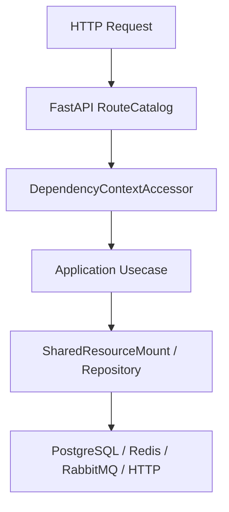

# 任务运行时

## 1. 文档目的
说明 local dispatcher、funboost、RabbitMQ message bus 和任务执行记录。

**最后更新范围**：覆盖当前源码、配置和相关测试；生产拓扑只描述代码与 Compose 可确认部分。

## 2. 适用读者
- 后端开发者
- 运维部署人员
- 安全审查人员

## 3. 关联源码
| 路径 | 作用 |
| --- | --- |
| `src/infrastructure/task` | 任务基础设施。 |
| `src/core/task_contract` | 任务契约。 |
| `config/runtime/task_runtime` | 任务后端配置。 |
| `config/runtime/message_runtime` | 消息后端配置。 |
| `config/modules/task_module` | 任务注册配置。 |
| `funboost_config.py` | funboost 第三方入口配置。 |
| `nb_log_config.py` | nb_log 第三方入口配置。 |
| `src/infrastructure/resource_mount/runtime_resource_bootstrapper.py` | 启动期校验任务后端与消息总线组合。 |
| `test/initialization_test/test_task_runtime_initialization.py` | 任务运行时初始化与失败组合测试。 |

## 4. 核心结论
- base/test 任务后端为 local，消息后端为 local。
- production 通过 `task_runtime_production.toml` 显式切换为 Funboost，消息后端为 RabbitMQ；Web `app` 作为 producer-only 节点，`task-worker` Compose profile 使用同一注册契约独立消费 `task_execution_probe`。
- `TaskRuntimeManager` 按 task backend 构建 local 或 funboost dispatcher。
- 任务执行记录持久化到 `task_execution_record`。
- `SettingsSecurityValidator` 要求 funboost task backend 搭配 RabbitMQ，且 task backend/detail 与注册项 broker_kind、exchange_name 保持一致。
- 本地 inline 执行会在 dispatch 时同步调用处理器并更新执行记录；非 inline 或 funboost 会先在同一事务中预占任务执行记录并写入 `task_execution_outbox`，再由发布器重扫投递；如果数据库提交后发布前进程崩溃，RESERVED outbox 可被重扫恢复发布。
- 本地 queued runtime 允许默认示例任务保持禁用，不因空 handler 或空启用声明阻断应用启动；仅在启用本地 inline 执行时要求 handler 完整绑定。
- funboost producer-only 节点不要求本地 handler 绑定，但启动时必须存在当前后端可发布的启用任务声明，避免空绑定静默上线。
- Funboost 发布主链使用持久消息、publisher confirm、mandatory、有界队列、QoS/prefetch 和死信交换机；确认失败或不可路由不会伪装为发布成功。
- 独立 worker 由 `src.cli.run_task_worker` 启动，内置 handler 通过 `TaskBindingProvider` 显式绑定；SIGTERM/SIGINT 触发停消费、断开 AMQP 连接并等待受管线程池在途任务结束。
- 发布成功但回写 PUBLISHED 失败时，Outbox 不会被错误标记为 FAILED，后续重扫依赖消息 `message_id` 幂等处理重复发布。
- funboost 与 nb_log 入口配置保持可 import；`LoggingEntryEnvironmentBridge` 会先把 `runtime.logging.entry_project_name` / `runtime.logging.entry_log_path` 桥接到 `LOGGING_ENTRY_PROJECT_NAME` / `LOGGING_ENTRY_LOG_PATH`，再由第三方入口模块读取，并关闭 `AUTO_PATCH_PRINT`。

## 5. 结构说明
该能力由核心契约、配置模型、基础设施实现和测试共同约束。外部组件差异以 `config/runtime/*` 与 Compose 文件为准。

## 6. 工作流程

## 7. 关键实现
| 组件 | 文件 | 职责 |
| --- | --- | --- |
| `TaskRuntimeManager.build_runtime` | `src/infrastructure/task/task_runtime_manager.py` | 构建任务运行时。 |
| `LocalTaskDispatcher` | `src/infrastructure/task/local_task_dispatcher.py` | 本地调度器。 |
| `FunboostTaskDispatcher` | `src/infrastructure/task/funboost_task_dispatcher.py` | funboost 调度器。 |
| `ConfirmedFunboostRabbitMqPublisher` | `src/infrastructure/task/confirmed_funboost_rabbitmq_publisher.py` | 持久发布、确认、mandatory 和有界拓扑。 |
| `BoundedFunboostRabbitMqConsumer` | `src/infrastructure/task/bounded_funboost_rabbitmq_consumer.py` | QoS、预取和可控后台消费。 |
| `ManagedFunboostThreadPool` | `src/infrastructure/task/managed_funboost_thread_pool.py` | 为消费任务提供确定性关闭的标准线程池适配。 |
| `TaskWorkerCli` | `src/cli/run_task_worker.py` | 独立生产 worker 进程入口与信号停机。 |
| `RuntimeResourceBootstrapper._validate_task_message_topology` | `src/infrastructure/resource_mount/runtime_resource_bootstrapper.py` | 禁止 local task backend 搭配 RabbitMQ message backend。 |
| `TaskExecutionStore` | `src/infrastructure/task/task_execution_store.py` | 预占、去重并更新任务执行记录状态。 |
| `TaskExecutionOutboxPublisher` | `src/infrastructure/task/task_execution_outbox_publisher.py` | 重扫 RESERVED outbox、发布失败标记 FAILED，并在发布成功但回写失败时保留重扫能力。 |

## 8. 如何修改或扩展
1. 先修改核心契约或配置模型。
2. 再修改基础设施实现和 `SharedResourceMount` 挂载/释放逻辑。
3. 按 development/test/production 差异更新 TOML 配置。
4. 补 unit、contract、interface 或 integration 测试。
5. 同步更新本说明书和运维检查清单。

## 9. 测试覆盖
| 测试类型 | 文件 | 验证内容 |
| --- | --- | --- |
| unit | `test/unit_test/test_local_task_dispatcher_unit.py` | 本地调度器。 |
| unit | `test/unit_test/test_funboost_task_dispatcher_unit.py` | funboost 调度器。 |
| unit | `test/unit_test/test_task_runtime_manager_unit.py` | 本地 queued runtime 与 producer-only 校验分支。 |
| unit | `test/unit_test/test_funboost_config_unit.py` | funboost/nb_log 第三方入口配置、环境变量覆盖与依赖固定。 |
| unit | `test/unit_test/test_task_execution_outbox_publisher_unit.py` | Outbox 发布成功、发布失败截断、提交后重扫恢复和发布成功后回写失败幂等重试。 |
| initialization | `test/initialization_test/test_task_runtime_initialization.py` | 验证 local/RabbitMQ 组合会启动失败。 |
| integration | `test/integration_test/test_funboost_rabbitmq_integration.py` | RabbitMQ 探测、持久发布、producer-only、真实消费、状态回写和资源释放。 |

## 10. 常见问题
- 生产环境不可依赖本地 `.env`，必须使用进程环境变量或部署系统注入。
- 如果依赖外部组件不可用，先区分是 local/test/production 配置差异还是服务健康问题。
- 如果 production 任务启动失败，先确认 funboost backend、RabbitMQ message backend、注册项 broker_kind、exchange_name 和 `default_job_kind` 是否一致。
- 启动独立 worker 使用 `docker compose -f compose.yml -f compose.production.yml --profile task-worker up -d task-worker`；必须先注入符合 production 安全校验的数据库、Redis、RabbitMQ 和 JWT 密钥，弱示例密钥会按设计拒绝启动。

## 11. 维护备注
修改运行时能力时，同步检查配置、资源生命周期、测试 support 和部署文档。

## 12. 相关文档
- [项目文档总览](../README.md)
- [配置文件](../07_configuration_deployment/configuration_files.md)
- [故障排查](../10_maintenance/troubleshooting.md)
