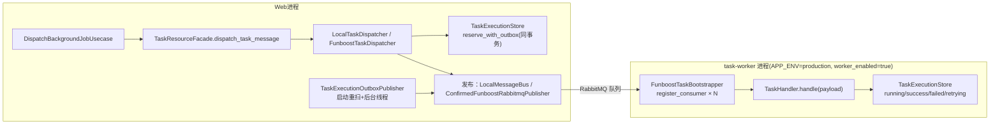

# 任务运行时

## 1. 这是什么

详解后台任务子系统的全部机制：任务注册契约与注册中心、两种任务后端（local / funboost+RabbitMQ）、派发链路（执行记录 + Outbox 同事务）、消费链路（worker 节点）、失败记录与重试、执行记录状态机与去重语义。这是本项目最复杂的基础设施域。

**最后更新范围**：覆盖 `src/core/task_contract/` 7 个契约、`src/infrastructure/task/` 16 个实现文件、task/message 配置模型与 `src/cli/run_task_worker.py`。

## 2. 设计思想与动机

1. **注册即契约**：任务不是"随手写个函数扔进队列"，而是先在配置声明 `TaskRegistrationEnvelope`（job_kind、后端、队列/交换机/路由键、retry_limit、消费者并发），再在代码绑定 `RegisteredTaskBinding`（job_kind + payload_model + handler）。配置声明与代码绑定在启动时交叉校验——消费节点缺处理器拒绝启动，杜绝"消息进了队列没人认识"。
2. **可靠派发 = 同事务 Outbox**：执行记录（`task_execution_record`）与待发布消息（`task_execution_outbox`）在**同一数据库事务**写入，之后才向消息总线发布并标记 published。进程在"已落库未发布"间崩溃，由启动重扫 + 后台线程（5s 周期，只扫超过 60s 安全窗口的记录）补发。语义为 at-least-once。
3. **去重键唯一约束**：`(job_kind, deduplication_key)` 数据库唯一。重复派发命中约束 → 返回既有记录（`created=False`）并计 `rejected` 指标，实现幂等派发；消费侧配合实现有效一次处理。
4. **Web 与 Worker 分进程**：生产 Web 节点 `worker_enabled=false`（producer-only：只注册 publisher、校验任务已声明），独立 task-worker 容器 `worker_enabled=true`（handler 完整性强校验 + 启动消费者）。同一份代码、同一套注册契约，横向扩容互不影响。

## 3. 组件地图

| 组件 | 文件 | 职责 |
| --- | --- | --- |
| `TaskRegistrationRegistry` | `task_registration_registry.py` | 注册清单 + 绑定管理；重复 job_kind/队列名拒绝；占位 BaseModel payload_model 拒绝；`assert_all_enabled_tasks_bound`（消费节点）与 `assert_enabled_tasks_declarable_for_producer`（生产节点）两级完整性校验；payload JSON 按绑定模型校验。 |
| `TaskRuntimeManager` | `task_runtime_manager.py` | 按 backend 装配 dispatcher/bootstrapper/outbox publisher/bootstrap 快照（见第 4 节）。 |
| `TaskExecutionStore` | `task_execution_store.py`（684 行） | 执行记录与 Outbox 的全部持久化操作 + 任务指标（success/failed/rejected）。 |
| `TaskExecutionOutboxPublisher` | `task_execution_outbox_publisher.py` | RESERVED Outbox 重扫发布；publish 成功才 mark_published，失败 mark_outbox_failed（原因截断 512 字符）；发布后标记失败的记录不回滚消息（容忍重复投递）。 |
| `LocalTaskDispatcher` | `local_task_dispatcher.py` | 本地后端：入队/可选内联执行、指数退避重试（delay×multiplier^n，上限 max_delay）。 |
| `FunboostTaskBootstrapper` | `funboost_task_bootstrapper.py`（813 行） | funboost 与 RabbitMQ 的桥：broker 连接配置、按注册项创建 publisher/consumer（复杂路由 exchange/routing_key、有界队列、死信、prefetch）、发布确认。 |
| `FunboostTaskDispatcher` | `funboost_task_dispatcher.py` | funboost 后端派发（经 store 落库 → bootstrapper 发布）。 |
| `RabbitMqMessageBus` / `LocalMessageBus` | `rabbitmq_message_bus.py` / `local_message_bus.py` | 独立消息传输资源（探活、有界本地队列 max_items）。 |
| `FailedTaskRecorder` | `failed_task_recorder.py` | 统一失败记录：产出 `TaskFailureRecord` → task_failure 结构化日志 + 回调。 |
| `TaskWorkerSupervisor` | `task_worker_supervisor.py` | 跨热更新保留 worker 绑定，重载时重放进新注册中心。 |

## 4. 装配矩阵（TaskRuntimeManager.build_runtime）

| backend | worker_enabled | 完整性校验 | 装配结果 |
| --- | --- | --- | --- |
| local + inline_execute_enabled | 任意 | handler 完整性强校验 | LocalTaskDispatcher（内联执行）+ 本地 Outbox 发布器 |
| local（非内联） | true | 强校验 | LocalTaskDispatcher（队列消费） |
| funboost | false（Web 节点） | producer 声明校验（启用任务必须有注册声明） | Funboost publisher-only + FunboostTaskDispatcher + Outbox（挂 bootstrapper） |
| funboost | true（worker 节点） | 强校验 + `start_consumers()` | 完整消费运行时 |

拓扑约束（启动即验）：local task + rabbitmq message 组合被禁止（避免双通道重复执行）；funboost 必须 rabbitmq 总线 + `RABBITMQ_COMPLEX_ROUTING` broker；funboost 队列名跨注册项唯一。

## 5. 执行记录状态机与消息契约

`TaskExecutionStatus`：`PENDING → RESERVED →（发布后）PUBLISHED → RUNNING → SUCCESS / FAILED / RETRYING(→RUNNING…)`。记录信封 `TaskExecutionRecordEnvelope` 为 header+detail 判别联合（每状态一个 detail 类型，含 attempt_count、queue_name、failure 原因等）。

`TaskMessageEnvelope`：`header{message_id(=task_id), request_id, trace_id, created_at_epoch}` + `payload{job_kind, deduplication_key, retry_limit, payload_kind, payload_json}`。request_id/trace_id 从 HTTP 请求一路带进消费日志，实现 Web→任务的链路贯通。

## 6. 配置总览

- `runtime.task`（task_runtime TOML）：`backend(local|funboost)`、`worker_enabled`、`backend_detail{retry_delay_seconds=1, retry_backoff_multiplier=2, retry_max_delay_seconds=30; local 另有 inline_execute_enabled; funboost 另有 broker_kind}`。
- `runtime.message`（message_runtime TOML）：`backend(local|rabbitmq)`、local `max_items=1000`；rabbitmq `rabbitmq_url、startup_probe_enabled/timeout、task_exchange_name/type/durable、task_message_persistent、publisher_confirm_enabled/timeout、queue_max_length=10000、consumer_prefetch_count=8、dead_letter_exchange_name=task.dead_letter`。
- `modules.task`（task_module TOML）：`default_retry_limit`、`default_job_kind`、`registrations[]`（信封列表，生产声明了 `task_execution_probe`）。

## 7. 怎么用

- **派发任务**：注入 `DispatchBackgroundJobUsecase`，`execute(TaskDispatchCommand(payload=模型实例, job_kind=..., deduplication_key=业务幂等键))`。**务必传业务派生的 deduplication_key**（缺省 uuid4 等于放弃去重）。
- **新增任务**：payload 模型（core 或应用层）→ handler（实现 `TaskHandler.handle`）→ `ApplicationTaskBindingProvider.build()` 加绑定 → `task_module_{env}.toml` 加注册信封（job_kind 与绑定一致）→ worker 节点验证启动 → 补 unit + integration 测试。
- **运维查看**：`/admin/tasks/runtime`（后端/模式/worker 开关）、`/admin/tasks/registrations`（绑定状态）、`/admin/tasks/executions`（记录检索）、`/admin/tasks/dispatch`（手工派发，payload 先校验）。
- **启动 worker**：`docker compose --profile task-worker up` 或 `python -m src.cli.run_task_worker`（阻塞至 SIGTERM/SIGINT，收信号后有序 shutdown）。

## 8. 注意事项

- handler 必须幂等：at-least-once + 重试意味着同一 payload 可能执行多次；以 deduplication_key/业务键做幂等落库。
- handler 内不要吞异常：抛出才会进入 retry/failed 记录路径与 `fastapi_task_execution_total{outcome="failed"}` 指标。
- Outbox 后台重扫默认只处理创建超过 60s 的 RESERVED 记录——正常发布路径失败后的秒级重试不由后台线程负责，观察到少量 RESERVED 短暂存在属正常。
- 队列有界（10000）+ 死信 exchange：队列满时发布确认失败会走 Outbox failed 路径而不是无界堆积；死信需要运维侧消费或告警。
- 热更新会整体重建任务运行时（注册中心/总线/调度器/Outbox），worker supervisor 负责把既有绑定重放进新注册中心；未在新配置声明的 job_kind 绑定会被丢弃。

## 9. 测试覆盖

| 测试类型 | 文件 | 验证内容 |
| --- | --- | --- |
| unit | `test/unit_test/test_task_registration_registry_unit.py` | 注册/绑定/完整性校验。 |
| unit | `test/unit_test/test_task_execution_store_unit.py` | 状态机、去重、Outbox。 |
| contract | `test/contract_test/test_task_registration_contract.py` | 注册与消息契约。 |
| interface | `test/interface_test/test_admin_task_interface.py` | 管理端任务接口。 |
| integration | `test/integration_test/test_funboost_rabbitmq_integration.py` | 真实 RabbitMQ 发布/消费/确认/死信。 |
| path | `test/path_test/test_task_execution_path.py` | 派发→执行主链路。 |

## 10. 相关文档

- [项目文档总览](../README.md)
- [管理员任务 API](../05_api_reference/admin_task_api.md)
- [运行时资源生命周期](../01_architecture/runtime_resource_lifecycle.md)
- [Docker 部署](../07_configuration_deployment/docker_deployment.md)
