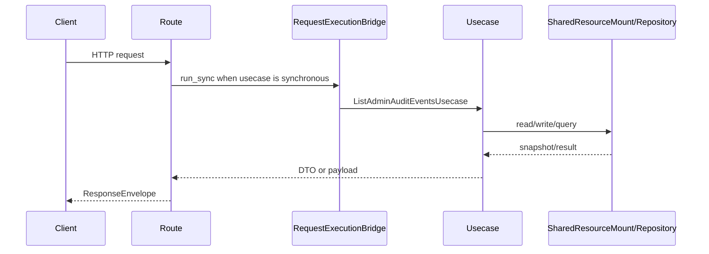

# 管理员审计 API

## 1. 文档目的
说明业务后台审计事件查询接口。

**最后更新范围**：覆盖本 API 的当前 route、contract、usecase、权限和测试，不包含前端页面调用约定。

## 2. 适用读者
- 新人开发者
- 后端开发者
- 测试维护者
- 安全审查人员

## 3. 关联源码
| 路径 | 作用 |
| --- | --- |
| `src/api/endpoint_admin_audit/route_admin_audit.py` | 审计路由。 |
| `src/api/endpoint_admin_audit/contract_admin_audit.py` | 审计契约。 |
| `src/application/admin/audit/list_admin_audit_events_usecase.py` | 审计用例。 |

## 4. API 目的
说明业务后台审计事件查询接口。

## 5. 路由入口
| 方法 | 路径 | 路由函数 | 文件 |
| --- | --- | --- | --- |
| GET | /admin/audit-events | `AdminAuditRouteCatalog.list_audit_events` | `src/api/endpoint_admin_audit/route_admin_audit.py` |

## 6. 请求参数
| 参数 | 位置 | 类型 | 是否必填 | 说明 |
| --- | --- | --- | --- | --- |
| actor_subject_id | query | str | 否 | 操作者。 |
| action | query | AdminAuditAction | 否 | 审计动作。 |
| target_kind/target_id | query | str | 否 | 目标过滤。 |
| occurred_from/occurred_to | query | datetime | 否 | 时间范围。 |
| page_size/offset | query | int | 否 | 分页；`page_size` 默认 50，范围 1-200，`offset` 最小 0。 |

## 7. 响应结构
- `AdminAuditEnvelope`
- `AdminAuditEventListPayload`
- `detail.events[]` 包含 `event_id`、`action`、`actor_subject_id`、`target_kind`、`target_id`、`result`、`occurred_at`、`summary`；列表同时返回 `page_size`、`offset`、`total`。

## 8. 鉴权与权限
业务后台模块，默认随 `app_base` 挂载；需要 Bearer token，要求角色 `admin` + scope `auth:read`。

## 9. 业务流程

## 10. 错误码
| 错误码 | HTTP 状态 | 触发条件 | 来源 |
| --- | --- | --- | --- |
| system.request.invalid | 422 | 请求结构或 detail 类型不满足契约。 | src/core/exception_contract/error_code_catalog_contract.py |
| auth.token.invalid | 401 | 未提供或未通过访问令牌认证。 | src/api/dependency_context_accessor.py |
| auth.authorization.permission_denied | 403 | 已认证但角色或 scope 不满足。 | src/application/authorization_guard.py |

## 11. 测试用例
| 测试文件 | 覆盖内容 |
| --- | --- |
| `test/interface_test/admin_audit/test_admin_audit_interface.py` | 审计接口。 |
| `test/contract_test/admin_audit/test_admin_audit_contract.py` | 审计契约。 |
| `test/unit_test/admin_audit/test_admin_audit_query_unit.py` | 审计查询。 |

## 12. 扩展注意事项
- 当前审计数据来源为管理员身份变更安全日志。

## 13. 相关文档
- [项目文档总览](../README.md)
- [API 总览](api_overview.md)
