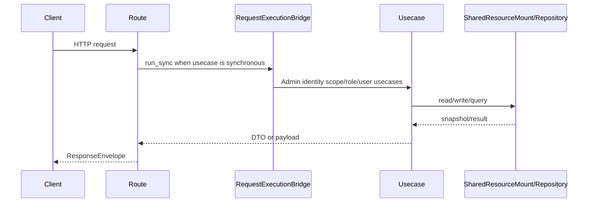

# 管理员身份 API

## 1. 文档目的
说明 scope、role、business-role、user 管理接口。

**最后更新范围**：覆盖本 API 的当前 route、contract、usecase、权限和测试，不包含前端页面调用约定。

## 2. 适用读者
- 新人开发者
- 后端开发者
- 测试维护者
- 安全审查人员

## 3. 关联源码
| 路径 | 作用 |
| --- | --- |
| `src/api/endpoint_admin_identity/route_admin_identity.py` | 身份路由。 |
| `src/api/endpoint_admin_identity/contract_admin_identity_envelope.py` | 身份响应信封契约；scope/role/user 字段分文件定义。 |
| `src/application/admin/identity` | 身份用例。 |
| `src/application/ports/admin_identity_port.py` | 身份端口。 |

## 4. API 目的
说明 scope、role、business-role、user 管理接口。

## 5. 路由入口
| 方法 | 路径 | 路由函数 | 文件 |
| --- | --- | --- | --- |
| GET/POST | /admin/scopes | `list_scopes/create_scope` | `src/api/endpoint_admin_identity/route_admin_identity.py` |
| GET/PATCH/DELETE | /admin/scopes/{scope_code} | `get_scope/update_scope/delete_scope` | `src/api/endpoint_admin_identity/route_admin_identity.py` |
| GET/POST | /admin/roles | `list_roles/create_role` | `src/api/endpoint_admin_identity/route_admin_identity.py` |
| GET | /admin/business-roles | `list_business_roles` | `src/api/endpoint_admin_identity/route_admin_identity.py` |
| GET/PATCH/DELETE | /admin/roles/{role_key} | `get_role/update_role/delete_role` | `src/api/endpoint_admin_identity/route_admin_identity.py` |
| PUT | /admin/roles/{role_key}/scopes | `replace_role_scopes` | `src/api/endpoint_admin_identity/route_admin_identity.py` |
| GET/POST | /admin/users | `list_users/create_user` | `src/api/endpoint_admin_identity/route_admin_identity.py` |
| GET/PATCH | /admin/users/{subject_id} | `get_user/update_user` | `src/api/endpoint_admin_identity/route_admin_identity.py` |
| POST | /admin/users/{subject_id}/password | `reset_user_password` | `src/api/endpoint_admin_identity/route_admin_identity.py` |
| POST | /admin/users/{subject_id}/disable | `disable_user` | `src/api/endpoint_admin_identity/route_admin_identity.py` |
| POST | /admin/users/{subject_id}/enable | `enable_user` | `src/api/endpoint_admin_identity/route_admin_identity.py` |
| POST | /admin/users/{subject_id}/roles | `replace_user_roles` | `src/api/endpoint_admin_identity/route_admin_identity.py` |

## 6. 请求参数
| 参数 | 位置 | 类型 | 是否必填 | 说明 |
| --- | --- | --- | --- | --- |
| keyword/enabled/limit | query | mixed | 否 | `/admin/scopes` 列表过滤；`limit` 默认 50，范围 1-200。 |
| keyword/page_size/offset | query | mixed | 否 | `/admin/roles` 与 `/admin/business-roles` 分页过滤；`page_size` 默认 50，范围 1-200，`offset` 最小 0。 |
| keyword/role_key/is_active/page_size/offset | query | mixed | 否 | `/admin/users` 用户列表过滤和分页；用户启用状态参数名为 `is_active`。 |
| scope_code/role_key/subject_id | path | str | 详情必填 | 目标标识。 |
| AdminIdentityEnvelope | body | object | 带请求体写操作必填 | 请求信封，`header.kind` 必须与 `detail.kind` 一致，`operation_name` 必须匹配允许的 `detail.kind`。 |
- scope 创建 `detail` 使用 `scope_code`、`scope_name`、`description`、`enabled`；scope 更新 `detail` 使用可选 `scope_name`、`description`、`enabled`，目标 `scope_code` 来自 path。
- role 创建 `detail` 使用 `role_key`、`role_name`、`scope_codes`；当 `scope_codes` 包含受保护后台 scope 时，必须同时提交高危授权确认字段 `confirmation` 并具备 `auth:grant_admin`；普通非受保护 scope 的角色创建只要求 `auth:role_manage`。role 更新 `detail` 只使用 `role_name`；替换 role scopes 的 `detail` 使用 `scope_codes` 和高危授权确认字段 `confirmation`，目标 `role_key` 来自 path。
- user 创建 `detail` 使用 `username`、`password`、`role_keys`、可选 `subject_id`；用户更新只使用 `username`；重置密码只使用 `password`；替换角色使用 `role_keys` 和高危授权确认字段 `confirmation`；启停用使用可选 `reason`，目标 `subject_id` 来自 path。
- 高危授权确认字段固定为 `confirm-admin-grant`；缺失或不匹配时返回 `422`。
- `DELETE /admin/scopes/{scope_code}` 和 `DELETE /admin/roles/{role_key}` 不接收请求体。兼容停用入口 `DELETE /admin/users/{subject_id}` 默认不注册；默认用户停用入口是 `POST /admin/users/{subject_id}/disable`，并通过请求体保留 `reason`。

## 7. 响应结构
- `AdminIdentityEnvelope`
- `AdminScope*Payload`
- `AdminRole*Payload`
- `AdminBusinessRole*Payload`
- `AdminUser*Payload`
- `AdminUserStatusResultPayload`
- `AdminIdentityDeleteResultPayload`
- scope/role 删除返回 `AdminIdentityDeleteResultPayload`，字段为 `target_id`、`deleted`、`reason`；用户停用返回 `AdminUserStatusResultPayload`，字段为 `subject_id`、`status`、`is_active`、`reason`，不是物理删除。

## 8. 鉴权与权限
业务后台模块，默认随 `app_base` 挂载。读取接口要求角色 `admin` + scope `auth:read`；scope 写接口要求 `auth:scope_manage`；role 写接口要求 `auth:role_manage`，其中创建包含受保护后台 scope 的角色还要求 `auth:grant_admin` 并提交高危授权确认短语；user 写接口要求 `auth:user_manage`；密码重置要求 `auth:password_reset`，但低权限密码重置管理员不能重置 admin 角色或具备 `auth:grant_admin` 能力的高权限目标；role scope 替换和 user role 替换要求 `auth:grant_admin` 并提交高危授权确认短语。

## 9. 业务流程

## 10. 错误码
| 错误码 | HTTP 状态 | 触发条件 | 来源 |
| --- | --- | --- | --- |
| system.request.invalid | 422 | 请求结构或 detail 类型不满足契约。 | src/core/exception_contract/error_code_catalog_contract.py |
| auth.token.invalid | 401 | 未提供或未通过访问令牌认证。 | src/api/dependency_context_accessor.py |
| auth.authorization.permission_denied | 403 | 已认证但角色或 scope 不满足。 | src/application/authorization_guard.py |
| auth.admin_identity.not_found | 404 | 目标不存在。 | src/domain/auth/admin_identity_error_code.py |
| auth.admin_identity.conflict | 409 | 写入冲突。 | src/domain/auth/admin_identity_error_code.py |
| auth.admin_identity.invalid | 422 | 业务约束不满足，例如角色/scope 不存在或未启用、只能分配预定义业务角色、创建含受保护后台 scope 的角色未完成授权确认、低权限密码重置管理员操作高权限目标、受保护 scope 变更会破坏管理员管理能力。 | src/domain/auth/admin_identity_error_code.py |
| auth.admin_identity.self_lock_blocked | 409 | 阻止操作者锁定自身。 | src/domain/auth/admin_identity_error_code.py |

## 11. 测试用例
| 测试文件 | 覆盖内容 |
| --- | --- |
| `test/interface_test/admin_identity/test_admin_user_interface.py` | 用户接口。 |
| `test/interface_test/admin_identity/test_admin_role_interface.py` | 角色接口。 |
| `test/interface_test/admin_identity/test_admin_scope_interface.py` | scope 接口。 |
| `test/interface_test/admin_identity/test_admin_identity_business_boundary_interface.py` | 业务后台边界与 OpenAPI surface。 |
| `test/contract_test/admin_identity/test_admin_identity_contract.py` | 身份契约。 |
| `test/contract_test/admin_identity/test_admin_identity_business_boundary_contract.py` | 业务边界契约。 |
| `test/integration_test/admin_identity/test_admin_identity_rbac_integration.py` | RBAC 集成。 |

## 12. 扩展注意事项
- 身份变更会记录管理员身份安全事件，供业务审计 API 查询。
- 旧 `DELETE /admin/users/{subject_id}` 兼容入口由代码常量默认关闭，OpenAPI 默认不暴露；新增兼容期前必须补迁移期限、审计口径和显式开关。

## 13. 相关文档
- [项目文档总览](../README.md)
- [API 总览](api_overview.md)
