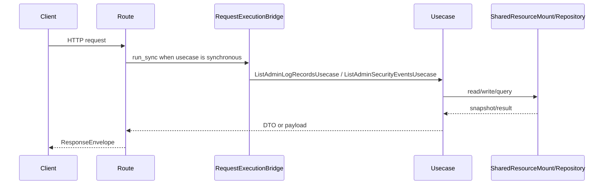

# 管理员日志 API

## 1. 文档目的
说明日志记录和安全事件查询接口。

**最后更新范围**：覆盖本 API 的当前 route、contract、usecase、权限和测试，不包含前端页面调用约定。

## 2. 适用读者
- 新人开发者
- 后端开发者
- 测试维护者
- 安全审查人员

## 3. 关联源码
| 路径 | 作用 |
| --- | --- |
| `src/api/endpoint_admin_log/route_admin_log.py` | 日志路由。 |
| `src/api/endpoint_admin_log/contract_admin_log.py` | 日志契约。 |
| `src/application/admin/list_admin_log_records_usecase.py` | 日志查询用例。 |
| `src/application/admin/list_admin_security_events_usecase.py` | 安全事件查询用例。 |

## 4. API 目的
说明日志记录和安全事件查询接口。

## 5. 路由入口
| 方法 | 路径 | 路由函数 | 文件 |
| --- | --- | --- | --- |
| GET | /admin/logs | `AdminLogRouteCatalog.list_log_records` | `src/api/endpoint_admin_log/route_admin_log.py` |
| GET | /admin/security-events | `AdminLogRouteCatalog.list_security_events` | `src/api/endpoint_admin_log/route_admin_log.py` |

## 6. 请求参数
| 参数 | 位置 | 类型 | 是否必填 | 说明 |
| --- | --- | --- | --- | --- |
| level | query | LogLevel | 否 | 日志级别。 |
| event_kind | query | LogEventKind | 否 | 事件类型。 |
| request_id | query | str | 否 | 请求 ID。 |
| trace_id | query | str | 否 | 链路 ID。 |
| occurred_from/occurred_to | query | datetime | 否 | 日志或安全事件发生时间范围。 |
| event_type/severity/decision | query | enum | 否 | 仅 `/admin/security-events` 使用的安全事件过滤。 |
| limit | query | int | 否 | 返回数量，默认 50，范围 1-200。 |

## 7. 响应结构
- `AdminLogRecordListEnvelope`
- `AdminSecurityEventListEnvelope`
- `/admin/logs` 的 `detail.records[]` 包含 `event_id`、`event_kind`、`schema_version`、`level`、`message`、`occurred_at`、`request_id`、`trace_id`、`authenticated_subject_id`、`source_module`、`source_component` 和脱敏后的访问、异常、资源生命周期、任务失败、安全或不可解析日志详情。
- `/admin/security-events` 的 `detail.events[]` 仅返回带 `security_event` 的安全事件，事件项包含 `event_id`、`log_level`、`log_message`、`occurred_at`、`request_id`、`trace_id`、`source_module`、`source_component`、`security_event`。

## 8. 鉴权与权限
运维控制面模块，默认不挂载；启用 `admin_log` 后需要 Bearer token，要求角色 `admin` + scope `system:read`。

## 9. 业务流程

## 10. 错误码
| 错误码 | HTTP 状态 | 触发条件 | 来源 |
| --- | --- | --- | --- |
| system.request.invalid | 422 | 请求结构或 detail 类型不满足契约。 | src/core/exception_contract/error_code_catalog_contract.py |
| 404 | 404 | `admin_log` 未加入 `app.modules.enabled` 时路由不存在。 | src/api/web_module_manifest.py |
| auth.token.invalid | 401 | 未提供或未通过访问令牌认证。 | src/api/dependency_context_accessor.py |
| auth.authorization.permission_denied | 403 | 已认证但角色或 scope 不满足。 | src/application/authorization_guard.py |

## 11. 测试用例
| 测试文件 | 覆盖内容 |
| --- | --- |
| `test/interface_test/test_admin_log_interface.py` | 日志接口。 |
| `test/contract_test/test_admin_log_contract.py` | 日志契约。 |
| `test/unit_test/test_admin_log_query_unit.py` | 日志查询。 |

## 12. 扩展注意事项
- 日志落库依赖 `app_log_record` 表和 logging runtime。

## 13. 相关文档
- [项目文档总览](../README.md)
- [API 总览](api_overview.md)
