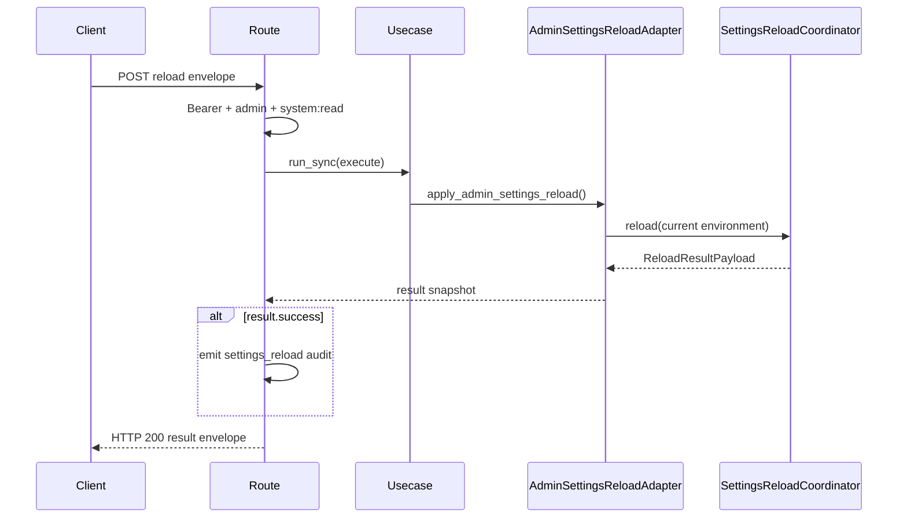

# 管理员配置 API

## 1. 范围与源码

`admin_settings` 是默认不启用的 `ops_only` 模块，提供配置热更新候选摘要和 reload 执行。

| 源码 | 职责 |
| --- | --- |
| `src/api/endpoint_admin_settings/route_admin_settings.py` | 2 个 route、权限、响应和成功审计。 |
| `src/api/endpoint_admin_settings/contract_admin_settings.py` | candidate/request/result 双层信封。 |
| `src/application/admin/*admin_settings_reload*_usecase.py` | 两个薄用例。 |
| `src/application/ports/admin_settings_reload_port.py` | candidate/result snapshot 与 Protocol。 |
| `src/infrastructure/admin_settings_reload_adapter.py` | 当前环境到 `SettingsReloadCoordinator` 的适配。 |

## 2. 端点与权限

| 方法 | 路径 | 请求 | 响应 `data` | 权限 |
| --- | --- | --- | --- | --- |
| GET | `/admin/settings/reload/candidate` | 无 | `AdminSettingsReloadCandidateEnvelope` | admin + `system:read` |
| POST | `/admin/settings/reload` | `AdminSettingsReloadRequestEnvelope` | `AdminSettingsReloadResultEnvelope` | admin + `system:read` |

启用方式是把 `admin_settings` 加入 `app.modules.enabled` 并重启。未启用是 404；Bearer 缺失/无效是 401；缺角色或 scope 是 403。

## 3. 请求信封

POST body 必须是：

```json
{
  "header": {
    "kind": "admin_settings_reload",
    "schema_version": "1.0",
    "operation_name": "apply_reload"
  },
  "detail": {
    "kind": "admin_settings_reload",
    "schema_version": "1.0"
  }
}
```

header/detail 均 `extra="forbid"`，`kind` 与 `schema_version` 必须一致。detail 当前没有 dry-run、candidate id 或 force 字段；candidate GET 和 apply POST 是各自独立地从当前环境重新构建/执行。

## 4. Candidate 响应

外层为 `ResponseEnvelope`；`data.header` 为：

- `kind=admin_settings_reload_candidate`
- `schema_version=1.0`
- `operation_name=read_candidate`

`data.detail` 只有 `kind/schema_version/candidate_version/digest`。它是摘要契约，不暴露变更字段、配置明文、hot/restart 分类或环境变量值；更详细的 diff 属 coordinator 内部数据，不在当前 API surface。

## 5. Apply 响应

`data.header.kind=admin_settings_reload_result`、`operation_name=reload_result`。detail 字段：

| 字段 | 类型 | 含义 |
| --- | --- | --- |
| `success` | bool | reload 是否成功生效。 |
| `rolled_back` | bool | 失败时是否执行回滚。 |
| `reason` | string/null | 拒绝或失败原因。 |
| `candidate_version` | string/null | 本次候选版本。 |
| `restored_resources` | string[] | 回滚恢复的资源名。 |
| `active_snapshot_id` | string/null | 当前生效快照。 |

关键语义：adapter/usecase 把拒绝和回滚作为 `AdminSettingsReloadResultSnapshot` 返回，route 始终构建成功的 HTTP response。因此 `success=False` 仍可能是 HTTP 200 + outer `system.success`；调用方必须检查 `data.detail.success` 和 `rolled_back/reason`，不能只检查状态码。

## 6. 执行与审计



- 允许热更新与必须重启字段由配置中的 reload policy 和 coordinator 校验。
- `settings_reload` 审计目标 `target_kind=settings`，target id 优先使用 `candidate_version`，缺失时使用 `runtime_settings`。
- 只有 `success=True` 发成功业务审计；拒绝/失败产生的 `config_security_rejected` 属安全日志链路，不会伪装成 `settings_reloaded`。

## 7. 错误语义

| HTTP/结果 | 错误码或字段 | 条件 |
| --- | --- | --- |
| 404 | route 不存在 | 模块未启用。 |
| 401 | `auth.token.invalid` | 未认证。 |
| 403 | `auth.authorization.permission_denied` | 缺 admin/system:read。 |
| 422 | `system.request.invalid` | POST 信封缺字段、额外字段或 header/detail 不一致。 |
| 200 | `detail.success=False` | 候选被拒、应用失败或发生回滚等协调器业务结果。 |
| 5xx | 统一异常错误码 | coordinator/基础设施抛出而不是返回 result snapshot 的未处理故障。 |

## 8. 事实核验测试

| 测试 | 覆盖事实 |
| --- | --- |
| `test/interface_test/test_admin_settings_interface.py` | 模块启停、认证授权、请求信封、未知字段和执行。 |
| `test/contract_test/test_admin_settings_contract.py` | candidate/request/result header/detail 契约。 |
| `test/unit_test/test_admin_settings_usecase_unit.py` | candidate、成功、拒绝和回滚结果映射。 |
| `test/unit_test/test_settings_apply_transaction_unit.py` | 资源应用与回滚事务。 |
| `test/unit_test/test_settings_snapshot_store_unit.py` | active snapshot 行为。 |

## 9. 相关文档

- [管理后台能力](../03_application_domain/admin_business_capabilities.md)
- [应用端口](../03_application_domain/application_ports.md)
- [API 总览](api_overview.md)
