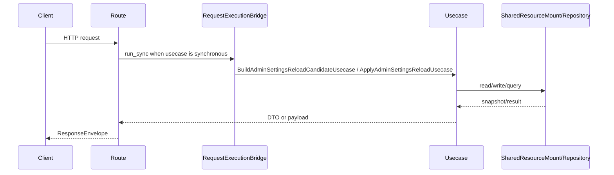

# 管理员配置 API

## 1. 文档目的
说明配置热更新候选读取和应用接口。

**最后更新范围**：覆盖本 API 的当前 route、contract、usecase、权限和测试，不包含前端页面调用约定。

## 2. 适用读者
- 新人开发者
- 后端开发者
- 测试维护者
- 安全审查人员

## 3. 关联源码
| 路径 | 作用 |
| --- | --- |
| `src/api/endpoint_admin_settings/route_admin_settings.py` | 配置热更新路由。 |
| `src/api/endpoint_admin_settings/contract_admin_settings.py` | 配置热更新契约。 |
| `src/application/admin/build_admin_settings_reload_candidate_usecase.py` | 候选读取用例。 |
| `src/application/admin/apply_admin_settings_reload_usecase.py` | 应用热更新用例。 |

## 4. API 目的
说明配置热更新候选读取和应用接口。

## 5. 路由入口
| 方法 | 路径 | 路由函数 | 文件 |
| --- | --- | --- | --- |
| GET | /admin/settings/reload/candidate | `AdminSettingsRouteCatalog.read_reload_candidate` | `src/api/endpoint_admin_settings/route_admin_settings.py` |
| POST | /admin/settings/reload | `AdminSettingsRouteCatalog.apply_reload` | `src/api/endpoint_admin_settings/route_admin_settings.py` |

## 6. 请求参数
| 参数 | 位置 | 类型 | 是否必填 | 说明 |
| --- | --- | --- | --- | --- |
| AdminSettingsReloadRequestEnvelope | body | object | reload 必填 | 热更新请求信封；`detail` 为无业务字段的 `AdminSettingsReloadRequestDetail`，route 仅校验契约后执行热更新。 |
- 热更新请求信封的 `header.kind` 与 `detail.kind` 均为 `admin_settings_reload`，`header.operation_name=apply_reload`，`schema_version=1.0`；额外字段会触发 422。

## 7. 响应结构
- `AdminSettingsReloadCandidateEnvelope`
- `AdminSettingsReloadResultEnvelope`
- `AdminSettingsReloadRequestEnvelope` 只作为 `POST /admin/settings/reload` 请求体，不作为响应返回。
- 候选响应 `detail` 包含 `candidate_version`、`digest`。
- 热更新结果 `detail` 包含 `success`、`rolled_back`、`reason`、`candidate_version`、`restored_resources`、`active_snapshot_id`。

## 8. 鉴权与权限
运维控制面模块，默认不挂载；启用 `admin_settings` 后需要 Bearer token，要求角色 `admin` + scope `system:read`。

## 9. 业务流程

## 10. 错误码
| 错误码 | HTTP 状态 | 触发条件 | 来源 |
| --- | --- | --- | --- |
| system.request.invalid | 422 | 请求结构或 detail 类型不满足契约。 | src/core/exception_contract/error_code_catalog_contract.py |
| 404 | 404 | `admin_settings` 未加入 `app.modules.enabled` 时路由不存在。 | src/api/web_module_manifest.py |
| auth.token.invalid | 401 | 未提供或未通过访问令牌认证。 | src/api/dependency_context_accessor.py |
| auth.authorization.permission_denied | 403 | 已认证但角色或 scope 不满足。 | src/application/authorization_guard.py |

## 11. 测试用例
| 测试文件 | 覆盖内容 |
| --- | --- |
| `test/interface_test/test_admin_settings_interface.py` | 配置接口。 |
| `test/contract_test/test_admin_settings_contract.py` | 配置契约。 |
| `test/unit_test/test_admin_settings_usecase_unit.py` | 配置用例。 |

## 12. 扩展注意事项
- 热更新范围受 `config/app_base.toml` 中 `app.reload.hot_reload_allowed` 和 `restart_required` 约束。

## 13. 相关文档
- [项目文档总览](../README.md)
- [API 总览](api_overview.md)
