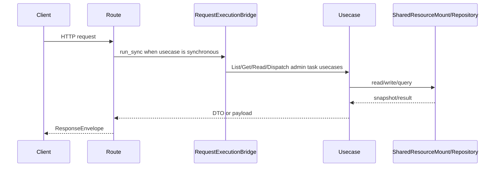

# 管理员任务 API

## 1. 文档目的
说明任务执行记录、运行时、注册信息和任务派发接口。

**最后更新范围**：覆盖本 API 的当前 route、contract、usecase、权限和测试，不包含前端页面调用约定。

## 2. 适用读者
- 新人开发者
- 后端开发者
- 测试维护者
- 安全审查人员

## 3. 关联源码
| 路径 | 作用 |
| --- | --- |
| `src/api/endpoint_admin_task/route_admin_task.py` | 任务路由。 |
| `src/api/endpoint_admin_task/contract_admin_task.py` | 任务契约。 |
| `src/application/admin/*task*_usecase.py` | 任务用例。 |

## 4. API 目的
说明任务执行记录、运行时、注册信息和任务派发接口。

## 5. 路由入口
| 方法 | 路径 | 路由函数 | 文件 |
| --- | --- | --- | --- |
| GET | /admin/tasks/executions | `AdminTaskRouteCatalog.list_task_executions` | `src/api/endpoint_admin_task/route_admin_task.py` |
| GET | /admin/tasks/executions/{task_id} | `AdminTaskRouteCatalog.get_task_execution` | `src/api/endpoint_admin_task/route_admin_task.py` |
| GET | /admin/tasks/runtime | `AdminTaskRouteCatalog.read_task_runtime` | `src/api/endpoint_admin_task/route_admin_task.py` |
| GET | /admin/tasks/registrations | `AdminTaskRouteCatalog.list_task_registrations` | `src/api/endpoint_admin_task/route_admin_task.py` |
| POST | /admin/tasks/dispatch | `AdminTaskRouteCatalog.dispatch_task` | `src/api/endpoint_admin_task/route_admin_task.py` |

## 6. 请求参数
| 参数 | 位置 | 类型 | 是否必填 | 说明 |
| --- | --- | --- | --- | --- |
| status | query | TaskExecutionStatus | 否 | 执行状态过滤。 |
| job_kind | query | str | 否 | 任务类型过滤。 |
| limit | query | int | 否 | 返回数量，默认 50，范围 1-200。 |
| task_id | path | str | 详情必填 | 任务 ID。 |
| AdminTaskDispatchEnvelope | body | object | dispatch 必填 | 派发信封；`detail` 为 `AdminTaskDispatchDetail`，包含 `job_kind`、`payload_json`、可选 `retry_limit`、可选 `deduplication_key`。 |
- 派发请求信封的 `header.kind` 与 `detail.kind` 均为 `admin_task_dispatch`，`header.operation_name=dispatch`，`schema_version=1.0`；额外字段会触发 422。

## 7. 响应结构
- `AdminTaskExecutionListEnvelope`
- `AdminTaskExecutionRecordEnvelope`
- `AdminTaskRuntimeEnvelope`
- `AdminTaskRegistrationListEnvelope`
- `AdminTaskDispatchResultEnvelope`
- 执行记录 `detail.records[]` 包含 `record_id`、`task_id`、`job_kind`、`deduplication_key`、`backend`、`queue_name`、`request_id`、`trace_id`、`created_at_epoch` 和 `runtime`。
- runtime 载荷包含 `task_runtime_mode`、`task_backend`、`transport_backend`、`configured_transport_backend`、`worker_enabled`、`inline_execute_enabled`、`default_job_kind`、`default_retry_limit`。
- 注册列表 `detail.registrations[]` 包含 `task_name`、`job_kind`、`enabled`、`registration_backend`、`current_runtime_backend`、`active_for_current_runtime`、`handler_bound`、`payload_model_name`、`retry_limit`、`queue_name`、`exchange_name`、`routing_key`。
- 派发结果包含 `task_id`、`job_kind`、`dispatched`、`retry_limit`、`backend`、`queue_name`、`published`、`worker_enabled`、`inline_execute_enabled`、`execution_status`、`execution_stage`、`reused_existing_record`。

## 8. 鉴权与权限
运维控制面模块，默认不挂载；启用 `admin_task` 后需要 Bearer token，查询要求角色 `admin` + scope `system:read`，派发要求角色 `admin` + scope `task:dispatch`。

## 9. 业务流程

## 10. 错误码
| 错误码 | HTTP 状态 | 触发条件 | 来源 |
| --- | --- | --- | --- |
| system.request.invalid | 422 | 请求结构或 detail 类型不满足契约。 | src/core/exception_contract/error_code_catalog_contract.py |
| 404 | 404 | `admin_task` 未加入 `app.modules.enabled` 时路由不存在。 | src/api/web_module_manifest.py |
| system.config.invalid | 500 | 任务注册、任务后端或消息后端配置不一致。 | src/infrastructure/task/task_registration_registry.py |
| system.request.invalid | 404 | 任务执行记录不存在。 | src/application/admin/get_admin_task_execution_record_usecase.py |
| system.resource.not_ready | 503 | 任务消息传输、任务运行时或相关资源未就绪。 | src/infrastructure/shared_resource_mount.py |
| system.task.failed | 500 | 本地、funboost 或 RabbitMQ 派发/发布执行失败。 | src/infrastructure/task/local_task_dispatcher.py；src/infrastructure/task/funboost_task_dispatcher.py；src/infrastructure/task/rabbitmq_message_bus.py |
| auth.token.invalid | 401 | 未提供或未通过访问令牌认证。 | src/api/dependency_context_accessor.py |
| auth.authorization.permission_denied | 403 | 已认证但角色或 scope 不满足。 | src/application/authorization_guard.py |

## 11. 测试用例
| 测试文件 | 覆盖内容 |
| --- | --- |
| `test/interface_test/test_admin_task_interface.py` | 任务 API。 |
| `test/contract_test/test_admin_task_contract.py` | 任务契约。 |
| `test/unit_test/test_admin_task_usecase_unit.py` | 任务用例。 |

## 12. 扩展注意事项
- 任务 runtime 后端与 message backend 差异见 `task_runtime.md`。

## 13. 相关文档
- [项目文档总览](../README.md)
- [API 总览](api_overview.md)
