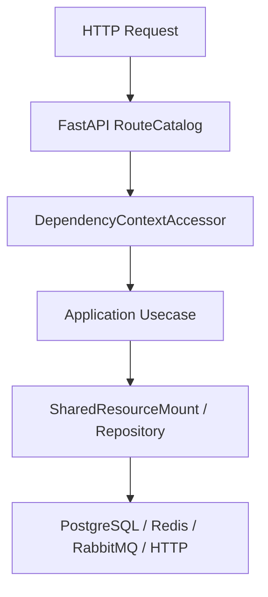

# API 总览

## 1. 文档目的
列出当前已注册 Web API 模块、模块边界和对应 route/contract 文件。

**最后更新范围**：覆盖 9 个 `src/api/endpoint_*` 模块和集中授权要求。

## 2. 适用读者
- 新人开发者
- 后端开发者
- 测试维护者
- 安全审查人员

## 3. 关联源码
| 路径 | 作用 |
| --- | --- |
| `src/api/web_module_manifest.py` | API 模块清单。 |
| `src/api/endpoint_health_probe` | 健康探针 API。 |
| `src/api/endpoint_auth_access` | 鉴权 API。 |
| `src/api/endpoint_system_overview` | 系统概览 API。 |
| `src/api/endpoint_security_protection` | 安全防护 API。 |
| `src/api/endpoint_admin_task` | 管理员任务 API。 |
| `src/api/endpoint_admin_settings` | 管理员配置 API。 |
| `src/api/endpoint_admin_log` | 管理员日志 API。 |
| `src/api/endpoint_admin_identity` | 管理员身份 API。 |
| `src/api/endpoint_admin_audit` | 管理员审计 API。 |
| `src/domain/auth/admin_route_authorization_policy.py` | 后台集中授权要求。 |

## 4. 核心结论
- 当前 manifest 可确认 9 个模块。
- 公开模块：health_probe、auth_access。
- 业务后台模块：admin_identity、admin_audit。
- 运维控制面模块：system_overview、security_protection、admin_task、admin_settings、admin_log。
- `config/app_base.toml` 默认只启用 `health_probe`、`auth_access`、`admin_identity`、`admin_audit`；运维控制面模块需要显式加入 `app.modules.enabled` 后才挂载路由和 OpenAPI。
- 本目录专题文档中的路径均为模块自身路径；运行时若配置 `runtime.web.api_prefix`，实际访问路径会加上该前缀，默认前缀为空。
- 后台受保护接口统一通过 `DependencyContextAccessor.read_authorized_principal` 读取主体并执行 `ADMIN_ROUTE_AUTHORIZATION_REQUIREMENTS` 中的角色/scope 要求。

## 5. 结构说明
每个 API 专题文档保持 route/contract/usecase/test 对应关系。

## 6. 工作流程

## 7. 关键实现
| 组件 | 文件 | 职责 |
| --- | --- | --- |
| `WebModuleManifestRegistry.list_entries` | `src/api/web_module_manifest.py` | 列出模块。 |
| `ADMIN_ROUTE_AUTHORIZATION_REQUIREMENTS` | `src/domain/auth/admin_route_authorization_policy.py` | 后台授权要求。 |
| `DependencyContextAccessor.read_authenticated_principal` | `src/api/dependency_context_accessor.py` | 未认证请求返回 401 `auth.token.invalid`。 |
| `AuthorizationGuard.assert_requirement` | `src/application/authorization_guard.py` | 已认证但角色/scope 不足返回 403 `auth.authorization.permission_denied`。 |

## 8. 如何修改或扩展
1. 新增 API 时先更新 manifest 和 `ApplicationModuleName`。
2. 新增 API 专题文档并从本总览和 README 链接。
3. 补 interface 和 contract 测试。

## 9. 测试覆盖
| 测试类型 | 文件 | 验证内容 |
| --- | --- | --- |
| unit | `test/unit_test/test_web_module_manifest_unit.py` | 模块清单。 |
| interface | `test/interface_test/test_http_interface.py` | HTTP 表面。 |
| integration | `test/integration_test/test_app_integration.py` | 应用集成。 |

## 10. 常见问题
- 如果 API 未出现在 OpenAPI，检查模块是否启用以及 production 是否关闭 OpenAPI。

## 11. 维护备注
API 变更时同步更新对应 API 文档、总览和开发指南。

## 12. 相关文档
- [项目文档总览](../README.md)
- [鉴权 API](auth_api.md)
- [新增 API](../09_development_guide/adding_new_api.md)
