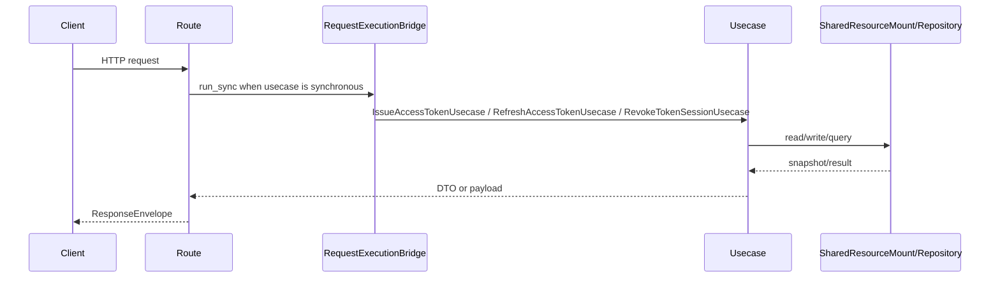

# 鉴权 API

## 1. 文档目的
说明令牌签发、刷新、吊销和读取当前主体接口。

**最后更新范围**：覆盖本 API 的当前 route、contract、usecase、权限和测试，不包含前端页面调用约定。

## 2. 适用读者
- 新人开发者
- 后端开发者
- 测试维护者
- 安全审查人员

## 3. 关联源码
| 路径 | 作用 |
| --- | --- |
| `src/api/endpoint_auth_access/route_auth_access.py` | 鉴权路由。 |
| `src/api/endpoint_auth_access/contract_auth_access.py` | 请求契约。 |
| `src/application/issue_access_token_usecase.py` | 令牌签发用例。 |
| `src/application/refresh_access_token_usecase.py` | 令牌刷新用例。 |
| `src/application/revoke_access_token_usecase.py` | 令牌吊销用例。 |

## 4. API 目的
说明令牌签发、刷新、吊销和读取当前主体接口。

## 5. 路由入口
| 方法 | 路径 | 路由函数 | 文件 |
| --- | --- | --- | --- |
| POST | /auth/token | `AuthAccessRouteCatalog.post_token` | `src/api/endpoint_auth_access/route_auth_access.py` |
| POST | /auth/refresh | `AuthAccessRouteCatalog.post_refresh` | `src/api/endpoint_auth_access/route_auth_access.py` |
| POST | /auth/revoke | `AuthAccessRouteCatalog.post_revoke` | `src/api/endpoint_auth_access/route_auth_access.py` |
| GET | /auth/me | `AuthAccessRouteCatalog.get_me` | `src/api/endpoint_auth_access/route_auth_access.py` |

## 6. 请求参数
| 参数 | 位置 | 类型 | 是否必填 | 说明 |
| --- | --- | --- | --- | --- |
| username | body | str | token 必填 | 登录用户名；首尾空白会被裁剪，裁剪后长度为 1-128。 |
| password | body | str | token 必填 | 登录密码；长度为 1-256。 |
| refresh_token | body | str | refresh/revoke 必填 | 刷新令牌；长度为 16-4096，格式匹配 `^[A-Za-z0-9._~+/=-]+$`。 |
| Authorization | header | Bearer token | me 必填 | 访问令牌。 |

### 6.1 认证请求模型约束
| 请求模型 | 字段 | 约束 | 契约来源 |
| --- | --- | --- | --- |
| `TokenIssueRequest` | `username` | 先裁剪首尾空白；裁剪后长度必须为 1-128。 | `src/api/endpoint_auth_access/contract_auth_access.py` |
| `TokenIssueRequest` | `password` | 长度必须为 1-256；不在接口层记录或回显原文。 | `src/api/endpoint_auth_access/contract_auth_access.py` |
| `TokenRefreshRequest` | `refresh_token` | 长度必须为 16-4096，且仅允许字母、数字、`.`、`_`、`~`、`+`、`/`、`=`、`-`。 | `src/api/endpoint_auth_access/contract_auth_access.py` |
| `TokenRevokeRequest` | `refresh_token` | 长度必须为 16-4096，且仅允许字母、数字、`.`、`_`、`~`、`+`、`/`、`=`、`-`。 | `src/api/endpoint_auth_access/contract_auth_access.py` |

认证请求体仍受全局 `runtime.web.max_request_body_bytes` 限制；字段级约束失败统一按请求契约错误返回。

## 7. 响应结构
- `TokenIssueRequest`
- `TokenRefreshRequest`
- `TokenRevokeRequest`
- `TokenIssuePayload`
- `TokenRevokePayload`
- `AuthenticatedPrincipal`
- `ResponseEnvelope[...]`
- `/auth/token` 和 `/auth/refresh` 的 `data` 为 `TokenIssuePayload`：`kind=token_issue`、`schema_version=1.1`、`access_token`、`refresh_token`、`token_type=Bearer`、`expires_in_seconds`、`refresh_expires_in_seconds`。
- `/auth/revoke` 的 `data` 为 `TokenRevokePayload`：`kind=token_revoke`、`schema_version=1.1`、`revoked`、`revoked_at_epoch`；重复撤销已撤销会话保持幂等并复用原撤销时间。
- `/auth/me` 的 `data` 为 `AuthenticatedPrincipal`：`kind=authenticated_principal`、`schema_version=1.0`、`subject_id`、`username`、`roles`、`scopes`、`is_admin`。
- `TokenIssueRequest`、`TokenRefreshRequest`、`TokenRevokeRequest` 均使用 `extra="forbid"`，未知字段直接按请求契约错误处理，并在接口边界执行长度、格式与用户名规范化校验。

## 8. 鉴权与权限
`/auth/token`、`/auth/refresh`、`/auth/revoke` 不声明路由级 bearer dependency；`/auth/me` 使用 `HTTPBearer(auto_error=False)` 并通过 `read_authenticated_principal` 要求登录。

## 9. 业务流程

## 10. 错误码
| 错误码 | HTTP 状态 | 触发条件 | 来源 |
| --- | --- | --- | --- |
| auth.access.invalid_credentials | 401 | 用户名或密码无效。 | src/domain/auth/auth_error_code.py |
| auth.request.throttled | 429 | 认证失败频率超过限制。 | src/domain/auth/auth_error_code.py |
| auth.token.invalid | 401 | 令牌无效。 | src/domain/auth/auth_error_code.py |
| auth.token.expired | 401 | 访问令牌或刷新令牌已过期。 | src/domain/auth/auth_error_code.py |
| auth.token.revoked | 401 | 访问令牌所属刷新令牌会话已被吊销。 | src/domain/auth/auth_error_code.py |
| auth.token.reused | 401 | 刷新令牌复用。 | src/domain/auth/auth_error_code.py |
| auth.access.account_disabled | 403 | 刷新令牌或访问令牌绑定主体已停用。 | src/domain/auth/auth_error_code.py |
| system.request.invalid | 422 | 请求体结构、字段类型或额外字段不满足 Pydantic 契约。 | src/infrastructure/fastapi_exception_presenter.py |
| system.request.payload_too_large | 413 | 请求体超过 `runtime.web.max_request_body_bytes`。 | src/infrastructure/middleware_chain/payload_guard_middleware.py |

## 11. 测试用例
| 测试文件 | 覆盖内容 |
| --- | --- |
| `test/interface_test/test_security_http_interface.py` | 鉴权 HTTP 行为。 |
| `test/interface_test/test_rate_limit_http_interface.py` | 限流行为。 |
| `test/unit_test/test_auth_persistence_unit.py` | 认证持久化。 |

## 12. 扩展注意事项
- 认证失败会记录安全事件和风险信号。
- 修改令牌结构时同步 `src/core/auth_contract/token_payload_contract.py`。

## 13. 相关文档
- [项目文档总览](../README.md)
- [API 总览](api_overview.md)
