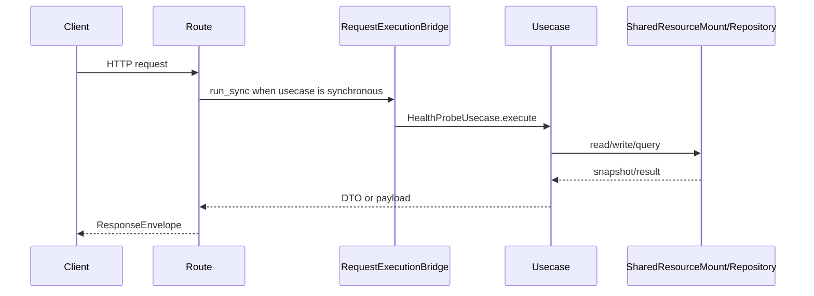

# 健康检查 API

## 1. 文档目的
说明存活和就绪探针接口。

**最后更新范围**：覆盖本 API 的当前 route、contract、usecase、权限和测试，不包含前端页面调用约定。

## 2. 适用读者
- 新人开发者
- 后端开发者
- 测试维护者
- 安全审查人员

## 3. 关联源码
| 路径 | 作用 |
| --- | --- |
| `src/api/endpoint_health_probe/route_health_probe.py` | 健康路由。 |
| `src/api/endpoint_health_probe/contract_health_probe.py` | 健康响应契约。 |
| `src/application/health_probe_usecase.py` | 健康用例。 |

## 4. API 目的
说明存活和就绪探针接口。

## 5. 路由入口
| 方法 | 路径 | 路由函数 | 文件 |
| --- | --- | --- | --- |
| GET | /health/live | `HealthProbeRouteCatalog.get_live` | `src/api/endpoint_health_probe/route_health_probe.py` |
| GET | /health/ready | `HealthProbeRouteCatalog.get_ready` | `src/api/endpoint_health_probe/route_health_probe.py` |

## 6. 请求参数
| 参数 | 位置 | 类型 | 是否必填 | 说明 |
| --- | --- | --- | --- | --- |
| 无 | - | - | 否 | 健康接口无业务请求体。 |

## 7. 响应结构
- `HealthProbePayload`
- `HealthProbeResult`
- `ResponseEnvelope[HealthProbePayload]`
- `data` 只包含 `kind=health_probe`、`schema_version=1.0`、`status`、`ready`，不会暴露 `resources`、`enabled_modules`、`environment`、`version` 等系统概览字段。

## 8. 鉴权与权限
公开接口，不需要登录；但请求如果携带无效 Bearer token，会被认证绑定中间件主动拒绝并返回 401。`/health/ready` 在 strict ready 开启且资源未就绪时返回 503。

## 9. 业务流程

## 10. 错误码
| 错误码 | HTTP 状态 | 触发条件 | 来源 |
| --- | --- | --- | --- |
| system.resource.not_ready | 503 | ready 探针检测应用未就绪。 | src/core/exception_contract/error_code_catalog_contract.py |
| auth.token.invalid | 401 | 公共路由携带无效 Bearer token。 | src/infrastructure/middleware_chain/authentication_binding_middleware.py |

## 11. 测试用例
| 测试文件 | 覆盖内容 |
| --- | --- |
| `test/integration_test/test_app_integration.py` | 应用健康接口。 |
| `test/initialization_test/test_runtime_initialization.py` | ready 状态。 |

## 12. 扩展注意事项
- Dockerfile HEALTHCHECK 读取 `runtime.web.api_prefix` 后访问严格就绪端点 `/health/ready`。

## 13. 相关文档
- [项目文档总览](../README.md)
- [API 总览](api_overview.md)
