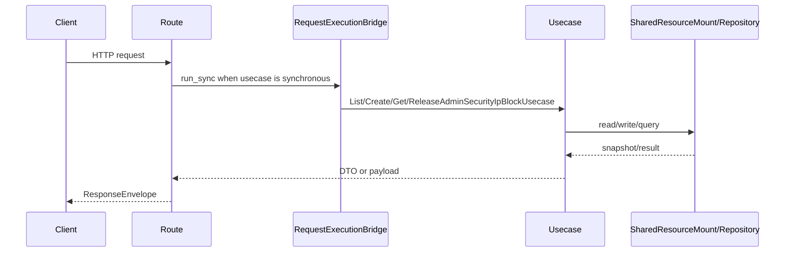

# 安全防护 API

## 1. 文档目的
说明 IP 封禁记录查询、创建、读取和释放接口。

**最后更新范围**：覆盖本 API 的当前 route、contract、usecase、权限和测试，不包含前端页面调用约定。

## 2. 适用读者
- 新人开发者
- 后端开发者
- 测试维护者
- 安全审查人员

## 3. 关联源码
| 路径 | 作用 |
| --- | --- |
| `src/api/endpoint_security_protection/route_security_protection.py` | 安全防护路由。 |
| `src/api/endpoint_security_protection/contract_security_protection.py` | 安全防护契约。 |
| `src/application/admin/security_protection/manage_admin_security_ip_blocks_usecase.py` | IP 封禁用例。 |

## 4. API 目的
说明 IP 封禁记录查询、创建、读取和释放接口。

## 5. 路由入口
| 方法 | 路径 | 路由函数 | 文件 |
| --- | --- | --- | --- |
| GET | /security/ip-blocks | `SecurityProtectionRouteCatalog.list_ip_blocks` | `src/api/endpoint_security_protection/route_security_protection.py` |
| POST | /security/ip-blocks | `SecurityProtectionRouteCatalog.create_ip_block` | `src/api/endpoint_security_protection/route_security_protection.py` |
| GET | /security/ip-blocks/{record_id} | `SecurityProtectionRouteCatalog.get_ip_block` | `src/api/endpoint_security_protection/route_security_protection.py` |
| POST | /security/ip-blocks/release | `SecurityProtectionRouteCatalog.release_ip_block` | `src/api/endpoint_security_protection/route_security_protection.py` |

## 6. 请求参数
| 参数 | 位置 | 类型 | 是否必填 | 说明 |
| --- | --- | --- | --- | --- |
| limit/status/ip_digest | query | mixed | 否 | 列表过滤；`limit` 默认 100，范围 1-200。 |
| record_id | path | UUID | 详情必填 | 封禁记录 ID。 |
| SecurityIpBlockCreateRequest | body | object | 创建必填 | 创建封禁；包含 `kind`、`schema_version`、`ip_digest`、`reason`、`block_seconds`。 |
| SecurityIpBlockReleaseRequest | body | object | 释放必填 | 释放封禁；包含 `kind`、`schema_version`、`ip_digest`、`released_reason`；释放按 `ip_digest` 操作，不按 `record_id`。 |
- `ip_digest` 最小长度为 12；`block_seconds` 必须大于等于 1；创建请求的 `reason` 默认为 `manual`，可选值为 `rate_limit_exceeded`、`risk_signal_exceeded`、`manual`；释放请求的 `released_reason` 必填且最小长度为 1。

## 7. 响应结构
- `SecurityIpBlockListPayload`
- `SecurityIpBlockCreatePayload`
- `SecurityIpBlockRecordPayload`
- `SecurityIpBlockReleasePayload`
- 记录载荷包含 `record_id`、`ip_digest`、`reason`、`status`、`blocked_until_epoch`、`released_reason`；创建响应包在 `record` 字段内，详情接口直接返回记录载荷。
- 释放响应包含 `ip_digest`、`released`；重复释放已释放或不存在的当前活动封禁时返回 200，`released=false`。

## 8. 鉴权与权限
运维控制面模块，默认不挂载；启用 `security_protection` 后需要 Bearer token，要求角色 `admin` + scope `security:manage`。

## 9. 业务流程

## 10. 错误码
| 错误码 | HTTP 状态 | 触发条件 | 来源 |
| --- | --- | --- | --- |
| system.request.invalid | 422 | 请求结构或 detail 类型不满足契约。 | src/core/exception_contract/error_code_catalog_contract.py |
| 404 | 404 | `security_protection` 未加入 `app.modules.enabled` 时路由不存在。 | src/api/web_module_manifest.py |
| auth.token.invalid | 401 | 未提供或未通过访问令牌认证。 | src/api/dependency_context_accessor.py |
| auth.authorization.permission_denied | 403 | 已认证但角色或 scope 不满足。 | src/application/authorization_guard.py |
| system.request.invalid | 404 | 封禁记录不存在；`SharedResourceMount._build_security_ip_block_not_found_fault` 使用该错误码并返回 404。 | src/infrastructure/shared_resource_mount.py |
| system.resource.not_ready | 503 | IP 封禁守卫或安全防护运行时未就绪。 | src/infrastructure/shared_resource_mount.py |
| system.cache.unavailable | 503 | 创建或释放封禁时 IP 封禁缓存读写不可用。 | src/infrastructure/security/ip_block_guard.py |

## 11. 测试用例
| 测试文件 | 覆盖内容 |
| --- | --- |
| `test/interface_test/test_security_protection_admin_interface.py` | 安全防护管理接口。 |
| `test/integration_test/test_security_ip_block_integration.py` | IP 封禁集成。 |
| `test/contract_test/test_security_protection_contract.py` | 安全防护契约。 |

## 12. 扩展注意事项
- 不要在 API 中传明文 IP，当前接口以 IP digest 管理。

## 13. 相关文档
- [项目文档总览](../README.md)
- [API 总览](api_overview.md)
