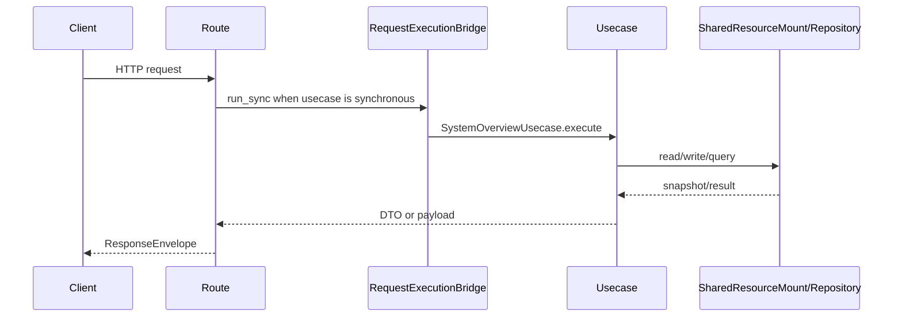

# 系统概览 API

## 1. 文档目的
说明系统信息读取接口。

**最后更新范围**：覆盖本 API 的当前 route、contract、usecase、权限和测试，不包含前端页面调用约定。

## 2. 适用读者
- 新人开发者
- 后端开发者
- 测试维护者
- 安全审查人员

## 3. 关联源码
| 路径 | 作用 |
| --- | --- |
| `src/api/endpoint_system_overview/route_system_overview.py` | 系统概览路由。 |
| `src/api/endpoint_system_overview/contract_system_overview.py` | 系统概览契约。 |
| `src/application/system_overview_usecase.py` | 系统概览用例。 |

## 4. API 目的
说明系统信息读取接口。

## 5. 路由入口
| 方法 | 路径 | 路由函数 | 文件 |
| --- | --- | --- | --- |
| GET | /system/info | `SystemOverviewRouteCatalog.get_info` | `src/api/endpoint_system_overview/route_system_overview.py` |

## 6. 请求参数
| 参数 | 位置 | 类型 | 是否必填 | 说明 |
| --- | --- | --- | --- | --- |
| 无 | - | - | 否 | 无请求体。 |

## 7. 响应结构
- `SystemOverviewAdminPayload`
- `SystemOverviewResult`
- `ResponseEnvelope[SystemOverviewAdminPayload]`
- `data` 为管理员载荷：`kind=system_overview_admin`、`schema_version=1.0`、`title`、`application_name`、`version`、`environment`、`enabled_modules`、`ready`、`resources`。

## 8. 鉴权与权限
运维控制面模块，默认不挂载；启用 `system_overview` 后需要 Bearer token，要求角色 `admin` + scope `system:read`。

## 9. 业务流程

## 10. 错误码
| 错误码 | HTTP 状态 | 触发条件 | 来源 |
| --- | --- | --- | --- |
| system.request.invalid | 422 | 请求结构或 detail 类型不满足契约。 | src/core/exception_contract/error_code_catalog_contract.py |
| - | 404 | `system_overview` 未加入 `app.modules.enabled` 时路由不存在。 | src/api/web_module_manifest.py |
| auth.token.invalid | 401 | 未提供或未通过访问令牌认证。 | src/api/dependency_context_accessor.py |
| auth.authorization.permission_denied | 403 | 已认证但角色或 scope 不满足。 | src/application/authorization_guard.py |

## 11. 测试用例
| 测试文件 | 覆盖内容 |
| --- | --- |
| `test/interface_test/test_http_interface.py` | HTTP 接口。 |
| `test/integration_test/test_admin_smoke_integration.py` | 后台冒烟。 |

## 12. 扩展注意事项
- 系统概览读取 `SharedResourceMount.read_application_settings_snapshot` 中的模块和运行时状态。

## 13. 相关文档
- [项目文档总览](../README.md)
- [API 总览](api_overview.md)
