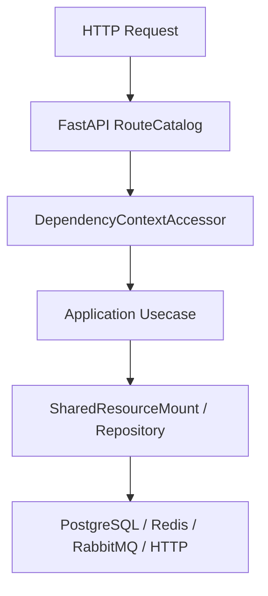

# Alembic 迁移

## 1. 文档目的
说明迁移环境和版本链。

**最后更新范围**：覆盖当前 ORM、Alembic、repository 和数据库运行时配置。

## 2. 适用读者
- 新人开发者
- 后端开发者
- 测试维护者
- 运维部署人员

## 3. 关联源码
| 路径 | 作用 |
| --- | --- |
| `src/infrastructure/persistence/orm_model` | ORM 模型。 |
| `src/infrastructure/persistence/alembic/versions` | 迁移版本。 |
| `src/infrastructure/persistence/repository_impl` | 仓储实现。 |
| `src/infrastructure/persistence/sqlalchemy_session_factory.py` | UnitOfWork。 |
| `config/runtime/database_runtime` | 数据库配置。 |

## 4. 核心结论
- 当前持久化表共 25 张：基础身份、日志、任务、安全与密钥环 11 张，Codex 控制面 14 张。
- Alembic 版本链从 `202605151600` 到 `202608161230`。
- 事务边界通过 `SqlAlchemyUnitOfWork` 控制。

## 5. 结构说明
数据层由 SQLAlchemy engine/session/UnitOfWork、ORM 模型、repository 实现和 Alembic 迁移组成。

## 6. 工作流程

## 7. 关键实现
| 组件 | 文件 | 职责 |
| --- | --- | --- |
| `SqlAlchemyEngineFactory` | `src/infrastructure/persistence/sqlalchemy_engine_factory.py` | 创建 engine。 |
| `SqlAlchemyUnitOfWork` | `src/infrastructure/persistence/sqlalchemy_session_factory.py` | 事务工作单元。 |
| `AlembicRunner.upgrade_head` | `src/infrastructure/persistence/alembic_runner.py` | 执行迁移。 |

## 8. 如何修改或扩展
1. 新增表先写 ORM 模型。
2. 新增 Alembic migration 并维护 down_revision。
3. 新增 repository 或扩展现有实现。
4. 补数据层 unit/integration 测试。
5. 同步本数据文档和 API/用例文档。

## 9. 测试覆盖
| 测试类型 | 文件 | 验证内容 |
| --- | --- | --- |
| integration | `test/integration_test/test_migration_job_integration.py` | 迁移。 |
| unit | `test/unit_test/test_task_execution_record_repository_unit.py` | 任务记录仓储。 |
| integration | `test/integration_test/test_task_execution_record_integration.py` | 任务记录集成。 |

## 10. 常见问题
- 如果 ORM 与 migration 不一致，优先以当前 ORM 和 Alembic 版本文件为准，历史方案只作参考。

## 11. 维护备注
数据模型变更必须同步 ORM、migration、repository、测试和本说明书。

### 当前表与模型对应

| 表 | ORM 模型 | 迁移来源 |
| --- | --- | --- |
| `auth_user` | `AuthUserOrmModel` | `202605151600_create_auth_tables.py` |
| `auth_role` | `AuthRoleOrmModel` | `202605151600_create_auth_tables.py` |
| `auth_user_role` | `AuthUserRoleOrmModel` | `202605151600_create_auth_tables.py` |
| `auth_user_scope` | `AuthUserScopeOrmModel` | `202608101100_add_auth_user_scope.py` |
| `auth_role_scope` | `AuthRoleScopeOrmModel` | `202605151600_create_auth_tables.py` + `202605291041_fix_identity_task_schema_drift.py` |
| `auth_refresh_token` | `AuthRefreshTokenOrmModel` | `202605151600_create_auth_tables.py` + `202605251640_harden_refresh_token_constraints.py` |
| `auth_scope` | `AuthScopeOrmModel` | `202605271330_create_auth_scope_catalog.py` |
| `app_log_record` | `AppLogRecordOrmModel` | `202605181039_create_app_log_record_table.py` + `202605291041_fix_identity_task_schema_drift.py` |
| `task_execution_record` | `TaskExecutionRecordOrmModel` | `202605221609_create_task_execution_record_table.py` + `202605231821_add_task_execution_backend.py` + `202605291041_fix_identity_task_schema_drift.py` |
| `task_execution_outbox` | `TaskExecutionOutboxOrmModel` | `202607021200_add_task_execution_published_at.py` |
| `security_ip_block_record` | `SecurityIpBlockRecordOrmModel` | `202605260859_create_security_ip_block_record.py` |
| `key_ring_snapshot` | `KeyRingSnapshotOrmModel` | `202607051000_create_key_ring_snapshot.py` |
| `codex_host` | `CodexHostOrmModel` | `202607311200_create_codex_control_phase1.py` + `202608081000_add_codex_host_compatibility.py` + `202608101000_harden_codex_device_ownership.py` |
| `codex_agent_credential` | `CodexAgentCredentialOrmModel` | `202607311200_create_codex_control_phase1.py` |
| `codex_workspace` | `CodexWorkspaceOrmModel` | `202607311200_create_codex_control_phase1.py` + `202608071400_add_codex_workspace_worktree_policy.py` + `202608151820_unify_codex_conversation_index.py` |
| `codex_thread_index` | `CodexThreadIndexOrmModel` | `202607311200_create_codex_control_phase1.py` + `202608151820_unify_codex_conversation_index.py` + `202608151940_normalize_codex_thread_status.py` |
| `codex_control_operation` | `CodexControlOperationOrmModel` | `202607311200_create_codex_control_phase1.py` + `202608161230_add_codex_operation_projection.py` |
| `codex_approval_audit` | `CodexApprovalAuditOrmModel` | `202607311200_create_codex_control_phase1.py` + `202608101300_repair_codex_approval_runtime_state.py` |
| `codex_host_device_key` | `CodexHostDeviceKeyOrmModel` | `202608071200_add_codex_device_identity.py` |
| `codex_device_authorization_audit` | `CodexDeviceAuthorizationAuditOrmModel` | `202608071200_add_codex_device_identity.py` |
| `codex_command_outbox` | `CodexCommandOutboxOrmModel` | `202608071300_add_codex_command_outbox.py` |

### 当前迁移链核对

| Revision | down_revision | 关键行为 |
| --- | --- | --- |
| `202605151600` | `None` | 创建 `auth_user`、`auth_role`、`auth_user_role`、`auth_role_scope`、`auth_refresh_token`。 |
| `202605181039` | `202605151600` | 创建 `app_log_record`，包含 `event_id` 唯一约束和日志查询索引。 |
| `202605221609` | `202605181039` | 创建 `task_execution_record`，包含 `job_kind + deduplication_key` 唯一约束和查询索引。 |
| `202605231821` | `202605221609` | 为 `task_execution_record` 增加非空 `backend` 字段并建立索引，历史数据默认填 `local`。 |
| `202605251640` | `202605231821` | 给 `auth_refresh_token.subject_id` 和 `rotated_to_token_id` 增加外键约束。 |
| `202605260859` | `202605251640` | 创建 `security_ip_block_record` 及 `ip_digest`、`status`、`blocked_until_epoch` 索引。 |
| `202605271330` | `202605260859` | 创建 `auth_scope` scope 目录表及 `enabled`、`scope_kind` 索引。 |
| `202605291041` | `202605271330` | 回填缺失 scope 目录行，给 `auth_role_scope.scope_code` 增加外键，规范重复 `task_execution_record.record_id` 后加唯一约束，并把 `app_log_record.detail_json` 对齐为 JSONB、`schema_version` 对齐为 64 长度。 |
| `202607021200` | `202605291041` | 为 `task_execution_record` 增加 `published_at_epoch`，并创建事务 Outbox 表 `task_execution_outbox`。 |
| `202607051000` | `202607021200` | 创建数据库权威密钥环快照表 `key_ring_snapshot` 及唯一约束和查询索引。 |
| `202607311200` | `202607051000` | 创建 6 张 Codex 控制面基础表并登记 Codex RBAC scopes。 |
| `202608071200` | `202607311200` | 规范 host capability 结构，创建设备公钥和设备授权审计表。 |
| `202608071300` | `202608071200` | 创建只保存 AEAD envelope 的 `codex_command_outbox`。 |
| `202608071400` | `202608071300` | 为 workspace 增加强类型 worktree policy JSONB。 |
| `202608081000` | `202608071400` | 为 host 增加 compatibility state 与 reason code。 |
| `202608101000` | `202608081000` | 为未撤销设备指纹增加全局部分唯一索引，并通过触发器禁止修改 host owner。 |
| `202608101100` | `202608101000` | 创建 Codex 权限模板、版本、用户分配、主机策略状态和不可变审计表，并初始化内置模板。 |
| `202608101200` | `202608101100` | 为权限模板版本增加用户只收紧策略开关，并更新受保护模板摘要。 |
| `202608101300` | `202608101200` | 补齐历史审批摘要扩展字段，并终结已超过有效期的待审批记录。 |
| `202608151820` | `202608101300` | 为会话索引补齐非空标题来源、模型提供方、`recency_at`、会话/项目置顶字段和稳定排序索引，并幂等回填历史数据。 |
| `202608151940` | `202608151820` | 将 `codex_thread_index.status` 中不属于公开契约的历史值规范为 `unknown`；该状态转换不可逆。 |
| `202608161230` | `202608151940` | 为 `codex_control_operation` 增加可空 JSONB `projection`，只持久化派生短标题与活动时间，不保存原始消息。 |

### 迁移执行与测试核对

- `src/infrastructure/persistence/alembic/env.py` 导入 `src.infrastructure.persistence.orm_model` 注册全部 ORM，并以 `ORM_MODEL_METADATA` 作为 `target_metadata`。
- 在线迁移使用 `create_engine(..., poolclass=NullPool)`，从 Alembic 配置读取数据库 URL、schema 和连接超时；离线迁移开启 `compare_type=True` 和 `compare_server_default=True`。
- `test/integration_test/test_migration_job_integration.py` 已覆盖升级到测试库、迁移失败返回、compose migration gate、最新漂移迁移后的外键/唯一约束/JSONB 类型，以及脏数据升级时的 scope 回填和重复 `record_id` 规范化。
- `test/integration_test/test_codex_phase1_persistence_integration.py`、`test_codex_conversation_index_integration.py` 和
  `test_codex_approval_runtime_migration_integration.py` 与 Codex enrollment、权限、approval、turn-control
  集成测试覆盖 `202608161230` head、标题回填、状态规范化、operation 强类型投影、owner 隔离、
  权限策略持久化、审批历史修复、事务 operation/outbox 和强类型状态恢复。

## 12. 相关文档
- [项目文档总览](../README.md)
- [新增迁移](../09_development_guide/adding_new_migration.md)
