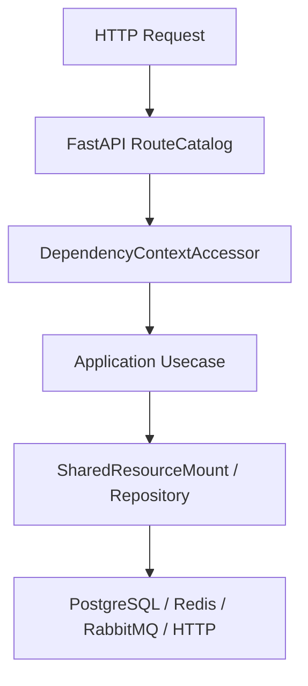

# 数据库总览

## 1. 文档目的
说明数据库配置、表、迁移和仓储的整体关系。

**最后更新范围**：覆盖当前 ORM、Alembic、repository 和数据库运行时配置。

## 2. 适用读者
- 新人开发者
- 后端开发者
- 测试维护者
- 运维部署人员

## 3. 关联源码
| 路径 | 作用 |
| --- | --- |
| `src/infrastructure/persistence/orm_model` | ORM 模型。 |
| `src/infrastructure/persistence/alembic/versions` | 迁移版本。 |
| `src/infrastructure/persistence/repository_impl` | 仓储实现。 |
| `src/infrastructure/persistence/sqlalchemy_session_factory.py` | UnitOfWork。 |
| `config/runtime/database_runtime` | 数据库配置。 |

## 4. 核心结论
- 当前持久化表共 11 张：身份/RBAC 6 张，以及 `app_log_record`、`task_execution_record`、`task_execution_outbox`、`security_ip_block_record`、`key_ring_snapshot`。
- Alembic 版本链从 `202605151600` 到 `202607051000`。
- 事务边界通过 `SqlAlchemyUnitOfWork` 控制。

## 5. 结构说明
数据层由 SQLAlchemy engine/session/UnitOfWork、ORM 模型、repository 实现和 Alembic 迁移组成。

## 6. 工作流程

## 7. 关键实现
| 组件 | 文件 | 职责 |
| --- | --- | --- |
| `SqlAlchemyEngineFactory` | `src/infrastructure/persistence/sqlalchemy_engine_factory.py` | 创建 engine。 |
| `SqlAlchemyUnitOfWork` | `src/infrastructure/persistence/sqlalchemy_session_factory.py` | 事务工作单元。 |
| `AlembicRunner.upgrade_head` | `src/infrastructure/persistence/alembic_runner.py` | 执行迁移。 |

## 8. 如何修改或扩展
1. 新增表先写 ORM 模型。
2. 新增 Alembic migration 并维护 down_revision。
3. 新增 repository 或扩展现有实现。
4. 补数据层 unit/integration 测试。
5. 同步本数据文档和 API/用例文档。

## 9. 测试覆盖
| 测试类型 | 文件 | 验证内容 |
| --- | --- | --- |
| integration | `test/integration_test/test_migration_job_integration.py` | 迁移。 |
| unit | `test/unit_test/test_task_execution_record_repository_unit.py` | 任务记录仓储。 |
| integration | `test/integration_test/test_task_execution_record_integration.py` | 任务记录集成。 |

## 10. 常见问题
- 如果 ORM 与 migration 不一致，优先以当前 ORM 和 Alembic 版本文件为准，历史方案只作参考。

## 11. 维护备注
数据模型变更必须同步 ORM、migration、repository、测试和本说明书。

### 当前表与模型对应

| 表 | ORM 模型 | 迁移来源 |
| --- | --- | --- |
| `auth_user` | `AuthUserOrmModel` | `202605151600_create_auth_tables.py` |
| `auth_role` | `AuthRoleOrmModel` | `202605151600_create_auth_tables.py` |
| `auth_user_role` | `AuthUserRoleOrmModel` | `202605151600_create_auth_tables.py` |
| `auth_role_scope` | `AuthRoleScopeOrmModel` | `202605151600_create_auth_tables.py` + `202605291041_fix_identity_task_schema_drift.py` |
| `auth_refresh_token` | `AuthRefreshTokenOrmModel` | `202605151600_create_auth_tables.py` + `202605251640_harden_refresh_token_constraints.py` |
| `auth_scope` | `AuthScopeOrmModel` | `202605271330_create_auth_scope_catalog.py` |
| `app_log_record` | `AppLogRecordOrmModel` | `202605181039_create_app_log_record_table.py` + `202605291041_fix_identity_task_schema_drift.py` |
| `task_execution_record` | `TaskExecutionRecordOrmModel` | `202605221609_create_task_execution_record_table.py` + `202605231821_add_task_execution_backend.py` + `202605291041_fix_identity_task_schema_drift.py` |
| `task_execution_outbox` | `TaskExecutionOutboxOrmModel` | `202607021200_add_task_execution_published_at.py` |
| `security_ip_block_record` | `SecurityIpBlockRecordOrmModel` | `202605260859_create_security_ip_block_record.py` |
| `key_ring_snapshot` | `KeyRingSnapshotOrmModel` | `202607051000_create_key_ring_snapshot.py` |

### 当前代码核对补充

- 数据库运行时配置由 `config/runtime/database_runtime/database_runtime_base.toml` 提供基础值：`backend = "postgresql"`、`schema = "public"`、连接池参数和 `auto_upgrade_on_startup = false`；development/test 只覆盖 PostgreSQL URL，production 覆盖 URL 并保持关闭启动期自动迁移，迁移入口以独立 migration job 或显式 CLI 为准。
- `database.schema` 只接受单个合法 PostgreSQL identifier，格式为字母或下划线开头、后续字母/数字/下划线且长度不超过 63；大小写按配置值保留，不支持带空格、分号、点号或引号的动态 schema 表达式。
- `SqlAlchemyEngineFactory` 使用运行时 URL 创建 engine，并通过 `connect_args.options = -csearch_path=<schema>` 指定 schema；同时启用 `pool_pre_ping`、`pool_size`、`max_overflow`、`pool_recycle_seconds` 和 `connect_timeout_seconds`。
- `AlembicRunner.upgrade_head` 将脚本目录、数据库 URL、schema、连接超时写入 Alembic `Config` 后升级到 `head`；迁移环境的在线模式使用 `NullPool`、显式创建目标 schema、设置 `version_table_schema`，并在成功或异常路径都 dispose online engine。
- 当前持久化表共 11 张：身份/RBAC 6 张、日志 1 张、任务执行记录 1 张、任务 Outbox 1 张、安全 IP 封禁 1 张、密钥环快照 1 张。运行态探活还包括 `RuntimeStateRepositoryImpl.ping()` 的 `SELECT 1`，不对应独立业务表。
- 测试覆盖除任务记录外，还包括 `test/unit_test/test_auth_persistence_unit.py`、`test/integration_test/admin_identity/test_admin_identity_rbac_integration.py`、`test/integration_test/test_security_ip_block_integration.py`、`test/integration_test/test_database_logging_integration.py` 和 `test/integration_test/test_migration_job_integration.py`。

## 12. 相关文档
- [项目文档总览](../README.md)
- [新增迁移](../09_development_guide/adding_new_migration.md)
