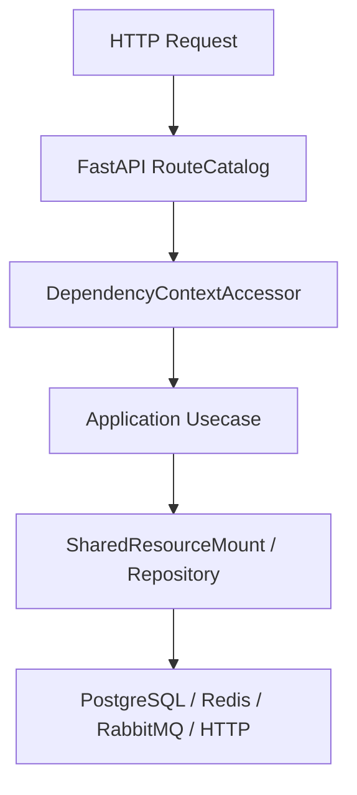

# ORM 模型

## 1. 文档目的
说明 ORM 模型与物理表的对应关系。

**最后更新范围**：覆盖当前 ORM、Alembic、repository 和数据库运行时配置。

## 2. 适用读者
- 新人开发者
- 后端开发者
- 测试维护者
- 运维部署人员

## 3. 关联源码
| 路径 | 作用 |
| --- | --- |
| `src/infrastructure/persistence/orm_model` | ORM 模型。 |
| `src/infrastructure/persistence/alembic/versions` | 迁移版本。 |
| `src/infrastructure/persistence/repository_impl` | 仓储实现。 |
| `src/infrastructure/persistence/sqlalchemy_session_factory.py` | UnitOfWork。 |
| `config/runtime/database_runtime` | 数据库配置。 |

## 4. 核心结论
- 当前持久化表共 11 张：身份/RBAC 6 张，以及 `app_log_record`、`task_execution_record`、`task_execution_outbox`、`security_ip_block_record`、`key_ring_snapshot`。
- Alembic 版本链从 `202605151600` 到 `202607051000`。
- 事务边界通过 `SqlAlchemyUnitOfWork` 控制。

## 5. 结构说明
数据层由 SQLAlchemy engine/session/UnitOfWork、ORM 模型、repository 实现和 Alembic 迁移组成。

## 6. 工作流程

## 7. 关键实现
| 组件 | 文件 | 职责 |
| --- | --- | --- |
| `SqlAlchemyEngineFactory` | `src/infrastructure/persistence/sqlalchemy_engine_factory.py` | 创建 engine。 |
| `SqlAlchemyUnitOfWork` | `src/infrastructure/persistence/sqlalchemy_session_factory.py` | 事务工作单元。 |
| `AlembicRunner.upgrade_head` | `src/infrastructure/persistence/alembic_runner.py` | 执行迁移。 |

## 8. 如何修改或扩展
1. 新增表先写 ORM 模型。
2. 新增 Alembic migration 并维护 down_revision。
3. 新增 repository 或扩展现有实现。
4. 补数据层 unit/integration 测试。
5. 同步本数据文档和 API/用例文档。

## 9. 测试覆盖
| 测试类型 | 文件 | 验证内容 |
| --- | --- | --- |
| integration | `test/integration_test/test_migration_job_integration.py` | 迁移。 |
| unit | `test/unit_test/test_task_execution_record_repository_unit.py` | 任务记录仓储。 |
| integration | `test/integration_test/test_task_execution_record_integration.py` | 任务记录集成。 |

## 10. 常见问题
- 如果 ORM 与 migration 不一致，优先以当前 ORM 和 Alembic 版本文件为准，历史方案只作参考。

## 11. 维护备注
数据模型变更必须同步 ORM、migration、repository、测试和本说明书。

### 当前表与模型对应

| 表 | ORM 模型 | 迁移来源 |
| --- | --- | --- |
| `auth_user` | `AuthUserOrmModel` | `202605151600_create_auth_tables.py` |
| `auth_role` | `AuthRoleOrmModel` | `202605151600_create_auth_tables.py` |
| `auth_user_role` | `AuthUserRoleOrmModel` | `202605151600_create_auth_tables.py` |
| `auth_role_scope` | `AuthRoleScopeOrmModel` | `202605151600_create_auth_tables.py` + `202605291041_fix_identity_task_schema_drift.py` |
| `auth_refresh_token` | `AuthRefreshTokenOrmModel` | `202605151600_create_auth_tables.py` + `202605251640_harden_refresh_token_constraints.py` |
| `auth_scope` | `AuthScopeOrmModel` | `202605271330_create_auth_scope_catalog.py` |
| `app_log_record` | `AppLogRecordOrmModel` | `202605181039_create_app_log_record_table.py` + `202605291041_fix_identity_task_schema_drift.py` |
| `task_execution_record` | `TaskExecutionRecordOrmModel` | `202605221609_create_task_execution_record_table.py` + `202605231821_add_task_execution_backend.py` + `202605291041_fix_identity_task_schema_drift.py` |
| `task_execution_outbox` | `TaskExecutionOutboxOrmModel` | `202607021200_add_task_execution_published_at.py` |
| `security_ip_block_record` | `SecurityIpBlockRecordOrmModel` | `202605260859_create_security_ip_block_record.py` |
| `key_ring_snapshot` | `KeyRingSnapshotOrmModel` | `202607051000_create_key_ring_snapshot.py` |

### ORM 字段与约束核对

- 所有 ORM 使用 `OrmModelBase.metadata` 的命名约定；多数模型通过 `AuditTimestampMixin` 提供 `created_at`、`updated_at`，`TaskExecutionRecordOrmModel` 额外显式声明自己的 `updated_at` 列。
- `AuthUserOrmModel`：`user_id` 为 UUID 主键，`subject_id` 与 `username` 唯一，关联 `user_roles` 与 `refresh_tokens`，刷新令牌关系限定 `AuthRefreshTokenOrmModel.user_id` 外键。
- `AuthRoleOrmModel`、`AuthUserRoleOrmModel`、`AuthRoleScopeOrmModel`：用户角色表以 `user_id + role_id` 为联合主键；角色作用域表以 `role_id + scope_code` 为联合主键，`scope_code` 当前外键到 `auth_scope.scope_code`，删除 scope 受 `RESTRICT` 保护。
- `AuthRefreshTokenOrmModel`：`token_session_id`、`user_id`、`subject_id`、`expires_at`、`rotated_to_token_id` 建索引；`subject_id` 外键到 `auth_user.subject_id`，`rotated_to_token_id` 外键到同表 `refresh_token_id`。
- `AuthScopeOrmModel` 是 scope 目录表，字段为 `scope_code`、`scope_name`、`description`、`scope_kind`、`enabled`；授权仓储只返回已启用 scope。
- `TaskExecutionRecordOrmModel.published_at_epoch` 记录可靠发布时间；`TaskExecutionOutboxOrmModel` 保存待发布消息及状态，二者由同一 UnitOfWork 维护一致性。
- `KeyRingSnapshotOrmModel` 保存加密后的密钥环快照和版本摘要，原始密钥材料不会明文入库。
- `TaskExecutionRecordOrmModel` 同时约束 `job_kind + deduplication_key` 唯一和 `record_id` 唯一，并索引 `job_kind`、`deduplication_key`、`status`、`backend`、`request_id`、`trace_id`、`queue_name`。
- `AppLogRecordOrmModel.detail_json` 使用 PostgreSQL `JSONB`；`event_id` 唯一，并按 `occurred_at`、`event_kind`、`request_id`、`trace_id`、`level` 建索引。
- `SecurityIpBlockRecordOrmModel` 以 `record_id` 为 UUID 主键，按 `ip_digest`、`status`、`blocked_until_epoch` 建索引。

## 12. 相关文档
- [项目文档总览](../README.md)
- [新增迁移](../09_development_guide/adding_new_migration.md)
